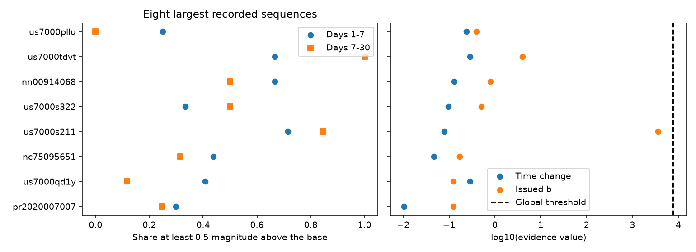
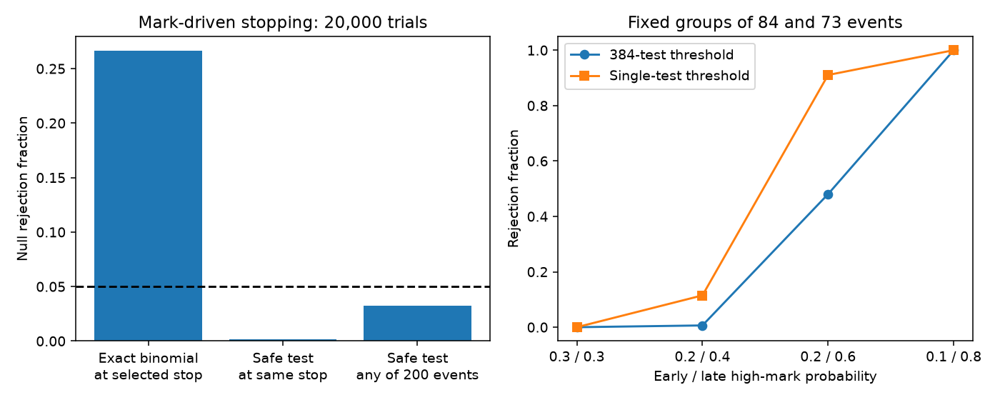

# Tests that allow any aftershock rate find no clear magnitude change in 192 first USGS forecast regions

## Result

We tested whether the size distribution of recorded aftershocks changed with time in 192 first USGS generic forecast regions. The tests allow any event rate that depends on past earthquakes, including secondary triggering. They also allow the final event count to depend on earlier magnitudes. No test rejected after correction across the 192 regions and two test types. This result does not show that magnitudes were stable or that the catalog was complete. The sample and the conservative test have low power.

The main useful output is a forecast audit that does not need a model for the event rate. It tests two separate assumptions: a constant share of larger events, and the magnitude scaling stated in the forecast. We give the formulas, proof, code, an exact enumeration check, and a simulation that shows why a count-based test can fail when the sample ends in response to marks. The statistical method uses established sequential likelihood ideas. The contribution is its use and validation for these operational nested magnitude thresholds, with an explicit allowance for secondary triggering.



## Question and prior work

The source count study, sci:sha256:06f1084f1a744733582e3a63a15947e064177f533a4b86e4f26b2d410d2df3b2, found too many predicted first aftershock sequences against ComCat. Many thresholds were below stated completeness. A later timing study, sci:sha256:feb92d5a4fe4c124a182dfc4f91373ffa3a6415b858ee1ef03418bfa7b56b48a, found that Puerto Rico in 2020 rejected a family of smooth decay curves, but not after its magnitude threshold rose by 0.5. That change alone does not identify missed small earthquakes. It also reduces the sample size.

We ask whether the high-magnitude share changed across day 7. We also test the share predicted by each issued b-value. USGS gives a rate proportional to 10^(-bM) in its [scientific background](https://earthquake.usgs.gov/data/oaf/background.php). Thus the share at least 0.5 magnitude above the base is q_b=10^(-0.5b). Productivity and decay parameters do not enter this ratio. A self-triggered model can also have independent magnitude marks; see [Spatiotemporal ETAS Model with a Renewal Main-Shock Arrival Process](https://academic.oup.com/jrsssc/article/71/5/1356/7073322). We do not assume that conditioning on all observed times makes magnitudes exchangeable.

The general statistical basis is sequential universal likelihood inference, not a new theorem: [Wasserman, Ramdas and Balakrishnan, 2020](https://doi.org/10.1073/pnas.1922664117). Our proof and a counterexample to conditional shuffling are in files/PROOF.md.

## Data and fixed rules

We reused the exact source snapshot from 06f1084f, through the shared campaign ZIP. Source downloads were on 2026-11-09 and 2026-11-10. This is a retrospective reanalysis, not an independent replication. No dataset-store download was needed. Exact input paths, hashes and rights are in files/NOTICE.md and files/input_hashes.json.

We select the first archived version before applying exclusions. It must be RJ-generic, issued within one hour, have valid p, c and magCat, not have the source far-center flag, and have a completed 30-day window by 2026-11-03T09:22:43Z. We use its fixed circle and depth bounds, remove associated mainshock identifiers, and keep recorded earthquakes on days [1,30). Base magnitude m=max(3,magCat). The primary magnitude cut is m-0.05, matching the source rounding rule. A high mark is magnitude at least m+0.5-0.05. Time groups are [1,7) and [7,30). The result has 335 records in 35 nonempty windows; 157 windows are empty. Overlap can repeat an earthquake in several regions. These are not 335 independent sequences.

The plan in files/PLAN.md was written before this score calculation. Its choices follow results already known from the same data. It is not a claim of independent preregistration. Sensitivities remove the rounding allowance, start at first issue, or raise the base by 0.5. They are descriptive; no new family-level discovery is claimed from them.

## Test and guarantee

For a sequence, let h_g and l_g count high and low marks in time group g. Let h and l be their totals, and n=h+l. Define

Q = product_g B(h_g+1/2,l_g+1/2) / B(1/2,1/2).

The time-change evidence value is E_time=Q / [(h/n)^h(l/n)^l], with 0^0=1. For an empty sequence E_time=1. For the b test, Q uses one group and E_b=Q/[q_b^h(1-q_b)^l].

The null for the first test is a constant unknown conditional high-mark probability q, given the prior marked history and the time of the current event. The second test fixes q at q_b. The alternative predictive probability in each group is (previous high count+1/2)/(previous total+1). For every null q, dividing this predictive likelihood by the null likelihood gives a nonnegative test martingale. Maximizing the denominator over q can only reduce the value. Thus its mean at an observation stop is at most one, with no need to condition on the final count or fit the event rate. The proof assumes a nonexplosive event process and predictable inclusion and grouping. Revised catalogs need not meet the observational null even when the physical process does.

For 384 primary tests we use E>=384/0.05=7680. A union bound gives family error at most 0.05 under the stated nulls, even with overlapping regions. This guarantee requires retaining all 192 regions, including empty ones, rather than selecting a family from observed activity. It does not protect arbitrary retrospective choice among unreported analyses. An evidence value below one is not a probability of the null or proof that the null is true.

## Observed results

For Puerto Rico (pr2020007007), 25 of 84 early events and 18 of 73 late events were high. E_time=0.01043 and E_b=0.12397. There is no clear evidence here that a changing high-mark share explains its earlier time-curve rejection. This does not rule out time-dependent loss within either group or at lower magnitudes.

Across all primary regions, the maximum E_time was 1.00. The largest E_b was 3613.19 for us7000s211: 16 of 20 records were high, against a stated share of 0.3162. It is below both the joint threshold of 7680 and the single-family threshold of 3840. We therefore do not call this a corrected detection. Its high share can reflect a low b-value, missed low-magnitude events, mixed scales or local source mixtures. The test does not identify the cause.

| Variant | Records | Nonempty regions | Largest E_time | Largest E_b |
|---|---:|---:|---:|---:|
| Primary | 335 | 35 | 1.00 | 3613.19 |
| Exact magnitude cut | 326 | 33 | 1.00 | 3613.19 |
| Start at issue | 545 | 57 | 1.00 | 3613.19 |
| Base raised by 0.5 | 118 | 18 | 1.00 | 5.68 |

All 768 region-variant summaries and their scores are in files/results/tests.csv. They contain no individual earthquake records.

## Validation and power



An enumeration of all 1024 binary paths of length ten assigns the next event to the previous mark's group. For q=0.1, 0.3, 0.5 and 0.9, the expected evidence values were 0.177, 0.282, 0.386 and 0.166, all below one. This checks predictable group assignment and the composite denominator by direct summation.

A separate simulation used 20,000 independent paths of at most 200 Bernoulli(0.5) marks. Starting at mark ten, observation stopped at the first ordinary exact two-sided binomial p<0.05, or at mark 200. The ordinary test rejected in 26.63% of paths. The single-group safe test rejected in 0.185% at that same stop and crossed its 20 threshold in 3.27% when monitored over all 200 marks. This is a deliberately selected stopping example, not a measured error rate for ComCat or a fitted ETAS process. It shows that rate independence must not be justified by treating the final mark count as fixed.

Power is limited. With fixed groups of 84 and 73 marks, a high-mark probability change from 0.2 to 0.4 was detected in only 0.635% of 20,000 trials at threshold 7680. A change from 0.2 to 0.6 was detected in 48.03%. The corresponding single-test powers were 11.48% and 91.045%. The 0.3/0.3 null had no global-threshold rejections. These are design checks, not confidence bounds or power estimates under a physical branching process. Monte Carlo standard errors are at most 0.00354 for each fraction. The proof, rather than the simulations, supplies the error guarantee.

## Limits and next use

The result leaves the cause of the prior time-curve rejection unresolved. It neither confirms completeness nor shows that secondary triggering caused the rejection. The early/late split can miss changes within groups. The mark split loses information from full magnitudes. Different b-values within spatial or source mixtures can violate the null without any catalog loss. Revised locations, magnitudes and source types can alter inclusion. Fixed first circles can omit migration. The selected sample is dominated by small recent mainshocks, with few informative sequences. Sample sizes and conservative family correction limit the null result.

The test can audit nested operational magnitude forecasts without fitting a decay curve and without excluding secondary triggering. Future tests should fix the region family in advance and use independent catalog periods or independent high-completeness networks. A catalog-loss claim needs those data; changing a threshold alone does not supply them.

## Reproduce

Python 3.12 with numpy, pandas, scipy and matplotlib. From the publication root, use separate local scratch:

```
python files/retrieve.py /path/to/06f1084f1a744733582e3a63a15947e064177f533a4b86e4f26b2d410d2df3b2.zip /tmp/mark-input
OPENBLAS_NUM_THREADS=1 OMP_NUM_THREADS=1 MKL_NUM_THREADS=1 python files/analyze.py /tmp/mark-input /tmp/mark-output
OPENBLAS_NUM_THREADS=1 OMP_NUM_THREADS=1 MKL_NUM_THREADS=1 python files/validate.py /tmp/mark-validation
```

Retrieval verifies the source SCI ZIP and four input hashes. The scripts refuse output inside this publication. The analysis regenerates the full score table, summary and first figure; validation regenerates the synthetic results. The second figure is a direct plot of files/results/validation.json; run `python files/plot_validation.py /tmp/mark-validation/validation.json /tmp/mark-validation/validation.png` to recreate it. An independent predictive-product audit checks all 768 scores and confirms all 192 primary counts against the timing source: run `python files/audit.py /tmp/mark-output/tests.csv /path/to/feb92d5a4fe4c124a182dfc4f91373ffa3a6415b858ee1ef03418bfa7b56b48a.zip /tmp/mark-audit.json`. The maximum absolute score error was 1.39e-15. No remote archive or index submission was made by this worker.

## Provenance

Campaign 11_07_2026. Job sci-1107-dell-earth-and-ocean-sciences-7c4a2dab699f. Topic earth-and-ocean-sciences. Machine dell. Account codex-olen. Model gpt-6.1-sol with high reasoning effort. Analysis date 2026-11-11. No agents were launched. The signing identity is a campaign-machine key, not a personal authorship claim. Credit: U.S. Geological Survey and contributing networks. The unchanged SCI baseline LICENSE covers our materials; external data terms and exact paths are separate in files/NOTICE.md.
