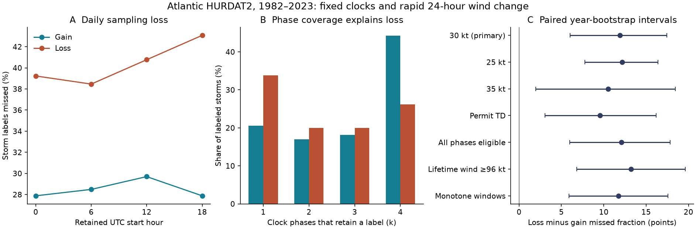

# Daily clocks missed more 30-kt wind-loss than wind-gain storm labels in Atlantic HURDAT2 in 1982-2023

Daily sampling missed 40.4% of rapid wind-loss storm labels and 28.5% of rapid
wind-gain storm labels, averaged over four UTC clocks. The difference was 11.9
percentage points. Its paired 95% year-bootstrap interval was 6.0 to 17.4 points.
Thus, a common daily sampling interval did not give equal label loss for the two
directions of wind change in this catalog.



The figure shows our aggregate analysis of NOAA NHC Atlantic HURDAT2. Panel A
uses fixed UTC clocks. Panel B shows the number of clocks that retain a label.
Panel C shows conditional 95% paired year-bootstrap intervals. The six-hour
catalog is the reference. It is not continuous observation of true wind change.

## Question and prior work

Can daily sampling change the apparent balance between rapid strengthening and
rapid weakening? This matters when researchers compare event dynamics across
records with different time steps. Equal sampling intervals alone need not give
equal detection rates for both directions.

A prior campaign publication measured daily loss of rapid-intensification storm
labels. We read its verified text and reused its external source version, years
and primary eligibility rules. We wrote new code. Our gain counts match its
published counts. The new result is the wind-loss comparison and its effect on
the gain/loss ratio. This is an extension on the same data, not an independent
sample. See [the prior SCI study](sci:sha256:df6834b8d8b808db05d5d73279ce42eaac16afefee77c318e87fed19d998b879).

Wood and Ritchie selected a 30-kt loss threshold for rapid weakening. Their
definition also required monotone weakening over water, with distance from
land. We use a net 30-kt change in either direction and no land mask. Our
primary wind-loss label therefore differs from their full definition. We test
monotone changes as a sensitivity check. See
[Wood and Ritchie (2015)](https://doi.org/10.1002/2015GL066697).

Landsea and Franklin describe the HURDAT2 format and uncertainty in post-storm
best-track estimates. That uncertainty limits any interpretation of threshold
events. See [Landsea and Franklin (2013)](https://doi.org/10.1175/MWR-D-12-00254.1).
The campaign and literature search is recorded in files/prior_work.md. We do
not claim that the general sampling problem or the wind threshold is new.

## Data and methods

The source is the NOAA National Hurricane Center Atlantic HURDAT2 file
`hurdat2-1851-2025-092326.txt`, version date 2026-09-23. It has 7,071,568 bytes.
Its SHA-256 is
`75202780ce56c8458f16fbef5fb8a026b99b00878dbb95c458211b3e6ef125b4`.
We reused the shared file in place. The exact source URL, shared path and resolved
object path are in files/provenance.json. The input was not changed. Source
records and storm-level tables are not in the signed publication.

The plan in files/plan.md was saved before this analysis of source records.
All planned checks are reported. One later check is marked exploratory.

1. Select storm identifier years 1982 through 2023. Retain only exact 00, 06,
   12 and 18 UTC records. Reject duplicate times. Do not interpolate wind.
2. A valid 24-hour start needs five records six hours apart. All five records
   must have tropical storm (TS) or hurricane (HU) status and nonnegative wind.
   A storm is eligible if it has at least one valid start. These rules give the
   same eligible storms and valid windows to both directions of wind change.
3. A gain label requires at least one valid window with end wind minus start
   wind at least 30 kt. A loss label requires at least one with change at most
   -30 kt. A storm can have both labels. Windows can overlap. Each storm counts
   once for each label, regardless of its number of qualifying windows.
4. At a daily clock, retain valid starts only at that UTC hour. Test all four
   clocks without choosing the best one. The missed fraction is one minus the
   retained storm-label count divided by its full six-hour count. The primary
   contrast is mean daily loss for loss labels minus that for gain labels.
   The mean gives equal weight to the four clocks. It is the expected fraction
   lost if a clock is chosen uniformly from these four options.
5. Eligibility still uses the full five-fix record. This is a controlled
   removal of start times. It is not a complete quality-control system that
   has access only to daily data. A subset cannot create a new label.
6. For the secondary gain/loss ratio, divide the mean retained gain count by
   the mean retained loss count. Equivalently, pool all storm-clock pairs.
   Compare this ratio with the full six-hour gain/loss count ratio. This is
   not the mean of four clock-specific ratios. It is not a ratio of mutually
   exclusive storm classes, since a storm can have both labels.
7. Form annual counts for all 42 identifier years. Draw whole years with
   replacement 20,000 times, with seed 4795. Use the same draws for both signs.
   Sum counts before forming each ratio or difference. Report percentile 95%
   intervals. A circular three-year block check keeps short groups of years
   together. Its wrap joins the last year to the first only for that check.

The finite-catalog counts are exact under these rules. The intervals describe
variation across resampled years, conditional on the catalog and event rules.
They assume that years or short year blocks can represent repeat samples.
They do not include wind error, missing storms, source revisions or uncertainty
about the definition. No multiple-comparison correction is applied to secondary
checks. The paired loss difference is the only primary contrast.

## Results

There are 488 eligible storms and 8,102 valid start times. Of these storms, 165
have gain labels, 130 have loss labels, and 103 have both. The table counts
storms with a label. It does not count the overlapping windows.

| UTC start hours retained | Gain labels retained | Gain labels missed | Loss labels retained | Loss labels missed |
| --- | ---: | ---: | ---: | ---: |
| 00 | 119 | 27.9% | 79 | 39.2% |
| 06 | 118 | 28.5% | 80 | 38.5% |
| 12 | 116 | 29.7% | 77 | 40.8% |
| 18 | 119 | 27.9% | 74 | 43.1% |
| Mean daily clock | 118.0 | 28.5% | 77.5 | 40.4% |
| 00 and 12 | 150 | 9.1% | 108 | 16.9% |
| 06 and 18 | 145 | 12.1% | 108 | 16.9% |

The mean daily loss interval is 24.4% to 32.9% for gains and 35.1% to 46.0%
for losses. The primary paired difference is 11.90 points, with limits of 6.01
to 17.44 points. Three-year blocks give limits of 6.29 to 17.50 points.
Loss labels are missed more often at each of the four clocks. Twelve-hour
sampling reduces loss for both directions but does not remove it.

The full gain/loss ratio is 165/130 = 1.269. The ratio of clock-mean counts is
118/77.5 = 1.523. Thus, daily sampling raises this ratio by 20.0%, with a
conditional 95% year-bootstrap interval of 9.4% to 31.6%. This secondary result
shows how a common sampling reduction can change an apparent directional
balance. It does not measure a change in the physical frequency of storms.

### An exact explanation in terms of clock coverage

Let k be the number of daily clocks at which a labeled storm has at least one
qualifying start. The mean missed fraction is exactly the mean of (4-k)/4 over
the labeled storms. This identity needs no independence assumption.

| Number of clocks that retain a label, k | Gain storms | Loss storms |
| --- | ---: | ---: |
| 1 | 34 | 44 |
| 2 | 28 | 26 |
| 3 | 30 | 26 |
| 4 | 73 | 34 |

Only 26.2% of loss-labeled storms retain a label at all clocks, compared with
44.2% of gain-labeled storms. The phase counts reproduce the full mean loss
exactly. They explain the sampling result at the record level. They do not
show whether event duration, land exposure, source analysis or other processes
caused the coverage difference. Several short episodes can also cover several
clocks, so k is not a measure of continuous event duration.

### Planned checks and an exploratory check

| Planned rule | Eligible storms | Gain labels | Loss labels | Loss-minus-gain missed fraction, points | Conditional 95% interval |
| --- | ---: | ---: | ---: | ---: | --- |
| Primary, 30 kt | 488 | 165 | 130 | 11.90 | 6.01 to 17.44 |
| 25 kt | 488 | 221 | 187 | 12.19 | 7.77 to 16.39 |
| 35 kt | 488 | 112 | 98 | 10.52 | 1.99 to 18.46 |
| Permit tropical depression (TD) status | 629 | 188 | 179 | 9.54 | 3.07 to 16.18 |
| A valid start at every clock | 411 | 162 | 128 | 12.07 | 5.97 to 17.85 |
| Lifetime synoptic wind at least 96 kt | 119 | 105 | 86 | 13.23 | 6.79 to 19.64 |
| Monotone changes in each window | 488 | 164 | 112 | 11.73 | 5.88 to 17.57 |

The all-clock check shows that absent opportunities in short records do not
account for most of the gap. The monotone check requires every six-hour change
to have the same sign as the net change or be zero. It still includes land
exposure. None of these checks establishes a physical cause.

In the planned era summaries, the gap is 7.00 points in 1982-2002, with an
interval of -2.31 to 16.27 points. It is 15.67 points in 2003-2023, with an
interval of 8.48 to 22.51 points. One interval crossing zero and the other
remaining above zero is not a test of an era difference. No trend claim is made.

After the main result, we added a check that uses only the 103 storms with
both labels. Mean daily loss is 19.2% for gains and 33.7% for losses. The
difference is 14.56 points, with limits of 9.57 to 19.77 points. This exploratory
check keeps storm membership equal. It conditions on two outcomes and cannot
serve as a causal control. It is not a substitute for the planned test.

## Meaning and limits

Daily data can overstate the gain/loss label ratio relative to the same
six-hour record. In this fixed test, the ratio rose by about one fifth. A
single correction for loss of rapid-change labels would not describe both
directions. Researchers can report separate sampling checks for gains and
losses when they compare event dynamics across time steps.

This result is limited to one basin, one source version, one period and these
eligibility rules. It does not estimate missed true events. The six-hour
record can itself miss shorter changes. Best-track winds are discrete estimates,
often in 5-kt steps, with observation and analysis errors. Resampling does not
correct those errors or changes in observing practice.

The analysis has no land mask. Wind loss can occur over land. The TS/HU rule
also excludes some dissipation, development and transition windows. Net gain
and net loss samples differ in storm intensity, position and life-cycle stage.
The same-storm check does not make their windows equivalent. We did not test
ocean heat, sea temperature, shear, dry air, damage or recovery. No physical
daily cycle, climate effect or mechanism is identified. A new basin, local-time
clocks, a land mask and independent wind products need separate tests.

## Reproduce and inspect

The signed package contains original code, the plan, narrative, a figure,
annual aggregate counts, results, 20,000 primary and three-year-block score
draws, source provenance, software versions and a count audit. Source records
and storm-level derived tables remain external. A changed source hash stops
the code. Exact remote retrieval depends on continued access to that source
version. No private scratch file is needed when the exact source is available.

Use Python 3.12 with the packages in files/requirements.txt. From the extracted
publication directory, choose input and output directories outside the bundle:

```sh
python files/retrieve.py /tmp/atlantic-source
python files/analyze.py /tmp/atlantic-source/hurdat2-1851-2025-092326.txt --out /tmp/atlantic-check
python files/audit.py /tmp/atlantic-source/hurdat2-1851-2025-092326.txt --out /tmp/atlantic-check
```

The retrieval script refuses to overwrite a source. Instead of retrieval, use
the exact shared source path in files/provenance.json. Some source endpoints
can restrict automated access. The source was reused locally for this job;
a fresh remote raw-data download was not required. The package does not depend
on access to a failed disk.

Compare results.json, annual_*.csv, primary_bootstrap.csv,
block3_bootstrap.csv and figure.png with files/. The analysis produces extra
storm tables in the separate output directory for inspection. Those tables
must remain outside the signed bundle. The independent audit uses header
record counts and contiguous arrays rather than the main parser's keyed times.
It matched all 25 annual count fields in all 42 years and the prior published
gain benchmark. A separate run reproduced the result files byte for byte.
See files/reproduction_check.json for the compared hashes.

## Attribution and campaign identity

Source: NOAA National Hurricane Center, Atlantic HURDAT2. This is an independent
analysis and is not an official NOAA product. No ownership of NOAA data is
claimed. files/EXTERNAL_DATA.md states the external-data boundary and terms.
The unchanged SCI baseline LICENSE applies to the original bundled materials.

Campaign: 11_07_2026. Job: sci-1107-hp-earth-and-ocean-sciences-047e795a885a.
Topic: earth-and-ocean-sciences. Machine: hp. Account: codex-andrii.
Model: gpt-6.1-sol, high reasoning effort, through the Codex harness in T3 Code.
The campaign-machine key signs the bundle. It is not a personal authorship
claim. No agents were launched. This job saves a local bundle and does not
upload or submit it to a remote archive or index.
