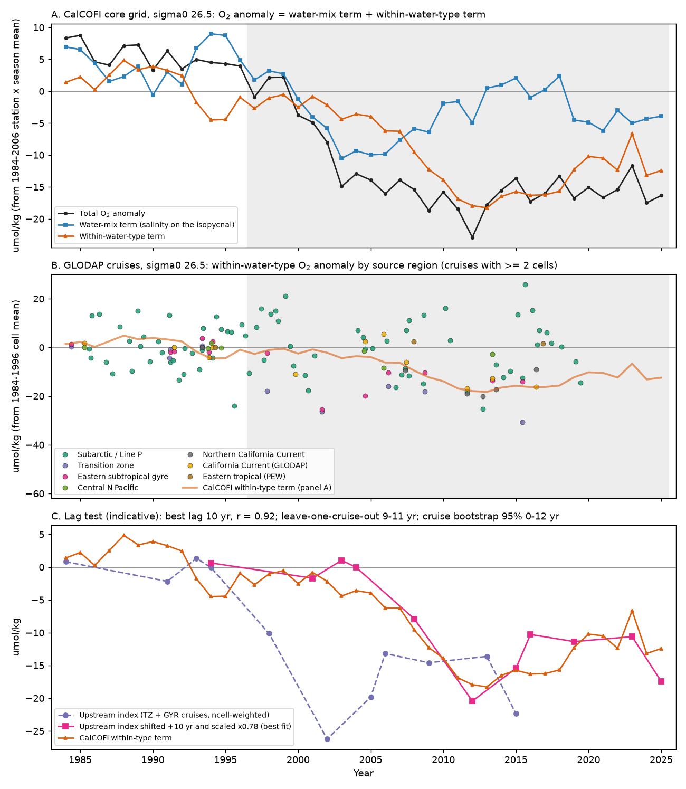
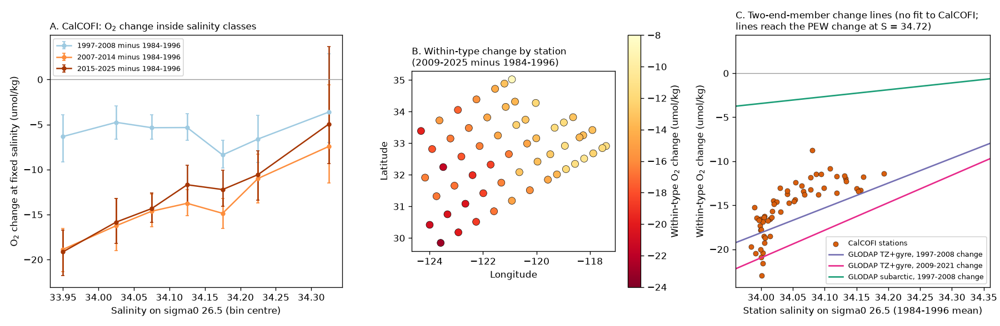
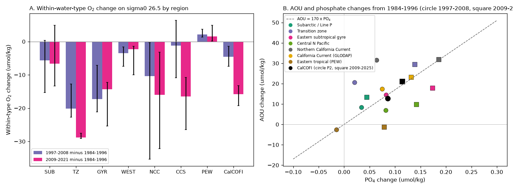

# The 2009-2025 sigma0 26.5 oxygen low off southern California is a loss inside water types that agrees with an earlier offshore transition-zone and gyre loss, not with subarctic or tropical water (CalCOFI and GLODAP, 1984-2025)

## Summary

Earlier campaign work found that oxygen on the sigma0 = 26.5 kg/m3 surface of the core CalCOFI grid fell from 1984 to 2006 and stayed low through 2025 (sci:sha256:d2aed83c..., sci:sha256:d73b9f65...). The isopycnal-salinity ("spice") proxy failed after 2006. Line P subarctic water did not carry the loss (sci:sha256:ad98ae6d...). Tracer-age shares of the AOU increase are not reliable (sci:sha256:978770d0...). Thus the cause of the California low was open.

We used a method that needs no tracer age. On a fixed isopycnal, salinity also fixes potential temperature. Thus (sigma0, S) identifies a water type. We split each CalCOFI cast anomaly into two terms:

- a **water-mix term**: the oxygen change that the change of water type (salinity) at the station gives, read from the 1984-1996 oxygen-salinity relation;
- a **within-water-type term**: the remainder, which is the oxygen change of water of the same type.

We then measured the same within-type change upstream in GLODAPv2.2023 bottle data, in six source regions, and tested whether a two-end-member mixing line with no fitted parameter can carry the upstream change to the CalCOFI stations.

Main results (sigma0 = 26.5; changes from 1984-1996; 95% intervals):

1. **The 2009-2025 low is mostly a loss inside fixed water types.** CalCOFI oxygen changed by -21.9 umol/kg (-23.3 to -20.2). The within-type term was -14.9 (-18.6 to -12.0) and the water-mix term was -6.9 (-9.0 to -3.7). In 1997-2008 the order was opposite: total -13.8, water-mix -9.2 (-14.0 to -4.3), within-type -4.6 (-7.4 to -1.4). The within-type term fell mainly in 2006-2012 (Fig. 1A). Ten sensitivity runs (reference curve, smoothing, data source, season, year 2023) gave a 2009-2025 within-type term of -14.7 to -16.1.
2. **The within-type loss is a remineralization signal, not a change of preformed nutrient mix.** AOU increased by 21.0 (19.4 to 22.5) and phosphate by 0.114 (0.093 to 0.142) umol/kg. PO4* = PO4 + O2/170 changed by only -0.016 (-0.030 to +0.008), also with an O2:P ratio of 150. N* fell by 0.60 (0.31 to 0.99) umol/kg.
3. **The within-type loss is largest in the freshest, most offshore water.** In 2007-2014, the change in the salinity class 33.90-34.00 was -18.9 (-21.3 to -16.6). In the class 34.25-34.40 it was -7.4 (-11.5 to -0.6). All 57 stations lost oxygen inside their water type (-8.8 to -23.0). The station loss correlated with longitude (r = 0.79): stations 100-120 had -19.4 on average and stations 28-60 had -12.7. More local respiration in the productive inshore band would give the opposite pattern.
4. **Upstream, the within-type loss occurred first in the transition zone and the eastern subtropical gyre (GLODAP).** In 1997-2008 the within-type change was -20.1 (-22.7 to -12.8) in the transition zone (36-46 N, 130-160 W) and -17.3 (-21.1 to -7.1) in the eastern gyre (25-36 N, 130-160 W). In the same years it was -1.2 (-10.8 to +6.3) in GLODAP casts of the southern California Current and -4.6 at CalCOFI. The southern California Current reached -16.5 (-26.4 to -10.8) only in 2009-2021 (Fig. 1B, Fig. 4A).
5. **Subarctic and tropical source water did not lose enough oxygen.** In the subarctic Gulf of Alaska and Line P region the within-type change was -5.7 (-15.3 to +0.4) in 1997-2008 and -6.7 (-13.4 to +4.9) in 2009-2021. Pacific Equatorial Water (10-25 N, 105-120 W) has almost no oxygen on this surface (3 umol/kg) and changed by +2.2 (+1.3 to +3.7). The central North Pacific (160-180 W) changed by only -3.5 (-7.5 to -1.6).
6. **A mixing line with no fitted parameter gives the size of the CalCOFI loss from the offshore source, but not from the subarctic source.** The line joins the upstream 1997-2008 change of the transition zone and gyre (mean salinity 33.98) to the change of Pacific Equatorial Water (salinity 34.72). At the CalCOFI station salinities it predicts a mean of -16.7 (-20.6 to -13.0). The observed 2009-2025 mean is -15.2 (share 1.10, 0.85-1.35; station RMSE 2.6). The same line from the subarctic source predicts -3.0 (share 0.20, -0.14 to 0.55; RMSE 12.5). The observed decrease of the loss with salinity (43 umol/kg per psu, 34-55) is steeper than the line (28 per psu). Thus the mixing line explains the size but only part of the salinity structure.
7. **The CalCOFI within-type series follows the upstream series with a lag of about 10 years (indicative).** A lagged, scaled fit of the CalCOFI within-type series to an upstream index from 22 transition-zone and gyre cruises had its lowest error at 10 years (r = 0.92, scale 0.78, RMSE 2.8 against 5.6 at zero lag). Leave-one-cruise-out gave 9-11 years. A cruise bootstrap gave a 95% range of 0-12 years, because the upstream index has few cruises in 1995-2005. Thus we do not claim a precise transit time.

Interpretation: the persistent California low on sigma0 26.5 after 2008 agrees with an oxygen loss that occurred in the offshore North Pacific transition zone and eastern subtropical gyre in the late 1990s and early 2000s and then reached the California Current. It does not require more local respiration, more Pacific Equatorial Water or a subarctic source. The earlier, 1997-2008 part of the CalCOFI decline was mostly a shift to saltier water, which agrees with the spice proxy that worked before 2006. This explains why the proxy failed after 2006: the later loss occurred inside water types. Our test identifies where the oxygen loss came from. It does not tell whether the upstream loss came from slower ventilation or from faster respiration; Section "Limitations" gives the reasons.

## Question and hypotheses

Question: what part of the CalCOFI oxygen low on sigma0 26.5 is a change of water mix, and what part is a change inside water types; and which source region, if any, carries the within-type change?

Hypotheses and their predictions for the within-type term:

| Hypothesis | Prediction | Result |
|---|---|---|
| H1 Water-mix change (spice) | Small within-type term | Rejected for 2009-2025 (within-type -14.9 of -21.9); accepted for most of 1997-2008 |
| H2 More local respiration | Loss largest inshore (high productivity) | Rejected: loss largest offshore, r = 0.79 with longitude |
| H3 Subarctic source (Line P) | Upstream loss of similar size, earlier | Rejected: -5.7 (CI includes 0); line share 0.20 |
| H4 Tropical source (PEW) | Loss largest at the salty end | Rejected: PEW O2 near 0 and +2.2; loss smallest at the salty end |
| H5 Offshore transition zone and gyre | Earlier upstream loss of similar size, loss largest in the freshest water | Supported: -20.1 and -17.3 in 1997-2008; share 1.10; lag about 10 years |

## Data

- **CalCOFI per-cast isopycnal metrics** from sci:sha256:d2aed83cfe2b4a27207c5bd10e25b2398ade09b4a6955fb06bb063a7136fb0d2 (members `files/data/bottle_db_casts.csv.gz`, `files/data/ctd_casts.csv.gz`, `files/data/core_stations.json`; hashes in `files/provenance.json`). These come from the CalCOFI bottle database (release of 16 October 2023, cruises to 2021-05) and the bottle rows of CalCOFI CTD products (2021-07 to 2025-04, preliminary). Winkler bottle oxygen only. We used the 57 core stations, the cast QC and the 1984-2006 station x season climatology of that publication. Result: 8,973 casts with oxygen and salinity on sigma0 26.5 from 178 cruises, 1984-2025.
- **GLODAPv2.2023 Pacific Ocean** merged bottle file (NCEI accession 0283442, CC BY 4.0), read in place from the campaign dataset store, `/mnt/dell-data/shared_datasets/glodapv2-2023-pacific-ocean-csv-ncei0283442/GLODAPv2.2023_Pacific_Ocean.csv`, SHA-256 d59b0776c5edaca5e921141444f22b9cdad5088db70f9129dc1b0fc50218d7ea. We used flag-2 salinity, oxygen, nitrate and phosphate in 10-56 N, 105-180 W: 2,003 casts with oxygen on sigma0 26.5 from 120 cruises, 1984-2021.

The external-data terms are in `files/NOTICE_external_data.md`. No source record or record-level extract is in this bundle.

## Methods

1. **Density surfaces.** TEOS-10 sigma0 from in-situ temperature, practical salinity and pressure (gsw 3.6.23) for both data sets. Linear interpolation in sigma0 on the monotone part of each profile; maximum bracket 0.35 kg/m3. Surfaces 26.3, 26.5 (primary) and 26.7.
2. **Epochs.** P1 1984-1996 (reference), P2 1997-2008, P3 2009-2021 (GLODAP; CalCOFI also 2009-2025), and for CalCOFI 2007-2014 and 2015-2025.
3. **CalCOFI decomposition.** O2_ref(S) is a LOWESS fit (fraction 0.3) of oxygen against salinity over all P1 casts, with linear end extrapolation. For a cast with salinity S at a station whose 1984-2006 station x season mean salinity is S_clim: water-mix term = O2_ref(S) - O2_ref(S_clim); within-type term = (O2 anomaly from the station x season mean) - water-mix term. The P1 within-station slope of oxygen anomaly on salinity anomaly (-279 umol/kg per psu) is close to the slope of O2_ref (-314 per psu in 34.00-34.15), so the split does not depend on the use of a spatial relation. We averaged casts to cruise means (15 or more stations), cruise means to annual means, and compared epoch means of annual values. Intervals: moving-block bootstrap of years (block 3, 2,000 draws).
4. **Salinity classes.** For bins of isopycnal salinity we averaged each property by season and then over seasons, in each epoch. Intervals: bootstrap of cruises (500 draws).
5. **Station map.** For each station, the season-balanced mean of the within-type term in 2009-2025 minus that in P1.
6. **GLODAP regions.** Cells of 2.5 deg latitude x 5 deg longitude. Cast anomaly = cast value minus the P1 mean of its cell; cells without P1 casts are not used. Within-type anomaly = O2 anomaly - b x S anomaly, with b the pooled within-cell P1 slope of O2 on S in the region. Region change = mean over cells of (epoch mean - P1 mean). Intervals: bootstrap of cruises within each epoch (1,000 draws). Regions: SUB 46-56 N, 125-150 W; TZ 36-46 N, 130-160 W; GYR 25-36 N, 130-160 W; WEST 25-46 N, 160-180 W; NCC 36-46 N, 120-130 W; CCS 25-36 N, 116-130 W; PEW 10-25 N, 105-120 W (Fig. 3).
7. **Mixing-line test (T5).** dO2(S) = dO2_U (S_E - S)/(S_E - S_U) + dO2_E (S - S_U)/(S_E - S_U), with U the upstream region and E = PEW. All four values come from GLODAP; nothing is fitted to CalCOFI. We compare the line at the 57 CalCOFI station salinities (P1 means) with the station within-type changes (2009-2025 minus P1). Intervals propagate the GLODAP bootstrap intervals (normal approximation, 4,000 draws).
8. **Lag test (T6, indicative).** Upstream index: ncell-weighted mean within-type anomaly of TZ and GYR cruises with 2 or more cells, per rounded year, linearly interpolated over 1984-2021. Model: CalCOFI(t) = a x U(t - L), a by least squares, L = 0-15 years, best L by RMSE. Uncertainty: cruise bootstrap (1,000) and leave-one-cruise-out.

## Results tables

CalCOFI, sigma0 26.5, change from 1984-1996 (umol/kg; `files/results/calcofi_watertype_results.json`):

| Epoch | Total O2 | Water-mix term | Within-type term | AOU | PO4 | PO4* |
|---|---|---|---|---|---|---|
| 1997-2008 | -13.8 (-19.6, -7.8) | -9.2 (-14.0, -4.3) | -4.6 (-7.4, -1.4) | +12.8 | +0.086 | +0.003 |
| 2009-2025 | -21.9 (-23.3, -20.2) | -6.9 (-9.0, -3.7) | -14.9 (-18.6, -12.0) | +21.0 | +0.114 | -0.016 |
| 2007-2014 | -22.8 (-25.2, -21.4) | -7.9 (-10.9, -4.9) | -14.9 (-19.5, -11.1) | +21.9 | +0.13 | -0.00 |
| 2015-2025 | -20.9 (-21.7, -19.7) | -7.1 (-9.9, -3.8) | -13.8 (-17.0, -10.5) | +20.0 | +0.10 | -0.02 |
| 2009-2025, nearshore (sta <= 60) | -19.0 | -6.5 | -12.5 (-15.5, -10.1) | | | |
| 2009-2025, offshore (sta >= 70) | -24.6 | -7.3 | -17.2 (-21.3, -13.6) | | | |
| 2009-2025, sigma0 26.3 | -14.1 | -6.4 | -7.7 (-13.4, -2.3) | | | |
| 2009-2025, sigma0 26.7 | -18.6 | -6.3 | -12.3 (-13.8, -11.1) | | | |

GLODAP within-type change on sigma0 26.5 (umol/kg; number of cruises in P1/P2/P3; `files/results/glodap_upstream_results.json`):

| Region | Cruises | P1 mean S, O2 | 1997-2008 | 2009-2021 |
|---|---|---|---|---|
| SUB subarctic, Line P | 38/30/20 | 33.71, 169 | -5.7 (-15.3, +0.4) | -6.7 (-13.4, +4.9) |
| TZ transition zone | 4/4/1 | 33.93, 207 | -20.1 (-22.7, -12.8) | -28.8 (one cruise) |
| GYR eastern gyre | 7/5/2 | 34.03, 180 | -17.3 (-21.1, -7.1) | -14.4 (-25.4, -12.3) |
| WEST central N Pacific | 4/2/1 | 34.10, 193 | -3.5 (-7.5, -1.6) | -2.3 (one cruise) |
| NCC northern California Current | 3/1/5 | 33.94, 126 | -10.4 (-35.3, -0.4) | -16.0 (-32.2, -3.2) |
| CCS southern California Current | 4/4/3 | 34.03, 116 | -1.2 (-10.8, +6.3) | -16.5 (-26.4, -10.8) |
| PEW eastern tropical | 3/2/2 | 34.72, 3 | +2.2 (+1.3, +3.7) | +1.5 (+0.1, +4.9) |
| CalCOFI (for comparison) | 178 cruises | 34.07, 98 | -4.6 (-7.4, -1.4) | -14.9 (2009-2025) |

In GLODAP CCS casts the total change in 1997-2008 was -19.7 with +0.09 psu, and the within-type change was small. This repeats the CalCOFI pattern with independent casts. On sigma0 26.3 the upstream 1997-2008 within-type loss was smaller (TZ -8.2, GYR -6.6), and on 26.7 it was -14.8 and -8.8; CalCOFI shows the same order of size between surfaces. With the TZ and GYR east edge at 125 W instead of 130 W, TZ was -21.9 and GYR -11.1 in 1997-2008.

## Robustness

CalCOFI sigma0 26.5 sensitivity runs (`files/results/calcofi_sensitivity_sig265.csv`):

| Run | Water-mix 1997-2008 | Within-type 1997-2008 | Water-mix 2009-2025 | Within-type 2009-2025 | Station r (longitude) |
|---|---|---|---|---|---|
| Main | -9.2 | -4.6 | -6.9 | -14.9 | 0.79 |
| LOWESS fraction 0.15 / 0.6 | -9.4 / -9.0 | -4.5 / -4.9 | -7.0 / -7.0 | -14.9 / -14.9 | 0.79 / 0.78 |
| Linear O2-S reference | -8.9 | -4.9 | -7.0 | -14.8 | 0.83 |
| Reference curve 1984-2006 | -9.5 | -4.3 | -7.2 | -14.7 | 0.78 |
| Bottle database only (to 2021-05) | -9.2 | -4.6 | -6.4 | -16.1 | 0.77 |
| Without 2023 | -9.2 | -4.6 | -6.8 | -15.4 | 0.80 |
| Dec-May cruises / Jun-Nov cruises | -9.3 / -9.0 | -4.8 / -4.8 | -7.4 / -6.3 | -14.7 / -15.3 | 0.58 / 0.76 |

PO4* in 2009-2025 changed by -0.00 to -0.03 in all runs, also with O2:P = 150. A complete rerun of `files/code/run_all.sh` from a clean scratch folder gave byte-identical result files.

## Limitations

- **Few upstream cruises.** The transition zone has 4, 4 and 1 cruises in the three epochs, and the gyre 7, 5 and 2. A cruise bootstrap with so few clusters gives intervals that are too narrow. The 2009-2021 transition-zone value rests on one cruise (P16N 2015) and has no useful interval. The 1997-2008 upstream changes rest on P16N (1997, 2006), P17N (2001, 2008) and P02 (2004, 2005).
- **Calibration.** GLODAP adjusts oxygen to about 1% between cruises (about 2 umol/kg here) and phosphate to about 2% (about 0.03 umol/kg). Upstream PO4 and PO4* changes are therefore not decisive; the transition-zone AOU rise of 20.6 in 1997-2008 had a phosphate change near zero, which can be a preformed-oxygen change or a calibration offset. We do not interpret it.
- **Ventilation or respiration upstream is not resolved.** At CalCOFI, the AOU-phosphate ratio is near 170, so the loss has a remineralization signature. Older water and faster respiration both give this signature. Our test locates the source of the loss; it does not separate its two possible causes. The tracer-age route is not reliable (sci:sha256:978770d0...), and we did not use it.
- **Two end members only.** The mixing line uses one offshore and one tropical end member. Water on this surface off California also contains subarctic water. A three-end-member solution needs a conservative third tracer; PO4* is not precise enough for this. The observed salinity dependence is steeper than the line, so the line does not describe all of the structure.
- **The water-mix term uses one reference relation.** A change in the shape of the oxygen-salinity relation is assigned to the within-type term. This is the purpose of the split, but the 1997-2008 water-mix term can also contain imported oxygen anomalies that came with saltier water.
- **Lag.** The 10-year lag depends on a few cruises in 1997-2005 and on linear interpolation between them. The bootstrap range (0-12 years) includes short lags.
- **Preliminary data.** CalCOFI values after 2021-05 come from preliminary CTD products. The bottle-database-only run (to 2021-05) gives -16.1 for the 2009-2025 within-type term.
- **Look-ahead.** The isopycnal and the general timing come from earlier work. We chose the epochs (1984-1996, 1997-2008, 2009-2021) to match the GLODAP repeat-section decades before we computed the CalCOFI split. We added the NCC region and moved the TZ and GYR east edge from 125 W to 130 W after a first run, because coastal West Coast cruises at 125-130 W entered the transition-zone box; the 125 W version is reported above.
- **Multiple tests.** We report several related tests and did not correct for multiple tests.

## Relation to prior work

- Campaign work: sci:sha256:d2aed83c... (CalCOFI 26.5 low and failed spice proxy), sci:sha256:d73b9f65... (low unprecedented since 1950), sci:sha256:ad98ae6d... (Line P did not carry the loss), sci:sha256:a1be8c13..., sci:sha256:c5d76aae... and sci:sha256:0cea84fd... (tracer-age attribution), sci:sha256:978770d0... (TTD ages biased in CMIP6), sci:sha256:6ef81107... (memory test of the low), sci:sha256:66c86fe2... and sci:sha256:cc75ea4e... (CMIP6 comparisons), sci:sha256:710d4880... and sci:sha256:597145cb... (BATS). A search of the campaign on 2026-11-10 found no water-type (fixed-salinity) decomposition of the CalCOFI record and no source-region test with GLODAP.
- Mecking et al. (2006, 2008) reported AOU increases on isopycnals near 26.5 along P16N, P17N and P02 in 1991-2004 and related them to ventilation changes. Bograd et al. (2008, 2015) reported the CalCOFI decline and more southern-origin water in the Southern California Bight. Pozo Buil and Di Lorenzo (2017) used isopycnal salinity as an oxygen proxy. Our new result is the quantitative link: the split of the CalCOFI record into a water-mix phase (1997-2008) and a within-type phase (after 2008), the offshore-intensified pattern of the within-type loss, and a parameter-free mixing test that assigns its size to the earlier offshore transition-zone and gyre loss and not to subarctic or tropical water.

## Files

- `files/code/`: `glodap_isopycnal.py` (GLODAP isopycnal values), `calcofi_watertype.py` (decomposition, salinity classes, station map), `glodap_upstream.py` (region changes), `synthesis.py` (T5 mixing line, T6 lag), `sensitivity.py`, `figures.py`, `run_all.sh`, `requirements.txt`.
- `files/results/`: CalCOFI annual term series for three surfaces and three station groups (`calcofi_annual_terms_*.csv`), salinity-class changes (`calcofi_binned_change_*.csv`), reference curves, station changes, all CalCOFI epoch statistics (`calcofi_watertype_results.json`), GLODAP region results and cruise-mean anomaly series (two region sets), synthesis and lag results, sensitivity table.
- `files/figures/`: four PNG figures.
- `files/provenance.json`: job identity, input paths and hashes, software versions, seeds, hashes of result files.
- `files/NOTICE_external_data.md`: terms and attribution of CalCOFI and GLODAP data.

## Reproduction

    bash files/code/run_all.sh CAMPAIGN_DIR SCRATCH_DIR OUT_DIR [GLODAPv2.2023_Pacific_Ocean.csv]

CAMPAIGN_DIR must hold the ZIP of sci:sha256:d2aed83c... (or use `sci pull`). The script verifies that bundle, extracts three members into SCRATCH_DIR and checks their SHA-256 values. It downloads the GLODAP file from NCEI if no local copy is given and checks its SHA-256. All outputs go to OUT_DIR, never into this bundle. Runtime is about 3 minutes. Software: Python 3.12.16 with the versions in `files/code/requirements.txt`. Seeds are fixed in the scripts.

## Provenance

Campaign 11_07_2026; job sci-1107-dell-earth-and-ocean-sciences-6ca2ec2b554a; topic earth-and-ocean-sciences; machine dell; model claude-opus-5-5 (Claude Code agent); analysis date 2026-11-10. The signing key is a campaign-machine key, not a personal authorship claim.

## References

- Anderson, L. A., and Sarmiento, J. L. (1994). Redfield ratios of remineralization determined by nutrient data analysis. Global Biogeochemical Cycles 8, 65-80. doi:10.1029/93GB03318
- Bograd, S. J., et al. (2008). Oxygen declines and the shoaling of the hypoxic boundary in the California Current. Geophysical Research Letters 35, L12607. doi:10.1029/2008GL034185
- Bograd, S. J., et al. (2015). Changes in source waters to the Southern California Bight. Deep-Sea Research II 112, 42-52. doi:10.1016/j.dsr2.2014.04.009
- Lauvset, S. K., et al. (2024). The annual update GLODAPv2.2023. Earth System Science Data 16, 2047-2072. doi:10.5194/essd-16-2047-2024
- Mecking, S., Warner, M. J., and Bullister, J. L. (2006). Temporal changes in pCFC-12 ages and AOU along two hydrographic sections in the eastern subtropical North Pacific: 1991-2001. Deep-Sea Research I 53, 169-187. doi:10.1016/j.dsr.2005.06.018
- Mecking, S., et al. (2008). Climate variability in the North Pacific thermocline diagnosed from oxygen measurements: An update based on the U.S. CLIVAR/CO2 Repeat Hydrography cruises. Global Biogeochemical Cycles 22, GB3015. doi:10.1029/2007GB003101
- Pozo Buil, M., and Di Lorenzo, E. (2017). Decadal dynamics and predictability of oxygen and subsurface tracers in the California Current System. Geophysical Research Letters 44, 4204-4213. doi:10.1002/2017GL072931
