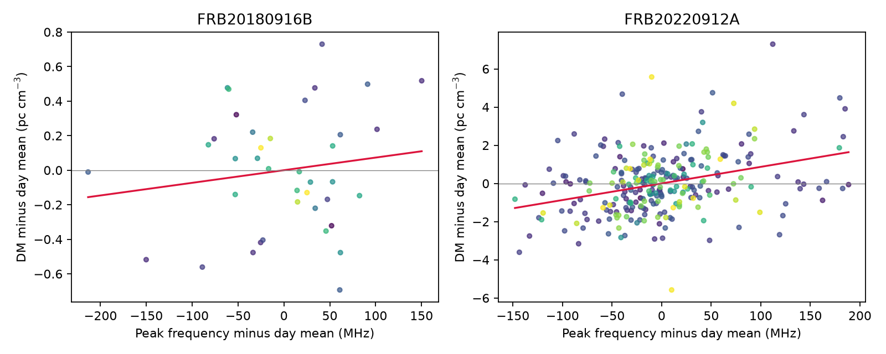
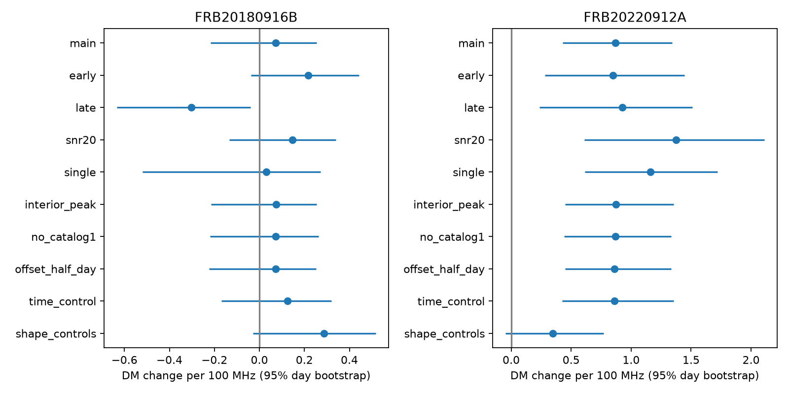

# A within-day DM and peak-frequency relation in FRB 20220912A weakens after burst-shape controls in CHIME Catalog 2

## Result

We test whether fitted dispersion measure (DM) changes with burst peak frequency within the same source and day. Two known repeating fast radio burst sources pass the sample cuts. For FRB 20220912A, the fitted slope is 0.869 pc cm^-3 per 100 MHz. Its 95% day-bootstrap interval is 0.429 to 1.342. The early and late data have positive slopes. A fit with burst-shape and time controls gives 0.349, with an interval of -0.048 to 0.771. Thus, the unadjusted association is repeatable in time, but it does not pass this control test. We do not identify a new physical DM change or a new object.

FRB 20180916B has a full-sample slope of 0.073, with an interval of -0.216 to 0.254. Its early and late slopes have opposite signs. This source does not show a stable association under this test.

The result is a limited catalog audit. It shows why a burst-to-burst DM difference must not be treated as a change in electron column without tests of burst shape. The added method removes each day's mean DM and frequency before the fit. Any DM change that is constant within a day is removed exactly. A slow time trend alone cannot produce the remaining association through differences between days.



## Data and scope

We use CHIME/FRB Catalog 2, release 20251231. The observing dates precede the release date. The input is the unchanged shared CSV at:

```
/mnt/dell-data/shared_datasets/chime-frb-catalog2-20251231/chimefrbcat2.csv
```

This is also available through `datasets/chime-frb-catalog2-20251231/chimefrbcat2.csv` in the job worktree. `files/raw_hash.json` records the resolved object path. The input has 4,057,396 bytes and SHA-256 `5108ada779d279a2547d9f9e73ae25bfdd40d8496d6ba7255ec29c6629057a48`. No new raw data were downloaded. Only this CSV was hashed. The shared source provenance is copied to `files/source_provenance.json`.

We retain named repeaters with sub_num=0, excluded_flag=0, sidelobe_flag=0 and intrachan_flag=0. DM, peak frequency and infinite-frequency MJD must be finite. There are 876 retained event rows. DM is an event parameter; we count each event once. Peak frequency and width refer to the first listed component. This choice can be poor for complex bursts, so we also test single-component events. Component counts use all rows of each event in the original catalog.

A day is floor(MJD). We keep days with at least two retained bursts. A source must then have at least 20 events on at least eight such days. These cuts select FRB 20180916B and FRB 20220912A. The main samples have 39 bursts on 17 days and 272 bursts on 84 days. Their MJD ranges are 58426.290 to 60074.783 and 59837.314 to 60200.322. Within-day spans have medians of 8.46 and 6.27 minutes, and maxima of 26.35 and 42.72 minutes. This is a short-time test, but not a test that proves a static propagation path.

## Method

Let x be peak frequency divided by 100 MHz, and y be DM in pc cm^-3. Subtract the mean of each variable within each day. Fit y = b x to these residuals without an intercept. Each burst has weight 1/n for a day with n retained bursts. Thus, each day has total weight one. Days with a larger frequency spread still contribute more information about b. We do not use formal DM errors as fit weights. These errors do not include all burst-to-burst model errors.

We resample whole days with replacement 3,000 times. The table gives the 2.5 and 97.5 percentiles of these slope fits. The intervals assume that days are independent samples. They do not correct for the selection of sensitivity tests or for long-lived source states. We use seed 110711.

For the two main tests, we also shuffle DM residuals within each fixed day 9,999 times. A two-sided p value uses a one-count correction. Benjamini-Hochberg adjustment covers the two source tests. The p values are 0.6673 and 0.0002; q values are 0.6673 and 0.0004. This shuffle assumes that DM values are exchangeable among bursts within a day under the null. Burst state, time order, detection selection, or joint fit errors can break that assumption. The q value is not a false-discovery probability for physical plasma changes.

We split the ordered unique days into early and late sets. The split is at MJD day 59243 for FRB 20180916B and 59937 for FRB 20220912A. Each set uses its own day means. We fit the early slope and apply it to later within-day frequency residuals. Forecast skill is one minus its weighted squared DM residual error divided by the error of predicting zero within-day residual. This is a conditional prediction of deviations about a known day mean. It is not a forecast of absolute DM before observing a day.

| Source | Main slope | Early slope | Late slope | Later skill of early fit | Leave-one-day slope range |
| --- | ---: | ---: | ---: | ---: | --- |
| FRB 20180916B | 0.073 | 0.216 | -0.303 | -0.799 | -0.048 to 0.119 |
| FRB 20220912A | 0.869 | 0.847 | 0.928 | 0.076 | 0.746 to 0.929 |

All slopes are in pc cm^-3 per 100 MHz. A skill of 0.076 means a 7.6% reduction in the stated later error. No one day removes the positive FRB 20220912A slope. This does not exclude a common state over many days.

## Checks of instrument and burst-shape effects

We repeat the fit with S/N >=20, single-component bursts, peak frequencies between 410 and 790 MHz, Catalog 1 parameter rows removed, and day boundaries shifted by half a day. We refilter for at least two bursts per day after each event cut. We report a sensitivity fit only if at least four days and enough residual degrees of freedom remain. These are exploratory checks, not separately registered confirmations.

One control adds within-day time in minutes. A second adds time, bandwidth, log10(width), log10(S/N), and flagged channel fraction together. Bandwidth is high_freq minus low_freq, in units of 100 MHz. Width is clipped below at 1e-7 seconds before taking its logarithm. All controls are demeaned within a day, and complete cases are used. The controls have measurement errors and can themselves reflect real propagation. They cannot give a causal separation.

For FRB 20220912A, the high-S/N slope is 1.375 (0.612 to 2.110), and the single-component slope is 1.161 (0.616 to 1.719). The time-only control gives 0.860 (0.425 to 1.353). The joint shape-control fit gives 0.349 (-0.048 to 0.771). Thus, low S/N, multiple components, and a linear within-day time effect alone do not explain the positive main fit. The full control set weakens it. Collinearity and uncertain shape measurements limit this comparison. All tests, including null tests, are in `files/results.csv`.



The flags test some known non-nominal observations. The time control tests a linear drift during a transit, which could include beam response. The frequency cut tests peaks near band edges. These do not test raw RFI residuals, beam calibration, parameter covariance, or the adequacy of the fitted dynamic-spectrum model. Peak frequency and DM come from the same fitted data. A covariance between them can create an association without any new physical change. No new raw spectrum fit is made here.

## Physical explanations and independent evidence

Cold-plasma delay has the form t = K DM nu^-2, with K = 4148.808 s MHz^2 pc^-1 cm^3. Under a single fixed ray path, a constant electron column has no dependence on which part of a burst is bright. A slow DM change that is constant during each day also disappears in this method. These restricted explanations alone do not generate the main within-day frequency slope. Rapid column changes or frequency-dependent ray paths remain possible.

An intrinsic emission delay can imitate DM. As a simple local model, let the emission time add a(nu-nu0). Matching the local frequency derivative gives DM_fit approximately DM_true - a nu^3/(2K). A common negative a can therefore give larger fitted DM at higher peak frequency. This assumes that each narrow burst samples the same emission-delay law and that the DM fit follows the local slope. It is an illustrative model, not a derivation of the catalog fitting procedure.

We test its cubic frequency predictor, normalized to have the same derivative as nu/100 at 600 MHz. We fit only early days and score later days with the same weighting. For FRB 20220912A, the later skill is 0.0688 for the cubic law and 0.0763 for the linear law. For FRB 20180916B both skills are negative. The cubic model has no predictive gain here. Over a narrow band the laws are similar, so this comparison does not rule out emission drift. If the entire main linear slope came from a constant a in this local approximation at 600 MHz, a would be about -0.067 ms/MHz. This conditional scale is not a measured drift rate.

Prior work already establishes the risk of DM bias from frequency-time structure. The [DM-power paper](https://arxiv.org/abs/2208.13677) tests a different DM estimator on FRB 20180916B and discusses intrinsic structure as a possible source of apparent DM variation. [Hewitt et al.](https://arxiv.org/abs/2308.12118) use independent Nancay observations of FRB 20220912A. They find fine microshots and broader components with different residual drift behavior. This supplies independent evidence that burst structure can affect DM interpretation. It does not confirm the CHIME within-day peak-frequency slope. Their frequency coverage and measurement method differ. We do not refit their data.

A [six-method comparison for FRB 20240114A](https://arxiv.org/abs/2607.03877) provides related evidence from another source: inferred DM depends on estimator, S/N and morphology in a short observing session. It is context, not a validation sample for our two objects. The [Catalog 2 paper](https://arxiv.org/abs/2601.09399) supplies the catalog methods and flag definitions. The [earlier campaign audit](sci:sha256:1fb8f14cfce76060a922a2bee70ca52a6c3e7b77b1d795eda59d26b1f6dfcf08) tested long-term DM trends. We use its data inventory and artifact context, but no fitted measurement from that bundle. Our tested quantity is within-day covariance, not its long-term time slope.

There is no independent telescope confirmation of the relation measured here. No plasma lens, emission mechanism, gas density change, or new source is identified. The useful result is the reproducible frequency-association audit and its failed joint-control robustness test.

## Reproduce and inspect

Use Python 3.12 with numpy, pandas, scipy and matplotlib. Exact versions are in `files/versions.json`. In a scratch copy of this package, run:

```
python files/analyze.py
python files/models.py
```

The scripts use the frozen `files/events.csv`, regenerate the tables and PNG figures beside the scripts, and run algebra and event-uniqueness checks. `files/validation.csv` contains time-split and deletion results. `files/models.csv` contains both physical predictor scores. `files/checks.json` records the checks. An added day-specific DM offset leaves the estimator unchanged; a synthetic exact slope and a zero response are recovered.

To rebuild the frozen events from raw data, run:

```
python files/analyze.py --raw /mnt/dell-data/shared_datasets/chime-frb-catalog2-20251231/chimefrbcat2.csv
python files/models.py
```

If that file is absent, download the exact source URL from `files/source_provenance.json` to local scratch space, verify its SHA-256 above, and pass that path to --raw. Do not write to the shared dataset directory. Bootstrap draws and permutations have fixed seeds. Small numerical or image differences can occur with other library versions.

Campaign searches used astronomy, CHIME, dispersion frequency, and within-day before the final question was fixed. The search for CHIME found the cited earlier audit. The frequency search also found a time-prediction audit for FRB 20190117A, outside our selected sample. The within-day search mostly returned non-astronomy results. We make no claim to have exhausted all prior work.

Job: sci-1107-syam2-astronomy-d48bcb8c344e. Topic: astronomy. Machine: syam2. Account: codex-myxtap. Model: gpt-6.1-sol, high reasoning effort. No child agent was used. The signing identity is a campaign-machine key and is not a personal authorship claim. The bundle is saved locally only.
