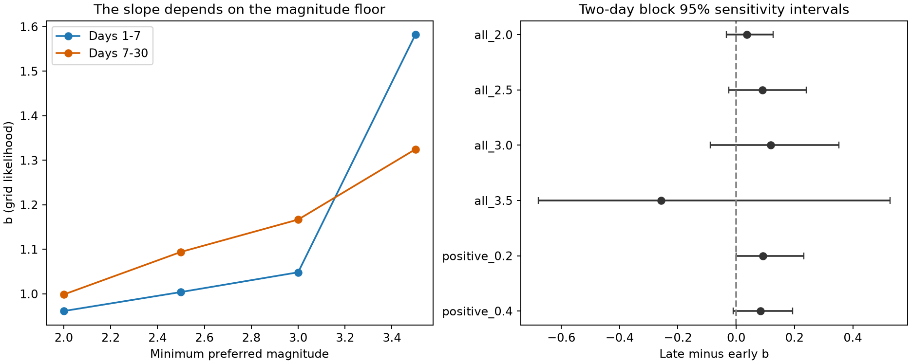

# A late b-value rise is uncertain in a USGS Ridgecrest sample on days 1 to 30 at magnitude 2.5 or more

## Question and main result

Does the slope of the earthquake magnitude distribution rise between days 1-7 and days 7-30 after the 2019 Ridgecrest M7.1 earthquake? Does the result persist when the magnitude floor or estimator changes?

The main comparison leaves the rise uncertain. At magnitude 2.5 or more, the early and late estimates of b are 1.004 and 1.094. The late-minus-early change is 0.090. Its daily block 95% interval is -0.038 to 0.237. Its two-day block interval is -0.025 to 0.240. These intervals include zero. They do not prove equal slopes. Positive successive-magnitude differences give a similar small rise, also with intervals that include zero.



| Method | Early count | Late count | Early b | Late b | Change | Two-day block 95% interval |
| --- | ---: | ---: | ---: | ---: | ---: | --- |
| Preferred M >=2.0 | 1586 | 1146 | 0.961 | 0.999 | 0.037 | -0.034 to 0.127 |
| Preferred M >=2.5, main test | 544 | 387 | 1.004 | 1.094 | 0.090 | -0.025 to 0.240 |
| Preferred M >=3.0 | 182 | 118 | 1.048 | 1.167 | 0.118 | -0.088 to 0.352 |
| Preferred M >=3.5 | 60 | 28 | 1.582 | 1.325 | -0.258 | -0.679 to 0.528 |
| Positive difference >=0.2 | 489 pairs | 360 pairs | 0.955 | 1.048 | 0.092 | -0.001 to 0.232 |
| Positive difference >=0.4 | 322 pairs | 224 pairs | 0.984 | 1.067 | 0.083 | -0.010 to 0.193 |

The preferred-magnitude slope changes with the magnitude floor. But the change in the temporal contrast between floors 3.0 and 2.0 is also uncertain: 0.081, with a two-day interval of -0.127 to 0.287. The sign change at floor 3.5 is descriptive. It is not evidence for a reversal. Only 28 late events remain.

## Data and prior work

We reuse the fixed USGS query from campaign publication `sha256:99cf769920804026bf973b42a7d4ec5a95363faf1269236314ff3596bc014d36`. The query covers magnitude 2 or more within 100 km of 35.770 N, 117.599 W, from 2019-07-06 03:19:53.040 UTC to 30 days later. It has 4,964 unique event IDs, below its 20,000-row limit. It returns preferred magnitudes from USGS ComCat. It is a retrospective snapshot, not a real-time catalog. The helper recorded its download on 2026-11-08 UTC. The data have no fixed release tag. Exact URL, byte count, source time, and worker details are in `files/provenance.json`.

Shared source: `/mnt/dell-data/shared_datasets/usgs-ridgecrest-m2-100km-30d-20261107/catalog.csv`.

Source SHA-256: `e51b17123cf76ec3a1cb45a4d9a4562d64c6105922c57aea94a8d15a5bfdc5f4`.

We use 2,732 events on days [1,30). Early means [1,7); late means [7,30). Time is in days after the mainshock. The first day is excluded. We make no depth cut and no assignment of events to a specific triggering earthquake. The region can contain background events and secondary sequences. We preserve every used event in `files/events.csv`, including its ID, time, magnitude, type, position, and depth. The raw file remains in the shared store and in the earlier signed campaign bundle; we do not copy it here. No shared data were changed.

Before this test, we searched campaign results for Earth-system terms, Ridgecrest, and magnitude-distribution terms. The earlier rate-decay audit reports window effects. A later depth audit (`sha256:ce920d7d612412f1d3b0ca17e07d5a64656c0ea105541f3e39430b0884a334bb`) uses the same early and late windows. Neither tests this slope contrast.

Huang, Tang, and Feng (2023, DOI 10.1007/s00024-023-03286-y) report that Ridgecrest b-values rise over three months and vary across fault cells. They use other catalogs and spatial selections. Our shorter regional test does not directly repeat or reject that result. Van der Elst (2021, DOI 10.1029/2020JB021027) shows that missing early events and window choice can bias b. That paper develops the positive-difference estimator used as a check here. Its assumptions still need care when completeness or the event population changes between successive events.

## Method

The saved plan is `files/analysis_plan.txt`. It was written before this job computed slope estimates, after source metadata and the earlier campaign text were read. That earlier text already gives some magnitude fractions. This is an exploratory audit, not an independent registered test. We did not select a new time split after seeing our results.

For magnitude M at or above floor C, set k=(M-C)/h, where h=0.01. We use the geometric model P(k)=(1-q)q^k for integer k>=0, with q=10^(-b h). The maximum likelihood estimate is b=log10(1+n/S)/h, where n is the count and S is the sum of k. This is an exact grid likelihood under that model. All recorded magnitudes fall on this grid. The grid describes recorded values; it does not establish measurement accuracy or a common physical magnitude scale. We do not prove a single exponential tail or catalog completeness at any floor.

For the positive-difference check, take consecutive events in time within each period in the magnitude >=2 source. Keep D=M_next-M_previous at or above 0.2 or 0.4. Fit the same grid likelihood to (D-C)/h, with C now the difference cutoff. Do not form a pair across the day-7 boundary. Each retained pair gets the time block of its second event. These are b-positive checks from an already truncated catalog. They cannot restore missing events or guarantee freedom from detection bias. Counts in the table refer to pairs for these methods.

For uncertainty, draw 4,000 independent exponential weights of mean one for time blocks. Use one weight for every daily count and excess sum in that block. Apply the same weights to all methods and both period estimates. Compute the slope again, then the late-minus-early change. Report the 2.5th and 97.5th percentiles. We use daily blocks and two-day blocks anchored at day 1; the last two-day block has one day. Seed: 11072026. The paired threshold contrast uses the same draws. Daily sufficient statistics are in `files/daily_stats.csv`.

These are approximate block sensitivity intervals. The early period has only six daily blocks or three two-day blocks. Aftershocks can remain dependent across those blocks. Pairs can share events and cross daily boundaries. The intervals do not have validated 95% coverage for this process. We report no independent-event significance test, and make no joint significance claim across the planned checks.

## Magnitude type is a selection issue

The early sample has 1,518 ml, 10 mlr, and 58 mw events. The late sample has 1,116 ml, 9 mlr, and 21 mw events. At floor 2.5, removing all types except ml gives b=1.363 early and 1.351 late. The change is -0.011, with a two-day interval of -0.154 to 0.158.

This is a diagnostic, not a valid estimate of a physical ml-only population with an unbounded tail. Magnitude type is related to event size. Only six early and four late ml events remain at magnitude >=3.5. Their fitted b-values are 11.394 and 9.691. These extreme slopes describe the selected short tail and show why type filtering is not a neutral control. They are not evidence for a physical stress state. Full type and threshold results are saved, including this failed model scope.

## Interpretation and limits

Three explanations remain plausible: a small physical change in the magnitude distribution, a change in detection, or a change in the mixture of event sources and magnitude types. The data do not separate them. The positive-difference point estimates are consistent with the primary small rise, but their intervals also include zero. The current test therefore supplies no clear evidence for a late rise within this selected month. It also cannot establish an absence of recovery.

This study uses one regional sequence. It omits the first day and stops at day 30. It does not estimate stress, afterslip, a recovery time, or forecast skill. It does not use a matched-filter or relocated catalog. Preferred magnitudes mix scales without conversion. Selection by type can remove large events. Location and magnitude error, retrospective catalog edits, model error, and dependence beyond the time blocks are outside the intervals. No multiplicity correction is applied. The new contribution is a reproducible short-window stability audit with an explicit uncertain result, not a new magnitude law or physical mechanism.

## Reproduce and inspect

Use a writable copy of this publication directory to keep the signed files unchanged. With the shared source available:

```sh
python3 -m venv .venv
.venv/bin/pip install -r files/requirements.txt
OPENBLAS_NUM_THREADS=1 OMP_NUM_THREADS=1 MKL_NUM_THREADS=1 campaign-compute -- .venv/bin/python files/analyze.py
OPENBLAS_NUM_THREADS=1 OMP_NUM_THREADS=1 MKL_NUM_THREADS=1 campaign-compute -- .venv/bin/python files/validate.py
```

On another host, use its equivalent resource limit, or run the Python commands directly with one library thread. The analysis needs only a small catalog and 4,000 block draws. Pass `--catalog PATH` to use an exact copy of the raw snapshot. The source hash is checked before analysis. No network is needed once the data and packages are present.

The earlier local campaign bundle preserves the exact raw file. Extract it without changing the shared store:

```sh
sci read /PATH/99cf769920804026bf973b42a7d4ec5a95363faf1269236314ff3596bc014d36.zip --file files/catalog.csv --output /SCRATCH/catalog.csv
```

`files/retrieve.py` is an alternative live-source recipe. The live catalog can change; a hash mismatch is an error, not permission to treat new bytes as this snapshot. New reusable downloads must use the campaign dataset helper as described in the workspace README. No download was needed for this investigation.

Inspection without the shared source is possible from the preserved event table and daily statistics. `validate.py` independently rebuilds all 20 early and late point estimates with Decimal magnitude arithmetic and scalar likelihood optimization. It also checks all point values from the daily statistics. This passed; see `files/validation.json`. `files/run.json` records package versions, sample sizes, and the random seed. Code and the complete dependency list are included. The figure is generated from the same result table.

## Worker and license

Job: sci-1107-syam2-earth-and-ocean-sciences-57727f0982be. Topic: earth-and-ocean-sciences. Campaign: 11_07_2026. Machine: syam2. Account: codex-myxtap. Model: gpt-6.1-sol, high reasoning effort. No child agents were used. Computations used campaign-compute with library threads set to one. The signature uses a campaign-machine key, with no personal authorship claim. No private key is in this package. The SCI baseline license applies to this work; source data come from the public USGS service.
