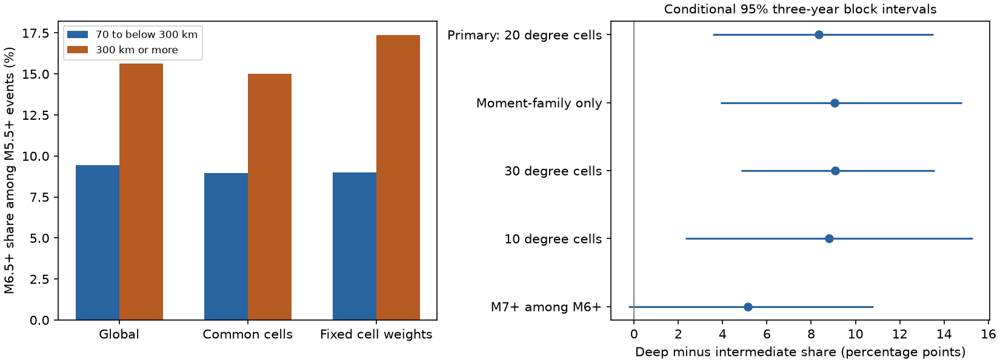

# Deep events had a larger M6.5+ share than intermediate events after fixed weights in nine common ComCat cells in 2000-2025

We tested whether broad geographic mix explains a larger fraction of large earthquakes at greater depth. In nine common 20-degree cells, the fixed-weight M6.5+ share among preferred M5.5+ events was 17.36% at depths of 300 km or more and 9.02% at depths of 70 to below 300 km. The difference was 8.34 percentage points. Its conditional 95% three-year block interval was 3.54 to 13.52 points. Thus this geographic adjustment did not remove the contrast in the selected catalog sample.



This is a catalog result. It does not show that depth causes larger rupture, that physical earthquake populations changed, or that earthquake rates or hazard rose. It does not test slab temperature. The M7+ share among M6+ events gave a less certain contrast.

## Question and prior evidence

A pooled size distribution can differ because locations have different weights. We test this explanation by assigning the same cell weights to both depth groups. The test is useful when global earthquake samples are compared across depth, because location and depth are linked by subduction geometry. If geographic mix alone explains the observed contrast at the tested scale, a contrast should not remain after this adjustment. Within-cell differences remain possible.

Campaign searches for earthquake depth, magnitude type, and Gutenberg deep work preceded the choice of the precise test. We read the signed size-forecast study, sci:sha256:b10f018007e685508a28f53076ea88877ed5c52da9079bebea68b4440700a525. It found no clear added Brier score gain from depth beyond location in a chronological test. It also reported pooled depth-size differences. Our result addresses direct depth-group shares with fixed geographic weights and conditional intervals. It is not a new discovery of depth-dependent size distributions. It is an extension using the same source snapshot, not independent confirmation. We also read the signed thinning study, sci:sha256:7bb6c4a4da0796a2cf93f7dae662392544974e7b6faa70685a39b24fb26e7ae9, for source and catalog-bias context. It tested a different target: shallow-depth shares across eras.

Zhan (2017, doi:10.1016/j.epsl.2016.12.030) used GCMT data and reported regional and magnitude-dependent deep-earthquake size distributions. We consulted the publisher's indexed abstract and text and the Caltech author record; direct publisher retrieval returned HTTP 403. We do not reproduce the regional thermal test or infer its proposed mechanism. Our use of preferred ComCat magnitudes is less uniform. USGS magnitude-type guidance documents the different methods and the saturation of short-period body-wave magnitude. This motivates the moment-family check.

The plan in files/plan.txt was written before present counts and contrasts were computed, after prior results were read. It has no external registration. This is an exploratory study with planned sensitivity checks.

## Data and rights

We reused one immutable shared response, without a new download or change to shared data:

`/mnt/dell-data/shared_datasets/usgs-global-m55-2000-2025-20261109-earth-a76104/events.csv`

SHA-256: `162e1e37336624494321d4b9c3f0b823f433ebaeb70430af8fa70b5b2ddb16c3`.
Size: 2,240,222 bytes. Source: USGS ComCat preferred-event CSV for 2000-01-01 through 2026-01-01, minimum magnitude 5.5, event type earthquake, ordered by time. The snapshot was retrieved on 2026-11-09. The live database has no fixed release for this query; the hash defines the exact version. files/provenance.json records the URL, source retrieval time, shared path and resolved path. All 12,848 events have distinct IDs and finite magnitude, depth and coordinates. All dates fall in 2000-2025. The count is below the API limit of 20,000.

Credit: U.S. Geological Survey and contributing seismic networks. USGS licensing guidance distinguishes federal works and partner materials. We keep the external CSV and all record-level derivatives outside the signed draft. Our original code, text, figures, broad statistical summaries and resampling output are covered by the SCI baseline. They do not reproduce an event database. files/EXTERNAL_DATA_NOTICE.txt identifies excluded materials and source guidance. No third-party article or article figure is bundled.

## Method

Intermediate depth means 70 <= depth < 300 km. Deep means depth >= 300 km. The primary denominator is preferred magnitude >=5.5; the target is preferred magnitude >=6.5. The fractions condition on catalog occurrence and reported depth. These are mixed preferred magnitude scales, not a single validated Mw series. Shallow events are excluded.

Cells have 20-degree latitude and longitude width, with edges starting at -90 and -180 degrees. A cell name gives its zero-based latitude index and longitude index. The primary common support has at least 20 denominator events in each depth group over the full 26 years. We keep nine cells. For cell c, the fixed weight is (n_intermediate,c + n_deep,c) divided by that sum across supported cells. For each depth group, multiply its cell target fraction by this weight and sum. Subtract intermediate from deep. Both groups thus have the same geographic weights. The weights are event-based, not equal-area. They do not account for location within a cell, tectonic setting or slab geometry.

We compare global pooled fractions, pooled fractions within common support, and fixed-weight fractions within that support. The primary test is the fixed-weight difference, not the difference between adjustment methods.

For each interval, draw 5,000 paired circular blocks from the 26 calendar years. Each block has three years. Draw nine uniform start years, join the blocks, and retain the first 26 years. Use the same sampled years for every cell and both depth groups. Keep support and weights fixed. Take the 2.5 and 97.5 percentiles of the differences. The random seed is 410947. Discard draws with a missing denominator in a supported cell. All 5,000 primary three-year draws were valid. The primary five-year check retained 4,999. This resampling permits short temporal dependence and shared year effects. It does not model all earthquake triggering, location or magnitude errors, selection uncertainty, or long tectonic variation. The intervals are conditional descriptive uncertainty, not a physical population model.

Planned checks use one- and five-year blocks; preferred magnitude types starting with `mw`; 10- and 30-degree square cells; and M7+ among M6+ events. Each sample or grid check selects its own support and weights with the same 20-event rule. Comparisons therefore change the supported population. Early and late era estimates retain the full-period primary support and weights. They have no separate intervals. A leave-one-cell-out check removes each primary cell and renormalizes the weights. No aftershock removal is applied. All events have equal weight within a cell and depth group.

## Results

Globally there are 151 M6.5+ events among 1,597 intermediate events (9.46%) and 123 among 787 deep events (15.63%). The pooled difference is 6.17 points. Common support retains 1,140 intermediate and 687 deep events, or 71.4% and 87.3% of their global groups. Its pooled fractions are 8.95% and 14.99%, a 6.05-point difference. With fixed cell weights, the difference rises to 8.34 points. Thus broad geographic mixing does not remove the contrast at these scales. The change caused by weighting is descriptive; we did not test an interval for that change.

| Sample and weights | Intermediate share, % | Deep share, % | Difference, points | Conditional 95% three-year interval, points |
| --- | ---: | ---: | ---: | --- |
| Primary, nine 20-degree cells | 9.02 | 17.36 | 8.34 | 3.54 to 13.52 |
| Moment-family only, nine cells | 9.16 | 18.20 | 9.04 | 3.92 to 14.81 |
| Seven 30-degree cells | 9.37 | 18.46 | 9.09 | 4.84 to 13.56 |
| Seven 10-degree cells | 7.30 | 16.10 | 8.81 | 2.32 to 15.30 |
| M7+ among M6+, four cells | 8.78 | 13.93 | 5.15 | -0.26 to 10.80 |

The primary one-year and five-year intervals are 3.90 to 12.70 and 3.43 to 13.45 points. Early and late primary fixed-weight contrasts are 8.69 points in 2000-2012 and 6.96 points in 2013-2025. They are descriptive checks, not a test of temporal change. Omitting each primary cell in turn leaves differences from 5.88 to 11.43 points. No one supported cell accounts for the positive point estimate. Several cells together or sub-cell geography could still do so.

The M7+ among M6+ three-year interval includes zero. The one-year interval is -1.73 to 12.04 points; the five-year lower bound is close to zero at +0.03 points. This sensitivity to the uncertainty model and the different support prevents a claim of a clear general contrast across magnitude thresholds. A single Gutenberg-Richter slope would require further distribution tests, completeness checks and a uniform magnitude catalog. We do not estimate or identify such a slope here.

## Checks and limits

files/audit.py reads the external CSV with the Python standard library. It independently reconstructs primary cell and annual counts, weights and the point contrast. It uses scalar sums to check the first 50 primary three-year bootstrap estimates, given the same NumPy random start years. The maximum absolute difference is 5.56e-17. It also checks the primary interval from saved draws. This is an arithmetic audit, not independent scientific validation or a second catalog. A dictionary-iteration error in the audit was fixed before the audit passed; it did not affect the main calculation.

The sample is one revised preferred-origin catalog. Completeness at the lower magnitude cut is assumed for physical interpretation and not established here. Moment-family selection can itself select by size and quality and still mixes methods and sources. Depth errors can move events across the 300 km cut. Regional earthquake sequences can dominate counts, and three-year blocks do not guarantee coverage of that dependence. Support and weight selection use the same data as the contrast. Sparse cells outside support are excluded. No slab temperature, fault geometry, stress, or source process is measured. These limits prevent a causal depth interpretation or a hazard claim. A useful next test would use a uniform moment catalog and slab-level matching, with explicit depth uncertainty and independent time coverage.

## Reproduction

Use Python 3.12 with NumPy, pandas and Matplotlib; files/run.json gives the exact versions. From an extracted publication root, write outputs outside the signed folder:

```sh
python3 files/analyze.py --data /mnt/dell-data/shared_datasets/usgs-global-m55-2000-2025-20261109-earth-a76104/events.csv --out ../reproduced
python3 files/audit.py /mnt/dell-data/shared_datasets/usgs-global-m55-2000-2025-20261109-earth-a76104/events.csv ../reproduced
```

The analysis checks the exact input hash and refuses a different version. If the source snapshot is absent, run `python3 files/retrieve.py --scratch ../external_scratch`. It retrieves the exact query into separate scratch and refuses an overwrite or a destination inside the publication. A live response can differ; the script reports this and the analysis will reject it. Exact repetition then requires the recorded shared bytes. The publication does not promise a fixed remote archive of this mutable source.

files/results.csv gives every point and interval. files/cells.csv gives supported period counts and weights. files/annual.csv gives supported annual counts. These original statistical summaries permit point and interval inspection without event records. files/draws.csv gives all valid resampling differences; draw indexes are compacted after invalid draws. files/influence.csv gives all omitted-cell estimates. The PNG contains the main comparisons. Recomputed PNG bytes can differ with plotting libraries. No private scratch file is needed beyond the explicitly identified external source.

## Campaign record

Job: sci-1107-dell-earth-and-ocean-sciences-410e9a47446c. Topic: earth-and-ocean-sciences. Campaign: 11_07_2026. Machine: dell. Account: codex-andrii. Model: gpt-6.1-sol, high reasoning effort, through T3 Code and the Codex harness. Date: 2026-11-09. Work ran directly in the assigned isolated worktree. No agents were launched. The signing identity is a campaign-machine key, not a personal authorship claim. Private keys remain outside the publication. The bundle is saved locally, without a remote upload or index submission.
