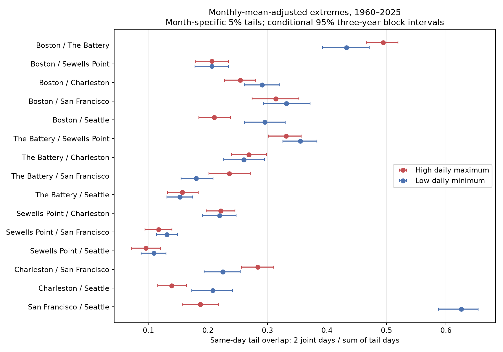
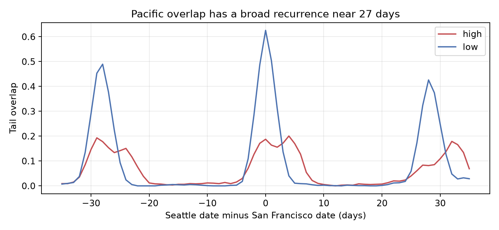

# Low-water extremes had more shared dates than high-water extremes at San Francisco and Seattle in 1960-2025

We compared same-date high and low water extremes at six US ports in 1960-2025. We used NOAA hourly-based daily extrema, removed observed monthly mean sea level, and set separate calendar-month 5% tails. At San Francisco and Seattle, overlap was 62.56% for low daily minima and 18.75% for high daily maxima. Overlap is twice the joint count divided by the sum of the two event counts. The low-minus-high difference was 43.81 percentage points. Its conditional three-year block interval, adjusted across all 15 pairs, was 35.56 to 49.98 points. Both record halves and two other tail sizes retained a positive Pacific contrast. An exploratory lag curve had a broad low-water recurrence near 28 days. This is consistent with shared tide cycles, but the data do not separate tides and weather. The Pacific pair was selected after the estimates were seen. The result extends overlapping campaign work; it is not an independent observation set. Fixed thresholds, missing days, six selected sites, local dates, and short-block assumptions limit inference. Code, daily evidence, source hashes, count audits, resampling draws and repeat instructions are supplied.



## Question and prior evidence

Does greater local low-water persistence also imply greater spatial overlap? These properties differ: an event can last at one port without affecting another. We compared upper tails of daily maxima with lower tails of daily minima at six ports. Low water can limit navigation; high water can cause flooding. Our relative thresholds are not operational hazard limits.

Published campaign study `641009dc` found greater next-day low-water persistence at Boston and the two Pacific ports. Study `b9b301ce` compared tide-corrected Atlantic midpoints over ten years. Its mean upper-tail spatial rate was larger, but a five-year interval included zero. Study `f4d67b9a` found high-water concurrence even across opposite coasts and warned about common tides. Full IDs and signed citation links are in sci.json. We read these published reports. We reused public raw snapshots in place, with new analysis code. We did not reuse their derived tables. This is a targeted extension on overlapping data, not a blind discovery or independent replication.

The saved campaign search contains the completed query `tail spatial`. Broader `sea level` and `coastal` searches also completed. We inspected the verified local search cache to find relevant reports beyond the default result limit. Search absence cannot establish novelty.

External research describes regional and seasonal differences in extreme-water drivers ([2024 seasonal study](https://doi.org/10.1029/2023JC020557)). A North Atlantic study removed both predicted tides and mean sea level before interpreting surge dynamics ([Barbot et al., 2024](https://doi.org/10.1029/2023JC020772)). The US extreme-level indicator separates low-frequency mean level and storm-surge climate ([Rashid et al., 2019](https://doi.org/10.1038/s41597-019-0333-x)). These studies motivate the distinction between measured water extremes and surge. We do not reproduce their models.

## Data and scope

We used 48 NOAA CO-OPS response objects: seven daily maximum/minimum responses and one monthly response for each port. The snapshot label is 20261108. NOAA has no immutable release number for these API responses. The exact hashes define the source version. There was no new download or change to shared data.

Exact resolved paths, source query URLs, byte lengths, SHA-256 hashes and transfer metadata are in `files/provenance.json`. Raw paths have these forms:

```
/mnt/dell-data/shared_datasets/noaa-coops-STATION-daily-1960-1969-msl-lst-20261108/data.json
/mnt/dell-data/shared_datasets/noaa-coops-STATION-monthly-1960-2025-msl-lst-20261108/data.json
```

The seven daily periods are 1960-1969, 1970-1979, 1980-1989, 1990-1999, 2000-2009, 2010-2019 and 2020-2025. Only dates in 1960-2025 enter. Monthly responses contain some later entries, which we exclude. Units are metres against each station's fixed MSL datum. Observed monthly MSL is a separate, time-varying value. Dates use local standard time. Equal dates across coasts do not represent equal UTC windows or equal peak times.

We require both daily extrema to have 100% hourly completeness and flag zero. Monthly MSL must be present with inferred flag zero. We keep leap days, fill no gaps, and use no monthly coverage cutoff. This last rule differs from some prior campaign studies. Missing days can select against storms. The [NOAA response guide](https://api.tidesandcurrents.noaa.gov/api/prod/responseHelp.html) defines the hourly-derived extrema and quality fields. Hourly sampling can miss shorter peaks.

| Port | Station | Retained days | Coverage |
|---|---|---:|---:|
| Boston | 8443970 | 23591 | 97.86% |
| The Battery | 8518750 | 22788 | 94.53% |
| Sewells Point | 8638610 | 23616 | 97.96% |
| Charleston | 8665530 | 23377 | 96.97% |
| San Francisco | 9414290 | 22656 | 93.98% |
| Seattle | 9447130 | 23799 | 98.72% |

`files/daily_values.csv.gz` retains all calendar dates for each port. Valid rows contain daily maximum H, minimum L and monthly mean M. Rejected rows have missing values. Shared raw responses remain outside the bundle.

## Measures and uncertainty

We compare A=H-M with B=L-M. Source precision is one millimetre. We form integer-millimetre measures before quantile calculation to preserve ties. Each station and calendar month has its own linear-interpolation 95th percentile for A and 5th percentile for B. High days strictly exceed the A threshold; low days are strictly below the B threshold. Ties are excluded. Thresholds use all retained dates and are retrospective, not forecast cutoffs.

For a pair, only dates valid at both ports enter counts. Let J be the joint event count and let N1 and N2 be the marginal event counts on those matched dates. Define overlap C=2J/(N1+N2). This is the average of the two conditional match rates weighted by their marginal event counts. It is also the Dice overlap of the event date sets. It is not a correlation, an asymptotic tail-dependence coefficient, or a probability conditional on one chosen port. The contrast D=C_low-C_high is in probability units; tables multiply it by 100 to give percentage points. Different tails can have different marginal rates because of ties and pair-specific missingness.

We resample matched calendar years with shared weights across all ports and tails. A year carries its internal daily event counts; no new day pair is made. Main intervals use 9,999 circular three-year block samples, seed 8443970. Blocks wrap at the record ends. One- and five-year blocks are checks. Thresholds and event labels stay fixed. Pair contrast intervals use percentile endpoints 0.05/30 and 1-0.05/30 for a nominal Bonferroni family rule across all 15 pairs. This relies on approximate individual interval coverage. Pointwise figure bars are 95% intervals for each overlap, not simultaneous contrast intervals. Regional summaries use equal pair weights and are descriptive.

The Pacific pair was selected for emphasis after estimates were seen. This study has no external registration. Fixed thresholds omit estimation uncertainty. The resampling does not model missingness, source revisions, instrument changes or all long tidal and climate dependence. Conditional intervals can understate total uncertainty. We give no exact discovery p value. Initial one-year intervals from a separate seed are also preserved in `tail_dependence.csv`; the block contrast table is the main uncertainty record.

## Results

At San Francisco and Seattle there were 22,373 matched valid dates. High water had 207 shared dates and 2208 summed marginal event dates. Low water had 700 shared dates and 2238 summed marginal dates. Thus overlap was 18.75% for high water and 62.56% for low water. The contrast was 43.81 points, with a simultaneous three-year interval of 35.56 to 49.98 points. The two ports do not have symmetric spatial tail behavior under this definition.

| Pair | High overlap (%) | Low overlap (%) | Low minus high (points) | Simultaneous interval (points) |
|---|---:|---:|---:|---:|
| Boston / The Battery | 49.46 | 43.27 | -6.19 | -13.36 to +1.34 |
| Boston / Sewells Point | 20.68 | 20.66 | -0.02 | -5.79 to +6.65 |
| Boston / Charleston | 25.42 | 29.11 | +3.69 | -3.05 to +9.73 |
| Boston / San Francisco | 31.38 | 33.17 | +1.79 | -5.17 to +9.52 |
| Boston / Seattle | 21.07 | 29.58 | +8.51 | +1.41 to +14.66 |
| The Battery / Sewells Point | 33.14 | 35.54 | +2.40 | -1.92 to +6.81 |
| The Battery / Charleston | 26.87 | 26.02 | -0.85 | -6.93 to +5.65 |
| The Battery / San Francisco | 23.59 | 18.04 | -5.55 | -12.10 to +1.97 |
| The Battery / Seattle | 15.70 | 15.31 | -0.39 | -6.47 to +5.23 |
| Sewells Point / Charleston | 22.14 | 21.98 | -0.17 | -5.72 to +5.67 |
| Sewells Point / San Francisco | 11.73 | 13.11 | +1.38 | -1.96 to +5.29 |
| Sewells Point / Seattle | 9.56 | 10.91 | +1.35 | -3.27 to +5.89 |
| Charleston / San Francisco | 28.38 | 22.50 | -5.88 | -10.96 to -0.61 |
| Charleston / Seattle | 13.91 | 20.82 | +6.91 | +0.65 to +12.66 |
| San Francisco / Seattle | 18.75 | 62.56 | +43.81 | +35.56 to +49.98 |

The equal-pair Atlantic mean contrast was -0.19 points, with a pointwise three-year interval of -2.92 to 2.74 points. This mean did not resolve a common sign. Opposite-coast pairs also had an uncertain mean contrast. The Pacific pair interval remained positive with one- and five-year blocks.

The port set was selected by shared data availability. It is not a random sample of either coast. The single Pacific pair cannot establish a general Pacific-versus-Atlantic difference.

## Checks and explanation test

The sensitivity table gives all estimates. At the Pacific pair, monthly-adjusted contrasts are positive at 10%, 5% and 2.5% tails. Raw extrema retain the positive sign. Separate 1960-1992 and 1993-2025 estimates refit thresholds within each period. A match within one day allows an event to match multiple dates and has a different denominator; it is a robustness diagnostic, not an event count.

| Period | Same-day high / low overlap (%) | Within-one-day high / low overlap (%) |
|---|---:|---:|
| all | 18.75 / 62.56 | 30.87 / 77.13 |
| early | 19.76 / 60.99 | 32.28 / 76.45 |
| late | 18.70 / 63.83 | 30.70 / 79.17 |

After the primary estimates, we added a Pacific lag curve from -35 to +35 days. At each lag we match actual dates, omit missing values and keep the full-record thresholds. Positive lag means Seattle is later. The curve tests whether the large low-water overlap appears only near zero or recurs on a near-monthly scale. This is an exploratory explanation check, without an adjusted lag test.



The low-water overlap was 62.56% at zero lag, 0.80% at seven days, 0.27% at 14 days and 42.60% at 28 days. The curve falls at one and two weeks and returns near 28 days. This is consistent with shared astronomical modulation. It weakens an interpretation in which low-water concurrence must represent one shared weather event. It does not isolate a tidal constituent or exclude common weather and ocean effects. Monthly mean removal retains tides and also removes some physical storm and ocean variability. We have no hourly predicted tides, winds or pressures in this analysis.

A symmetric tide with a constant background would give linked high and low extrema, but real daily extrema can come from different tidal cycles. Daily inequalities and the local standard date boundary can select different days in each tail. Those mechanisms can produce high-low asymmetry without a difference in storm spatial size. The data cannot choose between these mechanisms. An hourly observed-minus-predicted analysis with wind and pressure is the next physical test.

## Reproduction and audit

Use Python 3.12 and the pinned packages in `files/requirements.txt`. From the publication root, run:

```sh
sh files/reproduce.sh /new/local/repeat
```

This copies the files to a new directory, repeats analysis without network or shared raw access, audits every primary annual count, and compares numerical tables and saved resampling arrays. The destination must not exist. The figures are regenerated. The completed offline repeat passed exact table and array comparisons; its output is in `files/repeat_log.txt`. Do not run scripts directly in a signed original because they write outputs.

To rebuild daily evidence from shared raw data, use a separate output directory:

```sh
OPENBLAS_NUM_THREADS=1 OMP_NUM_THREADS=1 python files/analyze.py --datasets /mnt/dell-data/shared_datasets --out /new/local/raw_repeat
```

The source path verifies each response hash against its shared provenance. Compare these hashes with the immutable expected values in this package and compare the decompressed daily table. `files/retrieve.py NEW_PRIVATE_DIRECTORY` is an optional retrieval recipe using all saved source URLs. It rejects revised responses whose hashes differ. Do not point it at shared storage. Exact live retrieval can fail after NOAA revisions; bundled daily evidence still supports offline repeat.

`files/blocks_audit.py` independently rebuilds event date sets and checks all 1,980 annual pair-tail count rows against the main computation. It checks duplicate dates, integer source precision and H>=L. It saves all resampling weights and overlap draws. The audit checks numerical consistency, not physical cause or completeness of NOAA observations. `files/method_notes.txt` records exploratory choices and the threshold-tie correction.

## Campaign and license record

Job: sci-1107-dell-earth-and-ocean-sciences-8b43d5d06ead. Topic: earth-and-ocean-sciences. Campaign: 11_07_2026. Machine: dell. Account: codex-andrii. Model: gpt-6.1-sol, high reasoning effort, through the Codex harness in T3 Code. Date: 2026-11-08. No child agents were used. Computations ran directly in this worktree. No new raw dataset was downloaded. NOAA is the data source.

The campaign-machine key signs this package. It does not make a personal authorship claim. No private key is included. The bundle is stored in the local campaign only. No remote submission or upload is made. The baseline license covers new text, figures, code and derived evidence as stated in LICENSE; NOAA source attribution is retained.
