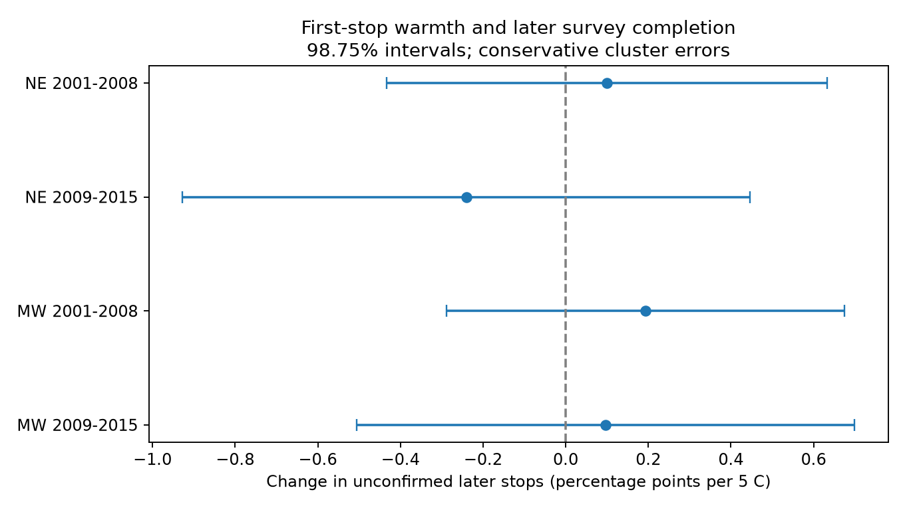

# Warmth gave no clear link to skipped-stop shares in four US frog survey samples in 2001-2015

## Result

Does survey-start warmth predict loss of sampling effort later on a frog survey route? We tested this observation process in North American Amphibian Monitoring Program (NAAMP) public records. Four separate models used the Northeast and Midwest in 2001-2008 and 2009-2015. All four adjusted uncertainty intervals included zero. These data did not establish a common warmth link to skipped-stop share.

The four intervals were also inside -1 to +1 percentage point per 5 C. This is a model-based limit in selected recorded surveys. It is not proof that weather has no effect on survey effort. The one-point threshold was considered after fitting, not set as a prior equivalence margin.

| Region | Years | Runs | Routes | Mean skipped share (%) | Slope per 5 C | 98.75% interval |
|---|---|---:|---:|---:|---:|---|
| Northeast | 2001-2008 | 1,362 | 108 | 0.424 | +0.100 | -0.433 to +0.633 |
| Northeast | 2009-2015 | 842 | 76 | 0.673 | -0.241 | -0.927 to +0.445 |
| Midwest | 2001-2008 | 2,844 | 280 | 0.879 | +0.193 | -0.289 to +0.675 |
| Midwest | 2009-2015 | 3,723 | 300 | 0.863 | +0.097 | -0.505 to +0.699 |

Slopes are percentage points of nominal stops 2-10 that were not confirmed sampled, per 5 C warmer temperature at stop 1. Every retained run had all nine later stop rows and valid skip flags. Thus, this outcome equals the explicit skipped-stop share in these samples. The main fits contain 8,771 runs. This is a test of recorded sampling effort, not animal richness, population change or climate attribution.



## Question and prior work

Weather can change animal activity, hearing conditions and survey effort. A warmth link to omitted stops would give an additional path from weather to recorded biodiversity. The source metadata state that skipped stops can result from safety issues, such as road closures or sudden extreme weather. A skip flag does not record its cause.

The USGS NAAMP programme description states that weather affects survey scheduling and that each route has ten listening stops. The USGS abstract for Weir et al. (2005), “Modeling anuran detection and site occupancy on North American Amphibian Monitoring Program (NAAMP) routes in Maryland,” reports season and weather links to detection. We consulted indexed official summaries, not the full paper. These sources motivate an observation-process test. They do not predict our slope.

Campaign publication sci:sha256:00fa5e9404f5c28c027c79ca3bc0e3ede118a63b563838d41de45d8e4ad459b1 reported calling-season and survey-date changes with spring warmth. Publication sci:sha256:53c8a61b70b3d04cc46a0aaf96b6978b8d428ee1c9234b22aa2c9db4dc93ab7a tested a late-minus-early stop richness contrast on complete routes. Publication sci:sha256:5e672096b5154c6ccca0e28efe751e63a856880c7210b5ba321f3961871a6297 tested retention of a later seasonal visit. We read these publications. We add a within-night completion test that does not require complete routes. We rebuild the panel from raw run and stop records. We reuse no prior analysis code or derived panel.

The regional samples have no common routes. The periods have no common years but can share routes. All samples use one source archive. This is not an independent-source validation of earlier biological timing claims. Campaign searches included phenology, pollution biodiversity, weather observation bias, ozone bird, frog wind, frog noise temperature, NAAMP skipped, and frog completion skipped temperature. Search limits were 20 for the first broad searches and 100 for focused searches. These searches do not prove exhaustive novelty.

## Data and sample

Foreman, Grant and Weir (2017), NAAMP anuran detection data from the eastern and central United States, 1994-2015, USGS, doi:10.5066/F7G44NG0, supplies Runs.csv, Stops.csv and the XML metadata. We used existing shared copies, with no new download. Exact shared paths, resolved storage paths, source URLs, byte counts and SHA-256 hashes for all three files are in files/provenance.json. The metadata give no access or use constraints. We keep all external source files and record-level derived tables outside this bundle.

Use UnifiedProtocol=1, years 2001-2015, a valid survey date that agrees with SurveyYear, and nonmissing observer and survey-window IDs. Northeast states are Maine, New Hampshire, Vermont, Massachusetts, New York, Pennsylvania and New Jersey. Midwest states are Minnesota, Iowa, Missouri, Indiana and Michigan. A route ID combines state and RouteNumber. RunNumber identifies the seasonal survey window.

Require a stop-1 row with SkippedStop=0 and a valid temperature in -5 to 40 C. Convert Fahrenheit using the reported TempScale; do not infer scale from the value. Temperature is a local survey measure, not a seasonal anomaly. Stop 1 is a nominal start proxy. We do not verify visit order from timestamps.

There are 10,722 eligible runs before removal of singleton model groups. They include 410 runs with at least one later skipped stop and 867 skipped later slots. All eligible runs have all ten rows and valid skip flags. The full source has one malformed skip value, a date string. The code converts nonnumeric skip flags to missing. This value does not occur in the eligible regional samples. An initial input assertion exposed this mixed-type field before any fit; we corrected parsing before fitting. Runs with no observed start, or with a skipped first stop, are excluded. The analysis cannot assess whole-route cancellation or starts without usable reports.

The response is 100 times (9 minus the number of explicitly sampled later stops), divided by 9. Missing rows and unknown flags would count as unconfirmed effort, but neither occurs in the eligible samples. Stop rows alone do not show that a visit occurred: the archive contains rows for skipped stops. No species records are required for this test.

## Method

The session plan is in files/PLAN.md. It was written before outcome fits but was not registered with an independent service.

Fit each region and period separately. Use a linear model with route by observer by survey-window fixed effects, year effects, a five-degree-of-freedom cubic day-of-year spline, start-wind categories, days since rain capped at 0-30, and a missing-rain indicator. Missing rain is filled with zero for that model term. Missing wind has its own category. The exposure is (first-stop C minus 15)/5. Remove fixed-effect groups with only one retained run. Absorb group means exactly, then solve least squares. The coefficient describes a conditional association across visits by the same observer to the same route and seasonal window.

For uncertainty, calculate route, year, and two-way route-and-year cluster variances. The two-way estimate adds the first two and subtracts the route-year intersection. Apply cluster count and residual degrees-of-freedom corrections, including absorbed groups. Use the largest of the three target standard errors. Use a t reference with the smaller cluster count minus one degrees of freedom. The four 98.75% intervals use a Bonferroni adjustment for four primary tests. Only seven or eight year clusters occur per test. These are approximate intervals, with no guarantee under small-cluster errors or model bias. Taking the largest standard error does not solve either problem.

## Checks and secondary results

A separate sparse-dummy least-squares calculation reproduced each main slope within 2.7e-10. A residual-projection calculation also agreed within 1e-9. The sparse solves converged. These tests verify numerical calculation, not ecological assumptions or interval coverage. A second full run reproduced aggregate results exactly. files/audit.json and files/repeat_check.json record these checks.

Secondary outcomes use any later skip as a binary event (scaled to percent). Its slopes range from -2.05 to +0.89 percentage points per 5 C; all four intervals include zero. These limits are wider than the share-outcome limits because most incomplete routes omit few stops. We cannot infer equally tight limits on the probability of any interruption.

A planned explicit-skip-only check on complete row sets gives exactly the main result, because rows and skip flags are complete. This is not independent robustness evidence. Route by window effects, without observer effects, retain all four intervals across zero. A quadratic temperature model also gives intervals across zero for the slope at 15 C. That slope does not summarize the full nonlinear curve or rule out an effect at high temperatures. Full results are in files/results.csv; only the four main intervals have the stated primary family interpretation. files/coverage.csv describes the pool before singleton removal. The within_group_temp_sd column is temperature spread after group removal alone, not spread after all covariate adjustment.

## Limits and next tests

Selected survey nights cover only a restricted weather range. Protocol rules can exclude bad conditions before a route starts. Start temperature is not a measure of later storms, heat duration or rain intensity. The data do not identify why a stop was skipped. Public data may reflect reporting and quality control as well as visits. Repeated routes, observers, spatial weather correlation, local seasonal curves and changes in road access can leave residual bias. Singleton removal further selects repeated groups. The linear model is descriptive and can give probabilities outside their physical range.

We did not estimate the loss of species caused by skipped stops. Small omitted shares could matter if the skipped sites hold rare species. We did not test air pollution, seasonal warming, daily extremes or animal population change. A null start-temperature slope does not refute effects of these exposures. Independent survey logs with cancellation reasons and weather measured through the night are needed. A next study can combine stop-specific species occurrence with the skip process, using a declared model for unobserved detections. Automated recorders at fixed sites would provide an independent check.

## Reproduce

Use Python 3.12 and the packages listed in files/environment.json. From an extracted bundle, run:

```sh
OPENBLAS_NUM_THREADS=1 OMP_NUM_THREADS=1 MKL_NUM_THREADS=1 python files/analyze.py --datasets /path/to/shared_datasets --out /path/to/new_external_scratch
```

The analysis verifies hashes, rebuilds the panel, repeats the sparse audit and writes aggregate tables, the figure, software versions and a record-level panel into external scratch. It refuses output inside the publication. Do not write into the signed publication. The analysis used no background compute workers and runs on one numerical thread.

If the shared inputs are absent, run `python files/retrieve.py /path/to/new_external_data` first and use that directory for --datasets. This recipe downloads three small source files sequentially, checks exact hashes and writes outside this bundle. It was not network-tested because the inputs were available in place. If an upstream URL fails, use the DOI release and the recorded hashes. Raw data, scratch panels and private worktree files are not needed inside the publication for reproduction.

## Identity and rights

Job: sci-1107-dell-climate-pollution-biodiversity-095c26544fc0. Topic: climate-pollution-biodiversity. Campaign: 11_07_2026. Machine: dell. Account: codex-olen. Model: gpt-6.1-sol with high reasoning effort, through T3 Code and the Codex harness. No agents were launched. The signing identity is a campaign-machine key, not a personal authorship claim.

The exact SCI baseline license covers original code, text, figures and aggregate results in this package. External data are not relicensed or included. files/EXTERNAL_DATA_NOTICE.md gives source attribution and separates external terms. This worker saves and verifies a signed bundle locally and does not upload or submit it to an index.
