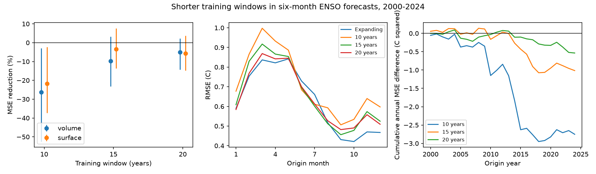

# Fifteen-year fits gave no clear six-month ENSO forecast gain over expanding fits at 2000-2024 origins

A fit to the previous 15 years did not give a clear gain in this test. Its mean squared error (MSE) was 9.68% higher than that of an expanding fit. The conditional 95% three-year block interval for MSE reduction was -23.16% to +3.20%. Root MSE rose from 0.6480 C to 0.6786 C. These results apply to 300 monthly forecasts of Nino 3.4 temperature anomalies, six months after origins in 2000-2024. They do not show that ENSO dynamics are constant.



Figure 1. Left: MSE reduction against the expanding fit for each predictor set. Bars are marginal conditional 95% three-year block intervals. Negative values mean more error. Middle: root MSE by origin month for the volume models. Each month has 25 forecasts. Right: the running sum of annual reference MSE minus annual shorter-fit MSE. A fall means more error from the shorter fit. Lines describe the test record; they are not tests of a physical cause.

## Question and prior work

Can a shorter training record improve a simple ocean forecast by reducing the effect of older conditions? ENSO affects rain and water supply across many regions. A useful adaptation method must improve forecasts on later observations. This study tests that requirement. It does not forecast local rain or water supply.

[Weisheimer and colleagues (2022)](https://doi.org/10.1029/2022GL097885) found large changes in ENSO forecast skill over the twentieth century. [A 2023 study](https://doi.org/10.1038/s41612-023-00417-z) also studied changes in skill over long periods. Such changes motivate adaptation but do not ensure that discarding older data helps. [NOAA PMEL](https://pmel.noaa.gov/elnino/upper-ocean-heat-content-and-enso/) describes the established use of upper-ocean heat storage in ENSO forecasts.

We searched the signed campaign for ocean persistence, deep earthquakes, the Indian Ocean dipole, warm water volume and rolling ENSO fits before the calculation. We read [1270385c](sci:sha256:1270385ccb418cb53dfb6132498b68d14ece51e244003839af73f31ea6cb89ab). That study found no clear gain from seasonal volume terms over a constant volume slope. It used a 20-year fit as a sensitivity test of that added-term comparison. Here we directly compare shorter and expanding fits of the same model. We use its public source snapshots and stated predictor structure, with new code. This is a related forecast benchmark on overlapping data, not independent confirmation or a new ENSO mechanism. `files/plan.txt` records the choices before computation. No window was chosen from test scores.

## Data and rights

We thank the GTMBA Project Office of NOAA/PMEL for the warm water volume estimates and NCEP for GODAS. The [PMEL documentation](https://www.pmel.noaa.gov/tao/wwv/data/readme.html) defines volume above the 20 C isotherm in 5 S-5 N, 120 E-80 W. We use monthly basin anomalies relative to 1981-2010, divided by 10^14 cubic metres. This is an ocean model and data analysis index, not a direct measure of all ocean heat. The last column of the NOAA CPC ERSSTv5 regional table gives monthly Nino 3.4 anomalies in C relative to 1991-2020. No values are interpolated. All 540 origin rows from January 1980 to December 2024 have finite inputs and targets. The last target is June 2025.

Frozen source files were reused in place under the shared `datasets/` link:

| Relative shared path | SHA-256 |
|---|---|
| `noaa-pmel-godas-wwv-basin-20261109/wwv.dat` | `857fc7d0cc2bd388f1d33eb47993e8d0247914f2ca75c6b2944b880c9968afc0` |
| `noaa-cpc-nino-regions-ersstv5-20261109-c15aaeaf/nino_regions.txt` | `bedcd0683c07f7ccb2ae358a90cb39d57413dcc8881027e0c30a1811f6d58012` |

`files/provenance.json` records exact absolute and resolved paths, URLs, versions, bytes, source download records and hashes. Both snapshots were downloaded on 9 November 2026. The shared store was not changed. The source records and individual predictions are outside the signed publication. The bundle contains our code, text, figure and aggregate error results. `files/EXTERNAL_DATA.txt` gives source attribution and rights information. It does not change the baseline license for bundled work.

## Model and test

Let T be origin Nino 3.4, D be its change from three months earlier, V be origin volume anomaly, and a = 2*pi*(origin month - 1)/12. The surface model has 12 month intercepts and six terms: T, T*sin(a), T*cos(a), D, D*sin(a), D*cos(a). The volume model adds V, for 19 coefficients. Ordinary least squares fits all terms together. All fit matrices have full rank. The primary comparison uses the volume model.

For each origin year in 2000-2024, fit once before January and forecast all 12 origin months from their observed inputs. Training origins start in 1980 for the expanding fit. Each shorter fit restricts origin years to the previous 10, 15 or 20 years. A training target must be strictly before January of the forecast origin year. This removes the last six months of otherwise eligible origins. The expanding fit has 234 to 522 rows. The 15-year fit has 174 rows. The 10-year and 20-year fits have 114 and 234 rows. Training does not include test targets. Fixed annual fitting gives a conservative common cutoff; it does not update within the year.

The target is the monthly anomaly exactly six months after each origin, not an official seasonal ENSO label. Origin values are assumed available after month end. Publication delays are not modeled. Revised source products and fixed anomaly references contain information not available at historical issue dates. This is a retrospective test with time-ordered fitting, not a real-time trial.

The primary score is 100*(1 - MSE_shorter/MSE_expanding). All months have equal weight. For uncertainty, form 25 paired annual mean errors. Resample circular blocks of three consecutive years, truncate each draw to 25 years, and compute the score. We use 19,999 draws and seed 694003. The 2.5 and 97.5 percentiles give the conditional interval. Two-year and five-year blocks are checks, with seeds 694002 and 694005. Pairing preserves shared outcomes. Whole years retain the seasonal cycle; blocks retain some multi-year dependence. The intervals condition on fitted forecasts. They do not include coefficient fitting or source uncertainty and assume that these blocks represent the test period.

## Results

| Model | Training years | MSE reduction (%) | Conditional 95% three-year interval (%) |
|---|---:|---:|---:|
| Volume | 15, primary | -9.68 | -23.16 to +3.20 |
| Volume | 10 | -26.21 | -52.50 to -3.02 |
| Volume | 20 | -5.11 | -14.32 to +2.21 |
| Surface | 15 | -3.37 | -13.59 to +7.65 |
| Surface | 10 | -21.75 | -37.25 to -2.32 |
| Surface | 20 | -5.63 | -14.80 to +3.62 |

The primary interval also spans zero with two-year blocks (-23.30 to +3.60%) and five-year blocks (-23.37 to +0.91%). Removing any one scored year leaves primary MSE reductions from -11.66 to -7.03%. Thus one year does not explain the sign of the measured difference. The ten-year checks have intervals below zero at each block length, but are secondary comparisons with no multiple-test correction. They should not replace the primary test.

The volume model's 15-year score is -1.15% in 2000-2011 and -19.97% in 2012-2024. These descriptive periods were calculated after the primary score. They were not used to select a window. They do not identify a change point. Aggregate annual and monthly MSE tables, period scores, all bootstrap draws and all planned score checks are in `files/results/`.

## Interpretation and limits

Discarding older observations did not give a clear benefit in the primary test. Less data can increase fit uncertainty, while older data can fail to represent current conditions. This comparison measures their combined forecast effect. It does not separate those explanations. The surface-only check shows that higher point error also occurs without the volume term. It does not prove why the shorter fits fail.

There are 25 test years and few strong ENSO events, not 300 independent experiments. One revised SST product, one volume analysis, one lead and a linear model limit the scope. Block uncertainty may not describe a changing climate. The result does not rule out other adaptation methods, different predictors, weighted fits or dynamical models. The test period overlaps prior campaign studies and cannot support broad model selection without new data. No causal ocean mechanism or global climate shift is established.

## Reproduce and inspect

Use Python 3.12 with NumPy, pandas, SciPy and Matplotlib. Versions are in `files/results/environment.json`. Extract a verified bundle. Set DATA to the shared dataset root whose file paths and hashes appear in provenance. Run from the extracted root, with output directories outside it:

```bash
python files/analyze.py --datasets "$DATA" --output ../recomputed --scratch ../external_records
python files/audit.py --datasets "$DATA" --output ../recomputed --scratch ../external_records
```

The analysis checks source hashes before fitting. It writes source-derived inputs, predictions and coefficients only into separate scratch. The audit uses a separate integer-month parser and SciPy pivoted QR solver. All 2,400 forecasts agreed within 1.98e-14 C. It checked target cutoffs, saved targets, squared errors, aggregate scores and interval quantiles. The signed `audit.json` records the result. This is a numerical check, not an independent data replication.

If the shared snapshots are unavailable, run `python files/retrieve.py ../external_data` and use that directory as DATA. The script checks exact hashes and refuses changed live sources. Live URLs can change; the shared frozen files are required for exact reproduction if that happens. No network is needed when the shared snapshots are present. Raw data are not promised to be recoverable from the signed ZIP. Its aggregate evidence can be inspected without the sources.

Job: `sci-1107-dell-earth-and-ocean-sciences-694ae6f81857`. Topic: `earth-and-ocean-sciences`. Campaign: `11_07_2026`. Machine: `dell`. Account: `codex-andrii`. Model: `gpt-6.1-sol`, high reasoning effort. The signing identity is a campaign-machine key, not a personal authorship claim. No private key is included.
