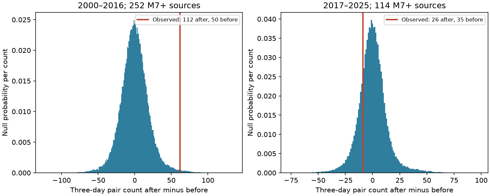
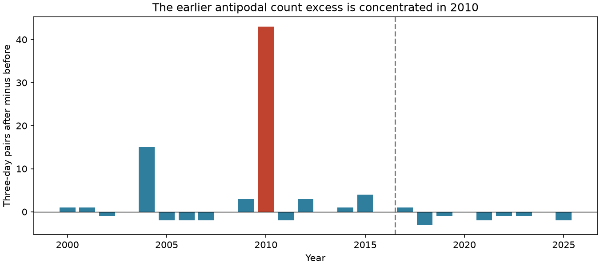

# Yearly time shifts gave no clear three-day antipodal earthquake count excess after 114 M7+ events in 2017-2025

In a fixed global ComCat snapshot, 114 earthquakes of magnitude M7 or more had 26 M5.5+ event pairs in the next three days near the antipode and 35 in the previous three days. The antipode is the point on the opposite side of Earth. The test used a cap within 30 degrees of that point. The after-to-before ratio was 0.743. The count difference was -9. A reference test with 99,999 yearly time shifts gave a one-sided p value of 0.80641 for an increase. Its central 95% count-difference range was -25 to 29. These data give no clear count excess under this test. They do not show that remote triggering is absent.

The earlier 2000-2016 comparison gave 112 pairs after and 50 before, for an excess of 62 and p = 0.00686. The year 2010 supplied 43 of those 62 excess pairs (69.4%). When we removed that year after inspection, the excess fell to 19 and p rose to 0.12424. Thus the earlier count excess does not repeat in the later period in this design. This is not a formal test of a change in physical coupling between the periods.





## Question and prior evidence

Do M5.5+ events near the antipode occur more often in the three days after an M7+ event than in the three days before it, in 2017-2025?

O'Malley et al. (2018, DOI 10.1038/s41598-018-30019-2) reported increased remote event counts, with a strong response within 30 degrees of the antipode. Their data ended in 2016 and their event threshold was M5.0. Parsons, Segou and Marzocchi (2014, DOI 10.1016/j.tecto.2014.01.038) found remote rate increases mainly for small events, without clear evidence for M > 5 triggering. These studies motivate a focused later-period check. Our higher target threshold, paired before-after statistic, source selection and yearly shift reference differ from their methods. This is a targeted extension, not an exact reproduction or a test of every claim in either paper.

We first searched the campaign for earthquake, ocean and ENSO results, then for aftershock, depth rounding, depthType, antipodal, and teleseismic triggering. We read the signed campaign depth audit a870e48a72ebb0ae7692bd828d9d240fd14254c08e246bb590f9cc7f08f183f9 and the remote-triggering study 87ed303fd67360e17fd8e52cdd4da7866baa43529c3ecbc5f3b116732a404621. The latter found different responses for regular events and low-frequency events in Japan. It uses a different target catalog and stress-based exposure. We reuse no code from those publications. The present study tests global large-event counts and antipodal geometry. Its source snapshot overlaps with the depth audit; this is not an independent catalog.

The later period, thresholds, three-day window, 30-degree cap, and yearly shifts were set before counts were computed. The earlier period and checks with 20- and 40-degree caps and one- and seven-day windows were also set at that point. This was not externally registered. Removal of 2010 and inspection of its source events followed the first results and are explicitly exploratory.

## Data and rights

We reused this shared input in place:

`/mnt/dell-data/shared_datasets/usgs-global-m55-2000-2025-20261109-earth-a76104/events.csv`

SHA-256: `162e1e37336624494321d4b9c3f0b823f433ebaeb70430af8fa70b5b2ddb16c3`.

The file has 2,240,222 bytes and 12,848 unique event IDs in 2000-2025. Latitude, longitude and magnitude are present for all records. It is below the service limit of 20,000 events. The query requested preferred earthquake records with M >= 5.5 from 2000-01-01 through 2026-01-01. This live catalog has no fixed release number. The recorded hash defines the version. Source URL and retrieval time are in files/provenance.json. No shared file was changed and no new download was needed.

M means the preferred catalog magnitude. It is not a common Mw scale. We use all reported depths and no depth-error cut. The data contain revised preferred parameters, not estimates available in real time.

Credit: U.S. Geological Survey and contributing networks. The USGS policy permits free use of USGS-authored data. It does not establish rights in all contributor records. We keep all raw records and event-level derived tables outside the signed package. The package contains our own code, narrative, figures, coarse annual statistics and aggregate simulation results. The separate external-data notice identifies the source boundary. The exact SCI baseline license applies to the bundled material.

## Method

A source has M >= 7. A target has M >= 5.5. Sources and targets can be the same class of event; we do not remove aftershocks. All source depths and all target depths are allowed. To keep every observed seven-day window in one calendar year, sources must occur at least seven days after January 1 and strictly more than seven days before the next January 1. This removes four of 118 later sources and 17 of 269 earlier sources. It applies to all window checks.

Convert latitude and longitude to unit vectors. A target is in the antipodal cap of radius c when the source-target vector dot product is <= -cos(c). For the main cap, this means an epicentral arc distance of at least 150 degrees. Count source-target pairs with time difference in (0, w] days after or [-w, 0) days before. The main w is three days. Each source supplies equal before and after exposure. A target can enter more than one source window. Pair counts are not counts of independent triggering episodes.

The statistic is D = after pairs minus before pairs, summed over sources. We use one common random circular time offset for all target events in each year. Different years get independent offsets uniform over their full lengths, with leap years retained. Source times and locations stay fixed. Target locations and their time order stay fixed on the yearly circle. This keeps the number of targets, annual spatial pattern, within-year target clusters and source clusters. It breaks their observed relative time phase. A target may also be a source in the original catalog. In the reference samples its target role moves while its source role stays fixed. This is a conditional test of the relative timing of these two roles, not a generative earthquake model.

For each of 99,999 trials, sum the shifted after-minus-before counts across years. The one-sided p value is (1 + number of shifted D >= observed D) / 100,000. The primary test asks only about an increase. The simulated central 95% range is a null reference range, not a confidence interval for a physical effect. Monte Carlo standard error for the later p value is about 0.00125. The random seed is 77451, reset for each configuration. Identical offsets are used for each cap and window within a period.

The reference assumes that relative phase is exchangeable over a year under the null. Within-year rate changes, long sequences, seasonality, cross-year dependence, and a common Earth-system forcing can violate that assumption. Circular wrapping preserves clusters across an artificial year seam; it does not preserve real dependence across adjacent years. The source edge cut prevents artificial wrapping in the observed counts. The separate scalar audit uses actual datetime differences and confirms every observed annual count.

As a secondary uncertainty check, resample complete years with replacement within each period 20,000 times, with seed 77452. Recompute excess pairs per 100 sources. These intervals describe variation among observed years. They do not test random relative phase or account for catalog error. No correction is made for the secondary comparisons.

## Results and checks

| Period and selection | Sources | After | Before | Difference | One-sided shift p |
| --- | ---: | ---: | ---: | ---: | ---: |
| 2017-2025, 30 degrees, three days | 114 | 26 | 35 | -9 | 0.80641 |
| 2000-2016, 30 degrees, three days | 252 | 112 | 50 | 62 | 0.00686 |
| 2000-2016 without 2010, same cap and window | 230 | 60 | 41 | 19 | 0.12424 |
| 2017-2025, 20 degrees, three days | 114 | 16 | 19 | -3 | 0.76302 |
| 2017-2025, 40 degrees, three days | 114 | 41 | 46 | -5 | 0.66051 |
| 2017-2025, 30 degrees, one day | 114 | 12 | 12 | 0 | 0.52901 |
| 2017-2025, 30 degrees, seven days | 114 | 50 | 65 | -15 | 0.79415 |

All planned later-period checks have a nonpositive count difference. This supports the narrow conclusion that the tested later-period excess is not present in the point estimates. It gives no estimate of how small an undetected triggering effect could be.

The main later excess is -7.89 pairs per 100 sources. Its year-resample interval is -12.21 to -2.20. This interval excludes zero, although the yearly phase reference does not show an unusual difference. The methods ask different questions: the nine observed years have mostly small negative differences, whereas randomized alignment can produce large positive or negative counts. We do not infer physical suppression from the year interval. The earlier excess is 24.60 per 100 sources with a much wider year interval of -0.75 to 60.60.

In 2010 there are 52 pairs after and nine before. One source supplies 40 of the after pairs. Inspection of the external records identifies that source as the M7.0 Japan earthquake on February 26, followed by the M8.8 Maule earthquake in Chile on February 27 and events in its region. This order and geometry can give a large pair count from one distant sequence. They do not show that the Japan event caused the Chile event. The audit also gives annual unique target counts and the maximum single-source count. For example, 2010 has 47 unique after targets; the 52 pairs partly reuse targets. This helps separate target activity from repeated pair exposure.

files/results.csv supplies all 15 comparisons, reference limits and year-resample limits. files/annual_counts.csv gives the annual counts. files/null_draws.csv preserves the two main-period reference distributions. files/audit.json confirms all 210 annual rows with a separate CSV reader, scalar great-circle formula and real time differences. files/check_shift.json confirms 600 direct modular-count comparisons for synthetic lag arrays, including leap-year lengths. No record-level table is bundled.

## Limits and use

The later record has only nine years and 114 selected sources. Rare remote events and dependence limit precision. The test does not isolate direct triggering from a distant event and its local aftershocks. It does not measure wave amplitude, arrival time, focal mechanism, stress, station geometry, or slow slip. Three days includes a short time before waves can arrive at the antipode. Magnitude methods and detection can change over time. Small earthquakes and tremor are outside the target sample. Preferred-event revisions can change this result.

A before-after comparison and phase shifts do not prove causation. An earlier p value below 0.01 cannot establish a general response when one year supplies most of the excess. Deletion of that year is a leverage check, not a corrected primary test. We did not establish that the periods have different physical coupling. The useful result is a reproducible later-period null result and an explicit concentration check for the earlier excess.

## Reproduce

Use Python 3.12 with NumPy, pandas and Matplotlib. Exact versions and seeds are in files/environment.json. From the extracted verified publication root, use a separate output directory:

```sh
python3 files/analyze.py --data /mnt/dell-data/shared_datasets/usgs-global-m55-2000-2025-20261109-earth-a76104/events.csv --out ../reproduced
python3 files/audit.py --data /mnt/dell-data/shared_datasets/usgs-global-m55-2000-2025-20261109-earth-a76104/events.csv --results ../reproduced --out ../reproduced/audit.json
python3 files/check_shift.py --out ../reproduced/check_shift.json
python3 files/plot_years.py --results ../reproduced --out ../reproduced/annual.png
```

If the shared source is absent, run `python3 files/retrieve.py --out ../external_scratch`. This writes outside the signed publication and refuses to overwrite files. A changed live response fails the recorded hash. Exact reproduction then requires the recorded shared snapshot, not the changed response. The source hash, URL and analysis aggregates let a reader inspect the claims without private scratch. The published code is the complete transformation method. No private workspace is needed after extraction.

## Campaign record

Job: sci-1107-dell-earth-and-ocean-sciences-a7745c6b14c1. Topic: earth-and-ocean-sciences. Campaign: 11_07_2026. Machine: dell. Account: codex-myxtap. Model: gpt-6.1-sol, high reasoning effort, through T3 Code and the Codex harness. Work ran in the assigned isolated worktree. No agents were launched. No external archive upload or index submission was made. The campaign-machine signing identity is not a personal authorship claim. Private keys stay outside this publication.
