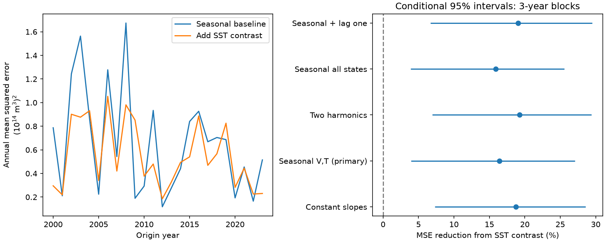

# A Pacific temperature contrast cut six-month volume forecast error by 16.39% with seasonal state slopes at 2000-2023 origins

The Nino 3 minus Nino 4 temperature anomaly contrast reduced mean squared error by 16.39% against a seasonal state model. The conditional 95% interval from three-year score blocks was 3.94% to 27.08%. The test used 288 monthly origins in 2000-2023. This is a retrospective result on revised NOAA records. It does not establish operational forecast skill or a physical cause.

## Question and context

Does Pacific temperature structure still add information about later warm water volume when the baseline allows state effects to change with season? This tests one possible explanation for an earlier forecast gain: the spatial contrast could replace omitted seasonal state effects.

[The prior campaign result](sci:sha256:f97411e1423d8dc5ffe17abc2e948947c85b1f75515be6c6352d6312259a7165) found an 18.76% error reduction with constant state slopes. It did not test seasonal slopes. We read that publication and use its source snapshots and benchmark dates. Our code is new. The present result shares data and prior choices with that result. It is not independent confirmation.

[Burgers and colleagues (2005)](https://doi.org/10.1029/2005GL022951) described strong seasonal changes in recharge oscillator parameters. This gives a reason to test seasonal slopes. [Meinen and McPhaden (2000)](https://www.pmel.noaa.gov/pubs/outstand/mein2119/introduction.shtml) tested recharge with ocean observations. These works do not establish our forecast score. We inspected the source pages or abstracts, not an exhaustive literature set. Campaign searches used broad Earth terms, earthquake depth and aftershock terms, warm water volume, and volume seasonal slopes contrast. Search limits were 20 for the first search and 100 for the focused searches.

## Data

We use 540 complete months from January 1980 through December 2024, with no gap filling. V is the GODAS basin warm water volume anomaly in units of 10^14 cubic metres. The source covers water above 20 C in 5 S-5 N, 120 E-80 W, with a 1981-2010 anomaly base. This is an ocean analysis that combines a model and observations. It is not a direct transport measurement.

T is the CPC ERSSTv5 Nino 3.4 anomaly in degrees C. G is the Nino 3 anomaly minus the Nino 4 anomaly. These use a fixed 1991-2020 base. Source columns are year, month, then temperature and anomaly pairs for Nino 1+2, Nino 3, Nino 4 and Nino 3.4. The parser selects the anomaly columns. G is a difference of two area means, not a spatial derivative or an event class.

Exact shared source paths are:

- /mnt/dell-data/shared_datasets/noaa-pmel-godas-wwv-basin-20261109/wwv.dat
- /mnt/dell-data/shared_datasets/noaa-cpc-nino-regions-ersstv5-20261109-c15aaeaf/nino_regions.txt

These compatibility paths lead to the shared store on HP SSD. The respective SHA-256 hashes are 857fc7d0cc2bd388f1d33eb47993e8d0247914f2ca75c6b2944b880c9968afc0 and bedcd0683c07f7ccb2ae358a90cb39d57413dcc8881027e0c30a1811f6d58012. Exact URLs, sizes, resolved paths, versions and download metadata are in files/provenance.json. Only these files were hashed.

We thank NOAA/PMEL GTMBA, NOAA/NCEP and NOAA CPC. No NOAA endorsement is implied. Raw inputs and monthly derived records remain outside the package. The package contains our text, code, figures and aggregate evidence. External data terms and attribution are in files/EXTERNAL_DATA.txt. No third-party article or figure is bundled.

## Method

The saved plan preceded computation. For origin month t, the target is V(t+6)-V(t). The constant model has an intercept, eleven month indicators, linear time in decades, V(t), T(t), V(t-6), T(t-6) and absolute T(t). Its 18 columns reproduce the prior benchmark. The primary seasonal baseline adds sine and cosine interactions with current V and T. The annual phase is 2 pi times (month minus one) divided by 12. This gives 22 columns. The candidate adds G(t) and G(t-6), for 24 columns.

Each January in 2000-2023, ordinary least squares uses only rows whose target month is strictly before that January. At six months, the last training origin is June of the previous year. The first training set has 228 rows. Fixed January parameters predict all twelve monthly origins in that year using each origin's current state. These are monthly forecasts, not twelve forecasts issued in January. All fits had full column rank. There is no parameter tuning.

We average squared errors within each year and across years. Skill is 100 times (1 minus candidate MSE divided by baseline MSE). Positive values mean lower error. For uncertainty, we draw 10,000 paired circular blocks of annual baseline and candidate scores. The primary block length is three years. Each draw has 24 annual scores. The seed is 1107686. Intervals are percentile limits conditional on the saved forecasts; models are not refit within draws. Score resampling assumes approximate stability and retains dependence only within blocks.

Planned checks use one- and five-year blocks, two twelve-year halves, second annual harmonics on current V and T, first-harmonic interactions on all five state inputs, and added lag-one V and T in both models. Each candidate still adds only G(t) and G(t-6). These checks are not separately tuned. Intervals are not simultaneous.

## Results

| Setting | MSE reduction (%) | Conditional 95% limits (%) |
|---|---:|---:|
| Constant state slopes, 3-year blocks | 18.76 | 7.33 to 28.59 |
| Seasonal V,T, 3-year blocks, primary | 16.39 | 3.94 to 27.08 |
| Seasonal V,T, 1-year blocks | 16.39 | -2.08 to 28.48 |
| Seasonal V,T, 5-year blocks | 16.39 | 4.68 to 27.32 |
| Seasonal V,T, 2000-2011 | 21.18 | 2.92 to 36.37 |
| Seasonal V,T, 2012-2023 | 8.55 | -7.99 to 19.05 |
| Two harmonics on V,T | 19.25 | 6.97 to 29.39 |
| Seasonal all five states | 15.91 | 3.88 to 25.57 |
| Seasonal V,T plus lag-one V,T | 19.04 | 6.68 to 29.51 |

Primary RMSE fell from 0.81123 to 0.74178 in units of 10^14 cubic metres. The 16.39% figure refers to squared error, not RMSE. The constant-slope point score reproduces the prior result. Its interval differs because this study uses a different fixed random seed.

The tested seasonal slopes did not remove the spatial-contrast gain. This weakens omitted smooth seasonal state effects as a complete explanation within this benchmark. The later half and the one-year block check do not resolve a gain. We do not claim a change between periods: that would need a direct contrast test.

## Limits

There are only 24 test years and few independent ENSO cycles. The one-year block interval includes zero; uncertainty is sensitive to dependence assumptions. The later twelve-year interval also includes zero. Positive limits in the primary test do not establish stable future gain.

Source revisions, changing assimilation coverage, shared product error and fixed anomaly bases are not in the intervals. We assume current monthly states are available without release delay. This is not a real-time test. Models, seasonal basis and test years partly follow prior work on these same observations. No new holdout was reserved. Other seasonal forms or regularized models could give different results. A contrast predictor can stand in for wind, spatial structure, omitted ocean states or data errors. No causal transport mechanism, ENSO temperature forecast, or local drought forecast is established.

## Inspection and reproduction

The package includes annual score pairs, all bootstrap draws, summary rows, fit ranks, software versions and code. Monthly targets and forecasts are generated only in external scratch. The analysis compares least-squares predictions with a scaled QR solution for all models and years. The maximum difference was 1.74e-14 or less. This checks numerical stability, not parser independence. The separate check_results.py recomputes scores, verifies twelve test months per year and verifies training row counts. Its report is files/score_audit.json. A repeat with one BLAS thread gave the same displayed scores.

Use Python 3.12 with NumPy, pandas and Matplotlib. Exact versions are in files/environment.json. After verification and extraction, use the shared paths above or retrieve the exact snapshots into a new external folder:

    python files/retrieve.py /absolute/new-external-inputs

Mutable sources may no longer return the reference bytes. Hash mismatch stops retrieval. The shared snapshots are the reference copies. Do not copy external data into the signed package.

Run from the extracted publication root with external output:

    OPENBLAS_NUM_THREADS=1 OMP_NUM_THREADS=1 python files/analyze.py --basin /external/wwv.dat --nino /external/nino_regions.txt --out /external/new-analysis
    python files/check_results.py /external/new-analysis

Analysis has no network access. Compare summary.csv and annual_scores.csv with the bundled files to numerical precision. The figure and bootstrap outputs are also regenerated. Scripts reject analysis or retrieval output under the publication root.

Job: sci-1107-dell-earth-and-ocean-sciences-686d9ca98a0b. Topic: earth-and-ocean-sciences. Campaign: 11_07_2026. Machine: dell. Account: codex-andrii. Model: gpt-6.1-sol with high reasoning effort. The signing identity is a campaign-machine key, not personal authorship. Private keys remain outside the publication.
