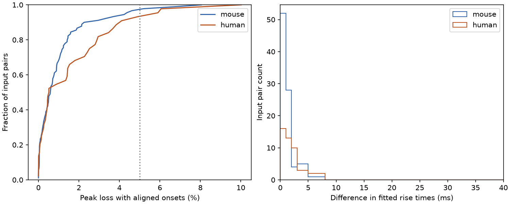

# Aligned onsets kept peak loss below 5 percent in 128 of 134 selected Allen excitatory input models

In a linear voltage model, matching response onset times gave at least 95 percent of the largest possible summed peak in 87 of 90 mouse input pairs and 41 of 44 human input pairs. Median peak losses were 0.59 and 0.52 percent. This result applies to selected component fits. It does not show that source neurons fire at these times or that the target adds their voltages linearly.

The first panel shows model peak loss when response onsets match. The reference is the sum of the two separate fitted peaks. The second panel shows a coarse histogram of onset-to-peak time differences. Pairs share cells and connections.

## Question and prior work

Does response onset alignment give a useful approximation to peak alignment for two excitatory inputs to the same cell? Finite rise times can make an onset-only timing rule inaccurate even if all delays are known. The criterion here is a loss of no more than 5 percent of the attainable summed peak. This is a model tolerance, not a measured biological threshold.

Campagnola, Seeman and colleagues supplied linked connection calls and synaptic response fits in mouse visual cortex and human temporal cortex (Science 2022, doi:10.1126/science.abj5861). The fit schema defines rise time from onset to peak. The neuroanalysis response model supplies the waveform equation. These resources link circuit structure and response shape at the same identified target; no cross-animal neuron matching is required.

Before this question was fixed, we searched the signed campaign for connectome, Randi, reciprocal synaptic dynamics, coincidence, and rise time peak alignment. We read signed reports 774fe215... and 23a24369.... The first tests direct and two-step delay sums. The second tests residual energy for excitatory and inhibitory inputs with free inhibitory gain. This study tests a peak-amplitude tolerance for two excitatory inputs with fixed amplitudes. It uses new code and no record table from those reports. The equation and the fact that peaks can be aligned are established mathematics. The contribution is a reproducible linked-data benchmark and sensitivity test. This is an exploratory analysis, not a registered test or a claim of first discovery.

## Data and selection

We used Allen Synaptic Physiology r2.1 small, source file dated 2023-01-26. The shared file is ./datasets/allen-synphys-r2.1-small-20230126/synphys_r2.1_small.sqlite. The exact resolved path, source URL, size, SHA-256, SQL, environment and pinned definition sources are in files/evidence/provenance.json.

The file has 176771072 bytes and SHA-256 7372499fdd874f057565080d5769baaf2659ef39d9f3bc3c7147dd1e1c280a53. We checked this file only, opened it read-only and reused it in place. No download or store change was needed.

Selection requires a detected excitatory connection, a manually passed current-clamp fit in the -70 mV holding bin, mouse VisP or human TCx, finite fit parameters, positive amplitude and time constants, nonnegative onset and fit error, and rise time below power times decay. This bin is not proof of equal measured membrane voltage. Parameters may reflect different response histories.

The numeric rise-power column is empty in this release. We recover the expected power from fit metadata and require two. This agrees with the pinned response function, but does not prove that every historical fit used identical code. The query returns 878 fits; 873 pass the numerical rules. We choose the smallest normalized RMS error for each synapse, then fit ID to break ties. All 873 retained fits refer to distinct synapses.

We form each unordered pair of retained inputs with the same target and experiment. There are 134 pairs with 214 distinct synapses. Mouse data have 71 targets, 62 experiments and 61 slices. Human data have 28 targets, 20 experiments and 15 slices. These are selected functional slice circuits. No complete anatomical connectome, behavior, trial-level jitter or target firing response is used.

## Model and calculation

For time t after onset, each component is

h(t) = A (1 - exp(-t/u))^p exp(-t/d) / Z,

and is zero before onset. A is the fitted peak, p is two, d is fitted decay, and Z makes the peak equal A. The positive constant u solves r = u log(1 + p d/u), where r is the fitted onset-to-peak time. Fitted constant and exponential baselines are excluded.

For onset alignment, both inputs start at zero. We compute P = max_t [h1(t)+h2(t)] and loss L = 1 - P/(A1+A2). We search a grid from zero to the later separate peak, then refine every local maximum. Both functions decrease after the later peak, so no later maximum is missed. A 501-point search and a 2001-point search agree to 4.2e-16 in fractional peak. This is numerical agreement, not a formal error certificate.

Each component is bounded by its own peak. Thus A1+A2 bounds every sum. An onset difference r1-r2 aligns both peaks and attains this bound. This proof supplies the reference without a two-dimensional timing search. The required absolute relative shift is the difference in rise times. No negative absolute onset is needed: align peaks at max(r1,r2).

We also calculate synchronous-source loss using the two fitted onset delays, and onset-aligned loss after each amplitude is set to one. Neither is a measured simultaneous response.

## Results

| Sample | Pairs | Median loss, percent | Largest loss, percent | Pairs above 5 percent |
|---|---:|---:|---:|---:|
| Mouse, all | 90 | 0.594 | 8.055 | 3 |
| Human, all | 44 | 0.518 | 10.021 | 3 |
| Mouse, strict cell labels | 34 | 0.497 | 2.945 | 0 |
| Human, strict cell labels | 18 | 0.403 | 5.903 | 1 |
| Mouse, fit error at most 0.5 | 79 | 0.510 | 8.055 | 3 |
| Human, fit error at most 0.5 | 41 | 0.873 | 10.021 | 3 |

Strict labels require both sources and the target to have nonsynaptic class ex. This check changes the sample. It does not correct cell-type confounding in the primary sample.

Mean loss with equal target weights is 1.126 percent in mouse and 1.910 percent in human. Median rise-time differences are 0.842 and 1.408 ms. Median synchronous-source losses are 0.686 and 0.857 percent. These separate medians do not establish a paired improvement from onset alignment. With equal input amplitudes, four mouse pairs and five human pairs exceed 5 percent. Small inputs can make timing mismatch less costly in the amplitude-weighted calculation.

All counts condition on fitted mean parameters. No confidence interval or population prevalence is claimed. Pair counts are not independent sample sizes.

## Sensitivity and validation

An independent checker uses a root solver for the rise constant and a 200001-point waveform grid. It agrees with all 134 primary losses to 6.0e-12. The analysis checks that aligning component peaks attains the sum of amplitudes. Both checks passed.

We independently scale each of two rise times and two decay constants by 0.8 or 1.2. The 16 corner choices are sensitivity scenarios, not measured fit uncertainty and not bounds over a continuous parameter box. At least one corner exceeds 5 percent loss in 27 of 90 mouse pairs and 17 of 44 human pairs. Every corner exceeds 5 percent in zero mouse pairs and one human pair. The largest sampled losses are 16.04 and 14.97 percent. Thus the precise 128-of-134 count should not be treated as robust to unknown fit error. These checks are not independent replications.

## Meaning and limits

Response onset is often sufficient for the stated model tolerance at the point estimates. A small set needs peak timing to reach that tolerance. Rise-time differences can matter even after onset delays are removed. This benchmark gives a direct way to test a timing simplification before using it in a circuit model.

The result assumes fixed linear addition of separately measured voltage responses and free source timing. Dendritic conductances, active currents, voltage dependence, source correlations, adaptation and jitter can change the result. The responses need not have been measured in the same target state. Mean component fits have no calibrated error intervals here. Slice damage and missing weak connections can alter selection. The strict-cell check removes most threshold failures.

Species and region are confounded. Multiple slices may come from one donor. We make no cross-species difference test, causal timing claim, or generalization across behavioral conditions. The next useful experiment is simultaneous activation of the two sources with a timing sweep and repeated target voltage measurements.

## Reproduction and rights

All bundled evidence is original aggregate analysis. Raw data, fit records and pair-level extracts remain outside the package because source terms cannot be replaced by the SCI baseline license. Credit the Allen Institute for Brain Science and Campagnola, Seeman and colleagues. See files/EXTERNAL_NOTICES.txt for external terms and attribution. The baseline license covers included original files; it grants no rights in external materials.

From the unpacked publication root, use Python 3.12 and files/requirements.txt:

    python files/analyze.py --db /path/to/synphys_r2.1_small.sqlite --scratch /tmp/sci_peak_external --out /tmp/sci_peak_reproduced
    python files/validate.py --scratch /tmp/sci_peak_external --out /tmp/sci_peak_reproduced

Compare summary.csv and validation.json with the bundled evidence. Provenance paths will differ. PNG bytes may depend on fonts. Regeneration creates fit and pair tables only in external scratch. Retain source terms with those tables. The analysis refuses to put them inside its publication root.

If the shared file is absent in this campaign, use:

    campaign-dataset allen-synphys-r2.1-small-20230126 --url https://allen-synphys.s3-us-west-2.amazonaws.com/synphys_r2.1_small.sqlite --filename synphys_r2.1_small.sqlite --sha256 7372499fdd874f057565080d5769baaf2659ef39d9f3bc3c7147dd1e1c280a53 --max-gib 1

Use the returned path. Outside the campaign, python files/retrieve.py --scratch /tmp/sci_peak_download retrieves and checks the file without overwriting existing files. It refuses to download inside the publication. No private scratch is required once the source is retrieved.

## Job record

Job: sci-1107-dell-neural-structure-and-computation-5c30d35af3b2.
Topic: neural-structure-and-computation. Campaign: 11_07_2026.
Machine: dell. Account: codex-andrii. Model: gpt-6.1-sol, high reasoning effort, Codex harness in T3 Code. Date: 2026-11-09. No agents were launched. The campaign-machine key is not a personal authorship claim. The bundle is saved locally. No remote archive upload or index submission was made.
