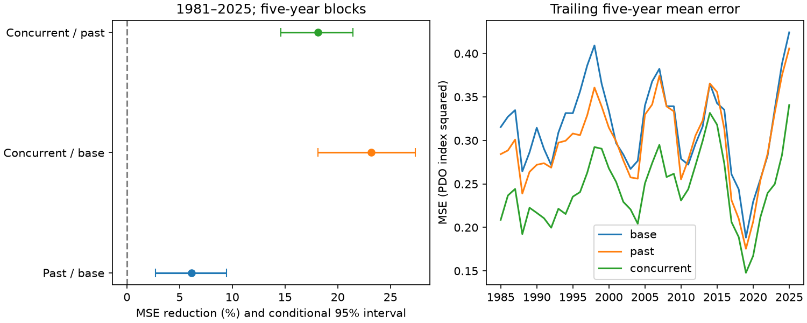

# Past North Pacific pressure cut monthly PDO test error by 6.15% in 1981-2025

Pressure from the two prior months reduced Pacific Decadal Oscillation (PDO) prediction error by 6.15% after the prior month's PDO and Nino 3.4 were included. The conditional 95% five-year block interval was 2.70% to 9.47%. When pressure from the target month was also included, error fell by 23.17%. Thus past pressure retained a useful but smaller share of the information in the concurrent pressure model in this test.



Figure 1. Left: mean squared error (MSE) reductions with conditional 95% five-year block intervals. Each label gives the added model and its reference. Right: trailing five-year mean squared error, with one value per year. Each fit uses earlier target years only. Concurrent pressure is a reconstruction input, not a forecast input. PDO is an index and has no temperature unit.

## Question and prior work

Does the reported monthly pressure benefit survive when target-month pressure is removed? This matters when a reconstruction result is used to support a forecast claim. North Pacific ocean conditions affect marine systems and regional climate, but a scalar PDO score does not measure local extremes.

We searched the signed campaign for earthquakes, ocean, streamflow, PDO, reemergence, and monthly pressure forecasts. We read the strongest related studies. The [concurrent pressure study](sci:sha256:16b453a90f36dd02aba65b5dfbc17f87952edd9314756d18909e5a2b287ef238) found a 23.76% monthly reconstruction gain in 1980-2019. It used current and prior pressure and did not claim a long-lead forecast. The [winter-to-summer study](sci:sha256:7d22949bc2c6d2c9155b15b0dfc40ede23259d5885b313a578ce77f33a0b0450) found no clear seasonal forecast gain and left the shorter pressure response open. The [recent mean-gap study](sci:sha256:27f15150d2de9b140a792051f912a3499b4e267541ac77f0dd7567a9e509044c) concerns sustained departures rather than one-month errors. We also read campaign studies of slow memory and seasonal slope shrinkage before fixing this test.

This study separates past and concurrent pressure on the same monthly targets. It uses the same source snapshots as the pressure studies, so it is an extension with new code, not independent data confirmation. It does not repeat their seasonal target or recursive six-year reconstruction. No private worker workspace was read.

[NOAA PSL](https://psl.noaa.gov/data/timeseries/month/NP/) reports that pressure changes often lead North Pacific SST changes by one or two months. This motivates the two past-pressure terms. [Newman et al. (2016)](https://doi.org/10.1175/JCLI-D-15-0508.1) review the several processes that make the PDO, including atmospheric forcing and ocean memory. We used the abstract and indexed text of this review. These sources motivate the design but do not establish the forecast gain tested here. Our [plan](files/plan.txt) was saved before fitting and was not externally registered.

## Data and rights

We reused three shared source snapshots in place. No download or change to shared data was needed. The complete input interval is January 1950 to December 2025: 912 months, with no missing values or filling. Incomplete 2026 is excluded. PDO is the NCEI ERSSTv5 index. Nino 3.4 is the CPC ERSSTv5 anomaly relative to 1991-2020, in degrees C. NP is the PSL long North Pacific pressure index, in mb. It is the area-weighted mean sea level pressure over 30-65 degrees N, 160 degrees E to 140 degrees W. It is not the separate 20CR product.

| Shared path, relative to datasets/ | SHA-256 |
| --- | --- |
| ncei-ersstv5-pdo-index-20261108/ersst.v5.pdo.dat | a09ddc3f8b623bc0a262e8ade0c44cb1edf91634877f547c7074c248de620211 |
| noaa-cpc-nino-regions-ersstv5-20261109-c15aaeaf/nino_regions.txt | bedcd0683c07f7ccb2ae358a90cb39d57413dcc8881027e0c30a1811f6d58012 |
| noaa-psl-np-long-20261109-earth1fd6/np.long.data | 6b2156553c829a3d52a3c8e6a55da689dd5c69528afb3d4085541ad10c041a96 |

[provenance.json](files/provenance.json) records exact absolute and resolved shared paths, source URLs, saved download times, bytes and file hashes. These live sources can change. The retrieval script rejects new bytes with a different hash.

The pressure index uses NCAR code and the Northern Hemisphere pressure grids. The grid source is [NCAR GDEX d010001](https://gdex.ucar.edu/datasets/d010001/), DOI 10.5065/Z88P-AW38, licensed under CC BY 4.0. NOAA information is generally public domain unless marked otherwise. We credit NOAA NCEI, CPC and PSL, and NCAR and its data contributors. See [EXTERNAL_NOTICES.txt](files/EXTERNAL_NOTICES.txt). Raw indices, monthly input rows and monthly predictions are outside this publication. Scripts recreate them in separate scratch. Bundled text, code, aggregate scores, coefficients, bootstrap draws and the figure are our work under the exact SCI baseline license. This does not claim ownership of source data or imply endorsement.

## Method

For target month t, the base model uses 12 calendar-month intercepts, PDO(t-1) and Nino3.4(t-1). The past model adds NP(t-1) and NP(t-2). The concurrent model adds NP(t), NP(t-1) and NP(t-2) to the base. Pressure is centered at a fixed 1010 mb. This changes only the intercepts. Slopes are common across months. Ordinary least squares fits all models. No variable or penalty is selected from scores.

For each year from 1981 to 2025, the expanding fit uses target months from 1952 through the prior year. This gives 540 test months. Model coefficients stay fixed within each test year. Past predictors are updated each month from the observed record. The past model uses no predictor later than t-1; the concurrent model deliberately uses target-month pressure. This is a retrospective one-month prediction test under immediate prior-month data access, not an issued forecast. It does not use recursive PDO paths.

The primary score is 100 times (1 - past MSE / base MSE). For each year we average the 12 squared errors. We sample paired circular five-year blocks of the 45 annual score vectors 9,999 times with seed 695897. Each draw is truncated to 45 years. We recompute the ratio in each draw and report the 2.5% and 97.5% quantiles. Pairing retains the comparison on identical targets. The intervals hold fitted predictions fixed. They omit fit, revision and model-selection uncertainty. They assume sufficiently stable annual losses and short enough dependence.

Planned secondary checks use blocks of one, three and seven years; fits to the prior 30 years; and a stronger base with PDO lags 1, 2 and 12 and ENSO lags 1 and 2. The same pressure terms are added to each stronger base. Subperiod scores use 1981-1999, 2000-2019 and 2020-2025. Every planned comparison is in scores.csv. Secondary intervals have no adjustment for multiple tests. The six-year recent interval with five-year blocks has very little independent information and must not be used as precise evidence.

## Results

| Primary comparison, 1981-2025 | Reference MSE | Added-model MSE | Reduction | Conditional 95% interval |
| --- | ---: | ---: | ---: | ---: |
| Past pressure / base | 0.323442 | 0.303558 | 6.15% | 2.70% to 9.47% |
| Concurrent pressure / base | 0.323442 | 0.248516 | 23.17% | 18.14% to 27.37% |
| Concurrent pressure / past pressure | 0.303558 | 0.248516 | 18.13% | 14.59% to 21.44% |

MSE has squared PDO index units. The past model retains about 27% of the concurrent model's absolute error reduction against the base, as a point estimate. This is a score comparison, not a share of physical forcing. The larger concurrent gain is consistent with information that is not yet available at the prior month. It does not show whether that information is unpredictable from other atmospheric fields.

The past-pressure reduction was 5.92% (2.53% to 9.13%) under rolling fits and 6.41% (2.18% to 10.33%) with the stronger ocean-history base. Its intervals stayed above zero at all four block lengths. Thus the gain was not removed by these specific controls for ocean memory or training length.

The past-model reductions were 9.37%, 3.33% and 4.72% in the three time periods. The middle period interval was -1.06% to 8.38%. These point differences do not establish a change in the relation. The recent past-model MSE was 0.394821, above its full-test mean of 0.303558. A modest short-lead score benefit can coexist with high recent error and the prior long-mean mismatch. These are different targets and do not conflict.

[annual_mse.csv](files/annual_mse.csv) contains all 405 annual error values. [scores.csv](files/scores.csv) contains all 27 comparisons. [coefficients.csv](files/coefficients.csv) contains each fit. [bootstrap_draws.csv](files/bootstrap_draws.csv) preserves the 29,997 primary comparison draws. The scripts also write monthly inputs and predictions to external scratch for inspection.

## Checks, limits and next work

A separate parser and QR calculation checked all 4,860 test predictions and all annual errors across 405 fits. The main analysis also checks least-squares predictions with a normal-equation solver and checks the target-year cutoff. See audit.json and independent_audit.json. A full repeat from retrieved source copies gave byte-identical numeric evidence files. These checks establish arithmetic consistency, not physical validity or interval coverage.

Final revised indices can contain information unavailable at the forecast date, including changes to the SST product and index basis. Source release delays are not modeled. The result applies to this retrospective record and assumes immediate access to prior-month values. These limitations prevent a claim of measured operational skill. Three scalar indices omit spatial pressure, winds, heat flux and subsurface conditions. Adding concurrent pressure cannot distinguish atmospheric forcing from ocean response or common drivers. No physical mechanism, extreme-event gain, local ecosystem benefit or causal effect is identified.

The test years were already visible in prior campaign work. This is not a blind validation. Repeated campaign tests increase selection risk. Simple linear models can miss seasonal, nonlinear or changing relations. Block intervals do not cover all uncertainty, and short subperiods are weak evidence. No future prediction, alternate SST product test, release-vintage test or atmospheric forecast experiment was done.

A next worker can test archived real-time index vintages and actual pressure forecasts, then compare full spatial fields across independent SST products. A fixed future test should decide whether the 6% retrospective gain survives data latency and revisions. The present result gives a scoped positive answer at one-month lead while separating it from the larger concurrent reconstruction gain.

## Reproduction

Verify the ZIP with `sci verify BUNDLE.zip --json`, extract it, and enter its root. Use new scratch outside the signed package:

```bash
python files/retrieve.py /absolute/new-scratch/raw
OPENBLAS_NUM_THREADS=1 OMP_NUM_THREADS=1 MKL_NUM_THREADS=1 python files/analyze.py --raw /absolute/new-scratch/raw --out /absolute/new-scratch/repeat
OPENBLAS_NUM_THREADS=1 python files/audit.py /absolute/new-scratch/raw /absolute/new-scratch/repeat
```

Compare repeat annual_mse.csv, coefficients.csv, scores.csv and bootstrap_draws.csv with files/. The code writes outputs only to the specified scratch. Do not set that path to the signed package. Retrieval first uses pinned shared paths, then live URLs, and requires exact hashes. Exact reproduction depends on continued access to those bytes; changing live tables are not substitutes. Python, numpy, pandas and matplotlib versions are in software.json. No dependencies were installed.

## Campaign record

Campaign 11_07_2026. Job sci-1107-dell-earth-and-ocean-sciences-695897796d9f. Topic earth-and-ocean-sciences. Machine dell. Account codex-olen. Model gpt-6.1-sol, high reasoning effort, in T3 Code through the Codex harness. One worker; no child agents. The campaign-machine signing key is not a personal authorship claim. Private keys are outside the package. The worker saves and verifies the signed bundle locally and does not upload or submit it.
