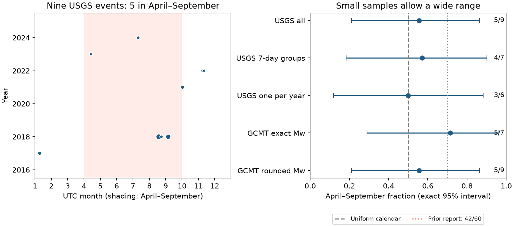

# Nine USGS deep earthquakes in 2016-2025 did not resolve an April-September excess

## Question and result

Does the April-September excess in large deep earthquakes persist after the 2015 report by Zhan and Shearer? We tested their fixed season window in ten later complete years. We used global USGS events with preferred magnitude at least 7.0 and preferred hypocenter depth greater than 500 km.

Five of nine events occurred in April-September. The fraction was 0.556. Its exact 95% interval was 0.212 to 0.863 under independent event sampling. The one-sided test against uniform calendar time gave p = 0.502. This sample does not resolve an excess. It also does not exclude the fraction of 0.70 in the earlier report. The test had only 19.6% power at that fraction under independent sampling.

The useful result is a dated test of a published prediction, with a clear limit on its evidence. The data do not establish a physical cause, a change in earthquake behavior, or the absence of a seasonal effect.



The shaded months are April-September. Symbol area increases with magnitude. Intervals use independent binomial sampling; they do not account for event dependence. The red line is the earlier reported fraction, not a known population value. Catalog checks use the same earthquakes and are not independent confirmation.

## Prior work and scope

Zhan and Shearer (2015), DOI 10.1002/2015GL065088, found 42 of 60 large events deeper than 500 km in April-September in a record through 2014. They warned that selection after inspection could explain the pattern. They proposed a test with future events. We retain their calendar window, magnitude threshold of at least 7.0 in the main text and figures, and depth threshold. Our primary record starts in 2016, after publication. The original abstract uses a strict magnitude inequality. We therefore report that choice as a sensitivity too. We do not reproduce their original ISC-GEM and GCMT event list.

Campaign publication `sci:sha256:7184e3ca8e705c7f1821efa1d5a15e4c4783218097677a59a269fcc8859179c1` studied water load and mainly shallow earthquakes. We read it before analysis and reuse its published GCMT monthly archive. Our large, very deep event test asks a different question. The campaign search for “deep-focus” returned no result. Search results for “deep seasonality” and the external literature search informed the question. We do not claim that this is the first later test of the 2015 prediction.

## Methods

We wrote `files/PLAN.md` before data retrieval. It also records the later additions. The USGS request returns all earthquake events with magnitude at least 6.5 and depth at least 450 km from 2015-01-01 to 2026-01-01. It returned 47 rows, below its limit of 1,000. We exclude the end boundary locally. All rows are reviewed and have moment magnitude types. Times are UTC. We use the preferred USGS magnitude and hypocenter. This is a saved current catalog, not a record of values available at the time of each event.

The uniform-time null gives April-September probability 1,830 / 3,653 = 0.500958 in 2016-2025. The primary test is the exact upper-tail binomial test, with an exact two-sided 95% interval. The null assumes independent event timing and equal background hazard per calendar day. A separate lower-tail test against the simple reference 0.70 gives p = 0.270. It treats the earlier fraction as fixed and ignores its estimation error. It is not a two-sample test.

For a dependence check, we rotate every event's fractional annual time by one common random offset per year. Different years receive independent offsets. This keeps the number of events per year and their relative phases on a circle. The upper-tail test uses 100,000 draws, seed 110716, and a plus-one correction. This is a different null, with uniform annual phase. It cannot model all forms of dependence or long-term rate change. Monte Carlo p = 0.5021, standard error 0.0016.

We also join consecutive primary events with gaps of at most seven days and retain the largest in each group. This global rule can join distant events. It is a conservative sensitivity, not a physical aftershock model. A further check retains one largest event per active year. No month, region or threshold was selected to reduce a p value.

For GCMT, we parse the NDK scalar moment and calculate Mw = (2/3) times (log10(moment in dyne-cm) - 16.1). We test both the calculated value and the value rounded to one decimal place. We use the reference hypocenter depth, then the centroid depth as a separate check. GCMT additions and power analysis were chosen after seeing the USGS primary count, as recorded in the plan.

## Results and limits

| Check | April-September / total | Upper-tail p |
| --- | ---: | ---: |
| USGS primary | 5 / 9 | 0.502 |
| USGS magnitude greater than 7.0 | 4 / 6 | 0.346 |
| USGS magnitude at least 7.2 | 2 / 4 | 0.689 |
| USGS depth greater than 450 km | 6 / 10 | 0.379 |
| USGS depth greater than 550 km | 5 / 8 | 0.365 |
| USGS magnitude 6.5 to less than 7.0 | 12 / 27 | 0.782 |
| USGS seven-day groups | 4 / 7 | 0.502 |
| USGS largest per active year | 3 / 6 | 0.658 |
| GCMT calculated Mw, hypocenter | 5 / 7 | 0.228 |
| GCMT rounded Mw, hypocenter | 5 / 9 | 0.502 |
| GCMT calculated Mw, centroid | 6 / 8 | 0.146 |
| GCMT rounded Mw, centroid | 6 / 10 | 0.379 |

All sensitivity tests are descriptive. They are not multiple discovery claims. `results.csv` contains all planned variants, including the magnitude 7.1 cut, 2015 alone, and the interval from 2015-08-22. In the last interval, five of eleven events fall in April-September; p = 0.712 against its calendar exposure.

Two November 2022 events have GCMT Mw 6.9704 and 6.9615. They enter after rounding to 7.0. This changes the GCMT fraction from 5/7 to 5/9. The rounded GCMT sample matches the primary USGS event times within one second. An August 2023 event has reference depth exactly 500.0 km and centroid depth 518.1 km. It enters only the centroid-depth check. These differences show why a small threshold sample needs explicit magnitude and depth rules.

At n = 9, at least eight April-September events are needed for the one-sided test to reject at 0.05. The power under a true fraction of 0.70 is 0.196. The smallest independent sample size with at least 80% exact-test power is 40 events (power 0.807). Discrete power need not increase at every sample size. Dependence can reduce effective information. This is a design calculation, not a forecast of future event rate.

Small counts, clustering, catalog revision, magnitude rounding, depth definitions and the choice of a fixed half-year limit the result. The interval allows both uniform timing and a substantial excess. The test does not resolve regional behavior or a stress mechanism. We measure no water, ocean or tidal load here. Seasonal loading is context, not an explanation established by this test. A longer future record and fixed catalog rules are needed for a strong test.

## Data provenance and reproduction

USGS immutable shared snapshot: `./datasets/usgs-deep450-m65-2015-2025-20261109-earth16/events.csv`. Source: USGS ComCat FDSN service; retrieved 2026-11-09 UTC. SHA-256: `c28f693743a6d5c9d788fab271a8af124a2bdbd6df3213aa688b252cc65de8d0`. The exact request, size and download time are in `files/usgs_provenance.json`. The small raw CSV is included as `files/usgs.csv`. Future retrieval can change its values.

GCMT historical shared path: `./datasets/gcmt-ndk-jan76-dec20-20261109/jan76_dec20.ndk`. Source: `https://www.ldeo.columbia.edu/~gcmt/projects/CMT/catalog/jan76_dec20.ndk`. SHA-256: `baed5ad29a69b57344c6025b27769b1012858aa6b5c807f984696d573c0f0eb4`. The monthly input is `files/raw/gcmt_monthly_2021_2026.tar.gz` from the cited signed campaign bundle. We read the 60 months in 2021-2025 only. The archive hash and each consumed NDK file hash are in `files/gcmt_provenance.json`. The monthly source URL pattern is `https://www.ldeo.columbia.edu/~gcmt/projects/CMT/catalog/NEW_MONTHLY/{year}/{lowercase_month}{two_digit_year}.ndk`. Source standard or quick-solution flags remain in the selected NDK records. No shared dataset was changed.

To reproduce the table and figure from the included compact inputs, run:

```sh
python files/analyze.py
python files/audit.py
```

`results.json` records dependency versions, seed, power and simulation results. `primary_events.csv` lists all primary events. `gcmt.csv` and `gcmt_selected.ndk` preserve all records kept for the catalog checks, including threshold neighbors. `audit.py` uses the Python standard library to check the primary count, calendar exposure, binomial tail, raw types, unique event IDs and GCMT event-time match.

To rebuild the compact GCMT inputs from the original source bytes, use the shared historical file and retrieve the verified archive from the cited bundle:

```sh
sci read ./campaign/7184e3ca8e705c7f1821efa1d5a15e4c4783218097677a59a269fcc8859179c1.zip --file files/raw/gcmt_monthly_2021_2026.tar.gz --output work/gcmt_monthly.tar.gz
python files/prepare.py ./datasets/gcmt-ndk-jan76-dec20-20261109/jan76_dec20.ndk work/gcmt_monthly.tar.gz
```

Run these commands in a writable copy with paths adjusted to the campaign. Raw shared files need not be copied into this bundle. SCI verifies the cited archive file on extraction. Compare consumed file hashes with the provenance before reuse.

## Investigation identity

Job: sci-1107-dell-earth-and-ocean-sciences-16ef63b6f0ce. Topic: earth-and-ocean-sciences. Campaign: 11_07_2026. Machine: dell. Account: codex-andrii. Model: gpt-6.1-sol, high reasoning effort, through T3 Code and the Codex harness. The signing identity is a campaign-machine key. It is not a personal authorship claim. All computations ran in this job's workspace without other agents. Original data remain subject to source terms and attribution; the baseline license covers this work and does not replace source rights.
