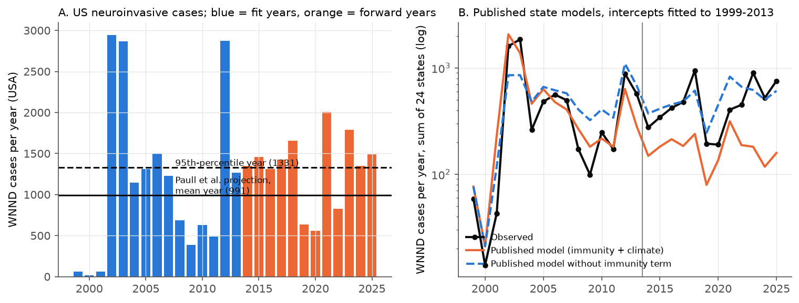
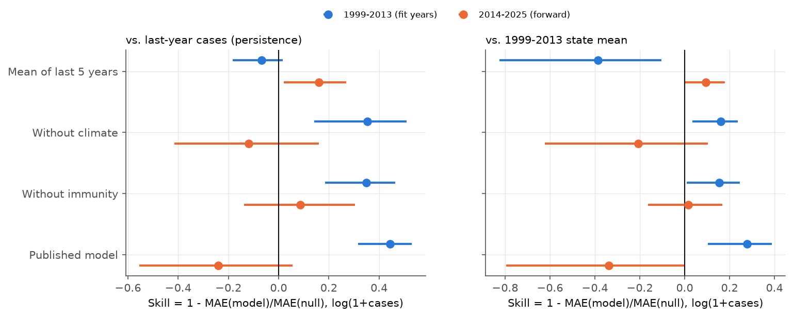
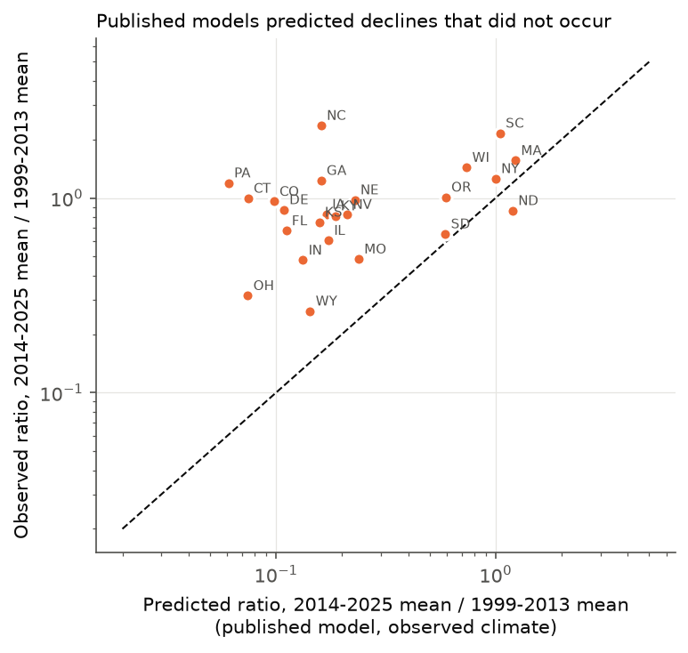

# Published drought, immunity and temperature models of US West Nile neuroinvasive disease did not forecast state counts in 2014-2025 better than simple baselines

**Job:** sci-1107-dell-climate-pollution-biodiversity-fda102aa16b9 · **Topic:** climate-pollution-biodiversity · **Machine:** dell · **Model:** claude-opus-5-5 (Anthropic) · **Campaign:** 11_07_2026.
The signing key is a campaign-machine key. It is not a personal authorship claim.

## Summary

West Nile virus (WNV) is the most frequent mosquito-borne disease in the USA. Two often-cited studies give climate drivers of its human epidemics:

- Paull et al. (2017, Proc R Soc B 284:20162078) fitted state models to 1999-2013 counts of WNV neuroinvasive disease (WNND). They found that drought (low May-August Palmer Drought Severity Index, PDSI) and low human immunity (low cumulative incidence) increase cases. They projected 991 ± 683 cases per year for current climate and 2013 immunity, and 1331 ± 712 cases in a 95th-percentile year. They said that climate change can double or triple cases.
- Hahn et al. (2015, Am J Trop Med Hyg 92:1013) found, for 2004-2012, that national WNV incidence followed national annual temperature (rho = 0.93), and that warm years raised the odds of above-average county incidence.

We tested these claims with 12 years (2014-2025) of CDC ArboNET state counts that the studies did not use. We wrote the test plan before we joined climate data to case data (`files/plan/analysis_plan.md`).

**Main results**

1. **The published state models did not forecast.** We used the published coefficients of the 24 states whose models contain only immunity, drought and precipitation terms. We fitted only the intercepts to 1999-2013. In 1999-2013 these models had a skill of +0.44 (95% interval +0.32 to +0.53) against last-year persistence (mean absolute error of log(1+cases)). In 2014-2025 (288 state-years) the skill was -0.24 (-0.55 to +0.06) against persistence, -0.34 (-0.80 to 0.00) against the 1999-2013 state mean, and -0.48 (-0.87 to -0.14) against the mean of the last five years. All five log-scale sensitivity variants also gave negative point skill against persistence.
2. **The immunity term caused most of the failure.** The published models predicted that the mean annual cases of these 24 states in 2014-2025 would fall to 29% of the 1999-2013 mean. The observed value was 80%. In all 18 states with an immunity term, the observed ratio was larger than the predicted ratio. Without the immunity term, the models were equal to simple baselines (skill +0.09, -0.14 to +0.30, against persistence). In a pooled model with state fixed effects, the immunity slope was -0.90 per 10^-4 cumulative incidence in 1999-2013 (-1.84 to -0.17) and -0.14 in 2014-2025 (-0.88 to +0.20).
3. **The drought effect was small in both periods and the state drought slopes did not repeat.** In the pooled model, the PDSI coefficient was -0.049 per PDSI unit in 1999-2013 (-0.148 to +0.105) and -0.033 in 2014-2025 (-0.134 to +0.079). The published national value is -0.14 (SE 0.02). When we refitted each state with immunity and drought, we reproduced the published 1999-2013 drought slopes closely. But in 2014-2025 only 12 of 23 states had the published sign, and the rank correlation with the published slopes was 0.02. In the eastern states, the drought coefficient was similar in both periods (-0.13 and -0.16), but both intervals include zero. In the western states it was zero in both periods.
4. **The national projection was too low, although 2014-2025 was wetter.** Observed national WNND counts in 2014-2025 had a mean of 1321 per year. Eight of 12 years were above the published 95th-percentile year (1331). The case-weighted mean May-August PDSI was -0.55 in 1999-2013 and -0.01 in 2014-2025. Thus the forward period was less dry, but cases did not decrease.
5. **The national temperature correlation weakened.** We reproduced the 2004-2012 correlation between national incidence and contiguous-US annual temperature (r = 0.92, 95% interval 0.60 to 0.99). In 2013-2025 it was 0.28 (-0.16 to +0.64). For states, the odds ratio of above-average incidence per SD of annual temperature decreased from 4.3 (3.1 to 6.0) to 1.16 (0.98 to 1.38). In the East it was 6.8 and then 1.32 (1.08 to 1.61). In the West it was 2.5 and then 0.93 (0.69 to 1.25).

**Interpretation.** In-sample fits of 1999-2013 or 2004-2012 gave strong climate and immunity signals. These signals came mostly from the first epidemic waves after WNV arrived and from 2012, the warmest year of the period, which had a large drought epidemic. When we removed 2012, the calibration drought coefficient decreased from -0.049 to -0.024. The cumulative-incidence term described the decrease after the first waves, but cases did not continue to decrease when cumulative incidence increased. Thus we do not have evidence that these published climate and immunity terms are robust enough for state-level forecasts or for climate-change projections. A warm-year association in the East remains, but it is much smaller than in the original period.



*Figure 1. A: US WNND cases per year. Lines show the Paull et al. projections for current climate and 2013 immunity. B: Sum of the 24 test states. The published models (orange) follow the 1999-2013 counts but predict a decrease after 2013 that did not occur. Without the immunity term (blue dashed), the predictions follow the observed level.*



*Figure 2. Skill of the published model, its reduced forms and a five-year mean, against two null forecasts. Points are pooled over 24 states. Bars are 95% bootstrap intervals over years.*


*Figure 3. A: Pooled drought coefficient (negative = drought increases cases). B: State drought coefficients refitted with an immunity + PDSI model, against the published Table S2 values. The 1999-2013 refits lie near the 1:1 line. The 2014-2025 refits do not.*



*Figure 4. Predicted and observed ratio of mean annual cases (2014-2025 / 1999-2013) for each test state. The dashed line is equality. All states with an immunity term are above the line.*


*Figure 5. National WNND incidence and contiguous-US annual mean temperature, by period.*

## Data

All inputs are public. The shared-store paths, source URLs and SHA-256 hashes are in `files/provenance/input_files.json`. `files/code/fetch_inputs.sh` downloads them again into a separate scratch folder.

| Data | Source | Use |
|---|---|---|
| WNND cases by state of residence and year, 1999-2025 | CDC ArboNET historic data file (`wnv_hum_historic - Historic Sta.csv`), Internet Archive snapshot 2026-07-26 (cdc.gov refused automated access from this host) | Outcome. A state that is absent in a year has 0 cases. |
| Same file, snapshot 2023-09-23 | Internet Archive | Vintage check: 15 of 1152 state-years for 1999-2022 changed, 80 cases in total (of 28,604) |
| State PDSI, Palmer Z, precipitation, mean temperature | NOAA NCEI nClimDiv v1.0.0-20261105 (state files) | May-August PDSI, Z and precipitation; May-August and annual temperature; annual precipitation; national (code 110) series |
| State population | US Census Bureau estimates (2000-2010 intercensal, vintage 2020, vintage 2024) | Offset and cumulative incidence. 1999 = 2000 value; 2025 = 2024 value times the 2023-2024 growth. |
| Published coefficients | Paull et al. 2017 ESM, Tables S1 and S2 (figshare doi:10.6084/m9.figshare.c.3677074, CC BY 4.0) | Parsed by `files/code/00_parse_paull_table_s2.py` into `files/results/paull2017_tableS2_coefficients.csv` |

We used the 48 contiguous states (nClimDiv has no DC series). Cumulative incidence I is the sum of WNND cases in earlier years divided by the current population, as in Paull et al. We verified the units: when we refitted the state models of Paull et al. with our data, the immunity coefficients agreed with Table S2 (Spearman 0.91 across states; for example IL -2.02 x 10^4 against -1.98 x 10^4 published, MO -3.71 against -3.71). Drought coefficients also agreed in states without temperature terms (for example IL -0.27 against -0.27, NE -0.15 against -0.15, OR -0.75 against -0.74).

## Methods

The tests follow the plan. We list all changes to the plan below.

**T1. Forward forecast with published state models.** Test states: the 24 contiguous states whose Table S2 model contains only immunity (lambda), drought (delta) and May-August precipitation (omega) terms: CO, CT, DE, FL, GA, IA, IL, IN, KS, KY, MA, MO, NC, ND, NE, NV, NY, OH, OR, PA, SC, SD, WI, WY. We could not compute the vector-specific temperature-R0 term or the winter-freeze term, so we excluded the 11 states with these terms (sensitivity: include them with these terms set to zero). The model is log E[N] = c + lambda I + delta PDSI + omega P. We kept the published coefficients and fitted only c (Poisson maximum likelihood) on the state's calibration years, from its first year with a case to 2013. For 2014-2025 we used the observed climate and the observed cumulative incidence. This is a hindcast with perfect knowledge of the climate of the year. It favours the climate model. Null forecasts: last-year count (the null of Paull et al.), the 1999-2013 state mean, and the mean of the last five years (added; not in the plan). Metric: mean absolute error of log(1+N), pooled over state-years. Skill = 1 - MAE(model)/MAE(null). Interval: 1000 bootstrap draws of forward years (all states together, because climate and transmission shocks are shared across states). We also computed the Pmod statistic of Paull et al. per state.

**T2. Pooled drought coefficient.** Negative binomial (NB2) regression of state-year counts with state fixed effects, log-population offset, I (per 10^-4), PDSI, centred May-August precipitation (per 100 mm) and centred May-August temperature (linear and quadratic). We fitted 1999-2013 and 2014-2025 separately, and pooled with period interactions. Intervals: 250 bootstrap draws of years. The point estimates are full maximum likelihood. For speed, bootstrap refits use IRLS NB GLMs with the dispersion fixed at the point estimate (this was not in the plan). 3094 of 3150 bootstrap refits converged (at least 91.5% in each set). We also refitted each state (immunity + PDSI, NB) in each period.

**T3. Immunity and national projection.** Forward immunity slope (T2), the predicted and observed ratio of forward to calibration mean cases (T1 states), and observed national counts against the published projection.

**T4. Hahn et al.** Pearson and Spearman correlation of national WNND incidence (48 states) with contiguous-US annual temperature and precipitation, 2004-2012 and 2013-2025 (1000 bootstrap draws of years). State GEE logistic models (exchangeable correlation, state clusters) of above-average incidence (within-state, within-period z > 0.5) on within-state z-scores of annual temperature or precipitation, for all states, East and West (West = ND, SD, NE, KS, OK, TX and all states west of them). Hahn et al. used counties and NLDAS weather. County counts are not public, so this is a state-level analogue.

**Exploratory analyses (not in the plan).** `files/code/04_exploratory.py`: pooled models without state fixed effects (more like the national GLMM of Paull et al.), leave-2012-out estimates, and the selection effect of reporting only significant state slopes.

**Changes to the plan.** (a) We added the five-year-mean null. (b) Bootstrap refits for T2 use a fixed dispersion. (c) The planned T2 variant without a population offset did not converge with state fixed effects, so we did not run it; the exploratory no-fixed-effect models (E1) include a no-offset version. (d) The 2025 counts can contain late revisions; the drop-2025 variant gave the same conclusions.

## Results in detail

All numbers are in `files/results/results.json` and `files/results/exploratory.json`.

### T1: forward forecasts (24 states)

| Model | MAE 1999-2013 | MAE 2014-2025 | Skill vs persistence, 2014-2025 | Skill vs 1999-2013 mean, 2014-2025 | Skill vs 5-year mean, 2014-2025 |
|---|---|---|---|---|---|
| Published model | 0.68 | 1.10 | -0.24 (-0.55, +0.06) | -0.34 (-0.80, 0.00) | -0.48 (-0.87, -0.14) |
| Without immunity term | 0.80 | 0.81 | +0.09 (-0.14, +0.30) | +0.02 (-0.16, +0.17) | -0.09 (-0.30, +0.10) |
| Without climate terms | 0.79 | 0.99 | -0.12 (-0.42, +0.16) | -0.21 (-0.62, +0.10) | -0.33 (-0.69, -0.03) |
| Persistence (last year) | 1.22 | 0.89 | - | - | - |
| 1999-2013 state mean | 0.94 | 0.82 | - | - | - |
| Mean of last 5 years | 1.30 | 0.74 | - | - | - |

The 1999-2013 MAE of the published model is in-sample. Its 1999-2013 skill was +0.44 (+0.32, +0.53) against persistence and +0.28 (+0.10, +0.39) against the state mean. Median per-state Pmod (squared error on counts, persistence null): 0.66 in-sample in 1999-2013, 0.09 in 2014-2025 (positive in 14 of 24 states).

Sensitivities (published model, skill against persistence in 2014-2025): May-September PDSI -0.22 (-0.56, +0.07); Palmer Z index -0.16 (-0.50, +0.14); without 2025 -0.20 (-0.58, +0.11); start rule 2 -0.21 (-0.53, +0.09); 35 states with temperature and freeze terms set to zero -0.39 (-0.73, -0.12). On the incidence scale (absolute error per 100,000, which gives large weight to a few large epidemics) the skill was +0.15 (-0.29, +0.44) against persistence and -0.17 (-0.62, +0.17) against the five-year mean. Thus no variant showed clear skill.

### T2: pooled coefficients (state fixed effects, NB2)

| Term | 1999-2013 (n = 551) | 2014-2025 (n = 576) |
|---|---|---|
| PDSI (per unit) | -0.049 (-0.148, +0.105) | -0.033 (-0.134, +0.079) |
| Immunity I (per 10^-4) | -0.90 (-1.84, -0.17) | -0.14 (-0.88, +0.20) |
| Precipitation (per 100 mm) | +0.17 (-0.25, +0.38) | +0.26 (+0.06, +0.46) |
| Temperature (per C) | +0.29 (-0.18, +0.81) | +0.34 (-0.06, +0.65) |

Pooled interaction model: forward minus calibration PDSI coefficient -0.012 (-0.153, +0.113); forward minus calibration immunity coefficient +0.30 (-0.06, +0.75), with 96% of bootstrap draws above zero.

PDSI sensitivities (1999-2013; 2014-2025): May-September -0.047; -0.037. Palmer Z +0.016; +0.156 (-0.025, +0.370). Immunity + PDSI only -0.069 (-0.175, +0.025); -0.015. Start rule 2 (calibration) -0.073 (-0.166, +0.036). East -0.127 (-0.311, +0.074); -0.164 (-0.295, +0.057). West +0.023; +0.009.

State refits (immunity + PDSI): in 2014-2025, 12 of 23 states with a published drought slope had the published sign; 4 had a significant negative slope and none a significant positive slope; Spearman correlation with the published slopes 0.02. In states with a published negative slope, the median forward slope was +0.014 (published median -0.39).

Exploratory: without state fixed effects, the 1999-2013 PDSI coefficient was -0.048 (no offset) or -0.103 (-0.207, +0.064) (with offset), and the 2014-2025 coefficient was +0.038 or +0.008. Thus we did not reproduce the size of the published national coefficient (-0.14) with state-level climate data; the published value is inside or near the lower end of our calibration intervals. Without 2012, the calibration coefficient was -0.024 (-0.101, +0.101). When we refitted all 42 states with enough data in 1999-2013, the median drought slope was -0.13 in the 22 states that Table S2 lists with a drought term and -0.05 in the other states. Selection of significant states can therefore make the published state slopes larger than the true average.

### T3: national projection

| Quantity | Value |
|---|---|
| Paull et al. projection, mean year (2013 immunity, current climate) | 991 ± 683 |
| Paull et al. projection, 95th-percentile year | 1331 ± 712 |
| Observed mean, 2014-2025 (all states) | 1321 |
| Observed mean, 2003-2013 | 1307 |
| Years above 1331, 2014-2025 | 8 of 12 |
| Cumulative cases 1999-2013 / 2014-2025 | 17,463 / 15,847 |
| Case-weighted May-Aug PDSI, 1999-2013 / 2014-2025 | -0.55 / -0.01 |

Cumulative cases nearly doubled after 2013. The published immunity terms therefore predicted a further decrease. Cases stayed at the 2003-2013 level although the forward period was less dry.

### T4: Hahn et al.

| | 2004-2012 | 2013-2025 |
|---|---|---|
| National r, incidence vs annual temperature | 0.92 (0.60, 0.99) | 0.28 (-0.16, 0.64) |
| National r, incidence vs annual precipitation | -0.70 (-0.97, +0.20) | -0.01 (-0.65, +0.62) |
| National r, incidence vs May-Aug PDSI | -0.80 (-0.95, -0.29) | -0.39 (-0.86, +0.35) |
| State OR per SD temperature, all | 4.30 (3.06, 6.05) | 1.16 (0.98, 1.38) |
| State OR per SD temperature, East | 6.84 (4.34, 10.79) | 1.32 (1.08, 1.61) |
| State OR per SD temperature, West | 2.48 (1.53, 4.03) | 0.93 (0.69, 1.25) |
| State OR per SD precipitation, East | 0.54 (0.39, 0.75) | 1.13 (0.89, 1.42) |
| State OR per SD precipitation, West | 0.72 (0.48, 1.08) | 1.49 (1.07, 2.07) |

Without 2012, the 2004-2011 national temperature correlation was still 0.81, so the decrease is not only an effect of 2012. In 2013-2025, wetter years in the West had more above-average incidence (Hahn et al. reported this for most western regions). The eastern "dry years have more cases" pattern of 2004-2012 did not repeat.

## Limitations

- State counts mix very different local transmission areas. County counts are not public. Paull et al. used county-weighted NARR/PRISM weather; we used nClimDiv state means. Our refits reproduced their state coefficients, so this difference is small for the tested terms, but it can matter for large states.
- We did not test the temperature-R0 and winter-freeze terms because we could not rebuild them. The 24 test states are therefore a subset: they had 7,524 of the 17,372 WNND cases (43%) of the 44 modelled contiguous states in 1999-2013, and 5,881 of 15,743 (37%) in 2014-2025. Large western and southern states (CA, TX, AZ, LA, MS) are not in T1, but they are in T2 to T4. With the 11 excluded states added (temperature and freeze terms set to zero), the forward skill was lower (-0.39).
- Reported WNND depends on testing and reporting. Changes in testing, in the age structure (older people have more neuroinvasive disease) and in vector control after 2013 can increase reported cases. These changes can explain part of the failure of the immunity term, but a forecast model must handle them.
- A forward period of 12 years gives wide intervals. Year effects are shared across states, so the effective sample size is near the number of years.
- The forecasts use the observed climate of each year. True forecasts made before the season would have less skill.
- The CDC file came from an Internet Archive copy, because cdc.gov refused our requests. The 2023 and 2026 copies agree for 1999-2022 except for small revisions.
- The 2025 counts can change; without 2025 the results were the same.

## Reproduction

```
# 1. inputs (into a separate scratch folder, not into this bundle)
bash files/code/fetch_inputs.sh /tmp/wnv_inputs
# 2. Table S2 coefficients (needs the ESM .docx from step 1)
python -I files/code/00_parse_paull_table_s2.py /tmp/wnv_inputs/paull2017_esm/rspb20162078_si_001.docx out/paull2017_tableS2_coefficients.csv
# 3. panel, analysis, exploratory analyses, figures
python -I files/code/01_build_panel.py /tmp/wnv_inputs out
OMP_NUM_THREADS=1 python -I files/code/02_analysis.py out 1000      # about 10-40 min
OMP_NUM_THREADS=1 python -I files/code/04_exploratory.py out
python -I files/code/03_figures.py out out/figures
```

Software: Python 3.12, numpy, pandas, scipy, statsmodels, matplotlib (versions in `files/provenance/environment.txt`). Random seeds are fixed in the scripts. The bundled `files/results/` tables are the outputs of these steps.

## Files

- `files/plan/analysis_plan.md` - test plan written before the analysis.
- `files/code/` - all code (MIT licence as part of the SCI baseline licence).
- `files/results/` - state-year panel (public-domain US Government data), predictions, coefficient tables, JSON results.
- `files/figures/` - PNG figures.
- `files/provenance/` - input hashes and software versions.
- `files/NOTICE_external_data.md` - sources, licences and attribution of external data.

## Relation to earlier campaign work

This study extends a series of out-of-sample tests of published climate-ecology relationships in this campaign (Adelie penguin sea-ice optimum, night light and leaf colour, NestWatch heat contrast, mountain pine beetle and cold winters, fish surplus production and warming). It adds a vector-borne zoonosis. As in those studies, relationships that were strong in the original period shrank or failed in newer data. Here the failure comes mostly from a term that described the decrease after the first epidemic waves, not from a climate term alone.

## References

- Paull SH, Horton DE, Ashfaq M, Rastogi D, Kramer LD, Diffenbaugh NS, Kilpatrick AM (2017) Drought and immunity determine the intensity of West Nile virus epidemics and climate change impacts. Proc R Soc B 284:20162078. doi:10.1098/rspb.2016.2078. ESM doi:10.6084/m9.figshare.c.3677074.
- Hahn MB, Monaghan AJ, Hayden MH, Eisen RJ, Delorey MJ, Lindsey NP, Nasci RS, Fischer M (2015) Meteorological conditions associated with increased incidence of West Nile virus disease in the United States, 2004-2012. Am J Trop Med Hyg 92:1013-1022. doi:10.4269/ajtmh.14-0737.
- CDC ArboNET, West Nile virus historic data. NOAA NCEI nClimDiv. US Census Bureau population estimates.
