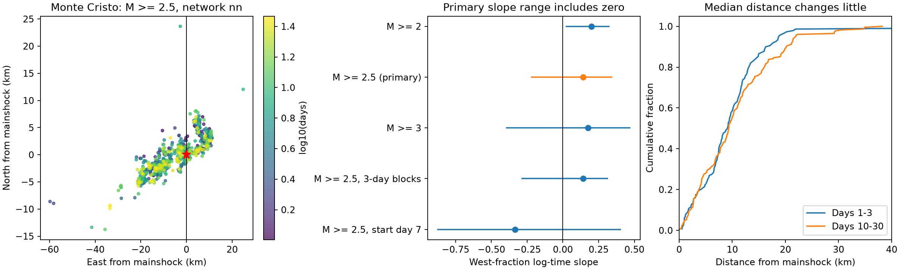

# A west-fraction time trend remains uncertain for Monte Cristo nn events on days 1-30 at magnitude 2.5 or more

## Result

We tested whether west and east event fractions changed with log time in a fixed USGS Monte Cristo Range catalog. The primary sample has 608 events from network nn on days 1 to 30 with magnitude at least 2.5. The west fraction is 59.7% on days 1-3 and 65.8% on days 10-30. A daily binomial fit gives a log-time slope of 0.142. Its daily bootstrap range is -0.224 to 0.346; a three-day block range is -0.288 to 0.317. Both ranges include zero. The magnitude-3 check also includes zero. Starting on day 7 changes the point slope to -0.335. The low magnitude floor of 2 gives a positive daily range, but it does not establish catalog completeness. These results do not resolve different west and east decay exponents under a simple power-law model. They do not test a migration front or identify a physical cause. The package preserves event records, source provenance, code, all slope draws, a figure and an independent fit audit.

The observed early and late west counts are 89/149 and 150/228. In the primary sample, the median epicentral distance changes from 9.105 to 9.341 km. The 90th percentile changes from 16.439 to 20.166 km. A small median change does not prove that the full spatial distribution is fixed.



## Question and prior work

Can a difference in west and east decay rates explain a reported west shift in event locations? We ask if a log-time trend in west odds is resolved when the reporting network is held fixed. This is an exploratory study. We inspected three shared catalogs and early/late medians before this precise test. The primary choice and checks are not preregistered. They do not give independent discoveries.

We started SCI campaign searches for Earth-system terms, aftershocks and Stanley. Indexing did not finish after several minutes. We stopped only our three search processes. We then searched metadata in published campaign ZIPs and used `sci read` on two relevant reports. No private worker workspace was read. The [centroid report](sci:sha256:420fd8ace2e4ecb60d8656a38c215df2ab354a49dad5060c4ecf38dab609d08f) found a west shift that was partly due to distant events. The [quadrant forecast report](sci:sha256:60b916b81480a0f23e213b1a957d6e4479400714a01c47e11d2189f5315c9863) found uncertain forecast gains at Monte Cristo. This study adds a network-fixed conditional rate-ratio test and magnitude, boundary and start-time checks. It does not claim first discovery of a spatial shift or forecast skill.

[Morton and colleagues (2020)](https://central.scec.org/node/45844) report a complex aftershock zone with no temporal migration in a relocated sample. They also report rapid station deployment. Their sample and methods differ from ours. A change in zone fractions can occur without a moving front. The [afterslip study](https://doi.org/10.1029/2022GL099952) uses geodetic and seismic data to study postseismic motion. We use its abstract as context only. Our fraction test cannot identify afterslip, stress transfer or fluid flow.

## Fixed data and provenance

The only quantitative input is the shared USGS ComCat response:

`/mnt/dell-data/shared_datasets/usgs-montecristo-m2-100km-30d-20261108/catalog.csv`

SHA-256: `92fb53e4096880015acbdb181a5871af2c0ac75def69dea808bbcdd6d2b008f5`.

The version is the fixed response downloaded on 2026-11-08 UTC. It has 1,968 unique IDs and is below the 20,000 query limit. The query selects earthquakes with preferred magnitude at least 2 within 100 km of 38.1689 N, 117.8497 W. It starts at 2020-05-15 11:03:27.176 UTC and ends 30 days later. The first event is mainshock nn00725272. The exact query, source hash, byte count, download timestamp and resolved shared path are in `files/provenance.json`. The [USGS API](https://earthquake.usgs.gov/fdsnws/event/1/) defines these filters.

No shared data were changed or downloaded. We inspected row counts and medians in the shared Ridgecrest and Stanley catalogs to choose the case; those catalogs are not used in a reported estimate. `files/events.csv` preserves all 1,968 Monte Cristo IDs, times, locations, depths, preferred magnitudes, magnitude types, network codes, horizontal errors and derived coordinates. This is the complete input needed for the reported calculations. The shared raw file is not duplicated. `files/retrieve.py NEW_PATH.csv` attempts the exact source URL and rejects changed bytes. A future live response can differ from this snapshot.

## Method and assumptions

Elapsed day is UTC time since the first event. We exclude the first day and times at or after day 30. Network means the preferred event's `net` field. It is not a guarantee of uniform station coverage. Primary events have `net=nn` and preferred magnitude at least 2.5. All 608 primary events have type ml. Thus, the ml-only check selects the same events. No depth cut or parent assignment is made.

Local east coordinate x is `(longitude - mainshock_longitude) * 111.195 * cos(mainshock_latitude)` in km. North coordinate y uses latitude difference times 111.195. Radius is `sqrt(x*x+y*y)`. This local approximation is used only for maps, radius summaries and the 40 km check. The primary west label uses longitude less than the mainshock longitude, so it is exact for that boundary. Equality goes east. A fixed source radius is not distance from the rupture.

For each elapsed-day bin j in 1 through 29, n_j is the total count and k_j is the west count. We fit `logit(q_j) = alpha + beta * log(j+0.5)` by a binomial likelihood. Natural log is used. Zero-count days contribute zero. This is a summary fit, not an event-independent inference model. Each daily time is replaced by its midpoint. If the two zone rates were exactly `A_w*t^(-p_w)` and `A_e*t^(-p_e)` with no c term or background, beta would approximate `p_e - p_w`. The fraction fit tests this consequence. It does not estimate both absolute exponents or prove those rate laws.

For the daily sensitivity range, we draw 29 daily bin indices with replacement, then refit using the counts of sampled indices as weights at the original time coordinates. For the three-day check, circular blocks of three adjacent daily indices are sampled and truncated to 29 indices. The binomial fit is repeated for 2,000 draws with seed 20261108. The 2.5 and 97.5 percentiles form the reported range. Each setting uses the same daily weights. All slope draws are preserved. This resampling measures sensitivity to day composition. It does not have proven coverage for a clustered, declining earthquake process. Dependence can cross day and block boundaries. Circular blocks join the last day to the first. We give no calibrated p value and make no multiple-test claim.

## Full sensitivity grid

A positive beta means west odds rise with time. All rows use daily draws except `block3`. `start3` and `start7` omit earlier days. `split-5` and `split5` put the west boundary at x=-5 and x=5 km. `r40` restricts radius to 40 km.

| Setting | Events | Beta | Resampling range |
| --- | ---: | ---: | --- |
| M2_all | 1586 | 0.224 | 0.056 to 0.361 |
| M2_nn | 1535 | 0.200 | 0.019 to 0.327 |
| M2.5_all | 636 | 0.172 | -0.189 to 0.381 |
| M2.5_nn | 608 | 0.142 | -0.224 to 0.346 |
| M3_all | 223 | 0.227 | -0.329 to 0.523 |
| M3_nn | 213 | 0.176 | -0.399 to 0.472 |
| M2.5_nn_ml | 608 | 0.142 | -0.224 to 0.346 |
| M2.5_nn_split-5 | 608 | 0.116 | -0.161 to 0.270 |
| M2.5_nn_split5 | 608 | 0.320 | -0.114 to 0.668 |
| M2.5_nn_r40 | 605 | 0.146 | -0.219 to 0.352 |
| M2.5_nn_start3 | 459 | 0.053 | -0.486 to 0.532 |
| M2.5_nn_start7 | 290 | -0.335 | -0.878 to 0.405 |
| M2.5_nn_block3 | 608 | 0.142 | -0.288 to 0.317 |

At magnitude 2, the daily range is positive for both network selections. At the primary magnitude 2.5, all boundary, source and radius ranges include zero. The magnitude-3 range also includes zero. Starting at day 7 reverses the point slope. These checks do not resolve a stable difference in west and east decay exponents. They also do not establish equal rates. The low-floor result could reflect a true difference, detection change, magnitude selection or clustered activity. This study cannot select among these explanations.

## Limits

This is one selected routine catalog. A magnitude floor does not prove completeness. Preferred magnitudes are not converted between scales. Network filtering changes the event population and is not a correction for detection. Location and magnitude errors, catalog revisions and temporary stations can affect fractions. The boundary does not follow mapped faults. The start-day checks show that one log-time slope does not describe every part of the selected window in the same way. Longer data, relocated events, station histories and explicit detection models would be needed to test a physical explanation. No earthquake hazard claim follows from this result.

## Reproduction and inspection

Use a writable copy of this publication. With Python 3.12 and the packages in `files/requirements.txt`, run:

```sh
OPENBLAS_NUM_THREADS=1 python files/reproduce.py
```

This runs the analysis and audit in a temporary directory and compares all numeric tables with the stored evidence. It needs no network after package installation. `files/analyze.py` directly regenerates outputs next to itself from the event extract. To rebuild the extract from the exact shared raw data, use `python files/analyze.py --shared /mnt/dell-data/shared_datasets`. That option checks the raw hash first. Direct analysis changes files, so keep the signed original unchanged.

`files/results.csv` gives every setting, count, fit and range. `files/daily_counts.csv` gives primary daily sufficient statistics. `files/draws.csv` gives all slope draws. Empty early-window fields in start-day checks mean there are no selected events in days 1-3; they are not zero fractions. The fitted day-2 value for these checks is an extrapolation and is not used as evidence. `files/audit.py` independently fits the event-level likelihood at daily midpoints with another optimizer. It checks all point fits, counts, times, coordinates and stored range percentiles. This audit does not validate model assumptions or interval coverage. The environment and audit records are included. `files/source_audit.py` checks the preserved source fields against the shared raw file and its hash. Its result is in `files/source_audit.json`. `files/reproduction.txt` records a successful full offline repeat.

## Worker and license

Campaign 11_07_2026. Job sci-1107-dell-earth-and-ocean-sciences-5d7c01ec6bf7. Topic earth-and-ocean-sciences. Machine dell. Account codex-andrii. Model gpt-6.1-sol, high reasoning effort. No child agents were launched. All computations ran in this assigned worktree. The campaign-machine signature is not a personal authorship claim. Private keys remain outside the publication. The SCI baseline license covers our report, figures, derived data and code. Source data are public USGS records. The bundle is saved locally only.
