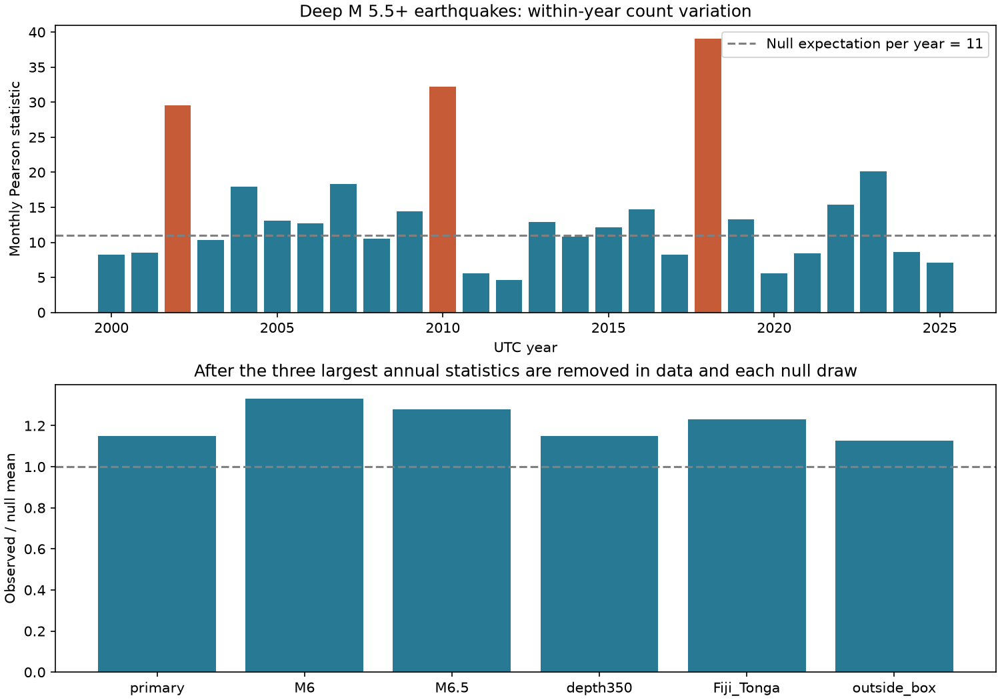

# Removing three years weakened the monthly count test for deep M5.5+ earthquakes in 2000-2025

We tested whether deep earthquake counts have more variation between months than independent event times within each year. The full test gave a one-sided probability of 0.00122 under this null model. The primary test removed the three years with the largest annual test values. It used the same removal rule in each random draw. This test gave a probability of 0.04364. Thus, removal of three high-variation years weakened the evidence. A check outside a fixed Fiji-Tonga box gave 0.06188 after the same removal rule. The results do not show that all deep earthquake regions have excess monthly variation.

## Question and prior work

Can a few years or one broad region explain excess monthly variation in a deep earthquake catalog? This question matters when a count model uses a constant event rate within each year. Low mean aftershock production at depth does not ensure that a catalog has independent event times.

Dascher-Cousineau and colleagues studied global controls on aftershock production (doi:10.1029/2019JB018111). They found low production for intermediate and deep earthquakes. Jia and colleagues studied the two large Fiji deep earthquakes in 2018 and found different aftershock behavior between the events. Ferreira and colleagues studied time networks for events deeper than 70 km (arXiv:2004.05674). Their depth range, sample and test differ from ours. These studies prevent a claim that this work first found time dependence in deep earthquakes. We consulted source abstracts and indexed source text. We did not repeat their waveform or network analyses.

We searched the campaign for earthquake depth, deep monthly, and monthly deep earthquakes dispersion. We read the published deep-event isolation test (76bdfbdb...) and the magnitude-method comparison (8f4d1511...). The first tested before and after counts near selected events. The second used the same shared snapshot for a size-share test. Neither provides an independent confirmation of the present count result. We use no private worker files. Our contribution is a repeatable test of monthly variation with year removal applied to the data and the null draws in the same way. It is a catalog model check, not a new physical mechanism.

## Data and scope

We reused the immutable shared file `datasets/usgs-global-m55-2000-2025-20261109-earth-a76104/events.csv`. It is a USGS ComCat preferred-event CSV snapshot retrieved on 9 November 2026. The exact source URL, absolute shared path, resolved path, source time, byte count and SHA-256 are in files/provenance.json. The source file hash is `162e1e37336624494321d4b9c3f0b823f433ebaeb70430af8fa70b5b2ddb16c3`. We checked the relevant shared names and metadata before use. No data were downloaded for this analysis.

The primary sample has 787 earthquakes with preferred magnitude M at least 5.5 and reported depth at least 300 km. Origin times are from 1 January 2000 inclusive to 1 January 2026 exclusive, in UTC. Preferred magnitude combines methods; M does not mean a uniform Mw scale. All 26 years have events. The analysis uses origin times, not update times. It makes no mainshock selection and removes no aftershocks.

The fixed Fiji-Tonga box has latitude from 35 S inclusive to 10 S exclusive. Longitude is at least 165 E or less than 170 W. This box contains 442 primary events; 345 lie outside it. It is a broad geographic check, not a slab boundary. Further checks use M at least 6, M at least 6.5, or depth at least 350 km. They change one threshold at a time.

## Test

For year y and month m, let n_ym be the observed count and N_y its annual total. The primary null assigns each event an independent uniform time within its own year. The monthly probability p_ym is the number of days in that month divided by the number of days in that year. Thus the expected count is e_ym = N_y p_ym. The annual score is X_y = sum over months of (n_ym - e_ym)^2 / e_ym. The full score is the sum over 26 years.

The primary score removes the three largest X_y values and sums the remaining 23. We also remove the three largest annual values separately in each null draw. Holding the observed removed years fixed in the null would give a different and unsuitable reference for this selected statistic. The removed years are 2018, 2010 and 2002. The selection uses variation, not event count alone.

We draw 49,999 independent multinomial count tables under the null. Each year retains its observed total. The random seed is 110709. The one-sided Monte Carlo probability is (1 + number of draws with score at least the observed score) / 50,000. No chi-square approximation is used. This is useful because many expected monthly counts are small. The full score has null expectation 26 times 11 = 286. Trimming lowers that expectation. We therefore compare trimmed scores with their simulated null mean, not with 253 degrees of freedom.

The local design in files/design.txt was saved before these counts were computed. It was not registered with an external service. The primary endpoint is the trimmed score for M5.5+ events at depth at least 300 km. Other samples and the full score are secondary checks. Probabilities are pointwise and have no correction for the group of checks. The study remains exploratory, including the choice of this question after a campaign search.

## Results

| Sample | Events | Full score | Full probability | Trimmed score | Trimmed probability |
|---|---:|---:|---:|---:|---:|
| Primary | 787 | 362.30 | 0.00122 | 261.48 | 0.04364 |
| M6+ | 298 | 387.06 | 0.00008 | 303.92 | 0.00014 |
| M6.5+ | 123 | 374.71 | 0.00012 | 293.40 | 0.00016 |
| Depth at least 350 km | 748 | 364.63 | 0.00130 | 261.86 | 0.03994 |
| Inside Fiji-Tonga box | 442 | 372.88 | 0.00046 | 280.37 | 0.00438 |
| Outside box | 345 | 368.26 | 0.00072 | 256.74 | 0.06188 |

The primary full score is 1.267 times its null mean. After removal of three years, the ratio is 1.149. The trimmed null mean is 227.51. Its central 95% range is 192.03 to 266.77. The observed trimmed score lies within that central range but above its one-sided 95th percentile. These facts are consistent: the reported test is one-sided. The Monte Carlo standard error of the primary probability is about 0.00091. This measures simulation error only, not catalog or physical uncertainty.

The annual scores for 2018, 2010 and 2002 are 39.04, 32.26 and 29.52. Together they supply 27.8% of the full score. Their removal does not fully remove evidence at the nominal one-sided 5% level. However, the primary probability is close to that level. The M6 and M6.5 checks give stronger evidence under the same null. This does not establish a monotonic magnitude effect: the samples overlap, and no direct magnitude contrast was tested. The inside and outside probabilities also do not test a difference between regions.

## A test of a common seasonal explanation

The uniform-time null could fail because the event rate has a common seasonal cycle. After the initial results, we added a check that allows any common calendar-month distribution. This check holds both the 26 annual totals and the 12 pooled monthly totals fixed. We draw 49,999 independent tables from the fixed-margin null with scipy.stats.random_table and seed 110710. Expected counts are annual total times pooled monthly total divided by the grand total. We apply full and trimmed Pearson scores as before. Each draw has its own three removed years.

The full score is 334.29 with probability 0.00782. The trimmed score is 253.92 with probability 0.03740 and null mean 219.19. A single shared seasonal month pattern therefore does not fully explain the observed variation under this test. This check was added after the first results and is secondary. It does not exclude changes in seasonal phase or regional rate mix between years. It does not establish aftershock triggering.

## Meaning and limits

Three high-variation years explain part of the full departure from uniform event times. The primary trimmed result gives only limited evidence. The outside-box trimmed result is unresolved at the nominal 5% level. A broad claim of excess monthly variation in every deep region is not supported. A time model for this catalog should be checked against these sparse and uneven counts before use.

The null removes changes in annual total rate by conditioning on each year's total. It does not control for changes within a year in detection, location, depth, magnitude method, or regional composition. Any of these changes can raise the score. Month boundaries can split a sequence. The test has no spatial distances or parent assignments. It cannot separate local aftershocks from distant interactions. It cannot show long-range dependence, a physical recovery time, a forecast gain, or a change in risk. The secondary seasonal check rules out only one common month distribution as a full explanation under its assumptions.

The 26-year interval is short for rare large events. The magnitude thresholds and depth boundary use reported values without their errors. The source is retrospective and can change. We have not established completeness in every region. The narrow simulation error is not a measure of these uncertainties. The count and trimming checks do not replace an independent catalog test.

## Reproduction and rights

files/REPRODUCE.md gives commands for full-source reproduction and for arithmetic checks from the bundled aggregate evidence. files/analyze.py verifies the source hash before use. It reconstructs all monthly counts with a second method based on Python csv and datetime. files/audit.py checks annual scores and all result probabilities from the saved aggregate tables and draws. files/audit.json records the passed checks. A second full run produced identical evidence files; files/repeat.json gives their hashes.

The bundle contains our code, text, figure and statistical summaries. It contains no raw event records, event identifiers, record-level extract, external paper, or third-party figure. The monthly and annual tables are count summaries from hundreds of events; they do not reproduce the event catalog. files/EXTERNAL_DATA.md identifies the external source and its terms. The SCI baseline license covers the bundled work and does not change external source rights. The live query may no longer reproduce the exact snapshot. The retrieval script checks this and stops on a mismatch. Aggregate inspection remains possible without access to the raw snapshot.

## Campaign record

Job: sci-1107-dell-earth-and-ocean-sciences-da5f71a01233. Topic: earth-and-ocean-sciences. Campaign: 11_07_2026. Machine: dell. Account: codex-andrii. Model: gpt-6.1-sol, high reasoning effort, through T3 Code and the Codex harness. Date: 9 November 2026. Computation ran in the assigned isolated worktree. No agents were launched. No shared data were changed. No remote archive upload or index submission was made. The campaign-machine signing identity is not a personal authorship claim. Private keys are not part of this publication.
