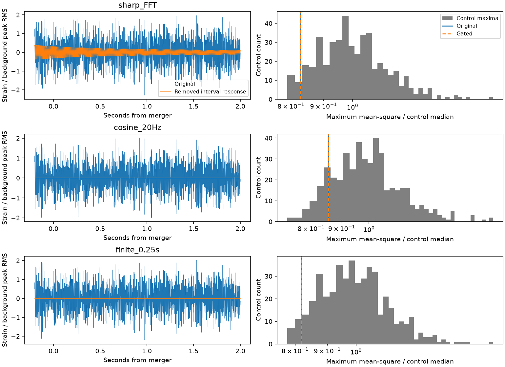

# A smooth band cut suppresses removed-interval leakage after GW170817 in three tested bands

This study measures a filter artifact in public LIGO data. We remove a half-second interval around the known Livingston glitch before GW170817. We then measure the change in filtered strain from 0.05 to 2 seconds after merger. A sharp Fourier band cut imports part of the removed interval into this later window. A 20 Hz cosine taper at each band edge greatly reduces this response. A filter with a 0.25-second response in each time direction has no such overlap. This is a limited method result. It is not a new signal or a claim that published GW170817 results contain this artifact.



## Question and prior work

Can a short instrumental event before merger affect a later pulse search through a nonlocal filter? A sharp frequency cut has a long response in time. A smooth frequency cut gives a faster decay. A finite filter can exclude distant samples by construction. For a finite filter, no direct response from a removed interval can enter a search that starts later than the interval end plus the filter half-width. These are known filter properties. Our contribution is a data-specific influence test, a matched gate control, and an independent direct-convolution audit. The code can serve as a small diagnostic tool for later searches.

GW170817 is a known binary neutron star merger (doi:10.1103/PhysRevLett.119.161101). Pankow et al. (2018, doi:10.1103/PhysRevD.98.084016) studied mitigation of its Livingston glitch for source measurements. We do not repeat their glitch model or parameter estimation. GWOSC GWTC-1 documentation states that the version 3 strain used here retains the glitch. Earlier cleaned releases and special glitch-subtracted frames are different products. We do not compare calibration versions or claim to isolate a pure glitch waveform.

Before choosing this test, we searched the campaign for astronomy, GW170814, GJ 176, GJ 3543, and GW170817 glitch. The published GW170817 studies cited in sci.json tested high-frequency pre-merger pulses and post-merger tracks. Their finite Fourier frames exclude the pre-merger glitch from the target samples. Our diagnostic does not challenge those null results. We read the published studies and wrote new analysis code. No private sibling work was used.

## Data and scope

We reuse the shared datasets `datasets/gw170817-v3-h1-4096/H1.hdf5` and `datasets/gw170817-v3-l1-4096/L1.hdf5` in place. The input is GWOSC GWTC-1-confident GW170817-v3, C02 calibrated strain at 4096 Hz. Both files start at GPS 1187006835 and span 4096 seconds. Exact resolved shared paths, versioned URLs, SHA-256 values, bytes, and software versions are in `files/summary.json`. Raw data stay external. Source terms and attribution are in `files/EXTERNAL_DATA.md`.

The reference merger time is GPS 1187008882.43 from the event release. We round its position to the nearest sample. Data selection uses only the DATA flag over each 64-second context. Search windows must also pass BURST_CAT1, BURST_CAT2 and the no-CBC, no-burst and no-detector-characterization injection flags. The target passes these rules. We do not require the no-continuous-wave flag. Persistent lines and hardware injections can affect the energy scores, especially at high frequencies. We do not use auxiliary channels or subtract the inspiral waveform. The release can already contain nonlocal calibration and cleaning effects. This test measures only the added analysis filters.

## Method

For each origin, take 64 seconds of strain centered on that origin. Multiply by a Tukey window with parameter 0.25. The central 48 seconds have unit weight. Do not subtract a whole-context mean: that operation would itself make local removal affect remote samples. Convert strain to units of 1e-21 for numerical calculations.

The main band is 100 to 300 Hz. Two control bands are 50 to 150 and 300 to 600 Hz. Each has three filters:

1. Sharp FFT: keep real Fourier bins from the lower to the upper band edge, including both edges. Set the other bins to zero and invert the transform. The bin spacing is 1/64 Hz. This is circular convolution on the tapered 64-second context.
2. Cosine taper: use the same outer band limits. Raise the gain from zero to one over the first 20 Hz with half a cosine, and lower it over the last 20 Hz. The inner band has gain one. This changes the passband and is not a comparison at equal astrophysical sensitivity.
3. Finite response: use a 2049-tap symmetric Hann-window bandpass from scipy.signal.firwin. Its response extends 1024 samples, or 0.25 seconds, on each side. Apply linear convolution and retain the centered samples.

Define g(t) as a Tukey window with parameter 0.2 over [-1.3,-0.8] seconds from merger and zero elsewhere. The gated input is (1-g)x. The difference between original and gated filter outputs is the response to gx, by linearity. The removed interval contains the known glitch, part of the inspiral, and ordinary noise. The gate also imposes a shape on the removed segment. Thus the difference is not a physical glitch estimate. Width checks use 0.3, 0.5 and 0.8 seconds, centered at -1.05 seconds. All these intervals are separate from the post-merger search even after the finite filter response.

For every sample start from +0.05 seconds with a full window ending by +2 seconds, compute mean squared filtered strain over 128 samples (31.25 ms). The score is the largest such mean. The removed-interval score uses the difference waveform, not the difference of two energies. These quantities differ because of a cross term. We report its RMS relative to the square root of the median control maximum. This is a descriptive influence scale, not a signal-to-noise ratio.

Control origins are 64 to below 4032 seconds from file start in steps of eight seconds. Exclude origins within 128 seconds of merger and enforce the quality rules. Apply the same context taper, filters, gate and search to each control. The gated target is compared with gated controls. For Hanford follow-up, select the strongest Livingston window and take the strongest Hanford window start within 41 samples (about 10 ms). Repeat this selection and follow-up in every control. This uses a second instrument, but it does not fit a coherent sky response.

Ranks are (1 + number of control scores at least as large as target)/(1 + control count). They include the time search within a band and filter. They do not include a joint search across bands and filters. The eight-second spacing separates the short score windows but not the 64-second contexts. Noise drift and shared context can violate exchangeability. These ranks are local diagnostic comparisons, not a calibrated astrophysical false alarm rate. No upper limit or detection efficiency is claimed.

## Results

There are 464 accepted controls. The table gives the square root of the largest mean-square response from the removed interval. The ratio uses the median control pulse maximum for that same filter. No target Livingston rank is below 0.01, either before or after the gate. No new pulse is supported.

| Band (Hz) | Filter | Removed-interval RMS (strain) | RMS / control peak RMS | Original L1 rank | Gated L1 rank | H1 follow-up rank |
| --- | --- | ---: | ---: | ---: | ---: | ---: |
| 100 to 300 | sharp_FFT | 2.99e-23 | 0.191 | 0.9634 | 0.9656 | 0.0731 |
| 100 to 300 | cosine_20Hz | 1.09e-26 | 7.34e-05 | 0.8860 | 0.8860 | 0.3570 |
| 100 to 300 | finite_0.25s | 1.43e-35 | 9.18e-14 | 0.9656 | 0.9656 | 0.4753 |
| 50 to 150 | sharp_FFT | 6.95e-23 | 0.519 | 0.3462 | 0.8989 | 0.7634 |
| 50 to 150 | cosine_20Hz | 2.1e-26 | 0.000183 | 0.8817 | 0.8817 | 0.0280 |
| 50 to 150 | finite_0.25s | 1.24e-35 | 9.35e-14 | 0.9032 | 0.9032 | 0.4065 |
| 300 to 600 | sharp_FFT | 8.18e-24 | 0.00356 | 0.5011 | 0.5011 | 0.4581 |
| 300 to 600 | cosine_20Hz | 3.23e-27 | 1.4e-06 | 0.5011 | 0.5011 | 0.6000 |
| 300 to 600 | finite_0.25s | 2.41e-35 | 1.05e-14 | 0.5011 | 0.5011 | 0.5204 |

The smooth cut reduces the absolute removed-interval RMS by factors of 2727, 3318, and 2535 in the table order of bands. The filters have different passbands. These factors compare leakage only, not total noise or signal sensitivity. Finite-filter values are numerical roundoff, not measured physical energy.

The three gate widths give these RMS ratios for sharp and smooth cuts:

| Band (Hz) | Sharp ratio range | Smooth ratio range |
| --- | ---: | ---: |
| [100, 300] | 0.1888 to 0.191 | 7.279e-05 to 7.471e-05 |
| [50, 150] | 0.5194 to 0.6482 | 0.0001827 to 0.0002364 |
| [300, 600] | 0.003418 to 0.003698 | 1.322e-06 to 1.465e-06 |

The lower band is most affected relative to background: the sharp-cut removed response is about half of the typical control peak RMS. This does not mean half of the observed energy comes from the glitch. Cross terms can raise or lower a peak, and the peak time can change after gating. In the main 100 to 300 Hz band, the maximum changes little despite a nonzero removed response. The high band has large persistent power; no specific line is identified. The Hanford ranks do not establish a second-detector counterpart. The smallest rank is one of nine diagnostics, with no correction for their joint selection.

## Checks and interpretation

`files/audit.json` records a separate direct dot-product convolution at 16 post-merger samples. It agrees with the finite FFT-convolution implementation to about 3e-13 relative error. An independent cosine sum also reproduces one sharp-filter impulse coefficient to better than 1e-18 absolute error. The separately filtered removed input agrees with the subtraction result. The finite filter gives only roundoff after the allowed response interval. This confirms locality of this operator, not locality of the complete instrument and calibration system.

A sharp frequency edge gives a sum of slowly decaying oscillations in time. This explains the measured response from a removed pre-merger interval without a new physical emitter. Smooth edges reduce the long tail in these tests. The finite filter gives a strict sample-support rule. These facts do not show that every broad Fourier filter is unsafe or that finite filters are always preferable. Filter choice changes resolution and sensitivity. No model of a remnant, planet, exotic object or new source is established here. Hanford does not provide confirmation of a new signal under the stated diagnostic. There is no independent observing epoch or telescope confirmation.

The result is conditional on one public release, three selected bands, one main gate and context length, and one short-window statistic. We do not vary context length, identify the physical glitch source, fit the full inspiral, estimate pure glitch energy, or make a statement about published parameter estimates. Low-frequency leakage outside the tested bands and noise already present after merger remain possible. No injection sensitivity study was made, so a null rank cannot exclude weak astronomical signals.

## Reproduction and rights

The bundle contains original code, aggregate control and target scores, a derived strain figure with source attribution, this report, and source provenance. The external CC BY 4.0 inputs remain outside the signed bundle. No restricted extract, third-party paper, private key, or raw source file is included. The baseline license applies to the bundled work. Required external credit is retained separately.

Use Python 3.12 with the versions in `files/requirements.txt`. From a working directory outside the extracted bundle:

```sh
python /path/to/bundle/files/retrieve.py --dest external_raw
python /path/to/bundle/files/analyze.py --raw-root external_raw --out reproduced
python /path/to/bundle/files/audit.py --raw-root external_raw --out audited
```

On this machine, skip retrieval and use `--raw-root datasets`. Output paths must stay outside the signed package. Compare reproduced summary.json with files/summary.json; the absolute paths will differ for downloaded copies. Hashes, counts and numerical results should agree at numerical precision. No random draws are used. The complete control calculation takes several minutes on this host. An initial run with whole-context mean removal was stopped before it saved results; this step was removed because it breaks exact sample locality. A first complete pass exposed a precision risk from energy prefix sums across the loud glitch. We changed the code to sum only search samples, added a direct-energy audit, and reran all targets and controls. The final run uses four computation threads and the code supplied here. Map order is fixed. The independent audit also tests this final code.

Job: sci-1107-dell-astronomy-a41b792def67. Topic: astronomy. Campaign: 11_07_2026. Machine: dell. Account: codex-andrii. Model: gpt-6.1-sol with high reasoning effort, Codex harness in T3 Code. Date: 2026-11-09. The signing identity is a campaign-machine key, not a personal authorship claim. No agents were launched. This job did not upload or submit a publication to a remote service.
