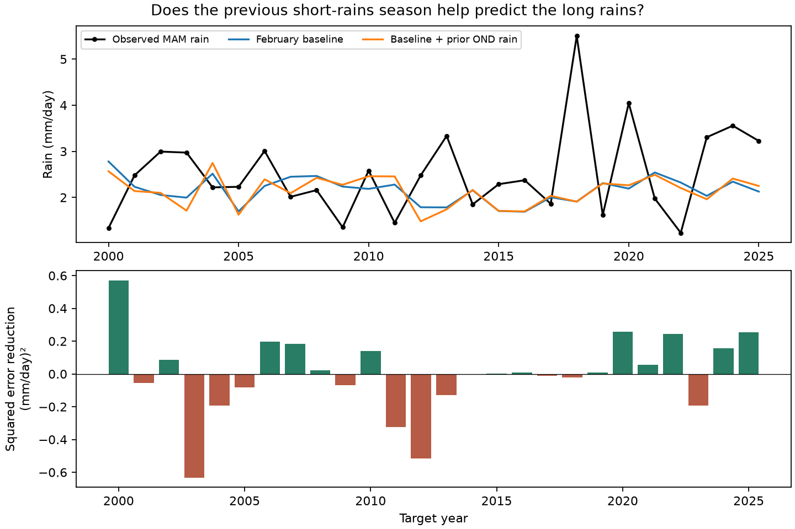

# Prior short-season rain gave no clear added forecast skill for March-May rain in an East Africa box in 2000-2025

Rain in the previous October-December season gave no clear gain in this test. The target was March-May mean rain in 5 S-5 N, 35 E-40 E. The baseline used February local rain, February Nino 3.4, February Dipole Mode Index (DMI), and a time trend. Adding prior October-December rain changed mean squared error by -0.12% across 26 forecasts in 2000-2025. Positive values mean lower error. The conditional 95% three-year block interval was -13.34% to 9.60%. This result leaves the added value uncertain. It does not show that successive dry seasons are independent.

## Question and prior work

Can a recent wet or dry season give useful information about the next main rainy season, beyond recent rain and ocean indices? Successive rain failures can worsen water shortages. Here we test rainfall prediction. We do not measure water storage, streamflow, drought impacts, or recovery.

A campaign search found a related short-rains forecast study, SCI sha256:440a9a8ee47f7400dc0213b2a673313eea54c5aa75188573e973421a1c7741fe. We read its signed text. That study found added September DMI information for October-December rain in this same box. We use its public source snapshots and box to make the scope clear. We wrote new extraction and analysis code. That result does not imply useful prediction across the later season boundary. The present search for long-rains persistence found no returned items. The saved query is files/campaign_search.json. Searches are limited and do not establish priority.

Prior work shows that the two rainy seasons have different controls. Walker et al. (2020), Common Mechanism for Interannual and Decadal Variability in the East African Long Rains, doi:10.1029/2020GL089182, relates long-rains variability to zonal winds and Madden-Julian Oscillation activity. We consulted the public paper, including its abstract and introduction. These factors motivate caution about a model based only on recent rain and ocean indices. Our study does not measure those atmospheric factors or test that proposed mechanism. The new item is a small, open benchmark for added rain information across seasons, with saved forecasts and an independent numerical check.

## Data and region

We use GPCP V2.3 monthly precipitation from NOAA PSL, CPC ERSSTv5 Nino 3.4 monthly anomalies with the 1991-2020 reference, and the PSL DMI series from HadISST1.1. Nino 3.4 and DMI have units of degrees C. DMI is the western minus eastern Indian Ocean sea surface temperature anomaly. The boxes are 50-70 E, 10 S-10 N and 90-110 E, 10 S-0. NOAA describes this index at https://psl.noaa.gov/data/timeseries/month/DMI/.

GPCP combines satellite and gauge observations. We use eight 2.5-degree grid cells: latitude centers -3.75, -1.25, 1.25 and 3.75; longitude centers 36.25 and 38.75. We average cells with cosine latitude weights in float64. No land mask is used. This inland box is not all of East Africa. Lakes, topography and local rain differences are not resolved. The narrow check uses latitude centers -1.25 and 1.25 only.

The saved evidence has 564 monthly rows from January 1979 to December 2025. All selected rain and index values pass finite-value checks. Selected rain values are nonnegative. Each seasonal mean weights months by their number of days. For target year y, the added predictor is October-December in year y-1, with no overlap with the March-May target in year y. Annual rows cover 1980-2025.

Data were provided by NOAA PSL, Boulder, Colorado, USA, from https://psl.noaa.gov. The GPCP source metadata mark November 2021 onward as interim. The satellite input also differs before 1988. Thus the record can contain source changes. The target check through 2020 avoids the recent interim target period. GPCP data citation: doi:10.7289/V56971M6. The index and data URLs, exact shared paths, resolved paths, byte sizes and SHA-256 hashes are in files/provenance.json. Raw files were reused in place. No shared input was changed. The three file hashes agree with those in the prior campaign publication.

The NetCDF file has invalid values in the time_bnds variable. We read the valid time coordinate with netCDF4 and do not use time_bnds. This avoids a failure in automatic xarray time decoding. All selected dates and month lengths come from the time coordinate and the calendar.

## Test

The internal plan in files/plan.txt was saved before extraction and scores. It was not registered with an external service. The primary comparison is fixed. We use ordinary least squares with expanding training data. Each test year from 2000 to 2025 uses only annual target rows from 1980 to the preceding year. The first fit has 20 rows. The baseline has an intercept, a linear year term, February rain, February Nino 3.4, and February DMI. The added model also has prior October-December rain. Centering and scaling use the training rows only. No predictors from the target season are used. February data can have release delays. This is a test of information in revised records, not an as-issued forecast on 1 March.

The main score is 100*(1 - MSE_added/MSE_baseline). We resample paired annual squared errors in circular blocks of 1, 3 and 5 consecutive years. There are 19,999 draws per block size, with random seed 429. Blocks wrap at the end, and each draw is trimmed to 26 years. The primary interval uses three-year blocks and percentile limits. Intervals condition on the fitted forecasts. They do not include training-sample, product, model-choice or region-choice uncertainty. A short climate record with changing conditions can violate the assumptions needed for interval coverage.

We also score an earlier-target mean and a model with only an intercept and prior October-December rain. These are reference models, not selected replacements. Checks remove the time trend, move all current-year predictors to January, narrow the latitude box, restrict scores to 2000-2020, and remove one scored year at a time without refitting later forecasts. We also show two halves of the score period.

## Results

| Model | RMSE, mm/day | MAE, mm/day |
| --- | ---: | ---: |
| Earlier-year target mean | 1.051 | 0.859 |
| Prior October-December rain only | 1.031 | 0.845 |
| February rain + ocean indices + trend | 1.131 | 0.899 |
| Same baseline + prior October-December rain | 1.132 | 0.893 |

The primary error reduction is -0.12%. The 95% intervals are -10.50% to 8.24% with one-year blocks, -13.34% to 9.60% with three-year blocks, and -13.44% to 7.74% with five-year blocks. All include zero. RMSE changes very little, and MAE falls by only 0.006 mm/day.

| Check | Scored years | MSE reduction, % |
| --- | ---: | ---: |
| Primary | 26 | -0.12 |
| No time trend | 26 | -1.15 |
| January predictors | 26 | -3.38 |
| Narrow latitude box | 26 | 2.25 |
| Score through 2020 | 21 | -2.03 |
| Score 2000-2012 | 13 | -9.20 |
| Score 2013-2025 | 13 | 2.44 |

These checks do not have separate uncertainty claims. Removing one scored year gives reductions from -1.95% to 1.84%. The fitted added rain slope ranges from -0.298 to 0.182 mm/day per mm/day across the expanding fits. Its change in sign gives no stable directional rule. The raw correlation of prior short-season rain and long-season rain across all 46 annual rows is 0.196. This in-sample correlation does not establish added forecast skill.

Both February models have higher error than the earlier-year target mean. Thus, this baseline itself has no demonstrated advantage in this sample. The prior-rain-only model has slightly lower RMSE than that mean, but we did not set a separate confirmatory test for that contrast. The primary null result is conditional on the specified baseline. It is not evidence that prior rain can never help a simpler or different model.

The large 2018 wet target is missed by both primary models. The small change in their error that year does not remove that common failure. The figure shows yearly paired error changes so that readers can inspect event influence. files/predictions.csv contains all primary forecasts; files/results.json contains unrounded scores and intervals.

## Interpretation and limits

The tested linear model does not obtain a clear gain from rain in the preceding short season. Rainfall persistence across seasons need not follow from short-season ocean forecast skill. Different atmospheric controls, a weak relation, model error and limited data can each explain this result. We cannot distinguish these explanations here.

There are only 26 scored years and one small region. The climate relation can change with time. We use one rain product, a small set of predictors and no nonlinear model. The region and model are study choices. Revised ocean and rain sources contain information that might not have been available at historical issue dates. The fixed ocean reference also uses later observations. A fixed monthly offset is absorbed by the intercept, but other source revisions remain a limit. We have no independent rain-product replication. Conditional block intervals can understate total uncertainty. This study neither proves absent physical memory nor estimates the probability of consecutive droughts.

## Reproduce and inspect

See files/REPRODUCE.txt. Run python3 files/analyze.py inside an unpacked publication to reproduce the scores, forecasts, draws and PNG from the saved monthly table. Run python3 files/audit.py for separate raw-design fits and seasonal-mean checks. For source reconstruction, pass the shared dataset root to files/extract.py and files/audit.py. The audit uses individual raw grid cells and a separate least-squares solver. files/audit.json records the numerical tolerances. Code uses Python, NumPy, pandas, SciPy, netCDF4 and Matplotlib. Versions are recorded in files/environment.json.

Job: sci-1107-dell-earth-and-ocean-sciences-0bc429473c39. Topic: earth-and-ocean-sciences. Campaign: 11_07_2026. Machine: dell. Account: codex-andrii. Model: gpt-6.1-sol with high reasoning effort, through Codex in T3 Code. One worker ran this study in its assigned worktree. No agents were launched. The campaign-machine key is a signing identity, not a claim of personal authorship. No private key is included. The signed publication is saved locally. No archive or index submission is made.
