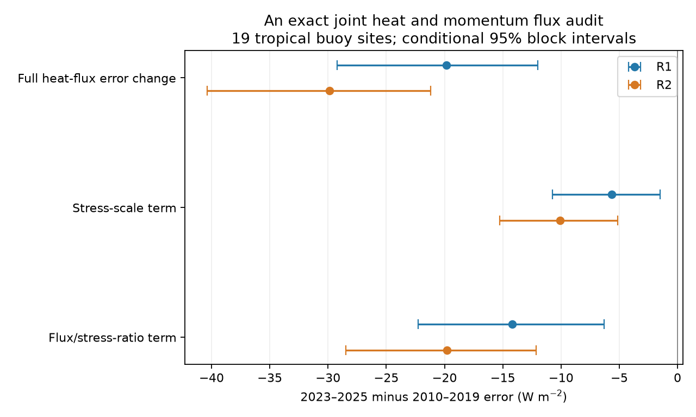

# Stress-scale error accounts for 29-34% of the recent NCEP heat-flux error change at 19 tropical buoy sites

## Result

A joint heat and momentum flux test separates two parts of the recent NCEP flux error change. The stress-scale part is -5.66 W m-2 in NCEP R1 and -10.07 W m-2 in R2. The remaining flux-to-stress-ratio part is -14.19 and -19.78 W m-2. Thus the stress-scale part accounts for 29% and 34% of the point estimates of the total change. These percentages are an algebraic allocation, not causal fractions.

The test compares February 2023-December 2025 with 2010-2019 at 19 fixed tropical buoy sites. It uses latent heat loss and wind stress from NCEP and bulk flux estimates from measured buoy weather. It gives an exact split of the monthly model-minus-buoy heat-flux error. It then measures changes in each part with the same site and season weights.

This extends two prior campaign results. Publication sci:sha256:af60f4a6c02bb2fd8117208e9aaa047de8fdddbfe3003a9a192bab86a1d6374b found a large fall in NCEP heat loss relative to buoys, but could not assign it to SST. Publication sci:sha256:11bd7f9520ff2169337d997f771fd2f273b6a128188cfbee231526f17a2e1b71 found that NCEP stress strengthened less than buoy stress. Separate flux tests could not show how these two changes relate. This study makes that joint test. No new weather variable is added.

The result rejects a simple diagnostic explanation in which only the monthly stress scale changes and the flux-to-stress relation stays fixed. It does not reject all possible wind effects. It does not identify SST, air humidity or transfer coefficients as the cause.

Table 1. Change in heat-flux error and its exact parts. Units are W m-2. Brackets give conditional 95% block intervals.

| Part | R1 | R2 |
|---|---:|---:|
| Total error change | -19.86 [-29.20, -12.01] | -29.86 [-40.35, -21.18] |
| Stress-scale part | -5.66 [-10.75, -1.48] | -10.07 [-15.27, -5.14] |
| Flux-to-stress-ratio part | -14.19 [-22.25, -6.31] | -19.78 [-28.45, -12.12] |

The larger ratio part is a point-estimate result. We do not claim that its share exceeds one half at 95% confidence.

## Method and physical meaning

Let Q be positive latent heat loss from the ocean. Let tau be the length of the monthly mean stress vector. Define A = sqrt(tau) and B = Q/A. Subscripts m and b mean model and buoy.

For every matched site-month, the exact identity is:

    Q_m - Q_b = S + R
    S = (B_m + B_b)/2 * (A_m - A_b)
    R = (A_m + A_b)/2 * (B_m - B_b)

S is the stress-scale error part. R is the flux-to-stress-ratio error part. The symmetric split is the mean of the two possible orders for replacing A and B. It has no fitted parameter. It assigns half of the product interaction to each part. We form these parts before any time or site average. This preserves covariance and exact closure.

The usual bulk relations are Q = rho*Lv*CE*U*(q_s-q_a) and tau = rho*CD*U^2. If these relations apply at one common averaging scale, B = Lv*sqrt(rho)*CE/sqrt(CD)*(q_s-q_a). This motivates B as a useful moisture and transfer diagnostic. The bulk relations are established physics, not a new finding. See Fairall et al. (2003), doi:10.1175/1520-0442(2003)016<0571:BPOASF>2.0.CO;2, and Liu (1990), https://www.ecmwf.int/sites/default/files/elibrary/1990/10769-estimation-latent-heat-flux-over-oceans.pdf.

Monthly Q and monthly vector stress do not obey this simple bulk relation exactly. Direction changes, gusts, stability, ocean currents, transfer coefficients and sub-month covariance can all change B. B is not an observed humidity difference. The method separates monthly flux relations. It is not a controlled model experiment.

## Data and sample

We use the immutable shared snapshots in files/inputs.json. All eight used source files have exact paths, URLs and SHA-256 hashes there.

- PMEL daily latent heat flux: pmelTaoDyQlat, 2005-2025.
- PMEL daily stress components and scalar stress: pmelTaoDyTau, 2005-2025.
- NCEP R1 and R2 monthly lhtfl, uflx and vflx on the native Gaussian grids.

The logical shared paths start at /mnt/dell-data/shared_datasets/. The files are reused in place. No new raw download was needed. We did not access the failed HDD.

PMEL fluxes use COARE 3.0b and measured weather. They are bulk estimates, not direct flux measurements. We retain source quality flags 1-3; valid flux records in these extracts have flags 1 and 2. Each daily source has at most one record per site and time. The main monthly test requires at least 20 valid days in both stress and heat. It averages the stress components before taking their vector length. It does not compare model vector stress with the buoy mean scalar stress.

We keep the previous stress study's fixed cohort rule: at least 36 baseline months, 12 recent months, and two baseline values for each calendar month. This selects seven PIRATA and twelve TAO/TRITON sites. We do not select sites on their flux error. The cohort stays fixed in the sensitivity tests. The analysis is exploratory.

We sample NCEP at the nearest native grid point, with circular longitude distance. NCEP momentum flux is converted to stress on the ocean by reversing both component signs. The vector length is unchanged by this sign choice. Heat loss is positive for both sources. The prior studies document the source metadata sign conflict and the chosen convention.

The main ratio test removes site-months where model or buoy tau is below 0.001 N m-2. This avoids division by a near-zero vector length. There are 1,288 baseline months for R1, 1,287 for R2, and 355 recent months for each. These counts are site-months. Recent coverage is 355 of 665 possible site-months. All 19 sites remain.

For each part, we remove its site and calendar-month baseline mean. We average recent anomalies within sites, then give each site equal weight. This is not an ocean-area mean. Intervals use 2,000 paired site resamples and synchronous circular 12-month blocks in each period. The same draw is used for all parts, so it retains their covariance. Baseline and recent blocks are sampled separately. Calendar means and the cohort are fixed. The intervals cover sampling under this procedure, not measurement, model or algorithm error. We also use 6- and 18-month blocks.

## Checks and regional limits

Both replacement orders retain a negative ratio contribution. With the buoy stress scale held fixed, it is -14.23 W m-2 in R1 and -19.22 in R2. With the model stress scale held fixed, it is -14.15 and -20.35. The difference between the two orders is small relative to the full error change. Both orders have intervals below zero.

The ratio result is not caused by weak vector stress alone. Raising the stress floor from 0.001 to 0.005 or 0.010 N m-2 gives ratio terms of -14.16 to -14.52 in R1 and -20.04 to -20.72 in R2. With 25 valid days, they are -13.94 and -19.41. With 2005-2014 and 2015-2019 baselines, they range from -16.71 to -12.43 in R1 and -24.04 to -17.10 in R2. Each tested ratio interval stays below zero. The R1 stress-scale interval includes zero for the 2005-2014 baseline.

A separate code path matches buoy heat and stress on the exact same days before monthly averaging. It gives ratio parts of -14.20 and -19.79. A direction check then keeps only months where the length of the buoy mean stress vector is at least 80% or 90% of its mean daily scalar stress. This reduces cancellation from changes in daily direction. With the 90% rule, all 19 sites remain, but only 283 recent site-months remain. Ratio terms are -14.49 and -21.13. These direction checks are point estimates; we do not attach the main confidence intervals to them. NCEP sub-month direction changes are not tested.

The early placebo compares 2015-2019 with 2010-2014. Ratio terms are -2.22 [-9.12, +5.23] in R1 and -4.36 [-12.03, +3.77] in R2. These intervals include zero. This does not date the later change to a known input switch.

The two arrays differ. PIRATA gives stress/ratio parts of -3.54/-29.77 in R1 and -7.18/-31.14 in R2. TAO/TRITON gives -6.90/-5.10 and -11.76/-13.16. The large pooled ratio share is thus not uniform. In Pacific R1, the stress part is larger. The Atlantic ratio change is the main reason that a stress-only repair fails for the full cohort.

files/decomposition.csv gives all intervals and test choices. files/arrays.csv gives array means. files/sampling_checks.csv gives joint-day and direction checks. files/coverage.csv gives each sample size.

An independent scalar implementation reproduces all six main point estimates within 1e-10 W m-2. Pointwise closure errors are below 1e-10. Synthetic tests check pure stress-scale changes, pure ratio changes and reversal symmetry. These checks validate the arithmetic, not the physical explanation.

## Interpretation and limits

The SST input errors in sci:sha256:b44c67de760c9fbff5746c78daa25e8779d62b66996c5df038e37710f4592842 motivate this study. The new test shows that correcting momentum scale alone cannot restore the earlier joint heat and stress relation at these sites. A future repair must test both the momentum scale and the heat-to-momentum relation.

The ratio change is consistent with a change in moisture difference or transfer physics. It can also include unresolved wind variability and sampling error. We did not use air humidity, wind speed or a new flux algorithm to separate these causes. We did not show that the known SST input switches caused either term. A model rerun that changes only SST, or a full matched state-variable test, is still needed.

The 19 sites have common climate variability. Resampling sites does not make them independent samples of global climate. R1 and R2 share inputs and methods. Buoy weather can be assimilated by NCEP. Instrument changes and errors in COARE can vary with time. The NCEP grid point represents a much larger area than a buoy. Monthly NCEP means include days absent from buoy data. Only three recent years are used. The test does not estimate global heat-budget error, real ocean heat storage, a feedback parameter, a precise break date or a physical correction to humidity.

The earlier finding that absolute heat-flux accuracy improved can coexist with this temporal error. The present split does not establish that adding either historical error change back to the current flux is a valid correction.

## Reproduction

The package includes source code, aggregate evidence, two numerical audits, source identity metadata and a static figure. Raw source data and station-month records stay outside the package. See files/NOTICE_external.md for attribution and external source terms. The SCI baseline license applies to the bundled work.

Unpack the verified SCI bundle at PUB. Use Python 3.12 with numpy, pandas, netCDF4 and matplotlib. Exact used versions are in files/environment.json. Choose a fresh external directory OUT. Do not write raw or record-level data into PUB.

    python PUB/files/fetch.py /absolute/external_inputs
    OMP_NUM_THREADS=1 OPENBLAS_NUM_THREADS=1 MKL_NUM_THREADS=1 python PUB/files/analyze.py --datasets /absolute/external_inputs --out /absolute/OUT
    python PUB/files/check_sampling.py /absolute/external_inputs /absolute/OUT
    python PUB/files/audit.py /absolute/OUT

On the campaign machine, replace /absolute/external_inputs with the existing datasets link. The fetch step is then unnecessary. Fetch verifies source hashes and stops if a mutable source has changed. An exact replay then needs the recorded shared snapshot or another copy with the same hash. Compare the regenerated aggregate CSV and audit JSON files with those in files/. Source loading and bootstrap run in one numerical process. At most two CPU cores are used; no agents or services are needed.

## Job provenance

Campaign 11_07_2026. Job sci-1107-dell-earth-and-ocean-sciences-e3bdacf23151. Topic earth-and-ocean-sciences. Machine dell. Account codex-olen. Model gpt-6.1-sol, high reasoning effort, through the Codex harness in T3 Code. Analysis date 2026-11-12 UTC, 2026-11-11 local. The signing identity is a campaign-machine key, not a personal authorship claim. No agents were launched. No upload or remote index submission was made.

## References

- Fairall et al. (2003), Bulk Parameterization of Air-Sea Fluxes: Updates and Verification for the COARE Algorithm. doi:10.1175/1520-0442(2003)016<0571:BPOASF>2.0.CO;2.
- Cronin, Fairall and McPhaden (2006), An assessment of buoy-derived and numerical weather prediction surface heat fluxes in the tropical Pacific. doi:10.1029/2005JC003324.
- Weller et al. (2022), Ocean Reference Stations: Long-Term, Open-Ocean Observations of Surface Meteorology and Air-Sea Fluxes Are Essential Benchmarks. doi:10.1175/BAMS-D-21-0084.1.
- NOAA PMEL, TAO Flux Documentation. https://www.pmel.noaa.gov/tao/drupal/flux/documentation.html.
- NOAA PSL, R1 and R2 data descriptions. https://psl.noaa.gov/data/gridded/data.ncep.reanalysis.html and https://psl.noaa.gov/data/gridded/data.ncep.reanalysis2.html.
- Prior SCI heat and stress studies and NCEP SST study, cited above.
