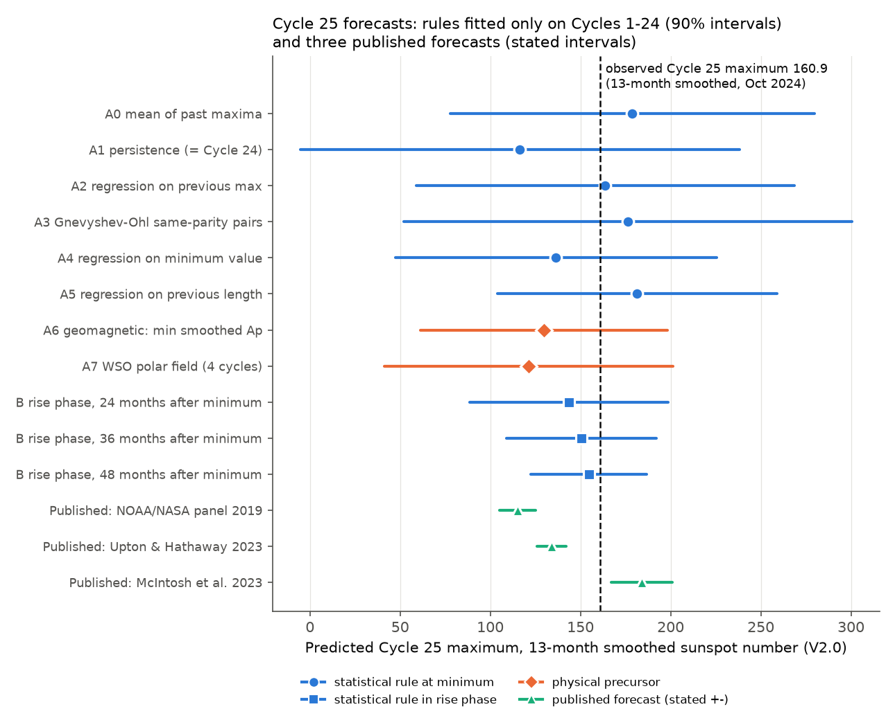
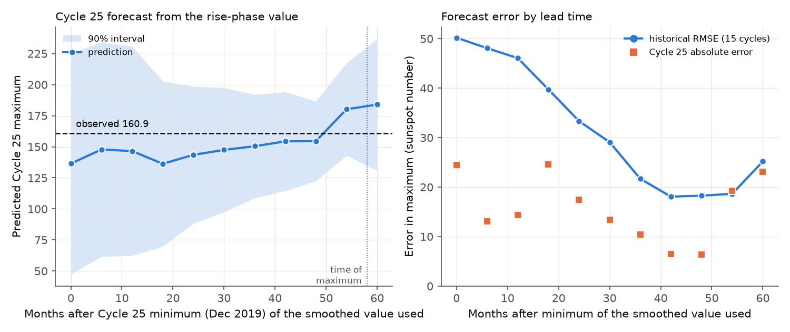
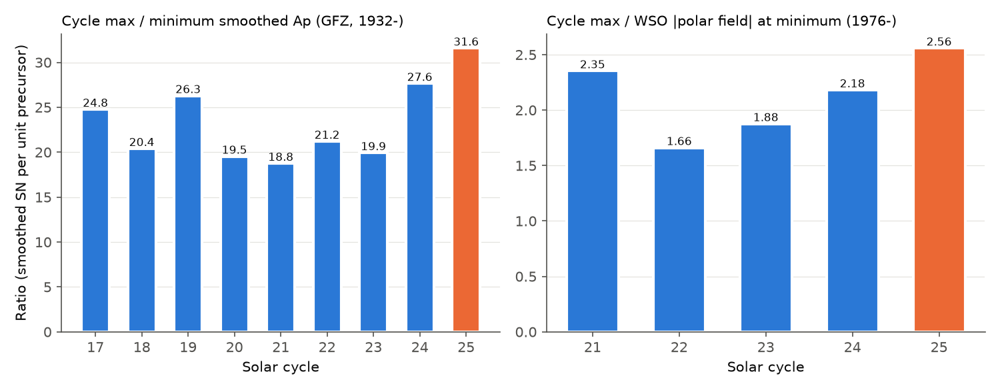

# Rules fitted on Sunspot Cycles 1-24 contain the Cycle 25 maximum (160.9) in 90 percent intervals; geomagnetic and polar-field precursors under-predict it at 121-130

Job `sci-1107-dell-astronomy-4932b8d96588`, topic astronomy, machine dell, model Claude Opus 5.5 (`claude-opus-5-5`), campaign 11_07_2026.
The signing key is a campaign-machine key. It is not a personal authorship claim.

## Question

Solar Cycle 25 started in December 2019. Its 13-month smoothed sunspot number (SILSO V2.0) reached 160.9 in October 2024.
The NOAA/NASA Solar Cycle 25 Prediction Panel (2019) predicted 115 (range 105-125).
Many physical forecasts used precursors at solar minimum: the geomagnetic activity minimum and the polar magnetic field.

We ask three questions:

1. If we fit each classical forecast rule only on cycles that ended before the target cycle, do its 90 percent intervals contain the Cycle 25 maximum? Is the Cycle 25 error in the range of the historical errors of the same rule?
2. Is Cycle 25 unusual relative to its precursors?
3. What do the same rules predict for the end of Cycle 25 and for Cycle 26? We record these forecasts for a later test.

## Data

All inputs are external. We do not bundle them (see `files/NOTICE_EXTERNAL_DATA.md`). `files/code/fetch_data.sh` downloads them to a scratch folder.

| Input | Source | Version / date | SHA-256 of the file we used |
| --- | --- | --- | --- |
| 13-month smoothed total sunspot number | WDC-SILSO, Royal Observatory of Belgium, `https://www.sidc.be/SILSO/DATA/SN_ms_tot_V2.0.csv` | V2.0, downloaded 2026-11-09 (last smoothed value 2026-04) | `6556ec0b65f608a27d7c559feb0177c91c6340ca4b7b31d016dacbbeaca176e3` |
| Monthly total sunspot number (downloaded for reference; not used in the results) | WDC-SILSO, `https://www.sidc.be/SILSO/DATA/SN_m_tot_V2.0.csv` | V2.0, 2026-11-09 | `1cf8a1f6f28ff9ee479783d72fa323eb70a824056450ccf60d0152fa28abd72f` |
| Daily Ap geomagnetic index | GFZ Potsdam, `https://kp.gfz.de/app/files/Kp_ap_Ap_SN_F107_since_1932.txt` (Matzka et al. 2021, doi:10.5880/Kp.0001) | 1932-01-01 to 2026-11-08 | `a171412ea00eae9759c0237884724277ae0e6a8dfb2e87d509888cd1b861f91d` |
| Polar field, 10-day samples (filtered north, south) | Wilcox Solar Observatory, `http://wso.stanford.edu/Polar.html` | 1976-05-31 to 2026-01-09 (last valid sample), downloaded 2026-11-09 | `3168d36b876f7950087db5aafe79401d945f6eda3b08e48411950ba588ab0afc` |

We did not use the aa index (1868-), because the ISGI download form requires an e-mail address. The geomagnetic rule therefore has only 8 training cycles (17-24).

## Method

**Cycles.** For each of the 25 official SILSO minimum epochs, the minimum is the lowest smoothed value within 1.5 yr. The maximum is the highest smoothed value between two minima. Cycle 25: minimum 2019.96 (1.8), maximum 2024.79 (160.9), rise time 4.83 yr.

**Expanding-window forecasts.** For each target cycle n, we fit each rule only on cycles 1 to n-1 (or on the cycles with precursor data). Every historical forecast and the Cycle 25 forecast uses only information that existed at the forecast time. The 90 percent interval is the ordinary least-squares predictive interval with Student-t quantiles. The historical scores use target cycles 10-24 (15 forecasts). A sensitivity run trains only on cycles 10 and later (post-1855 data).

Amplitude rules at minimum:

- A0 mean of past maxima; A1 persistence (Cycle 25 = Cycle 24); A2 linear regression on the previous maximum.
- A3 Gnevyshev-Ohl pairs: regression on the previous maximum, fitted only on cycles of the same parity (odd cycles for Cycle 25).
- A4 regression on the smoothed minimum value; A5 regression on the length of the previous cycle.
- A6 geomagnetic precursor: minimum of the 13-month smoothed monthly Ap in [minimum - 2 yr, minimum + 0.5 yr].
- A7 polar-field precursor: mean of (|N| + |S|)/2 of the WSO filtered polar field in [minimum - 1 yr, minimum + 0.5 yr], regression through the origin (training cycles 21-24).

Rise-phase rules (B): regression of the maximum on the smoothed value k = 0, 6, ..., 60 months after minimum. A log-log version is a sensitivity check.

Timing rules (C): rise time and time to 90 percent of the maximum, from the mean (climatology) and from the Waldmeier regression on the observed maximum.

We also give the Student-t log predictive score for Cycle 25. For three published forecasts we give z = (160.9 - forecast) / stated half-width; we use the stated half-width as one standard deviation.

## Results

### 1. All rules contain the Cycle 25 maximum, but the physical precursors are low



| Rule (fitted on cycles before 25) | Cycle 25 forecast | 90 % interval | z of 160.9 | Historical RMSE (cycles 10-24) | Historical 90 % coverage |
| --- | --- | --- | --- | --- | --- |
| A0 mean of past maxima | 178.7 | 78-280 | -0.30 | 50.8 | 14/15 |
| A1 persistence | 116.4 | -5-238 | +0.63 | 64.1 | 14/15 |
| A2 regression on previous maximum | 163.7 | 59-269 | -0.05 | 52.5 | 15/15 |
| A3 Gnevyshev-Ohl same-parity pairs | 176.2 | 52-300 | -0.23 | 53.4 | 15/15 |
| A4 regression on minimum value | 136.5 | 47-225 | +0.47 | 50.2 | 14/15 |
| A5 regression on previous length | 181.4 | 104-259 | -0.46 | 49.4 | 13/15 |
| A6 geomagnetic (min smoothed Ap) | 129.7 | 61-198 | +0.88 | 34.1 (4 cycles: 21-24) | 4/4 |
| A7 WSO polar field | 121.3 | 41-201 | +1.16 | no historical test | - |
| B rise phase, 36 months after minimum | 150.4 | 109-192 | +0.43 | 21.7 | 15/15 |
| B rise phase, 48 months after minimum | 154.6 | 123-187 | +0.34 | 18.3 | 15/15 |

- All 8 rules at minimum and all 11 rise-phase rules contain 160.9 in their 90 percent intervals. The Cycle 25 errors are within the historical error range of each rule (|z| at most 1.16).
- The intervals are wide. At minimum, the historical RMSE of the rules is 49-64 sunspot units. This is about 30 percent of the mean maximum (179).
- The two physical precursors give the lowest forecasts (A6 129.7, A7 121.3). They under-predict by 31 and 40 units. The simple statistical rules A0, A2, A3 and A5 give 164-181. The sign of this difference is clear, but its size is within the noise: z = 0.88 and 1.16.
- The polar-field result depends on the window. Windows that end at minimum leave 3 training cycles (WSO starts in May 1976). They give 111 with 90 percent intervals 60-163 ([-2, 0] yr) and 79-143 ([-3, -1] yr). The second interval does not contain 160.9 (z = 4.5). A polar-field fit with an intercept gives 142 (interval 18-266). The Ap windows give 122-144, and all their intervals contain 160.9 (`files/results/E_precursor_window_sensitivity.csv`).
- When we train only on cycles 10 and later, the conclusions do not change (`A_amplitude_rules_summary_train_from_cycle10.csv`).
- The published intervals were too narrow. If the stated half-width is one standard deviation, the panel forecast (115 +- 10) misses by z = 4.6, and Upton and Hathaway (2023; 134 +- 8) miss by z = 3.4. McIntosh, Leamon and Egeland (2023; terminator method; 184 +- 17 at 68 percent) miss by z = -1.4. The McIntosh forecast has the best log score of the three published forecasts (-4.7, against -13.8 and -8.7). Its log score is similar to the expanding-window rules (-3.9 to -5.4). The historical RMSE of the precursor class (34 units for Ap, 4 cycles) is 3-4 times larger than the stated panel half-width.
- The Gnevyshev-Ohl rule as a yes/no statement (the odd cycle is stronger than the preceding even cycle) held in 8 of 11 pairs before Cycle 25. It holds for 24/25 (ratio 1.38; the median ratio before was 1.30).

### 2. The rise-phase value predicts the maximum from about 36 months after minimum



The historical RMSE of the rise-phase rule falls from 50 at minimum to 22 at 36 months and to 18 at 42-48 months. The Cycle 25 forecast was 136-148 for 0-30 months after minimum and 150-155 for 36-48 months. The Cycle 25 error was smaller than the historical RMSE at every lead time except 54 months (19.3 against 18.6). The log-log version gives 158-161 at 36-48 months. At 54-60 months (after the Cycle 25 maximum) the linear rule over-predicts (180-184). The reason is that the Cycle 25 maximum came late for its size (see below).

### 3. Cycle 25 has the largest maximum per unit precursor in both precursor records



- The ratio of the maximum to the minimum smoothed Ap is 31.6 for Cycle 25. Cycles 17-24 give 18.8-27.6 (mean 22.3, SD 3.4).
- The ratio of the maximum to the WSO polar field at minimum is 2.56 for Cycle 25. Cycles 21-24 give 1.66-2.35.
- Cycle 25 has the largest ratio for every window that we tested (5 Ap windows, 4 polar-field windows).
- Interpretation and limits: this is a record in short series (9 and 5 cycles). Cycle 24 also had a high Ap ratio (27.6) and the lowest Ap minimum (4.2). An activity floor in Ap at low values can make the ratio large when the precursor is small. A linear fit with an intercept removes most of the effect (z = 0.9). We therefore do not claim a change in the physical relation. The result is a quantitative statement: the two most-used physical precursors gave the least accurate rule forecasts for Cycle 25. Cycle 26 will show if the high ratio continues.

### 4. Timing of the maximum

The Cycle 25 rise time was 4.83 yr. The climatology rule gives 4.39 yr (interval 2.3-6.5). The Waldmeier regression on the observed maximum gives 4.67 yr (3.3-6.1). Both contain the observed value. The time to 90 percent of the maximum (4.41 yr) is later than the Waldmeier value (3.86 yr; z = 0.67), but this is in the normal range. The Waldmeier anti-correlation between maximum and rise time is r = -0.75 for cycles 1-24 and r = -0.58 for cycles 10-24.

### 5. Recorded forecasts for a later test


| Forecast | Target | Value | 90 % interval |
| --- | --- | --- | --- |
| D1a length climatology | Cycle 26 minimum (end of Cycle 25) | 2031.0 | 2028.9-2033.1 |
| D1b length on Cycle 25 maximum | Cycle 26 minimum | 2031.1 | 2029.1-2033.1 |
| D1c decline time on maximum | Cycle 26 minimum | 2031.3 | 2029.2-2033.3 |
| D1d decline time on S(max + 18 months)/max | Cycle 26 minimum | 2030.7 | 2028.5-2032.9 |
| D2a climatology | Cycle 26 smoothed maximum | 178.7 | 78-280 |
| D2b regression on previous maximum | Cycle 26 smoothed maximum | 174.8 | 75-274 |
| D2c even-cycle regression on preceding odd maximum | Cycle 26 smoothed maximum | 158.9 | 54-263 |

In the historical test (cycles 10-24), the decline-time rules on the maximum and on the post-maximum ratio did not do better than climatology (RMSE 0.92 and 1.07 yr against 0.85 yr). Thus D1a is the reference forecast for the end of Cycle 25. The Cycle 26 amplitude forecasts are only climatology-level forecasts. A polar-field forecast for Cycle 26 will be possible near the Cycle 26 minimum. The test in section 3 then gives a direct check: if the Cycle 26 ratio of maximum to polar field is again above 2.35, the relation has changed.

## Limitations

- The training sets are small: 24 cycles for the sunspot rules, 8 for Ap, 3-4 for the WSO polar field. The precursor results are therefore weak in a statistical sense.
- We did not use the aa index (1868-) or the MWO/WSO polar-faculae proxies. These give more training cycles for the physical precursors.
- The SILSO series before about 1850 has larger uncertainties. The sensitivity run (training from cycle 10) gives the same conclusions.
- The last SILSO values are provisional. The Cycle 25 maximum (160.9) can change by a small amount.
- The three published forecasts are a small, selected set. We took their values and half-widths from the papers and the NOAA panel statement. We did not do a full survey of the many published Cycle 25 forecasts.
- We used ordinary least squares with Gaussian errors. We did not use more complex models (for example, joint models with several precursors). Their skill can be different.

## Files

- `files/code/fetch_data.sh` downloads the inputs to a scratch folder and records SHA-256 hashes.
- `files/code/analysis.py` makes all result files. `files/code/figures.py` makes the figures.
- `files/results/` aggregate results: `A_*` amplitude rules, `B_*` rise-phase rules, `C_*` timing, `D_*` forward forecasts and decline-rule skill, `E_*` log scores and window sensitivity, `summary.json`.
- `files/NOTICE_EXTERNAL_DATA.md` gives the terms and attribution for the external data.

Record-level tables (per-cycle values, per-cycle expanding forecasts) come from CC BY-NC sunspot data. `analysis.py` writes them to a separate private folder; they are not in this bundle.

## Reproduce

```bash
bash files/code/fetch_data.sh /tmp/sc25_data          # external inputs, outside the bundle
python files/code/analysis.py /tmp/sc25_data /tmp/sc25_results /tmp/sc25_private
python files/code/figures.py /tmp/sc25_results /tmp/sc25_figures
```

Python 3.12 with numpy 2.5, pandas 3.1, scipy 1.18 and matplotlib 3.11. The run takes a few seconds. New downloads can contain revised SILSO values, so compare the SHA-256 hashes with the table above.

## Related campaign work

A different campaign publication (sci:sha256:d8fe105441f4a8deb0890611a7a4970adb89bee39e6907d41713aa800780c4cf) tested a 629-day planetary clock against Cycle 25 flares. That work and this work are independent. Both use Cycle 25 as out-of-sample data.

## References

- Clette, F., Lefevre, L. 2016, Solar Physics 291, 2629: the new sunspot number (V2.0). SILSO data doi:10.24414/qnza-ac80.
- Matzka, J. et al. 2021, Space Weather 19, e2020SW002641: the geomagnetic Kp index and derived indices.
- NOAA/NASA Solar Cycle 25 Prediction Panel, statement of December 2019 (115, July 2025 +- 8 months).
- Upton, L. A., Hathaway, D. H. 2023, arXiv:2305.06516: Solar cycle precursors and the outlook for Cycle 25.
- McIntosh, S. W., Leamon, R. J., Egeland, R. 2023, Frontiers in Astronomy and Space Sciences 10, 1050523.
- Gnevyshev, M. N., Ohl, A. I. 1948; Ohl, A. I. 1966; Waldmeier, M. 1935: classical cycle rules.
