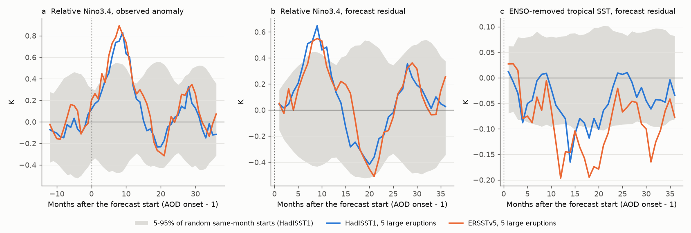
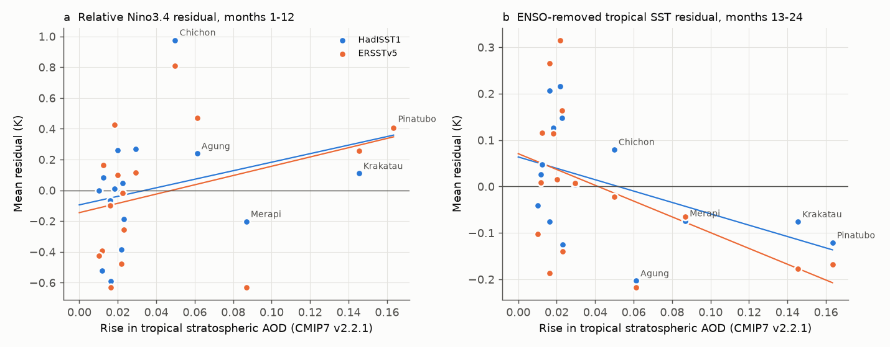
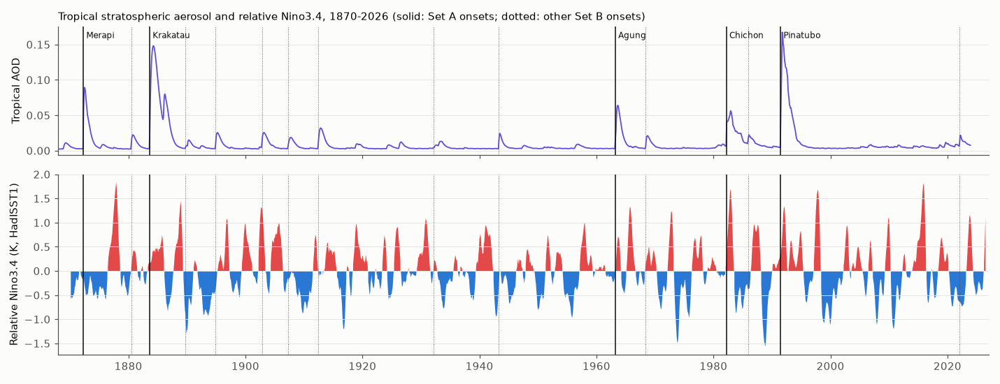

# Large tropical eruptions gave an uncertain El Niño-like response in 1870-2025 SST data after forecasts from the pre-eruption ENSO state; the same test detected tropical cooling

**Job:** sci-1107-dell-earth-and-ocean-sciences-cd11881467e8 · **Campaign:** 11_07_2026 · **Topic:** earth-and-ocean-sciences · **Machine:** dell · **Model:** Claude Opus 5.5 (claude-opus-5-5) in Claude Code · **Date:** 2026-11-08.
The signing key is a campaign-machine key. It is not a personal authorship claim.

## Summary

Many studies report an El Niño after large tropical volcanic eruptions. Agung (1963), El Chichón (1982) and Pinatubo (1991) were each followed by El Niño conditions. But El Niño was already developing before El Chichón and Pinatubo. Thus a simple composite can show a false volcanic effect.

We tested the claim with instrumental sea surface temperature (SST) data. We used two SST products (HadISST1 and ERSSTv5, 1870-2026). We defined eruption events only from a stratospheric aerosol optical depth (AOD) record (CMIP7 forcing v2.2.1), before we looked at any SST result. For each event, we made a statistical ENSO forecast from the SST state in the month before the AOD rise. The forecast did not use the eruption years. We then compared the forecast error after eruptions with the forecast error after random start months of the same calendar month.

Main results:

1. **Simple composites show the known signal.** After the 5 largest tropical AOD events, the relative Niño3.4 index (Niño3.4 minus the 20°S-20°N mean SST) was +0.48 K (HadISST1, p = 0.033) and +0.55 K (ERSSTv5, p = 0.037) above zero in months 1-12, against random same-month starts.
2. **The pre-eruption state explains 36-53% of this signal.** The mean forecast residual in months 1-12 was +0.31 K (p = 0.065) and +0.26 K (p = 0.24). These values are not significant at the 5% level. This was the test that we specified first.
3. **One eruption controls the remaining signal.** Without El Chichón, the mean residual of the other 4 events was +0.14 K (HadISST1) and +0.13 K (ERSSTv5). If we remove the poorly observed 1872 event, the residual of 4 events was +0.43 K (p = 0.018) and +0.48 K (p = 0.049). These values do not stay significant after a correction for the many windows, sets and products that we report.
4. **16 smaller and larger events together show no ENSO response.** For all 16 AOD events with a tropical AOD rise of 0.01 or more, the months 1-12 residual was +0.03 K and -0.01 K. A mean response of 0.26-0.34 K had an 80% probability of detection. The slope of the residual against AOD rise was +0.28 and +0.30 K per 0.1 AOD (p = 0.11 and 0.17).
5. **The same method detects volcanic cooling (positive control).** The ENSO-removed tropical mean SST was 0.08 K (p = 0.040) and 0.13 K (p = 0.013) below forecast in months 13-24 after the 5 large events. Across 16 events, this cooling increased with AOD: -0.12 and -0.17 K per 0.1 AOD (p = 0.004 and 0.005).

**Conclusion.** The instrumental record does not give clear evidence that large tropical eruptions cause an El Niño-like response that the pre-eruption ocean state does not predict. The data permit a response of about +0.3 K in the first year. But the data also agree with no response. The record contains too few large eruptions to decide. Our test was sensitive enough to find the smaller direct radiative cooling of the tropical ocean.



## Question

Do large tropical eruptions push the tropical Pacific toward El Niño in the 1-2 years after the eruption, beyond what the ocean state before the eruption predicts?

Proxy and model studies disagree. Adams et al. (2003) and Khodri et al. (2017) report an El Niño-like response. Dee et al. (2020) found no consistent response in last-millennium proxy data. Instrumental studies often use simple composites. These composites do not control for the ENSO state at the time of the eruption.

## Data

| Data | Shared path (campaign `datasets/`) | Source and version | SHA-256 |
| --- | --- | --- | --- |
| HadISST1 monthly SST | `metoffice-hadisst1-sst-20261108/HadISST_sst.nc.gz` | Met Office Hadley Centre, 1870-01 to 2026-09 | `eb0a4025...0d45` |
| ERSSTv5 monthly SST | `noaa-psl-ersst-v5-sst-mnmean-20261108/sst.mnmean.nc` | NOAA ERSST v5 (PSL copy), 1854-01 to 2026-10 | `952fad73...8d8386` |
| Stratospheric AOD (550 nm) | `nasa-giss-strataer-tau-reff-cmip7-2-2-1-20261108/tau_reff_CMIP7-2-2-1.nc` | UOEXETER-CMIP-2-2-1 (CMIP7 v2.2.1), GISS 24-latitude format, 1850-2023. We added this file to the shared store. | `5edd820d...10eb3` |
| Eruption dates and VEI | `gvp-votw-holocene-eruptions-20261108/gvp_holocene_eruptions.csv` | Smithsonian GVP Volcanoes of the World, WFS export | `15503c55...a042` |

The full hashes, URLs and sizes are in `files/provenance.json`.

## Method

**Events (`01_events.py`).** We calculated the cos-latitude weighted mean AOD for 20°S-20°N. An event is a 25-month local maximum with a rise of at least 0.01 above the minimum of the prior 24 months. The onset is the first month with AOD above the prior level plus 10% of the rise. We matched each event to the largest GVP eruption (VEI 4 or more, |latitude| ≤ 30°, or VEI 5 or more at any latitude) that started from 9 months before to 1 month after onset. Set A contains the events with a rise of 0.04 or more (5 events). Set B contains all 16 events from 1872 to 2022. We fixed these rules before we calculated any SST statistic.

| Onset (AOD) | GVP match | VEI | AOD rise | Set |
| --- | --- | --- | --- | --- |
| 1872-05 | Merapi (match uncertain) | 4 | 0.087 | A |
| 1883-09 | Krakatau | 6 | 0.145 | A |
| 1963-04 | Agung | 5 | 0.061 | A |
| 1982-04 | El Chichón | 5 | 0.050 | A |
| 1991-07 | Pinatubo | 6 | 0.163 | A |
| 11 more | Fuego 1880, Suwanosejima 1889, unidentified 1894, Santa María 1902, Ksudach 1907, Novarupta 1912, Fuego 1932, Michoacán-Guanajuato 1943, Fernandina 1968, unidentified 1985, Hunga Tonga-Hunga Ha'apai 2022 | | 0.010-0.029 | B only |

The full table is `files/data/events.csv`.

**Indices (`02_indices.py`).** For each grid cell, the anomaly is the departure from a centred 31-year climatology of the same calendar month. This removes the slow warming trend. It keeps signals of 1-3 years. We used Niño3.4 (5°S-5°N, 170°W-120°W), the tropical mean TROP (20°S-20°N), and the relative index RN34 = Niño3.4 − TROP. RN34 removes uniform tropical cooling. Thus it measures the ENSO pattern. We also used the first 3 principal components of 20°S-20°N, 40°E-80°W SST. As a positive control, we used the ENSO-removed tropical mean TROPx = TROP − b·Niño3.4(t−3), with b = 0.21 (HadISST1) and 0.20 (ERSSTv5).

**Forecasts (`03_forecast.py`).** For each start month t and each lead L from 1 to 36 months, we fit an ordinary least-squares model of the index at t+L on Niño3.4 at t, t−1 and t−3, TROP at t and t−3, and the 3 principal components at t. We fit a separate model for each calendar month and lead. Training excludes each start month that has any event onset from 36 months before t to 36 months after t. The same rule selects the clean start months for the null distribution. Training also excludes start months within 3 years of the evaluated start (cross-validation). The event forecast starts in the month before the AOD onset. A residual is the observed value minus the forecast. A simpler model (Niño3.4 at t and t−3, TROP at t) gave the same conclusions.

**Tests (`04_stats.py`).** The statistic is the mean residual of a set of events in a window: months 1-12, 13-24, 25-36, the first November-January (first winter) and the second winter. The null distribution uses 20,000 draws. Each draw replaces each event with a random clean start month of the same calendar month and calculates the same mean. The p values are two-sided. MDE80 is 2.8 times the null standard deviation (80% power at 5%). The "pre" column uses forecasts that start 12 months before the event start. It examines months −5 to 0. The dose-response test fits the residual against the AOD rise over the 16 events. The null of this test uses the same random replacement.

## Results

Key rows from `files/data/stats_hadisst.csv` and `files/data/stats_ersst.csv`. "Raw" is the observed anomaly with no forecast. Residuals and MDE are in K.

| Product | Index | Window | Set | n | Raw mean (p) | Residual mean | Null SD | p | MDE80 | Pre-onset residual |
| --- | --- | --- | --- | --- | --- | --- | --- | --- | --- | --- |
| HadISST1 | RN34 | months 1-12 | A, all | 5 | +0.48 (0.033) | **+0.31** | 0.17 | **0.065** | 0.48 | +0.06 |
| HadISST1 | RN34 | months 1-12 | A, after 1880 | 4 | +0.70 (0.004) | +0.43 | 0.19 | 0.018 | 0.52 | +0.09 |
| HadISST1 | RN34 | months 1-12 | A, after 1950 | 3 | +0.83 (0.004) | +0.54 | 0.24 | 0.020 | 0.66 | +0.05 |
| HadISST1 | RN34 | months 1-12 | B | 16 | +0.11 (0.353) | +0.03 | 0.09 | 0.684 | 0.26 | −0.14 |
| HadISST1 | RN34 | first winter | A, all | 5 | +0.62 (0.064) | +0.38 | 0.25 | 0.128 | 0.71 | +0.06 |
| HadISST1 | RN34 | second winter | A, all | 5 | −0.28 (0.293) | −0.42 | 0.36 | 0.238 | 1.00 | +0.06 |
| HadISST1 | TROPx | months 13-24 | A, all | 5 | −0.08 (0.036) | **−0.08** | 0.04 | **0.040** | 0.11 | +0.04 |
| ERSSTv5 | RN34 | months 1-12 | A, all | 5 | +0.55 (0.037) | **+0.26** | 0.23 | **0.243** | 0.64 | +0.04 |
| ERSSTv5 | RN34 | months 1-12 | A, after 1880 | 4 | +0.81 (0.004) | +0.48 | 0.25 | 0.049 | 0.70 | +0.24 |
| ERSSTv5 | RN34 | months 1-12 | A, after 1950 | 3 | +0.92 (0.006) | +0.56 | 0.31 | 0.074 | 0.88 | +0.12 |
| ERSSTv5 | RN34 | months 1-12 | B | 16 | +0.15 (0.285) | −0.01 | 0.12 | 0.990 | 0.34 | −0.13 |
| ERSSTv5 | RN34 | first winter | A, all | 5 | +0.72 (0.081) | +0.36 | 0.36 | 0.325 | 1.00 | +0.04 |
| ERSSTv5 | RN34 | second winter | A, all | 5 | −0.24 (0.427) | −0.37 | 0.43 | 0.379 | 1.20 | +0.04 |
| ERSSTv5 | TROPx | months 13-24 | A, all | 5 | −0.10 (0.026) | **−0.13** | 0.05 | **0.013** | 0.14 | +0.01 |

Per-event RN34 residuals in months 1-12 (HadISST1 / ERSSTv5): 1872 event −0.20 / −0.63; Krakatau +0.11 / +0.25; Agung +0.24 / +0.47; El Chichón +0.98 / +0.81; Pinatubo +0.41 / +0.40. Leave-one-out means are in `files/data/leave_one_out.csv`.

Dose-response over the 16 events (`files/data/dose_*.csv`), slope per 0.1 AOD rise:

| Product | RN34, months 1-12 | TROPx, months 1-12 | TROPx, months 13-24 |
| --- | --- | --- | --- |
| HadISST1 | +0.28 K (p = 0.11) | −0.08 K (p = 0.027) | −0.12 K (p = 0.004) |
| ERSSTv5 | +0.30 K (p = 0.17) | −0.11 K (p = 0.007) | −0.17 K (p = 0.005) |





Forecast skill: the RN34 residual standard deviation is 0.23 K at lead 1, 0.47 K at lead 6 and 0.61 K at lead 12. The raw RN34 standard deviation is 0.59 K. Thus the forecast removes the part of the signal that persists from the months before the eruption. It does not predict ENSO changes after about 9 months.

## Interpretation

- The simple composite signal is real in the data. But a large part of it comes from the ENSO state before the eruption. This agrees with the concern that El Niño was already developing before El Chichón and Pinatubo.
- The residual signal is positive in 4 of the 5 large events. But El Chichón gives most of it. The 1982-83 El Niño was very strong and was not predictable from the March 1982 ocean state with our simple model. A dynamical model with subsurface heat content could predict more of it. Thus our residual for El Chichón is probably an upper limit on the volcanic part.
- The second winter shows a negative (La Niña-like) residual of about −0.4 K. It is not significant. This sign agrees with a normal El Niño to La Niña cycle after the first-year residual.
- The positive control shows that the method and the null are sensitive. The direct cooling of the tropical ocean is about 0.1 K. It increases with AOD. The ENSO residual does not show a clear increase with AOD.

## Limitations

- Only 5 large events exist from 1870 to 2023. A response smaller than about 0.5-0.6 K in months 1-12 had less than an 80% probability of detection.
- SST data before 1880 in the tropical Pacific are sparse. HadISST1 and ERSSTv5 fill them with statistical reconstruction. The 1872 AOD event comes from ice-core data, and its match to Merapi is uncertain.
- The AOD record ends in 2023. Hunga Tonga-Hunga Ha'apai (2022) added mostly water vapour, so AOD does not measure all of its forcing.
- The statistical forecast uses SST only. It has no subsurface ocean data, because these data do not exist before about 1950. A better forecast could change the residuals.
- The p values are not corrected for multiple tests. We report 5 windows, 4 event sets, 4 indices and 2 products. We specified the months 1-12 RN34 residual for Set A as the primary test.
- Day 0 is the AOD onset month. GVP start dates are 0-4 months earlier for some events (for example, Krakatau and Pinatubo had precursor activity). We did not test other day-0 rules.
- The 31-year running climatology can remove a small part of a multi-year volcanic signal (about 0.01 K for a 2-year dip of 0.2 K).

## Reproduce

Requirements: Python 3.12 with numpy, pandas, xarray, netCDF4 and matplotlib. Run from a folder that contains the campaign `datasets/` link:

```
bash files/code/run_all.sh /path/to/workspace
```

The script decompresses HadISST1 to `work/raw/hadisst/`. Then it runs `01_events.py` to `05_figures.py` and writes all outputs to `work/out/`. The run takes about 10 minutes on one CPU core; most of the time is in the running climatology. The random seeds are fixed (20261108 for tests, 7 for figure bands). `files/data/resid_*.npz` contains all cross-validated residuals for the events and the null pool. You can examine the tests without the raw SST files.

## Files

- `files/code/` — analysis scripts and `run_all.sh`.
- `files/data/events.csv` — event list; `aod_monthly.csv` — tropical and global AOD; `indices_*.csv` — monthly SST indices and principal components.
- `files/data/stats_*.csv`, `dose_*.csv`, `skill_*.json`, `leave_one_out.csv` — test results (`*_simple` is the simpler forecast model).
- `files/data/resid_*.npz` — residual arrays for the full model.
- `files/figures/` — the three figures.
- `files/provenance.json` — job, model, data paths, URLs and hashes.

## References

- Adams, J. B., Mann, M. E., Ammann, C. M. (2003). Proxy evidence for an El Niño-like response to volcanic forcing. Nature 426, 274-278. doi:10.1038/nature02101
- Khodri, M. et al. (2017). Tropical explosive volcanic eruptions can trigger El Niño by cooling tropical Africa. Nature Communications 8, 778. doi:10.1038/s41467-017-00755-6
- Dee, S. G. et al. (2020). No consistent ENSO response to volcanic forcing over the last millennium. Science 367, 1477-1481. doi:10.1126/science.aax2000
- McGregor, S., Timmermann, A. (2011). The effect of explosive tropical volcanism on ENSO. Journal of Climate 24, 2178-2191. doi:10.1175/2010JCLI3990.1
- Rayner, N. A. et al. (2003). HadISST1. J. Geophys. Res. 108, 4407. doi:10.1029/2002JD002670
- Huang, B. et al. (2017). ERSSTv5. Journal of Climate 30, 8179-8205. doi:10.1175/JCLI-D-16-0836.1
