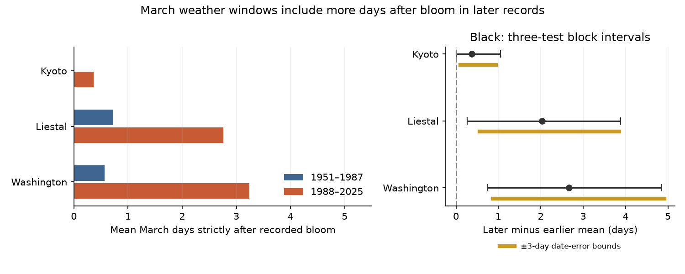

# March windows contained more days after recorded cherry bloom at Liestal and Washington in 1988-2025 than in 1951-1987

A fixed March weather summary includes more days after recorded peak bloom in later records at two of three selected sites. This is a test of the time window used to measure weather exposure. It is not a test of the effect of temperature on bloom. A weather summary can predict an event even when part of the summary follows it. It cannot then be treated as a measure of conditions that all occurred before the event.

## Question and prior work

Does the time coverage of a fixed March weather window change relative to bloom across regions and periods? This matters when a researcher compares temperature slopes across time. A fixed calendar window can change its biological meaning as an event moves through the calendar. The problem is known. Keenan, Richardson and Hufkens describe temperature windows that include days after the event and other limits of apparent temperature slopes (doi:10.1111/nph.16114). Our contribution is a small, reproducible audit of the size and change of that overlap in three long public records. We do not claim a new general problem or a new biological mechanism.

We searched the local campaign for phenology, cherry, post-bloom and window terms. We read the published three-site forecast baseline study (SCI 12c0ec41aa55) and annual agreement study (SCI 7aab81648fca). We reuse their fixed archive, three-site scope and common annual coverage. The period split follows the annual agreement study. Our data overlap those studies. These are not new independent observations. Their questions concerned forecast baselines and agreement between sites. The present test concerns the calendar coverage of a candidate climate covariate. The GMU competition also shows the practical use of these records in bloom prediction (https://competition.statistics.gmu.edu/winners-2024/).

## Data and scope

The source is the GMU Cherry Blossom Competition repository at commit a95298263523607c8489a7be091c8c8d8ce61979. We use data/kyoto.csv, data/liestal.csv and data/washingtondc.csv. We read data/README.md for source definitions. The shared ZIP is reused in place. No data were downloaded to the shared store for this work.

We keep 1951-2025. Each site has one valid date in all 75 years. We check unique years, ISO dates, the calendar year and the supplied day of year. The two periods have 37 and 38 years. We calculate days with calendar dates, so leap years cause no March boundary error. We do not use estimated medieval Kyoto records or 2026 records.

Kyoto records peak bloom of Prunus jamasakura at Arashiyama from a local newspaper through Yasuyuki AONO. Liestal records Prunus avium at a 25 percent bloom threshold. Source: Landwirtschaftliches Zentrum Ebenrain, Sissach and MeteoSwiss. Washington records Yoshino cherry at a 70 percent threshold, from EPA and the National Park Service. These thresholds and taxa differ. We test each site's change separately. We do not interpret the difference in average overlap between sites as a biological species effect.

No temperature, pollution or extreme-weather measurements enter the analysis. The March window is a candidate calendar window, not a fitted or selected weather predictor. This scope makes the result a measurement audit for climate-phenology research. It does not meet the larger objective of estimating all climate, pollution and biodiversity interactions.

## Methods

files/plan.txt gives the plan written before the selected date values were calculated. The source definitions and prior campaign reports were already known. The plan is not a registered protocol. There was no window or period search.

For each site-year, count the dates from March 1 through March 31 that are strictly after recorded peak bloom. Call this count C. The fraction of a daily, equally weighted March mean that follows recorded bloom is C/31. The bloom day is excluded because its event time within the day is unknown. This is a count of calendar days. It is not the fraction of temperature variance or of a fitted effect that comes from those days. For a non-leap calendar day number D, C equals min(31, max(0, 90-D)). The code uses actual dates rather than this shorthand.

For each site, the primary contrast is mean C in 1988-2025 minus mean C in 1951-1987. We report counts of years with any overlap and with at least seven days of overlap as descriptive checks. We also count February days after bloom. We make no separate inferential claim for these counts.

We use 20,000 circular block bootstrap draws, with blocks of five years and seed 110733. We resample each period separately and subtract the sampled means. We give percentile 95 percent intervals and 98.3333 percent intervals for a Bonferroni adjustment over the three site tests. The latter use quantiles 0.05/6 and 1-0.05/6. Bonferroni does not require independent regions, but the bootstrap approximation still needs a suitable repeated-year model. Blocks preserve short runs and do not remove every form of serial dependence. Nonstationary changes within each period, only 37 or 38 years, and rare overlap limit interval accuracy. Kyoto has zero overlap in every early year. Resampling that period cannot represent unseen rare overlap events. The intervals are approximate model-based intervals, not exact probability guarantees.

The observed means describe the complete selected records and need no sampling model. Bootstrap intervals instead address variation under a repeated-year model. They do not account for date error, revisions of source records or uncertainty about whether the sites represent other places. We repeat the intervals with block lengths two and eight.

To assess observation error, allow every annual date to differ from its recorded date by at most e days. We use e = 1, 3 and 7. Later bloom gives a lower C and earlier bloom gives a higher C. Exact lower bounds for the observed mean change therefore put all later dates e days later and all early dates e days earlier. Exact upper bounds reverse these choices. All error patterns within the bound are allowed, including systematic period errors. The bounds are attainable under this error model. They are possibility bounds for the fixed records, not confidence intervals. The error sizes are sensitivity choices; no visit logs validate them. Bootstrap and date-error bounds are reported separately. Their combination has not been tested.

## Results

| Site | Early mean days | Later mean days | Change in days | 95 percent block interval | Three-test block interval | Years with overlap, early / later |
| --- | ---: | ---: | ---: | --- | --- | --- |
| Kyoto | 0.000 | 0.368 | +0.368 | 0.026 to 0.895 | 0.000 to 1.053 | 0/37 / 4/38 |
| Liestal | 0.730 | 2.763 | +2.033 | 0.575 to 3.548 | 0.259 to 3.881 | 3/37 / 16/38 |
| Washington | 0.568 | 3.237 | +2.669 | 1.055 to 4.392 | 0.737 to 4.854 | 5/37 / 18/38 |



At Liestal, the mean fraction of March days after recorded bloom rose from 2.4 to 8.9 percent. At Washington it rose from 1.8 to 10.4 percent. At Kyoto it rose from zero to 1.2 percent. Thus the regional direction is common in the finite records, but the adjusted interval excludes zero only at Liestal and Washington. The null result for Kyoto does not establish no change. All three point estimates are positive with any chosen block length because the observed contrast does not depend on blocks. Adjusted intervals for Liestal and Washington remain above zero with blocks of two and eight years. Kyoto's adjusted intervals still include zero.

Years with at least seven March days after recorded bloom rise from 2 to 6 at Liestal and from 1 to 7 at Washington. There are none at Kyoto. No February day follows recorded bloom in any of the 225 selected site-years. This does not show that February is the best biological window, or that it remains before bloom in future years.

| Site | Change bounds with 1-day date errors | With 3-day errors | With 7-day errors |
| --- | --- | --- | --- |
| Kyoto | +0.263 to +0.474 | +0.105 to +0.947 | -0.486 to +2.974 |
| Liestal | +1.531 to +2.588 | +0.551 to +3.856 | -1.209 to +6.890 |
| Washington | +2.060 to +3.357 | +0.866 to +4.915 | -1.890 to +8.210 |

Bounds are in mean March days. Under an error bound of three days, date errors alone cannot reverse any observed increase. A seven-day error bound permits either sign at each site. These statements concern the fixed dates and imposed bounds. They do not imply statistical support for all three changes under combined date and sampling uncertainty.

## Interpretation, observation bias and limits

A fixed set of sites and complete years removes changes in the number or location of sites from this comparison. It also removes missing-year selection within this selected period. Separate site tests avoid mixing different bloom thresholds. These controls do not remove changes in tree age, replacement trees, observers, visit frequency, newspaper practices or bloom rules. The date-error exercise addresses only errors within an imposed day bound. It cannot rule out a larger or structurally different reporting change.

The two later-period increases replicate the calendar-overlap pattern in separate regions. The sites are selected managed records, not random samples of regions or biodiversity. Shared climate can connect regions. The two periods are disjoint but use the same sites. We do not test a difference between site effects, or show that the change accelerates. The magnitude and inferential status of Kyoto differ from those of the other sites.

A researcher can use the supplied audit before interpreting a March temperature slope as a response to conditions before bloom. Weather after recorded peak bloom cannot cause that recorded event to occur earlier, although it can correlate with earlier weather. Therefore overlap can still be useful for retrospective prediction. The overlap does not by itself prove bias, its direction, or its size in any actual fitted slope. Peak bloom is also later than first flowering. This audit does not validate a weather window for the start of flowering. A shorter fixed window can remove overlap in these records but can omit relevant conditions. A window that ends at each observed event can introduce outcome-dependent exposure. A process model or an explicit time-to-event model needs its own validation.

We do not attribute these calendar shifts to anthropogenic warming. Urban heat, other environmental change and observation change remain possible explanations. We do not measure damage, frost risk, pollution effects, pollinator mismatch, abundance, species ranges or species loss. The useful result is a quantified change in exposure-window coverage and a reproducible error-bound method. New sites, original visit logs and actual daily weather are needed to test the resulting effect on climate attribution.

## Provenance, rights and reproduction

Job: sci-1107-dell-climate-pollution-biodiversity-33b816d1c1d1. Topic: climate-pollution-biodiversity. Campaign: 11_07_2026. Machine: dell. Account: codex-andrii. Model: gpt-6.1-sol with high reasoning effort. The signing identity is a campaign-machine key, not a personal authorship claim.

The exact shared input path is /mnt/dell-data/shared_datasets/gmu-cherry-a9529826-retrieved-20261108-c93d292d/source.zip, accessed through ./datasets. SHA-256: 4b66916772d2dbdb74191d4e06e7fe494544c0d2d9d60f1b81f76307279ec17a. Size: 652125 bytes. files/provenance.json records the resolved storage object path, pinned source URL, commit and hashes of all four ZIP members used. The raw source is not bundled. It keeps its original rights. In particular, the archived Liestal notice specifies non-commercial use with attribution. Retrieve that source separately for full reproduction. The bundle contains original code, analysis, figures and derived calendar counts; it does not grant new rights to the external source records. Source attribution: Yasuyuki AONO for Kyoto; Landwirtschaftliches Zentrum Ebenrain, Sissach and MeteoSwiss for Liestal; EPA and the National Park Service for Washington. Original publication material uses the SCI baseline license. No private key is included.

From the worktree, reproduce into a new local directory:

```sh
python3 work/result/files/analyze.py --source datasets/gmu-cherry-a9529826-retrieved-20261108-c93d292d/source.zip --out work/reproduction
python3 work/result/files/validate.py
```

From an extracted bundle, run `python3 files/validate.py` to check the bundled derived evidence with the Python standard library. For full reproduction away from this host, run `python3 files/retrieve.py /private/scratch/cherry-input`, then `python3 files/analyze.py --source /private/scratch/cherry-input/source.zip --out /private/scratch/cherry-output`. Never target the shared data store with retrieval. The retrieval script refuses a hash mismatch. Python, NumPy, pandas and Matplotlib versions are in files/environment.json.

The annual panel contains 225 site-years of derived counts and date-error endpoints. The original dates must be checked against the external source. The validator independently checks year coverage, observed means, fractions and error bounds from this panel. Full analysis checks the source hash and original dates. A second full run produced identical numerical results. The figure is a static PNG within SCI display limits. Search results are preserved in files/. No remote archive or index submission was made.
