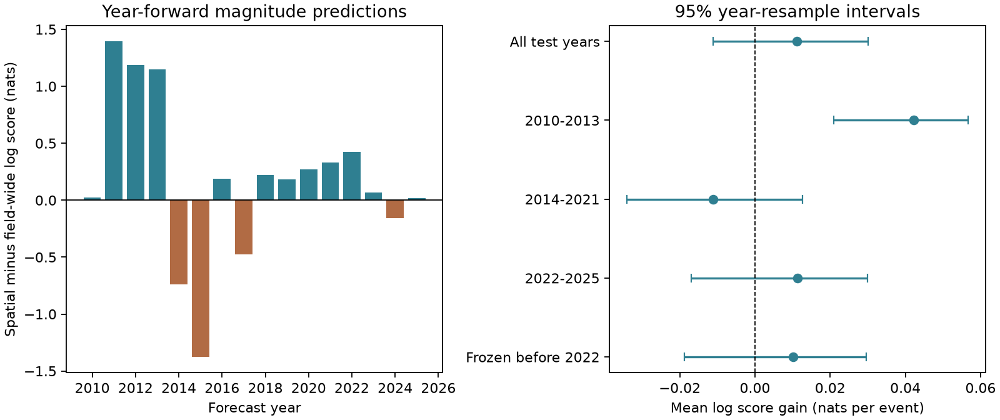
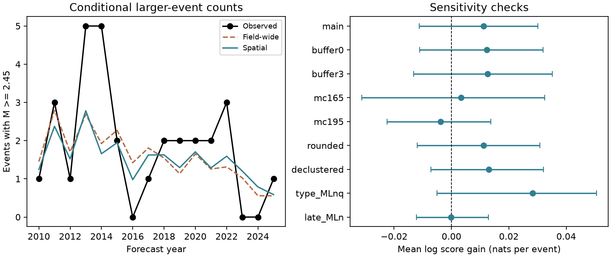

# A smooth location model gave no clear size prediction gain for 244 Groningen earthquakes in 2010-2025

## Result

A model that uses event location gave a small, uncertain gain in earthquake size prediction in the Groningen gas field. We used the KNMI catalogue and the NLOG field outline. For each test year from 2010 to 2025, we fitted the models with earlier events only. The test had 244 events with local magnitude at least 1.45.

The mean log score gain was **0.0111 nats per event**. The conditional 95% interval from resampled years was **-0.0112 to +0.0301**. An interval from two-year blocks was **-0.0150 to +0.0331**. Both intervals include zero. Thus this test did not establish a prediction gain for the location model.

A fit to all 368 events in 1995-2025 showed a spatial pattern. That descriptive pattern did not give a clear gain in the later-year prediction test. This result applies to one smooth coordinate model. It does not test a model that uses reservoir thickness directly.



Figure 1. Left: total log score gain in each test year. Positive values favour the location model. Right: mean gains with conditional 95% intervals from resampled calendar years. The fixed pre-2022 fit predicts only 2022-2025. These are conditional size predictions: each event and its location are already given.

## Question and prior work

Can a spatial pattern in earthquake sizes improve predictions for later events during a large change in field activity?

Kraaijpoel et al. (2022, DOI `10.1017/njg.2022.15`) found spatial differences in the Groningen magnitude distribution. They found reservoir thickness useful as a predictor and proposed its use in size forecasts. Muntendam-Bos and Grobbe (2022, DOI `10.1038/s41598-022-14451-z`) also found spatial differences. These studies motivate a test of prediction in later years. Our model uses coordinates as a simple proxy. It does not reproduce their physical models.

The prior campaign study `sci:sha256:5826d0025c5a4094dc4800a36b7aac6db106ef17174f534d965dd09643f9eb4a` found slow decay of Groningen event counts and a later shift toward the Loppersum area. It did not test conditional size prediction. We use its source paths and study-area rule. We do not use its code or numerical result files.

The new work is a time-ordered prediction test, a fixed pre-2022 test, and a reusable scoring tool. This is a retrospective test with a locally fixed analysis plan. It is not a registered prospective forecast. The plan and later decisions are in `files/analysis_plan.md` and `files/analysis_deviations.md`.

## Data and scope

We reused two shared source snapshots. No new data download was needed.

| Input | Shared path | Snapshot | Bytes |
| --- | --- | --- | --- |
| KNMI event catalogue | `./datasets/knmi-fdsn-events-nl-1986-2026-20261109/knmi_events_nl_1986_20261109.txt` | 2026-11-09 | 603207 |
| NLOG field outlines | `./datasets/nlog-gdn-wfs-field-outlines-20261109/nlog_fields_epsg4326.geojson` | 2026-11-09 | 3039567 |

The shared base path is `/mnt/dell-data/shared_datasets`. This is the campaign compatibility path on HP. `files/provenance.json` gives each exact URL, path and hash.

SHA-256 of the KNMI file:

`22bd2b1ce0e0d4ebca484836f87693d50571b510db9eab109e02df77435c7051`

SHA-256 of the NLOG file:

`a82954caf1f372c1dd7c1f1bbae3119a2cfb6f044d394aa490ef5c5153a32909`

The KNMI service is the Royal Netherlands Meteorological Institute Event Catalog, DOI `10.21944/ef5j-rz10`. Field boundary source: NLOG.nl. KNMI did not take part in this work and does not necessarily endorse it.

We selected events that meet all these rules:

- The catalogue type is `induced or triggered event`.
- The time is from 1995-01-01, inclusive, to 2026-01-01, exclusive.
- The epicentre is in the NLOG `GRO` polygon or within 0.5 km of it.
- The unrounded local magnitude is at least 1.45.

We projected coordinates to UTM zone 31N (EPSG:32631) for the distance rule. The field area is 969.23 square kilometres. The primary selection has 368 events. Of these, 124 occurred before 2010 and 244 were test events. We excluded the incomplete year 2026.

The magnitude cut follows the unrounded-data rule in Kraaijpoel et al. It represents a rounded local magnitude of at least 1.5. Most source magnitudes have more than one decimal place: 96.7% of selected values are not exact multiples of 0.1. We therefore used a continuous size model and checked a rounded model separately.

The selected catalogue has 242 `MLnq` and 126 `MLn` magnitude labels. The label changes around 2015. We did not determine why it changed. A label audit and separate tests reduce, but do not remove, concern about catalogue changes.

Raw inputs and event-level derived tables are outside the signed package. The package contains our code, figures, aggregate results and provenance. See `files/EXTERNAL_DATA_NOTICE.md` for source terms and attribution.

## Models and tests

Let `e = M - m0`, where `m0 = 1.45`. The conditional density of excess magnitude is

`f(e | x, y) = beta(x, y) * exp(-beta(x, y) * e)`, for `e >= 0`.

The field-wide model fits one positive rate, `beta`. Its maximum-likelihood estimate is `1 / mean(e)`. The location model fits three parameters:

`log(beta) = a + bx * (x_km - 700) / 10 + by * (y_km - 5900) / 10`.

Here `x_km` and `y_km` are UTM coordinates. In Gutenberg-Richter notation, `b = beta / ln(10)`. Neither model has an upper magnitude limit. We do not use these fits to infer a maximum possible earthquake.

For each year Y from 2010 to 2025, we fitted both models with events in 1995 through Y-1. We then scored each event in Y. No magnitude from Y entered its model fit. Parameters were estimated by maximum likelihood, with no choice of spatial model based on test scores.

The primary score is the log density under the location model minus the log density under the field-wide model. A positive value is a gain. A nat is one unit of the natural logarithm. We report the mean over test events, so years with more events have more weight.

The secondary score is the reduction in Brier score for `M >= 2.45`. This is rounded magnitude at least 2.5. We also sum those conditional probabilities to obtain expected larger-event counts at the observed locations. These counts do not predict how many events occur. They condition on the 244 observed events.

We formed 10,000 paired resamples of the 16 test calendar years. Each draw resamples both models' scores together. We divide the score sum by the event count in that draw. The interval is the 2.5% to 97.5% range. A second calculation uses circular blocks of two years. Both calculations condition on the fitted sequence. They do not refit models or include uncertainty in new training samples. Years may remain dependent beyond two years. These intervals have limited support in the short period tests.

We also fitted both models with data before 2022 and kept those parameters fixed for all 31 events in 2022-2025. This small sample tests transfer beyond the main period in the 2022 literature.

## Prediction results

| Test | Events | Mean log score gain | Conditional 95% year interval |
| --- | ---: | ---: | ---: |
| Primary annual fits, 2010-2025 | 244 | +0.01115 | -0.01119 to +0.03011 |
| Annual fits, 2010-2013 | 89 | +0.04221 | +0.02099 to +0.05675 |
| Annual fits, 2014-2021 | 124 | -0.01118 | -0.03413 to +0.01256 |
| Annual fits, 2022-2025 | 31 | +0.01129 | -0.01702 to +0.02989 |
| Fixed pre-2022 fit, 2022-2025 | 31 | +0.01007 | -0.01883 to +0.02966 |

The primary total log score gain is 2.7203 nats. The positive total comes mainly from 2010-2013. The intervals for those four years describe those years only. We did not test a causal effect of the 2014 production cuts or establish a change between periods.

The primary Brier scores are 0.10851 for the field-wide model and 0.10599 for the location model. The mean reduction is 0.00251. Its conditional 95% year interval is -0.00074 to +0.00531. Thirty events had `M >= 2.45`. The field-wide model assigned a total of 25.11 such events. The location model assigned 24.22. In the fixed late test, four occurred, against 3.39 and 4.13. We did not run a separate formal calibration rejection test.



Figure 2. Left: observed and expected annual counts of events with magnitude at least 2.45, conditional on the observed selected events. Right: log score gains with conditional 95% year intervals. `buffer0` and `buffer3` use 0 and 3 km boundary buffers. `mc165` and `mc195` raise the lower magnitude cut. `rounded` uses exact geometric likelihood after rounding to 0.1. `type_MLnq` uses only the older magnitude label. `late_MLn` is an exploratory later-label test.

## Checks and limitations

All planned log score sensitivity intervals include zero:

| Check | Test events | Mean log score gain | Conditional 95% year interval |
| --- | ---: | ---: | ---: |
| Field outline only | 240 | +0.01228 | -0.01109 to +0.03199 |
| Field plus 3 km | 253 | +0.01255 | -0.01314 to +0.03512 |
| Lower cut 1.65 | 161 | +0.00334 | -0.03124 to +0.03244 |
| Lower cut 1.95 | 82 | -0.00378 | -0.02245 to +0.01368 |
| Rounded magnitudes | 244 | +0.01117 | -0.01187 to +0.03083 |
| After nearby-event removal | 206 | +0.01301 | -0.00722 to +0.03211 |
| MLnq only, 2010-2015 | 118 | +0.02826 | -0.00512 to +0.05059 |
| MLn only, 2019-2025, exploratory | 70 | -0.00017 | -0.01216 to +0.01290 |

Nearby-event removal drops an event if an equal or larger selected event occurred within 5 km in the prior 30 days. It can bias the size distribution. It is a sensitivity check, not the primary catalogue. The rounded likelihood uses the exact geometric probability for each 0.1 bin. Its scores compare models within that discrete scale.

The older-label-only Brier gain has an interval above zero, but covers only six early years. It is a secondary subset result. It does not establish transfer to later years. The exploratory MLn-only test uses 56 training events before 2019 and tests 70 later events. It gives no clear gain.

For description only, the fit to all 368 events gives a likelihood-ratio statistic of 10.70 for two added coordinate parameters. Its nominal chi-square p value is 0.00476. The full-record field-wide b value is 0.947. The spatial fit assigns relatively more large events to the northwest. This fit includes the test events. It cannot serve as evidence of prediction skill. Its nominal p value also assumes independent sizes and a correct exponential tail.

Independent numerical checks passed. The field-wide fit matches its analytic solution. Primary spatial Hessians are positive definite. Newton corrections are below 0.00001. A separate optimizer with centred coordinates agrees within 0.0000001 in objective value. Independent SciPy density scores match the saved event predictions. Each training set ends before its test year. Aggregate totals match the event-level scratch outputs. The audit is in `files/results/verification.json`.

The main limitations are the small event sample, 16 test years, source revisions, magnitude uncertainty, changing magnitude labels and a simple spatial form. A retrospective test can inherit design information from prior work, even when each numerical fit uses only earlier events. The fixed late test has only 31 events. The uncertainty intervals condition on fitted models. They are not full uncertainty intervals for a new field or a new sequence. We did not test reservoir thickness, compaction, pressure, fault properties or stress. We did not fit event rates. These results do not show that spatial size variation is absent or that a physical spatial model cannot improve a forecast.

## Reproduction

The package requires Python 3.12 and the packages in `files/requirements.txt`. Exact used versions are in `files/results/versions.json`. Use a private environment if needed. One process with one numerical thread is sufficient. A complete repeat takes seconds on this host.

After extraction, run from the publication root:

```sh
python files/code/reproduce.py --datasets /path/to/shared_datasets --output /path/to/new_external_run
```

The output must be outside the publication. The script checks the two input hashes, regenerates all tables and figures, runs the independent audit, and compares all summary values with the bundled values. The comparison tolerance is 0.0000001. It writes selected events and per-event predictions only to `new_external_run/records`. It writes aggregate evidence to `new_external_run/aggregate`.

If the shared snapshots are not available, first run:

```sh
python files/code/fetch_inputs.py --output /path/to/external_inputs
python files/code/reproduce.py --datasets /path/to/external_inputs --output /path/to/new_external_run
```

The retrieval script downloads one file at a time and checks its hash. If a service has revised the file, it stops and labels the new bytes as changed. Exact reproduction then needs the preserved shared snapshot. A current retrieval may still allow a new analysis, but it is not an exact repeat of this result.

`files/results/summary.json` contains every reported score and interval. Annual CSV files preserve the score sums and counts. The main year-resample draws, fit coefficients, convergence checks, period summaries and source audit are also included. A complete separate repeat passed the numerical audit. Its summary JSON was byte-identical to the bundled result. See `files/results/reproduction_check.json`. No private scratch file is needed when the exact external snapshots are available. Open tests are listed in `files/CONTINUATION.md`.

## Provenance and publication rights

Job: `sci-1107-hp-earth-and-ocean-sciences-c7a6824772bc`. Topic: `earth-and-ocean-sciences`. Campaign: `11_07_2026`. Machine: `hp`. Assigned account: `codex-olen`. Model: `gpt-6.1-sol`, high reasoning effort. Analysis date: 2026-11-11.

The signing identity is a campaign-machine key. It is not a personal authorship claim. The exact SCI baseline license is supplied unchanged. The source data remain external, with their own terms. Our code, text, figures and aggregate statistical results are supplied under the baseline terms. See the external-data notice for attribution and the reason for keeping record-level source material out of this package.
