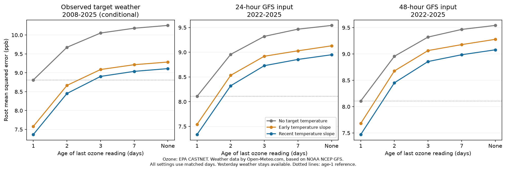

# Calibrated temperature did not replace timely ozone readings at 30 rural US sites in 2022-2025

We tested whether temperature forecasts can offset delayed ozone readings. We fitted five-year models with ozone ages of 1, 2, 3 and 7 days, or no ozone. Yesterday weather stayed available. Forecast weather was calibrated with earlier summers only. All ages used the same scored days. In 2022-2025 at 30 rural eastern US sites, the three-day ozone model with 24-hour GFS temperature cut squared error by 12.31% against the same-age reference. It still had 15.89% more squared error [limits 8.99 to 21.73%] than the one-day ozone model without target temperature. Against the one-day ozone model with the same temperature input, its reduction was -41.54% [-48.57, -34.69]. Limits are descriptive whole-year resamples from four summers. A longer 2008-2025 observed-weather test and tests with 48-hour inputs, early temperature slopes and no ozone are supplied. Final data, a selected network, a fixed afternoon mean and unknown archive delivery times limit operational use. This is a data-delay sensitivity test, not a live forecast trial or a causal climate test.

Weather data by [Open-Meteo.com](https://open-meteo.com/), based on NOAA NCEP GFS. Ozone and station weather: EPA CASTNET. Each panel uses matched days across all ozone ages. The dotted line is the one-day ozone model without target temperature. "None" omits ozone from the predictors.

## Main results

The primary comparison tests whether a temperature forecast pays for two extra days of ozone delay. Its error reduction was -15.89% [-21.73, -8.99]. It was positive in 0 of four summers. With temperature in both models, the three-day model gave -41.54% [-48.57, -34.69] reduction against the one-day model. Negative reduction means more error. These are separate questions: skill against a weaker delayed reference does not imply low absolute error.

The temperature term cut error by 12.31% [9.90, 15.00] against the three-day reference. However, its MSE remained 76.177 ppb squared, versus 65.730 for the one-day reference without target temperature. This is a reference-dependent skill result, not a failure to detect a temperature signal.

All 24-hour-input results use 15,480 site-days at 30 sites. The same days are used for the 48-hour-input test. Root mean squared error is in ppb. Intervals are descriptive 95% whole-year resamples.

| Age of ozone reading, days | No target temperature RMSE | Recent temperature RMSE | Reduction against same-age reference | Reduction against one-day reference without target temperature |
|---|---:|---:|---:|---:|
| 1 | 8.107 | 7.336 | 18.12% [15.14, 20.18] | 18.12% [15.14, 20.18] |
| 2 | 8.956 | 8.322 | 13.66% [10.70, 16.46] | -5.36% [-8.88, -1.63] |
| 3 | 9.321 | 8.728 | 12.31% [9.90, 15.00] | -15.89% [-21.73, -8.99] |
| 7 | 9.466 | 8.854 | 12.51% [9.87, 15.32] | -19.28% [-25.40, -11.57] |
| None | 9.542 | 8.949 | 12.04% [9.56, 14.73] | -21.84% [-28.72, -14.13] |

The primary comparison's leave-one-summer-out reductions range from -19.26% to -13.38%. These omissions retain the fitted predictions. They do not estimate how models trained on fewer years would behave.

## Secondary and longer tests

The table gives recent-temperature error reduction against the same-age reference. The long test uses realized target weather. It cannot establish live forecast skill.

| Ozone age, days | Observed weather, 2008-2025 | 24-hour GFS, 2022-2025 | 48-hour GFS, 2022-2025 |
|---|---:|---:|---:|
| 1 | 30.13% [28.65, 31.76] | 18.12% [15.14, 20.18] | 15.09% [12.10, 17.70] |
| 2 | 23.69% [22.20, 25.24] | 13.66% [10.70, 16.46] | 10.93% [8.25, 13.46] |
| 3 | 21.56% [20.38, 22.81] | 12.31% [9.90, 15.00] | 9.72% [7.59, 12.22] |
| 7 | 21.19% [20.13, 22.25] | 12.51% [9.87, 15.32] | 9.90% [7.43, 12.51] |
| None | 21.06% [19.94, 22.28] | 12.04% [9.56, 14.73] | 9.47% [7.08, 12.01] |

The full results retain every early-slope comparison, early/late long-period check and annual score, including adverse results. These settings were not selected by their test score.

## Question and prior work

The campaign tests which reported climate responses give later prediction gains. Its ozone work showed that an old temperature response can retain value with observed weather. A later test recovered skill from that old response through regression calibration of archived forecast weather. Both assumed access to yesterday ozone. We test the dependence of this result on the age of ozone observations. This extends one pollution system; it does not add an independent ecological family.

Data availability at issue time is an established forecast design concern. EPA's 2003 forecast guide states it directly. Model output statistics and persistence references are also established; the 2022 CAMS study compared these methods. Li, Wang and Lu (2025) studied changes in the US ozone-temperature slope. We do not claim a new calibration method, first recognition of data latency, or a new cause of ozone change. The new evidence is a controlled observation-age curve with later archived weather forecasts and a matched longer conditional test.

We searched published campaign results for ozone forecasts and delays before fixing the plan. We read and verified SCI 0e9a5b323ff054fa6a1a4996ef93c464413f677bab38048ef8c0521de51f92bb and read SCI 0dd123d426114b1277aeeacdea8f4408cf47e213c9797495c783c66365a44c72. We reused their licensed source loader and model functions. We read no sibling private workspace. PLAN.txt was written before delay scores. It is a local plan, not independent registration.

## Data and models

We reused immutable shared EPA CASTNET METDATA snapshots for 2003-2025 and SITE metadata, plus GFS Global forecasts served by the Open-Meteo Previous Runs API for 2021-2025. Exact shared paths, source URLs, file hashes, source versions, member hashes and helper records are in provenance.json and gfs_provenance.json. Shared sources were accessed here on November 11, 2026. No new download was needed. The original downloads were made on November 10.

The inherited panel has rural eastern US sites in 30-49 N and 90-65 W. A target is the mean of paired valid ozone and temperature readings at hours 12-19 local standard time in May-September, with at least six readings. Quality level is 3. The inherited loader corrects reversed validity labels in older source dictionaries, as already reported in the prior study. This is not the regulatory daily maximum eight-hour target. The fixed panel requires old and later coverage, so its site selection uses future availability.

For each ozone age k, use exact calendar joins to obtain Y(t-k). Omit it for the no-ozone setting. Every model also has T(t-1), T(t-1)-T(t-2), and a site-by-calendar-month intercept. The base model contains these predictors only. Temperature models add D=T(t)-T(t-1). Each test summer uses the five preceding summers. The recent model estimates all coefficients again. The early model fixes only the D coefficient from a joint 2003-2007 fit at that ozone age; it fits other terms again. The early coefficients differ across ages because the conditioning set changes. They are not literal published hourly slopes.

Training and scoring require all planned ozone lags, even for a model that omits them. Thus each age is compared on the same available days and uses the same training rows. This isolates an information contrast but selects complete records. We do not impute missing ozone. No current-summer outcomes enter a fit. Yesterday temperature stays available at all ozone ages. This is an ozone-only delay, not a complete station outage and not a change of forecast lead.

For GFS, we retain the inherited 30-site subset. UTC hours are changed to fixed local standard time and averaged over the same eight afternoon hours. A weather-only regression predicts D from forecast D, yesterday temperature, its prior-day change, and site-month intercepts. It uses up to three preceding summers, starting in 2021. It contains no ozone. Each test year's calibrated weather is identical across ozone ages. Forecast fields have nominal 24- or 48-hour offsets before valid time. The API does not establish run delivery cutoffs. In particular, yesterday weather remains an assumed available input even in the 48-hour-field comparison; this is not a verified two-day operational ozone forecast.

## Scores, uncertainty and checks

Square errors, absolute errors and signed errors are first averaged within each site-year. Site means are averaged equally within a year, then years equally. Skill is 1 minus the model MSE divided by reference MSE. The reported RMSE is the square root of that aggregate MSE, not a mean of individual RMSE values.

For four-year GFS tests, all 256 ordered four-year resamples give descriptive percentile limits. Four summers cannot establish long-run interval coverage. The long observed-weather comparison uses 10,000 circular three-year block resamples of whole spatial year fields. Fits stay fixed. Secondary ages, weather input age, early slopes and early/late periods have no multiple-comparison correction. They are sensitivity checks, not additional confirmed discoveries.

Independent explicit group-indicator regressions check all five ozone-age recent models in 2022 and the weather calibration in each test year. An independent row-weight formula checks all aggregate MSE values. Assertions check calendar joins and strictly earlier training dates. delay_audit.json gives maximum numerical differences. The new analysis was rerun from the rebuilt panel and forecast inputs; repeat_check.json records numerical agreement. We did not run the entire raw-source reconstruction a second time for this study.

## Scope and limits

A relative temperature gain can be large because the delayed reference has become weak. Comparison with a common timely reference is needed to show whether a climate term offsets the information lost through delay. This experiment quantifies that distinction in one system. It does not prove a general rule across population, timing, disease or abiotic responses.

This is a retrospective, final-data sensitivity study. It does not measure actual station reporting delays, forecast real-time data revisions, compare monitoring investment costs, or test a live warning service. A single ozone lag is a limited model of information available after a delay; richer lag histories, nearby stations, chemical transport models, humidity, radiation and wind may alter the result. Past weather and historical ozone are final quality-controlled values. Site selection uses later coverage. Restricting all ages to complete lag windows may exclude difficult outages. The recent forecast test has only four summers. The long weather test uses observed target weather and is conditional, not deployable. No causal temperature effect, climate attribution, health effect or biodiversity effect is established.

## Reproduction

Extract the verified SCI ZIP and change to its root. Run:

    python files/reproduce.py --data-root /mnt/dell-data/shared_datasets --output /tmp/ozone-delay-repeat-new

Use a new directory outside the signed draft. The command checks exact source hashes, rebuilds the daily panel, fits inherited reference models, reconstructs forecast weather, runs the delay experiment and its independent audits, and compares delay_results.json at relative and absolute tolerance 1e-9. Raw data and every daily transformed record stay in external scratch. If shared sources are absent, use --download instead of --data-root. This retrieves exact recorded URLs into external scratch and stops if scientific input hashes change. Only generationtime_ms changes in Open-Meteo metadata can be accepted through the semantic hash. On the campaign, add new reusable snapshots with campaign-dataset; do not overwrite shared files.

To redraw the static figure from reproduced summaries:

    python files/figure.py --root /tmp/ozone-delay-repeat-new/results

The source loader has resumable per-year caches and verifies their raw input hash. Numerical and plotting requirements are listed in requirements.txt. delay_results.json includes all contrasts and annual and leave-one-year-out scores. delay_annual.csv and delay_site_year.csv provide error summaries. delay_fits.json contains fitted parameters, not observations. Source retrieval metadata and original transformation code allow every daily result to be regenerated outside the publication. No private scratch file is required after this bundle is saved.

## Provenance and rights

Job: sci-1107-dell-climate-pollution-biodiversity-121be31d3bc7. Topic: climate-pollution-biodiversity. Campaign: 11_07_2026. Machine: dell. Account: codex-olen. Model: gpt-6.1-sol, high reasoning effort. One finite worker ran the study without child agents. Numerical library threads were limited to one. The campaign-machine signing key is not a personal authorship claim.

The exact SCI baseline LICENSE applies to bundled code, text, figures and aggregate evidence. Raw external data and daily transformed databases remain outside. EXTERNAL_DATA_NOTICE.md supplies source attribution, terms and prior-code credit. No source license was replaced. No private key is bundled. This worker made no remote archive upload or index submission.

## References

- SCI 0e9a5b323ff054fa6a1a4996ef93c464413f677bab38048ef8c0521de51f92bb. Weather regression restored ozone forecast skill with an old temperature slope at 30 rural US sites in 2022-2025.
- SCI 0dd123d426114b1277aeeacdea8f4408cf47e213c9797495c783c66365a44c72. Recent temperature coefficients reduced ozone forecast error with archived GFS weather.
- EPA (2003). Guidelines for Developing an Air Quality (Ozone and PM2.5) Forecasting Program. EPA-456/R-03-002. https://nepis.epa.gov/Exe/ZyPURL.cgi?Dockey=2000F0ZT.TXT .
- Model output statistics applied to CAMS ozone forecasts (2022). doi:10.5194/acp-22-11603-2022.
- Li, Wang and Lu (2025). Anthropogenic emission controls reduce summertime ozone-temperature sensitivity in the United States. doi:10.5194/acp-25-2725-2025.
- EPA CASTNET use and citation: https://www.epa.gov/castnet/data-use-and-citation .
- Open-Meteo Previous Runs API: https://open-meteo.com/en/docs/previous-runs-api . Terms: https://open-meteo.com/en/licence .
