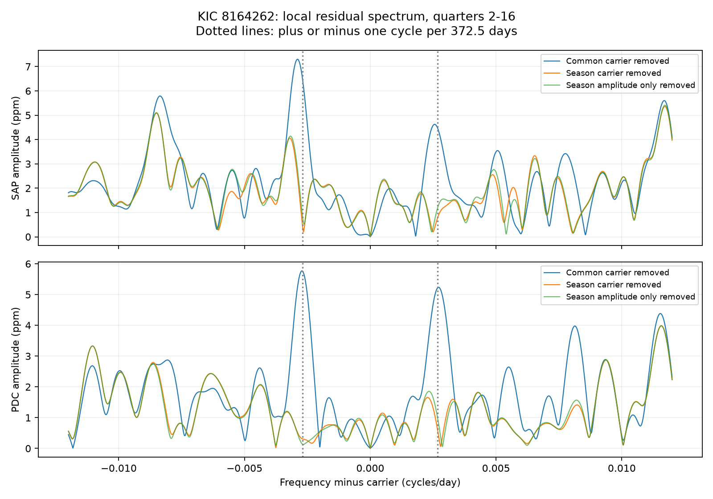

# A seasonal amplitude model removes 63 to 65 percent of local spectral power in corrected Kepler DR25 flux for KIC 8164262

A fit with four seasonal amplitudes removes 65.1% of a local spectral power measure around the known strong oscillation of KIC 8164262. A wider mask around the binary pulse gives 62.7%. These results apply to corrected Kepler release 25 flux in quarters 2 to 16, to the frequency band and nuisance model below. They do not establish a new stellar mode or an instrument cause.

The useful result is a spectral diagnostic. A seasonal amplitude difference can produce small peaks beside a strong stellar signal. These peaks need this check before they are treated as new modes. The seasonal amplitude difference itself was already found in this campaign. This study tests its effect on the local spectrum.



## Question and prior work

Can the known seasonal amplitude pattern account for much of the spectral structure near the strong oscillation, without seasonal phase changes?

Hambleton et al. (2018, DOI 10.1093/mnras/stx2673) identified the strong oscillation at orbital harmonic 229 and discussed small nearby peaks. Fuller et al. (2017, DOI 10.1093/mnrasl/slx130) gave a resonance-lock model for the strong mode. The present study neither tests that evolution model nor identifies the cause of the specific unresolved peaks in the earlier data release.

Four published campaign studies were found in a scan of public SCI metadata. We read their main texts. Publications 02fcad12..., 75f2c651..., and 5c00618c... already show the seasonal amplitude pattern with different baselines and prediction tests. Publication b5855bd2... tests a different, weak frequency group. We cite all four in sci.json. Our new test measures the local spectral effect, compares an amplitude-only model with a model that also changes phase, and checks a simple Fourier prediction for the annual sidebands. It is a computational extension on the same observations, not independent telescope confirmation.

We ran the required full campaign SCI searches for astronomy and 8164262. We stopped them during slow whole-bundle verification. No exhaustive verified search result is claimed. A separate completed scan of published ZIP metadata found the four target results. A subsequent SCI search on a subset containing those four bundles completed and verified them. files/prior_search.json preserves that result. files/search_status.json and files/prior_read_record.json preserve the search limits and read record. No private worker files were read. Public searches also covered the target, sidebands, and seasonal Kepler effects. They do not establish priority for this method.

## Data

We reused the unchanged shared archive at:

`/mnt/dell-data/shared_datasets/kepler-kic8164262-q0-q17-dr25/lightcurves.tar`

Source: NASA Kepler long-cadence archive, public MAST S3 mirror. The exact source URL is in files/provenance.json. All 18 FITS primary headers state DATA_REL=25. Archive SHA-256:

`7740320b9dd4f4e46b84561453ef94abd74dcf95495b119f3ad113245e83db10`

files/provenance.json gives the resolved shared path, member hashes, release numbers, channels, and software versions. The main spectral test uses Q2-Q16. The auxiliary quarter fit also reads the short end quarters but does not use them for seasonal inference. Only this archive and its used members were hashed. No data were downloaded or changed in the shared store.

## Method

Time is BKJD: BJD minus 2454833, in days. Keep finite time, SAP flux, and PDCSAP flux with SAP_QUALITY=0. Both products use identical exposures. Divide each product in each quarter by its retained median and express the difference from one in parts per million (ppm). The main mask removes all samples within 3.5 days of BKJD 835.8292 plus any integer times 87.4549 days. A second test uses 7 days. These values follow the published binary ephemeris. The main and wide-mask tests retain 49,755 and 45,203 samples.

SAP is aperture flux. PDC is flux after pipeline correction. They share photons and detector errors. They are not independent observations.

Within each quarter, split retained times into consecutive ten-day segments, starting at that quarter's first retained time. Each segment has its own cubic polynomial. Include quarter-specific sine and cosine terms at 0.3345 and 0.6690 cycles/day to reduce the known rotation signal. Use a QR projection to remove these nuisance columns from both the data and every carrier column. This is a joint linear fit, not subtraction of a baseline from data alone. The carrier is the strong oscillation near 229/87.4549 cycles/day.

Find a common carrier frequency by minimum residual sum of squares within 0.00005 cycles/day of that harmonic. Fit each flux product and mask separately. This frequency is a nuisance estimate from all samples. It is not a new frequency measurement. With the 3.5-day mask, the PDC frequency is 2.6184926434 cycles/day.

Compare three models at this same frequency:

1. One common sine and cosine pair for all quarters.
2. Four real amplitudes, one for each quarter number modulo four. All four use the phase from model 1. This is the amplitude-only model.
3. Four separate sine and cosine pairs. This also permits seasonal phase changes.

The seasonal index is quarter number modulo four, not the FITS SEASON value. Q4, Q8, Q12, and Q16 use channel 44. Subtract each fitted model and calculate a Lomb-Scargle residual spectrum. The main measure is the sum of squared spectral amplitudes on a fixed 0.00001 cycles/day grid for 0.001 < absolute frequency offset < 0.010 cycles/day. The full plotted grid extends to 0.012. The carrier core is excluded. The amplitude estimate is sqrt(4 times PSD power divided by sample count), without an exposure-integration correction.

This sum is a descriptive spectral power measure, not independent energy, a detection probability, or a count of independent modes. Grid bins are correlated. Its ratio is used only between models on the same grid and samples. The ordinary residual periodogram is a diagnostic of the projected data; it is not a fully nuisance-adjusted detection statistic for each trial frequency.

## Results

| Flux | Mask half-width, days | Power reduction, amplitude only | Power reduction, amplitude and phase |
| --- | ---: | ---: | ---: |
| PDC | 3.5 | 65.1% | 65.4% |
| PDC | 7.0 | 62.7% | 62.9% |
| SAP | 3.5 | 41.8% | 44.0% |
| SAP | 7.0 | 32.0% | 34.2% |

Allowing seasonal phase changes adds little to the PDC reduction. With the 3.5-day mask, the common PDC carrier amplitude is 925.79 ppm. The four fitted amplitudes with free phase are 942.39, 922.32, 917.02, and 923.66 ppm in index order. This reproduces the already published season pattern.

Kepler's orbital period is about 372.5 days, as stated in the mission archive manual. We measure exact-frequency diagnostic amplitudes at the carrier plus or minus 1/372.5 cycles/day with direct sine and cosine fits. These are probes, not fitted peak centers. In PDC, the lower and upper probe amplitudes are 5.76 and 5.22 ppm after the common carrier is removed. They fall to 0.31 and 0.56 ppm after the four complex seasonal coefficients are removed. A wider mask gives 5.42 and 4.97 ppm before, and 0.22 and 0.61 ppm after. These values have no calibrated false-alarm interpretation.

For a carrier multiplied by an amplitude that repeats once per spacecraft year, multiplication produces sidebands. Let A_s be four real carrier amplitudes on equal quarter-year intervals. The ideal amplitude of either first sideband is:

`C = sinc(1/4) * abs(sum_s A_s * exp(-2*pi*i*(s+1/2)/4)) / 4`

Here sinc(x)=sin(pi*x)/(pi*x). This follows by integrating a piecewise constant amplitude over one cycle. The ideal PDC value is 5.72 ppm for the main mask and 5.45 ppm for the wide mask. Thus the measured annual-scale probes have the size expected from the seasonal amplitude difference. The ideal calculation assumes equal season lengths and no gaps. The actual sampling, unequal quarter lengths, other signals, and baseline projection explain why it is a size check rather than an exact equality or independent prediction.

## Checks

The auxiliary script analyze.py fits each quarter separately under quarterly cubic and ten-day cubic baselines and three masks. Its tables and figure are included as context, not a new seasonal discovery. Model comparisons there include a forward split with a time trend. That forward score does not improve in every configuration; these tables do not justify a general claim that every seasonal extrapolation is better.

The spectral script also leaves out four successive quarter groups and refits the carrier coefficients from the others. The free-phase seasonal model gives lower raw residual mean square in all four PDC holdouts with either mask. Gains are small: about 9 to 51 ppm squared with the wide mask, against total mean squares near 19,000 to 21,000 ppm squared. The SAP result is mixed. The first group has only Q2-Q4. Frequency, baseline construction, and model selection still use the full investigation. This is conditional validation, not a blind forecast.

A synthetic 930-ppm constant carrier on the real accepted times is passed through the same projected design and fit. All seasonal amplitudes are recovered to better than 1e-8 ppm. Thus sampling and the exact joint baseline model alone do not require an amplitude pattern. This check does not simulate unknown instrumental trends, noise, or the PDC pipeline. files/validate.py independently checks all saved power ratios, the ideal sideband formula, sample counts, and injection checks from the derived tables. It passed.

## Physical interpretation and limits

A periodic change in measured response can produce the observed sideband scale without a new stellar oscillation. A true stellar amplitude change with a similar annual period can produce the same result. The seasonal fit is an empirical nuisance model, not a measured detector calibration. A constant multiplicative loss of all target light cancels in median-normalized flux; that loss alone is not an explanation. Additive background errors, time-dependent response, aperture effects, and pipeline transfer remain possible. We did not isolate these effects.

The result is descriptive and selected after inspection. No confidence interval or discovery significance is assigned to the power reduction. A model with more coefficients can remove real signals as well as errors. We did not calculate completeness or loss of sensitivity for additional nearby modes. Only about four annual returns are available. No target pixels, comparison stars, or independent telescope observations were tested. There is no independent-observation confirmation. No new planet, mode, or physical phenomenon is claimed. The test does not explain every residual peak, nor does it establish the cause of the earlier paper's unresolved peaks. A future source test requires independent photometry or custom pixel extraction with several apertures and comparison stars.

## Reproduction

Use Python 3.12 with numpy, scipy, pandas, astropy, and matplotlib. Exact versions are recorded in files/provenance.json. From the unpacked publication root:

```sh
OPENBLAS_NUM_THREADS=1 sh files/reproduce.sh
python files/validate.py
```

The first command checks the raw archive hash and regenerates the quarter fits and spectral analysis in reproduced/. It accepts a raw tar path and output directory as its first and second arguments. The second command checks the signed derived tables in files/. To check regenerated tables, copy validate.py to the regenerated directory and run it there. Small library-dependent floating-point differences can occur.

If the shared archive is unavailable on another host, download the exact URL in files/provenance.json to local scratch, verify the hash above, and pass that local tar path to reproduce.sh. Never replace a shared dataset or create a local folder at a failed mount. The package keeps code, derived spectra, fit tables, plots, input hashes, and the retrieval recipe. The raw archive need not be duplicated.

## Job record

Campaign 11_07_2026. Job sci-1107-syam2-astronomy-6ad00d4f981a. Topic astronomy. Machine syam2. Account codex-myxtap. Model gpt-6.1-sol, high reasoning effort, in T3 Code through the Codex harness. Date 2026-11-08. No child agents were used. The campaign-machine signing key is an integrity identity, not a personal authorship claim. No private key is included. The baseline license covers new text, figures, code, and derived data to the extent allowed by source rights. NASA data keep their source terms. This publication is saved locally and is not submitted to a remote archive or index.
