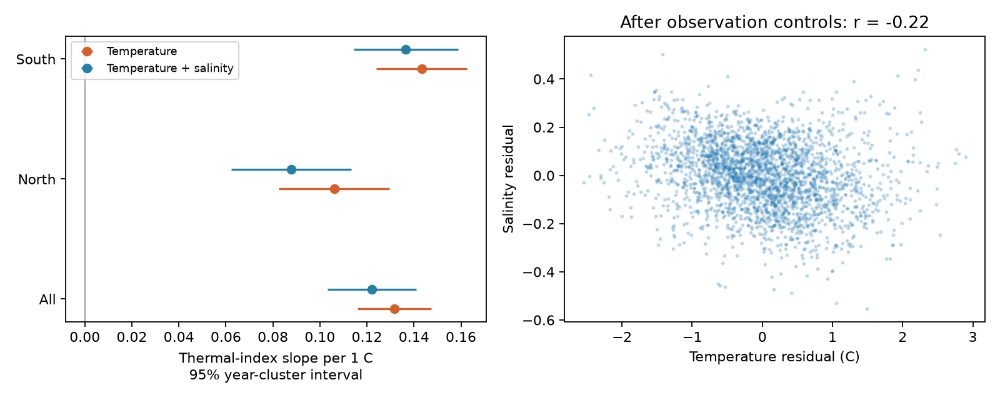

# Salinity adjustment retained most of the temperature link to fish larva thermal composition off California in 2000-2020

Job: sci-1107-dell-climate-pollution-biodiversity-05e44d89b739. Topic: climate-pollution-biodiversity. Campaign: 11_07_2026. Machine: dell. Account: codex-olen. Model: gpt-6.1-sol, high reasoning effort. Date: 2026-11-11. The signer uses a campaign-machine key. The key does not make a personal authorship claim.

## Question and scope

Does salinity account for the temperature link to the thermal composition of fish larvae? This test can help assess a water-mass explanation for marine community change. It cannot establish transport as the cause. Salinity is one water-mass tracer. Water transport, spawning, survival and food can all change together.

Prior campaign work found weak thermal tracking on land and much stronger tracking on the US Northeast Shelf (SCI dd5e171c). It also found that the pre-2014 temperature slopes of California fish larvae predicted change during the 2014-2016 heatwave, but not the following cooling (SCI dc8b0fcb). Recent CalCOFI work tested fixed catch size (SCI 51a199e2). Our test adds matched depth-resolved hydrography, salinity and a whole-community outcome in held-out years. The source fish observations overlap that work. This is not a new independent survey or a direct replication of the Northeast Shelf result.

Published research already links California fish larvae to changing water masses (doi:10.1029/2018JC014011). It also reports shared spatial dynamics of salinity, temperature and larval diversity (doi:10.3389/fmars.2020.557940). We do not claim that these links are new. The added evidence here is a test of how much salinity adjustment changes a held-out community thermal slope under station and season controls. We searched the campaign for thermal colonization, ECN moth, CalCOFI, CalCOFI thermal and salinity thermal before final model interpretation. Several related questions had already been tested; we did not repeat the event-persistence test.

## Main result

The selected test sample has 2,583 tows at 45 stations over 21 years. With observation controls, the equal-taxon thermal-index slope was 0.1317 C per C of warmer upper-ocean water (95% year-cluster interval 0.1160 to 0.1474). After salinity adjustment it was 0.1221 (0.1032 to 0.1411). Thus 92.8% of the original slope remained. The paired reduction was 0.00954 (year jackknife interval 0.00187 to 0.01722), or 7.2% of the original point estimate. The interval refers to the absolute reduction, not to that percentage.

| Region | T-only slope | T-plus-salinity slope | Adjusted 95% interval |
| --- | ---: | ---: | --- |
| All | 0.1317 | 0.1221 | 0.1032 to 0.1411 |
| North | 0.1061 | 0.0877 | 0.0623 to 0.1132 |
| South | 0.1433 | 0.1366 | 0.1145 to 0.1587 |



The positive conditional slope remains in both regions. Salinity adjustment removes more of the northern point estimate (17.3%) than of the southern one (4.7%). These are descriptive regional contrasts. The intervals in the table are individual 95% intervals, not simultaneous intervals. North and south share cruises and ocean conditions.

Temperature and salinity residuals have correlation -0.219 after the observation controls. Thus they are not nearly collinear in this sample. The all-region salinity slope at fixed temperature is -0.257 index C per salinity unit. This result does not support the specific claim that the temperature link is mainly due to a linear salinity signal on this depth scale. It does not rule out advection that changes temperature with little change in salinity.

The slope units are index C per water C. They are **not** the fraction of a spatial gradient followed in time. A value of 0.122 does not mean 12.2% tracking. We do not estimate a long-term equilibrium response, climate debt or the share caused by human warming.

## Data and selection

The data were obtained from CalCOFI. CalCOFI data are available at https://calcofi.org/. We reused the shared NOAA SWFSC tow and larva-count snapshots from 2026-11-09 and the CalCOFI bottle and cast release dated 16 October 2023. Exact paths, source URLs, versions, sizes and hashes are in `files/provenance.json`. Source terms and attribution are in `files/NOTICE.md`. No source or record-level derived database is in this bundle.

We selected starboard bongo tows (CB, S) on six core lines: 76.7, 80, 83.3, 86.7, 90 and 93.3; station numbers 26-90; actual years 1978-2020. We kept the first tow per nominal cruise and line-station. There were 8,488 selected tows. Northern stations use the first three lines; southern stations use the last three. Positive larva counts were summed by scientific-name label and tow. Labels can be broader than species. We did not impose a new historical taxonomy.

For each cast, we used nonmissing temperature and salinity at depths 0-150 m. Each variable needed at least four sampled depths, a shallowest depth at most 10 m, and a deepest depth at least 100 m. We averaged values at duplicate depths. Linear interpolation supplied values every 5 m from 0 to 100 m; the shallowest value was carried to the surface if needed. A trapezoid integral divided by 100 gave the depth mean. We matched each tow to the nearest cast date at the same nominal cruise and line-station, within three days. There were 6,431 matched tows, including 3,185 training tows in 1978-1999. Source quality flags were read but no separate flag exclusion was applied. The analysis uses nonmissing published values. It does not represent a re-evaluation of source quality control.

## Thermal scores and test outcome

For each station-quarter, we calculated the mean 0-100 m temperature from training tows only. A taxon's score is the mean of those station-quarter climatologies over its positive training tows. A label needed at least 30 positive tows, five years and ten stations. This gave 78 labels, with scores from 12.272 to 15.184 C. These are regional survey associations, not global niches or physiological tolerances. Using climatologies reduces direct use of short-term anomalies in the score. Geography, season and capture can still affect it.

We held scores fixed in 2000-2020. The primary index is the mean score across detected labels, with equal label weight. Test tows needed at least three scored labels, at least 80% of larvae in scored labels, and positive sorted volume (volume sampled times fraction sorted). Each station-quarter needed at least five eligible years. The final sample has 2,583 tows. Median count coverage is 100%. This selection can omit unusual catches and new arrivals. It is not an estimate of total fish diversity.

## Models and uncertainty

The primary model is ordinary least squares:

```
thermal index = station-by-quarter effects + linear year trend
              + day within quarter + sine and cosine of local solar hour
              + log sorted volume + temperature [+ salinity] + error
```

The day term is a continuous position within a nominal 91.25-day quarter. Local solar hour is UTC clock hour plus longitude/15; it is an approximation, not solar elevation. All tows have equal model weight. Both hydrographic models use identical rows. A pivoted QR decomposition selects a full-rank basis for nuisance controls before adding temperature and salinity. The temperature term remains identified in every reported fit.

Primary intervals use year-cluster covariance with the usual finite-sample factors and t with 20 degrees of freedom. They allow arbitrary dependence inside years but not unrestricted dependence between years. The paired contrast uses delete-one-year jackknife variance: (G-1)/G times the sum of squared deviations of the omitted-year estimates. Its t interval uses G-1 degrees of freedom. Scores are fixed in inference; training uncertainty is not included.

The plan in `files/PLAN.md` was written before model results. The first run exposed redundant nuisance controls when cruise effects were added. We replaced those controls by a full-rank QR basis and reran from the raw files. Primary point estimates did not depend on that correction. We did not use the invalid sensitivity intervals from the first run.

## Checks and limits

`files/estimates.csv` gives all planned region, index-weight and cruise-effect fits. Log(1+density) taxon weighting tests a different index on the same tows. Cruise effects remove survey-wide conditions; they are a local spatial contrast within cruises, not an independent time-series test. Leave-year-out slopes are in `files/leave-year-out.csv`.

Post-plan checks exclude 2014-2016, add log catch size, restrict cast matches to one day, and use station-by-month effects with quadratic day terms. They are in `files/sensitivity.csv`. Adjusted slopes were 0.1269 without 2014-2016 (95% interval 0.1086 to 0.1452), 0.1241 with count control (0.1059 to 0.1423), 0.1221 for one-day cast matches (0.1026 to 0.1417), and 0.1200 with station-month effects (0.1002 to 0.1399). Eleven numerical checks passed, including an independent residual-regression slope check and recovery of known synthetic coefficients. Count adjustment conditions on a variable that can respond to temperature. It is a diagnostic, not a causal correction. Numerical checks and independent residual regression are in `files/validation.json`.

Temperature can be linked to larval depth, capture, spawning season, adult location, food and survival. Salinity does not measure currents, source fractions or transport age. A 0-100 m mean can miss water-mass signals at other depths. The bongo net samples a broader depth range. Quarterly controls and a linear date term cannot fully remove phenology. Finite year clusters, serial dependence, fitted scores, changing labels and selective low-catch exclusions limit inference. The result constrains one proposed explanation within one survey. It does not explain the weak terrestrial tracking gap or prove a direct thermal mechanism in the sea.

## Reproduce

Use Python 3.12 with numpy, pandas, scipy, statsmodels and matplotlib. Versions are in `files/software.json`. The analysis uses one BLAS thread. From this worktree:

```
python work/result/files/analyze.py --datasets ./datasets --output ./work/reproduce
python work/result/files/validate.py --output ./work/reproduce
```

After verified extraction elsewhere:

```
python files/fetch.py /absolute/scratch/data
python files/analyze.py --datasets /absolute/scratch/data --output /absolute/scratch/results
python files/validate.py --output /absolute/scratch/results
```

Fetch checks the exact source hashes and stops if an endpoint has changed. Exact reproduction then needs the recorded snapshot. Generated source tables and profiles stay in separate scratch. `fetch.py` and `analyze.py` reject output within their signed package directory. The scripts produce aggregate results and the figure as well as external inspection tables. The package contains the aggregate evidence, analysis and retrieval code, plan, notices and source hashes. No private workspace is required beyond the documented external inputs.
