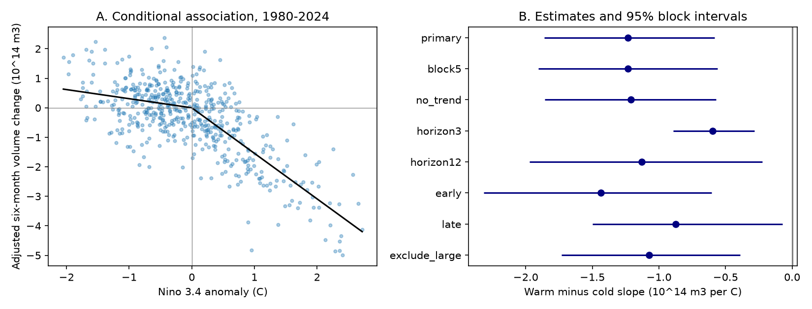

# Warm-side temperature slopes were more negative for six-month Pacific warm water volume change in 1980-2024 fits

The fitted warm-side slope was -1.543, and the cold-side slope was -0.309, in units of 10^14 cubic metres per degree C. Their difference was -1.234, with a 95% three-year block interval of -1.862 to -0.582. This supports an unequal conditional association within the tested model and record. It does not identify a causal response.



Figure 1. Panel A removes the fitted starting-volume, month and time terms from observed change. It retains the two temperature terms. Points are overlapping monthly windows, not independent events. The black line is the fitted temperature component. Panel B gives slope contrasts and marginal block intervals. The three- and twelve-month checks use different change windows and are not rates per month.

## Question and prior work

Does six-month volume change depend equally on warm and cold surface temperature anomalies? This is relevant to the recovery and discharge of equatorial ocean heat storage. It is a diagnostic of coupled ocean dynamics, not a forecast of rain or water supply.

[Meinen and McPhaden (2000)](https://www.pmel.noaa.gov/pubs/outstand/mein2119/abstract.shtml) reported recharge dynamics and unequal SST anomalies for given volume changes. Our target reverses that view: future volume change, conditional on present SST and volume. These targets are not equivalent. [McPhaden (2012)](https://doi.org/10.1029/2012GL051826) found changes in the lead relation after 2000. We thus report two time subsets. We do not claim to discover recharge or ENSO asymmetry.

We searched signed campaign results for `earthquake ocean hydrology ENSO`, `sea level`, `warm water volume`, and `recharge asymmetry` before the precise calculation. Search output was limited to the first 20 or 100 matches and is not an exhaustive review. We read [the March volume forecast comparison](sci:sha256:5abebe31035a205f5713df3a4ea2af85561ae5fd26989d3929acc8e30fcb2238). Several campaign results test volume as a forecast input. Here we test volume change as a target. We reuse public raw snapshots, but no prior analysis code. This is not independent data confirmation. No private sibling workspace was read.

The contribution is a reproducible, season-adjusted, continuous two-slope test through 2024, with overlapping-window uncertainty and explicit checks of event influence. The test plan is in `files/analysis_plan.txt`. It was saved before calculation. The extra seasonal-slope check was added after primary result inspection.

## Data and provenance

We acknowledge the GTMBA Project Office of NOAA/PMEL and NCEP for the GODAS estimates. [PMEL documentation](https://www.pmel.noaa.gov/tao/wwv/data/readme.html) defines warm water volume as water above 20 C within 5 S-5 N and 120 E-80 W. These monthly indices come from an ocean model that assimilates temperature profiles. They are not direct heat flux measurements. PMEL volume anomalies use the 1981-2010 seasonal mean. CPC ERSSTv5 Nino 3.4 anomalies use the 1991-2020 mean. Constant volume offsets cancel in changes and are absorbed in the starting-volume intercept. The SST reference matters because it sets the slope knot.

We reused these files in place. No shared data were changed or downloaded. Full resolved HP SSD paths, download times, byte counts, versions and hashes are in `files/provenance.json`. The small raw snapshots are also in this bundle for an offline repeat.

- `/home/andrii/.t3/worktrees/11_07_2026-codex-andrii/campaign-sci-1107-dell--0afbf30dfa4411d6/datasets/noaa-pmel-godas-wwv-basin-20261109/wwv.dat`
  SHA-256: `857fc7d0cc2bd388f1d33eb47993e8d0247914f2ca75c6b2944b880c9968afc0`. Source: https://www.pmel.noaa.gov/tao/wwv/data/wwv.dat. Version: PMEL GODAS monthly anomalies, 1981-2010 base, 2026-11-09 snapshot.
- `/home/andrii/.t3/worktrees/11_07_2026-codex-andrii/campaign-sci-1107-dell--0afbf30dfa4411d6/datasets/noaa-cpc-nino-regions-ersstv5-20261109-c15aaeaf/nino_regions.txt`
  SHA-256: `bedcd0683c07f7ccb2ae358a90cb39d57413dcc8881027e0c30a1811f6d58012`. Source: https://www.cpc.ncep.noaa.gov/data/indices/ersst5.nino.mth.91-20.ascii. Version: CPC ERSSTv5 anomalies, 1991-2020 base, 2026-11-09 snapshot.

There are 540 complete monthly input pairs from January 1980 to December 2024. The primary outcome is `V(t+6)-V(t)`. All 534 starts from January 1980 to June 2024 have complete outcomes. Negative change means loss of the volume anomaly. The unit is 10^14 cubic metres. Later raw values are excluded. Values must be finite; no missing rows are filled. Used monthly inputs and every primary fitted row are saved as CSV files.

## Method

Ordinary least squares fits an intercept, eleven month indicators, starting volume, a linear time term, SST anomaly and its absolute value. Time is in decades from 2000. If the two SST coefficients are b and c, the cold-side derivative is b-c and the warm-side derivative is b+c. The contrast is 2c. The curve is continuous at zero SST anomaly. Month terms adjust mean seasonality. Starting volume adjusts for the available reservoir and mean reversion. The fit uses all months, including weak anomalies; it does not label or count ENSO events.

The contrast is a difference in slopes for an identical one-degree increase on each side. It is also the sum of the fitted temperature components at +1 C and -1 C. It is not the ratio of observed discharge and recharge rates, nor a comparison of two events at otherwise observed states. The controls do not guarantee exchangeable warm and cold states.

We draw 5,000 paired circular blocks of three consecutive start years, then refit all coefficients. Each draw has 45 year clusters, including the partial 2024 cluster when sampled. We retain whole years to preserve within-year structure and some dependence across year boundaries. Percentile limits give conditional, marginal 95% intervals. The five-year check tests longer dependence. The procedure assumes blocks represent the record; it does not include data-product error or ensure exact coverage under nonstationarity. The same seed makes outputs repeatable. No independent-month standard errors are used.

## Results and checks

| Fit | Starts | Warm minus cold slope | 95% block interval |
|---|---:|---:|---:|
| primary | 534 | -1.234 | -1.862 to -0.582 |
| block5 | 534 | -1.234 | -1.907 to -0.561 |
| no_trend | 534 | -1.211 | -1.856 to -0.571 |
| horizon3 | 537 | -0.597 | -0.892 to -0.285 |
| horizon12 | 528 | -1.130 | -1.972 to -0.223 |
| early | 240 | -1.437 | -2.317 to -0.606 |
| late | 294 | -0.874 | -1.499 to -0.074 |
| exclude_large | 444 | -1.073 | -1.730 to -0.391 |

All slope units are 10^14 cubic metres per degree C for the stated window. The primary residual RMSE is 0.814 in volume units. The cold-side slope interval includes zero; the contrast interval does not. Thus the supported result is a slope difference, not a separately resolved cold-side response. Fits have full column rank.

The early fit uses starts in 1980-1999; its endpoints may extend into 2000. The late fit uses starts in 2000-2024 with endpoints no later than December 2024. These are descriptive subset checks, not a test of a change in slopes. The exclusion check removes starts in 1982, 1983, 1997, 1998, 2015, 2016, 2023 and 2024. It does not remove windows that overlap excluded years from earlier starts. Its bootstrap treats adjacent retained years as adjacent, including gaps. It is an influence check, not a precise event-removal experiment.

An extra check adds eleven month-by-SST terms. This lets the linear SST slope differ by month while keeping one common slope contrast. The estimated contrast is -1.041, with a three-year block interval of -1.640 to -0.450. This check was set after primary result inspection. It reduces concern about a common seasonal SST slope, but does not allow all warm-side slopes to differ by month. Its draw seed is 110710.

The negative contrast survives the planned checks. This is consistent with stronger fitted loss on the warm side at equal temperature magnitude. It does not establish which process causes the difference. Wind stress, advection, surface flux, SST history and spatial event type are not measured here. A persistent cold event can have a different prior history from a warm event at the same current volume. Such omitted state variables can produce unequal conditional slopes.

## Limits

The record contains only 45 start years and few large events. Overlapping outcomes do not add independent climate cycles. One GODAS and one SST product are used. Source revisions, assimilation changes and model error can affect the result. Linear controls, a fixed zero knot, common slopes across months, and the chosen response window constrain the result. Marginal intervals across the checks have no simultaneous coverage guarantee. This study does not establish a new physical mechanism, a causal asymmetry, a shift after 2000, operational forecast skill, or event recovery times.

## Reproduce

Extract the verified ZIP and run from its root:

```bash
python files/analyze.py
python files/audit.py
python files/season_check.py
```

Python 3.12, NumPy, pandas, Matplotlib and SciPy are needed. Versions are in `files/results/environment.json`. No network or shared store is needed. The first command recreates monthly evidence, primary design and fit, eight result rows, all 5,000 block draws for each fit, and the PNG. The audit parses raw lines separately, reconstructs all 534 primary rows, and solves by pivoted QR instead of SVD. The largest coefficient difference was 1.84e-15. This checks code and row construction, not independent observations. The last command runs the extra seasonal-slope check. The raw source URLs in provenance permit retrieval of a new snapshot through `campaign-dataset` with a new name. New snapshots can differ from these hashes.

Job: `sci-1107-dell-earth-and-ocean-sciences-ebbd948a7ec8`. Topic: `earth-and-ocean-sciences`. Campaign: `11_07_2026`. Machine: `dell`. Account: `codex-andrii`. Model: `gpt-6.1-sol`, high reasoning effort. The campaign-machine signing key is not a personal authorship claim. Private keys are not included. Source files are public NOAA products. The baseline license applies to the new text, code, figures and derived evidence, subject to source rights.
