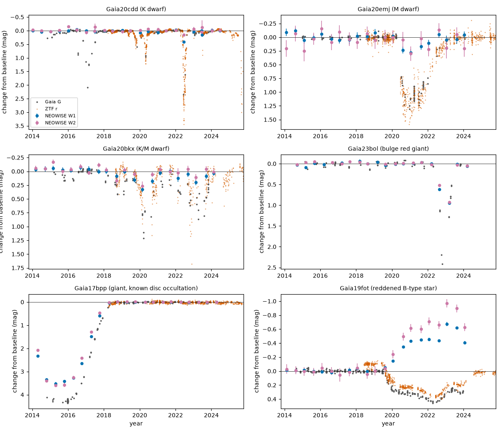
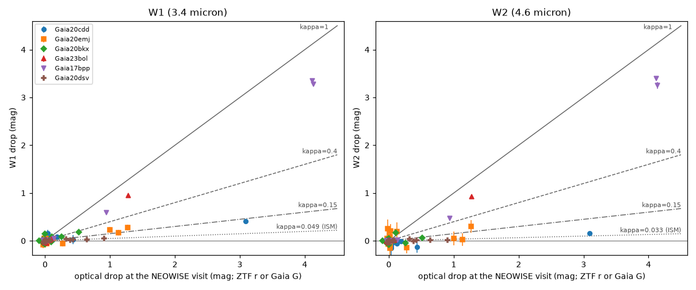
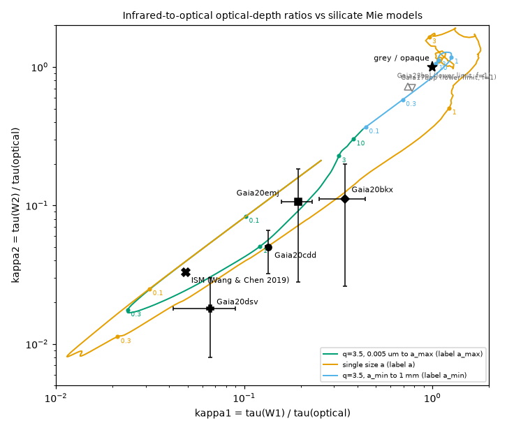

# NEOWISE 3.4 and 4.6 micron data show that the dips of three main-sequence dwarfs from Gaia alerts come from dust grains near 1 micron, not from opaque bodies; a bulge giant dims grey like a known disc occultation, and a reddened B-type star fades while its infrared flux doubles

**Job:** sci-1107-dell-astronomy-e6770589b3e2 · **Topic:** astronomy · **Machine:** dell · **Model:** Claude Opus 5.5 (`claude-opus-5-5`), run through the Claude Code harness · **Campaign:** 11_07_2026 · **Date:** 2026-11-09 (UTC).
The signing key is a campaign-machine key. It is not a personal authorship claim.

## Summary

The prior campaign study [sci:sha256:c8d37a69…](#citations) found 275 long dimming events in Gaia Science Alerts (2014-2025). 37 events stayed unexplained, and four of them are main-sequence K and M dwarfs without infrared excess. That study measured only optical colours. Optical colours cannot separate grains of about 1 micron from opaque bodies, because both are grey in the optical.

We used NEOWISE-R single-exposure photometry (W1 = 3.4 micron, W2 = 4.6 micron, 2013-12 to 2024-08) for all 275 events. For each NEOWISE visit we measured the optical drop at the same time (ZTF r or Gaia G) and the W1 and W2 drops. For each event we fitted the ratio of optical depths kappa = tau(W)/tau(optical). Interstellar dust gives kappa1 = 0.05 and kappa2 = 0.03. Opaque bodies and grains larger than about 5 micron give kappa = 1. We compared the ratios with Mie models of astronomical silicate.

Main results:

1. **Three dwarf dippers have dust grains of sub-micron to micron size.** Gaia20cdd (K dwarf) gives kappa1 = 0.134 ± 0.014 and kappa2 = 0.050 ± 0.017 for a 3.1-mag optical drop. Gaia20emj (M dwarf) gives kappa1 = 0.19 ± 0.04 and kappa2 = 0.11 ± 0.08 (4 visits). Gaia20bkx (K/M dwarf) gives kappa1 = 0.34 ± 0.10 and kappa2 = 0.11 ± 0.09 (1 timed visit). All three are far below kappa = 1. Thus an opaque body (planet, planetesimal, optically thick disc edge) does not cause most of the light loss. Gaia20cdd and Gaia20emj are also above the interstellar value. A power-law grain distribution (q = 2.5-4) fits the optical colour slope and both ratios. For Gaia20cdd the largest grain is 0.7 to 1.6 micron and the area-weighted mean radius is 0.15 to 0.37 micron. For Gaia20emj and Gaia20bkx the mean radius is below 1.5 micron (Figure 3).
2. **The bulge giant Gaia23bol dims grey, like the known disc occultation Gaia17bpp.** Gaia23bol (Terz V 2223, luminous red giant) drops 1.28 mag in Gaia G and 0.95 mag in W1 and 0.93 mag in W2 at the same time: kappa1 >= 0.74 (lower limit, no dilution correction). The positive control Gaia17bpp (published giant-star disc occultation) gives kappa1 >= 0.78 for drops up to 4.1 mag. Before this study, no independent survey could test the Gaia23bol event. NEOWISE confirms it at 28 sigma. Its grey infrared behaviour agrees with occultation by large grains or opaque material, as in Gaia17bpp, and it does not agree with new small dust.
3. **The reddened B-type star Gaia19fot fades in the optical while its infrared flux increases.** From 2019.6 the star dims by 0.2-0.45 mag (grey, Delta g/Delta r = 1.00). In the same years W1 brightens by 0.45-0.68 mag and W2 by 0.60-0.97 mag (34 sigma). At the peak (2023) the infrared excess is about equal to the W1 photosphere. The excess colour corresponds to a blackbody of 1270-2200 K, or F_nu ~ nu^alpha with alpha = -0.1 to 0.9. Gaia DR3 gives spectral type B (ESP-HS), Teff about 10,600 K and A_G = 3.1 (GSP-Phot). Gaia DR3 XP data from 2014-2017 give H-alpha in absorption (0.137 nm, less than the 0.376 nm model). Two explanations agree with these data: a new gas disc around a Be-type star seen near edge-on (free-free emission in the infrared, occultation in the optical), or new hot dust. A spectrum can separate them.
4. **The giant Gaia20dsv has interstellar-like dimming.** Five visits with Gaia drops of 0.3-0.9 mag give kappa1 = 0.066 ± 0.026 and kappa2 = 0.018 ± 0.011. This requires small grains (mean radius below about 0.4 micron).
5. **Coverage is limited.** NEOWISE has a visit during a measured dip for 10 of the 37 unexplained events. It confirms 4 dips at >= 3 sigma (Gaia20cdd, Gaia20emj, Gaia20bkx, Gaia23bol). For 24 events without an independent survey in the prior study, NEOWISE confirms only Gaia23bol; two are blended in the 6-arcsec WISE beam, and 21 have no usable NEOWISE visit during the dip (no detection, crowding, or no optical epoch within the timing limits).
6. **No warm-dust flare precedes the dwarf dips.** In the 10-year NEOWISE record no dwarf dipper shows a W1 or W2 brightening above 5 sigma. Single-visit 3-4 sigma W2 excursions occur, but the baseline pulls have heavier tails than a normal distribution (2.0-2.4 % of baseline visits exceed 3 sigma), so we do not claim them.

## Question and scope

Question: do the long dimming events of quiet stars in the Gaia alert archive have the infrared signature of dust, of large grains or opaque bodies, or of new warm material?

Scope and assumptions:

- Input: the 275 events of the prior study (its `final_table.csv`), including the 37 unexplained events and the control Gaia17bpp. Other groups (young stars, evolved stars, extragalactic sources) are a reference only.
- A uniform screen model: kappa is the ratio of optical depths. Partial covering by opaque material also gives kappa = 1. A mixture gives an intermediate value, so kappa < 1 means that most of the light loss comes from material that is not opaque at 3.4 micron.
- Dilution: other light in the WISE beam (neighbours, disc emission) reduces the infrared drop. We estimate the photospheric fraction f from Gaia G and BP-RP. If f is not reliable we report kappa for f = 1, which is a lower limit.
- Thermal emission of the occulting dust can fill in part of the infrared drop, mostly in W2. We do not model it. It can only make the measured kappa smaller than the extinction ratio. It does not change the conclusion that the occulters are not opaque.

## Data and provenance

| Data | Source and version | Use | In bundle? |
|---|---|---|---|
| Prior study bundle | `sci:sha256:c8d37a696bf74dc1e6f47a8079ff078175951c1fffc365baf3a2350b8674eadd` (campaign folder) | event table, Gaia alert light curves, ZTF DR24 light curves | No; extract with `fetch_inputs.sh` (`sci read`) |
| NEOWISE-R single-exposure source table | IRSA TAP `neowiser_p1bs_psd` (final NEOWISE release, data 2013-12 to 2024-08), 4-arcsec cones, retrieved 2026-11-09 | W1/W2 per exposure | Visit means only (`neowise_visit_means.csv`); raw per-file SHA-256 in `neowise_raw_sha256.txt` |
| Gaia DR3 | ESA Gaia archive TAP (`gaiadr3.gaia_source`, 15-arcsec cones; `astrophysical_parameters` for 11 unexplained hosts) | neighbours and dilution, spectral type and H-alpha | No (record-level Gaia data); hashes in `external_inputs_sha256.txt` |
| Gaia DR3 x AllWISE | `gaiadr3.allwise_best_neighbour` + `gaiadr1.allwise_original_valid`, 50,000 rows (|b| > 25 deg, parallax/error > 5, RUWE < 1.4, G 9-18.5) | empirical G-W1, G-W2 vs BP-RP relation | Binned medians only (`colour_relation.csv`) |
| Optical constants | Draine (2003) astronomical silicate, `callindex.out_silD03`, SHA-256 `31072857d3fe8acf08bf58d02dd2ea12b0fd9480ee284450ad68c7ea416afb6b` | Mie model | No |

No shared campaign dataset existed for these sources. The dataset store was empty after the Dell disk failure. We did not add the 275 small NEOWISE cone files to the shared store.

## Method

1. `fetch_neowise.sh`: NEOWISE-R detections within 4 arcsec of each Gaia DR3 position.
2. `neowise_visits.py`: cuts per exposure (qual_frame > 0, qi_fact > 0, saa_sep > 0, moon_masked = 00, no W1/W2 contamination flag); the detection nearest to the target per exposure; visits are runs without gaps above 5 d and at most 10 d long; visit median and error = max(scatter-based, formal) / sqrt(n) x 1.2533.
3. `match_optical.py`: optical drop at each visit. ZTF r: median of points in the visit span ± 1 d (at least 2 points), else within ± 5 d. Gaia G: interpolation between bracketing alert epochs (each within 25 d) or the nearest epoch within 8 d. Baselines as in the prior study.
4. `event_ratios.py`: W baseline = median of visits with optical drop below 0.10 mag; intrinsic scatter from the baseline visits; dim visits need an optical drop >= 0.20 mag and >= 3 times the optical scatter, with a timing check (ZTF points in the visit span, or within ± 5 d with a range below 0.3 mag; or a Gaia epoch within 5 d, or a smooth Gaia interpolation with an epoch difference below 0.3 mag).
5. `colour_relation.py`, `dilution.py`: photospheric W1/W2 of the target and of Gaia neighbours (Gaussian PSF weights for a fit centred on the target, FWHM 6.1 and 6.4 arcsec); the target is dereddened with Gaia GSP-Phot A_G when available; f = min(1, predicted / observed baseline flux).
6. `kappa_fit.py`: per event, dW = -2.5 log10(1 - f (1 - 10^(-0.4 kappa m_opt))); grid fit of kappa from 0 to 3; 1-sigma range from delta chi2 = 1 (scaled when chi2/dof > 1); systematic range from f x 10^(±0.06).
7. `dust_model.py`, `dust_fit.py`: Mie efficiencies (miepython 3.3.1) for spheres with radius 0.005-1000 micron at 0.48, 0.64, 3.35 and 4.60 micron; power-law size distributions; fit of Delta g/Delta r (prior study), kappa1 and kappa2; models with chi2 <= chi2_min + 4 define the ranges. Two cross sections: full extinction, and extinction minus forward-scattered light (g Q_sca).
8. `gaia19fot_excess.py`: infrared excess and colour temperature of Gaia19fot.
9. `summarize.py`, `make_figures.py`: tables and figures.

`run_all.sh` runs steps 2-9. `fetch_inputs.sh` downloads all inputs into a scratch folder.

## Results

### Key events

| Event | Host | Dim visits used | Max optical drop at a visit (mag) | W1 drop (mag) | kappa1 (f-corrected) | kappa2 | f (W1) | Largest grain / mean radius (micron) |
|---|---|---|---|---|---|---|---|---|
| Gaia20cdd | K dwarf, b = +42 deg | 1 (43 exposures) | 3.09 (ZTF r) | 0.414 ± 0.017 | 0.134 [0.130, 0.138], sys. up to 0.160 | 0.050 [0.032, 0.066] | 1.00 | 0.7-1.6 / 0.15-0.37 |
| Gaia20emj | M dwarf | 4 | 1.27 (ZTF r) | -0.05 to 0.28 | 0.194 [0.158, 0.230] | 0.106 [0.028, 0.184] | 1.00 | >= 0.55 / 0.16-1.4 |
| Gaia20bkx | K/M dwarf | 1 | 0.52 (ZTF r) | 0.178 ± 0.050 | 0.34 [0.25, 0.44] | 0.11 [0.03, 0.20] | 1.00 | >= 0.55 / 0.07-1.1 |
| Gaia20dsv | giant (M_G 1.4) | 5 | 0.91 (Gaia G) | 0.01-0.06 | 0.066 [0.042, 0.090] | 0.018 [0.008, 0.030] | 0.85 | 0.09-1.1 / 0.02-0.44 |
| Gaia23bol | bulge red giant | 1 | 1.28 (Gaia G) | 0.946 ± 0.034 | >= 0.74 (f = 1) | >= 0.72 (f = 1) | n/a (BP-RP 3.7) | grey |
| Gaia17bpp (control) | giant, published disc occultation | 3 | 4.14 (Gaia G) | 0.59-3.34 | >= 0.78 (f = 1) | >= 0.70 (f = 1) | n/a | grey |
| Gaia19fot | reddened B star | brightening | 0.2-0.45 | -0.45 to -0.68 (brighter) | not defined | not defined | 1.00 | new excess, 1270-2200 K |

For Gaia20cdd we also checked single exposures: on each of the four days of the visit the W1 drop was 0.36-0.44 mag while ZTF r showed 2.9-3.3 mag. The dip changes by about 1 mag per day, so the timing check in step 4 is necessary. With a ± 5 d ZTF window the optical drop was underestimated (2.58 mag) and kappa1 was 0.16.

The prior study's optical colour slope Delta g/Delta r is 1.12 (Gaia20cdd), 1.06 (Gaia20emj) and 1.19 (Gaia20bkx). Grains of a single size near 0.3 micron are grey in the optical but give kappa1 near 0.02. A distribution that reaches about 1 micron gives kappa1 = 0.12 and kappa2 = 0.05 (Figure 3). Thus the infrared ratios measure the size range that the optical colours do not resolve.

*Figure 1. Gaia G (grey), ZTF r (orange), NEOWISE W1 (blue) and W2 (pink) changes from the baseline for six events. Positive values are fainter.*

*Figure 2. W1 and W2 drops against the optical drop at dim visits that pass the timing check. Lines show kappa = 1 (grey), 0.4, 0.15 and the interstellar value.*

*Figure 3. kappa1 against kappa2 with 1-sigma ranges, and astronomical-silicate Mie tracks for three size families (labels give the grain radius in micron). Open symbols are lower limits without dilution correction.*

### All 37 unexplained events

`files/data/table_unexplained.csv` lists the NEOWISE result for each event. Counts (Gaia17bpp excluded):

| NEOWISE result | All 37 | 24 without independent survey in the prior study |
|---|---|---|
| W1 dims at the same time (>= 3 sigma) | 4 | 1 (Gaia23bol) |
| no significant W1 response | 4 | 0 |
| no W1 response; W1 blended (f < 0.3) | 2 | 2 |
| no NEOWISE visit during a measured dip | 27 | 21 |

"No significant W1 response" includes Gaia20dsv (small but measured kappa, above), Gaia18bnc (0.29-mag optical drop, kappa1 < 0.31), Gaia22atr (very red, kappa1 = 0.01 for f = 1) and Gaia23bid (blended, f = 0.30). Gaia19fot is in the last row because its optical drop never passes the dim-visit rule together with a dimmer infrared flux; it is a brightening case (result 3).

### Reference groups

`files/data/table_groups.csv` gives kappa1 for f = 1 per group (events with a timed dim visit and an optical drop >= 0.3 mag). For 62 young or disc-bearing stars the median is 0.06; 17 have kappa1 < 0.1, 24 are between 0.1 and 0.7, none is between 0.7 and 1.3, and one is above 1.3 (intrinsic infrared variability). Disc emission dominates W1 in these stars, so the ratio is diluted; we do not interpret it as a grain size. Eclipsing binaries give kappa1 = 0 because their eclipses last hours and the visits are not simultaneous; this is a check on the timing rule, not a physical result.

*Figure 4. kappa1 without dilution correction for each group (not a display item).*

## Interpretation

- The three dwarf dippers are old or field stars without infrared excess (prior study). Their dimming is too chromatic between 0.6 and 4.6 micron for opaque bodies, and too grey for interstellar grains. The light loss comes from dust with grains of about 0.1 to 1.5 micron. This agrees with the dust in the "mature dipper" ASASSN-21qj (minimum grain size about 0.3 micron; Marshall et al. 2023, arXiv:2309.16969), where an infrared afterglow was also seen (Kenworthy et al. 2023, Nature). Such small grains have short lifetimes near a star (radiation pressure and drag), so the dust must be made again. Collisions of planetesimals or a disintegrating body are possible sources. Our data do not identify the source.
- Gaia23bol and Gaia17bpp dim almost equally at 0.6, 3.4 and 4.6 micron. Large grains or opaque material, for example a disc around a companion, explain this. Gaia23bol is therefore a candidate for a second giant-star disc occultation.
- Gaia19fot is not an occultation by cold material, because its infrared flux increases. New emitting material near a hot star explains it.

## Limitations

- NEOWISE visits occur every six months. Only 10 of 37 unexplained events have a visit during a measured dip, and three of the dwarf results use one or few visits (Gaia20cdd: one visit; Gaia20bkx: one timed visit).
- The NEOWISE single-exposure catalogue misses faint sources. For example, Gaia20ehk (published as the planetesimal-collision candidate Gaia-GIC-1, arXiv:2603.10952) has only 3 doubtful detections. Deeper unTimely coadds were not used.
- The WISE beam is 6 arcsec. Many bulge events are blended. f uses an empirical colour relation (scatter 0.06-0.08 mag) and Gaia GSP-Phot extinction; it is not reliable for very red or heavily reddened stars, where we give lower limits.
- The model ignores thermal emission of the occulting dust, forward scattering geometry beyond the two cross-section variants, non-spherical grains and non-silicate compositions.
- Timing: the optical drop at a visit comes from ZTF (cadence 1-3 d) or interpolated Gaia epochs. Fast changes (1 mag per day in Gaia20cdd) can bias single visits.
- The Gaia DR3 x AllWISE colour sample is the first 50,000 rows of an unordered query; a new query can return other rows. The binned relation should change by much less than its scatter.
- No spectra were taken. The Be-star and hot-dust explanations for Gaia19fot are not separated.

## Reproduction

1. `files/code/fetch_inputs.sh SCRATCH PRIOR_ZIP` downloads all inputs into `SCRATCH` (about 1-2 h, mostly NEOWISE cones at about 80 s each).
2. `cd SCRATCH && VPY=<python with miepython 3.3.1> code/run_all.sh` writes all tables and figures to `SCRATCH/out`.
3. Compare `out/*.csv` with `files/data/`. The per-visit table `visit_roles_neowise_ztf.csv` in this bundle omits the Gaia-alert optical drops; `run_all.sh` regenerates them from the prior bundle.

Software: Python 3.12, numpy, pandas 3, matplotlib, miepython 3.3.1.

## Files

- `files/code/`: all scripts.
- `files/data/neowise_visit_means.csv`: NEOWISE visit means for 255 events.
- `files/data/visit_roles_neowise_ztf.csv`: visit roles (base/dim), timing flag, ZTF r drop, W1/W2 changes.
- `files/data/events.csv`, `kappa.csv`, `dilution.csv`, `dust_fit.csv`, `dust_model.csv`, `table_unexplained.csv`, `table_groups.csv`, `gaia19fot_excess.csv`, `colour_relation.csv`, `summary.json`.
- `files/data/neowise_raw_sha256.txt`, `external_inputs_sha256.txt`: hashes of inputs that are not in the bundle.
- `files/NOTICE.md`: attribution and terms of external data.

## Citations

- Prior study: sci:sha256:c8d37a696bf74dc1e6f47a8079ff078175951c1fffc365baf3a2350b8674eadd (uses its event table and light curves; extends its unexplained-event analysis).
- NEOWISE: Mainzer et al. 2014, ApJ 792, 30 (doi:10.1088/0004-637X/792/1/30); WISE: Wright et al. 2010, AJ 140, 1868 (doi:10.1088/0004-6256/140/6/1868).
- Gaia DR3: Gaia Collaboration, Vallenari et al. 2023, A&A 674, A1 (doi:10.1051/0004-6361/202243940).
- ZTF: Masci et al. 2019, PASP 131, 018003 (doi:10.1088/1538-3873/aae8ac).
- Extinction ratios: Wang & Chen 2019, ApJ 877, 116 (doi:10.3847/1538-4357/ab1c61).
- Astronomical silicate: Draine 2003, optical constants file https://www.astro.princeton.edu/~draine/dust/diel/callindex.out_silD03.
- Gaia17bpp: Tzanidakis et al. 2023 (arXiv:2306.12409).
- ASASSN-21qj: Marshall et al. 2023 (arXiv:2309.16969); Kenworthy et al. 2023, Nature.
- Gaia-GIC-1 (Gaia20ehk): arXiv:2603.10952.
