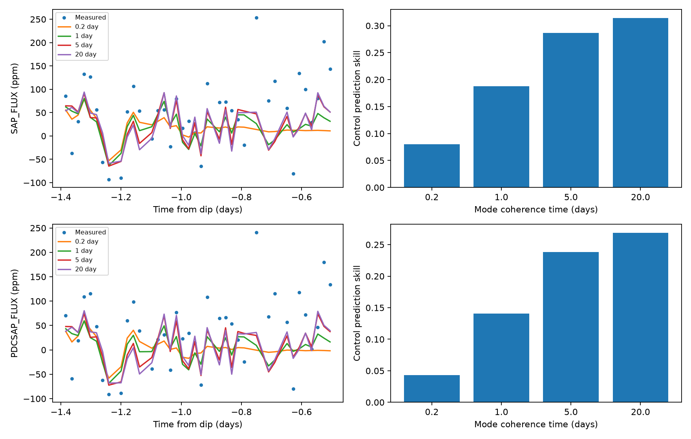
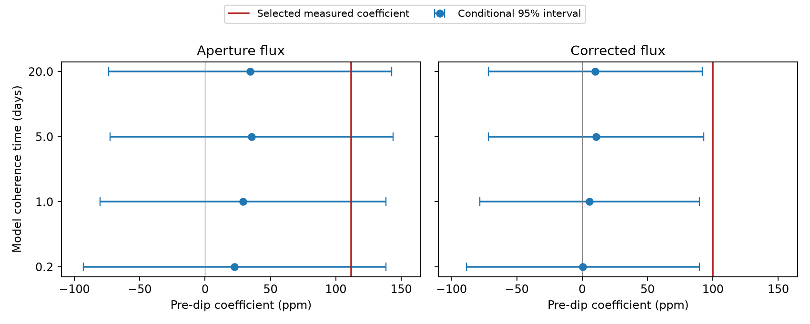

# Eight Kepler fits place the selected KIC 8027456 brightening within 2.3 conditional standard deviations

The selected pre-dip coefficient is 1.38 to 2.20 conditional standard deviations above a model prediction in eight fits to public Kepler release 25 quarter 15 data. These fits use four fixed coherence choices and two flux products. Mean predictions leave residual responses from 78.7 to 99.7 parts per million (ppm), but the noise model matters. This is not a new event detection.

## Question and prior work

Can a model with changing oscillations predict a selected increase in light before the known dip of KIC 8027456? This star is also called HD 182952. Kennedy et al. (2019; DOI 10.1093/mnras/sty3049) reported the known asymmetric dip. We test one possible stellar or instrument explanation of a weak nearby feature. We do not report a new object.

Campaign publication `sha256:925bf68b588009edda48b379bc875eab357972ffad3bd53bb63b01402febbb90` measured a positive Gaussian response before the dip. Its main aperture and corrected flux values were 111.9 and 99.9 parts per million (ppm). It tested linear pointing and background terms and sample deletion. Those tests did not remove the feature. Publication `sha256:f7bbb477ee64eb1e3a3253187033bd7255996c251e5663327fe5377185e8098d` tested stable sine waves fitted outside the event. Their predicted responses were small. It left changing modes open. We extend that test with a covariance model that permits changes in mode amplitude and phase. These models can also describe correlated instrument noise. They do not identify physical modes.

We searched the local campaign with SCI before selecting this question. A direct metadata pass through published ZIP files found the relevant studies while the broad SCI search was running. We read and verified both selected prior publications with `sci read`. No private worker files were used. The targeted literature search found the original event report and the celerite method paper (Foreman-Mackey et al. 2017; DOI 10.3847/1538-3881/aa9332). This is a follow-up of a selected feature, not a new blind survey.

## Data

The shared input is `/mnt/dell-data/shared_datasets/kepler-kic8027456-q15-dr25/q15.fits`. This is NASA Kepler release 25, quarter 15, long-cadence data. The source pipeline is SOC 9.3.31 r60524. The file has 506880 bytes and SHA-256 `55f138bf46a55b07b50bfa1355dc317d86dae011ce0104902711960e2c2592e4`. `files/provenance.json` gives the exact HTTPS source URL, shared path and resolved object path. We read the shared file without change. The package includes the exact input for offline use.

We keep rows with zero SAP_QUALITY and finite time, SAP_FLUX and PDCSAP_FLUX. Each flux is divided by its full retained-quarter median and expressed in ppm. BKJD is BJD minus 2454833. The flux products use the same observations. Their agreement is not independent confirmation. `files/samples.csv` preserves the selected flux and event predictions.

## Method

The reference dip time is c = BKJD 1448.9. The tested positive profile is a Gaussian centered at c - 0.75 day, with a standard deviation of 0.10 day. We average it at 21 points across a 0.02043365-day exposure. To measure its coefficient, we fit this profile with a quadratic time baseline to data within five days of c. We omit c - 0.5 through c + 2.1 day to exclude the known dip. We fit no center or width and impose no positive coefficient constraint. This reproduces the prior selected response.

Prediction training omits c - 1.15 through c + 2.1 day. Thus, the core of the brightening and all fitted dip samples are absent. The Gaussian at the nearest training boundary is 0.034 percent of its peak. Each control also omits data within five days of the known event. The quarter median used for normalization is not a prediction of local shape.

Frequency selection uses only samples before BKJD 1412, before every control and the event. The same frequencies and weights are used for all subsequent predictions in one flux product. A five-day time-window median, computed without masked samples, removes slow variation for this step. A greedy procedure selects six frequencies from 0.5 to 24 per day. At each step a Lomb-Scargle peak is refined and all sine and cosine coefficients are fitted again. Squared sine-pair amplitudes, normalized to sum to one, set six weights w_j. The upper frequency stays below the nominal long-cadence Nyquist scale. High-frequency modes can still have aliases in this band. We use the modes as functions on recorded sample times. We do not measure intrinsic pulsation frequencies or amplitudes.

The prediction model subtracts a quarter-wide quadratic fitted only to training data. Its residual covariance for time lag h is

`K(h) = S^2 exp(-abs(h)/5) + A^2 exp(-abs(h)/tau) sum_j w_j cos(2*pi*f_j*h)`.

A white-noise variance W squared is added on the diagonal. All times are in days. We test tau = 0.2, 1, 5 and 20 days. These are fixed choices, not inferred mode lifetimes. For each choice, two optimizer starts fit A, S and W by training likelihood. Each scale is bounded from 1 to 500 ppm. We retain the better objective. The predictive mean comes from celerite2. This kernel is positive definite; it represents damped random sine and cosine components plus a slow random component. It is not a complete physical stellar model. Exposure averaging is absorbed only as an effective sampled covariance, not modeled as an intrinsic light-source process.

We apply the same Gaussian coefficient estimator to the model prediction. The measured coefficient minus the predicted coefficient is the residual response. Apart from the common quarter-median normalization, no held-out event flux tunes the covariance. The test uses samples before and after each mask; it is not a forecast. A change in the slow component can contribute to the predicted coefficient; it is not assigned to a stellar mode.

Eight control centers are fixed at BKJD 1418, 1422, 1426, 1430, 1434, 1438, 1460 and 1464. They move the same mask and estimator through the later part of the quarter. We require at least 15 held-out pre-dip rows and at least 30 rows on each outer side. We keep the early-training frequencies and weights fixed and repeat covariance fitting for each control. Control prediction skill is one minus the pooled prediction squared error divided by the error from the quarter quadratic alone. Only the held-out interval c - 1.15 to c - 0.5 is scored. The control rank compares positive residual Gaussian responses. Controls can overlap and have different gaps. Ranks are descriptive, not false-alarm probabilities. There is no calibrated survey significance. A separate conditional Gaussian interval uses the fitted event kernel. It treats all outer samples as known and varies only the masked pre-dip samples. The coefficient weights come from the last row of the local design pseudoinverse. Its variance is the quadratic form of the conditional latent covariance plus fitted white noise. It fixes frequencies, weights, baseline and kernel scales. It omits parameter uncertainty and feature selection. This interval is not a survey detection probability. `files/predictive.py` and `files/predictive.json` preserve the calculation.

## Results

| Flux | Coherence time, day | Measured, ppm | Predicted, ppm | Residual, ppm | Rank / total | Control skill |
|---|---:|---:|---:|---:|---:|---:|
| SAP | 0.2 | 111.9 | 21.0 | 90.9 | 1/8 | 0.080 |
| SAP | 1 | 111.9 | 27.0 | 84.9 | 1/8 | 0.188 |
| SAP | 5 | 111.9 | 33.1 | 78.7 | 1/8 | 0.286 |
| SAP | 20 | 111.9 | 31.9 | 80.0 | 1/8 | 0.314 |
| PDC | 0.2 | 99.9 | 0.1 | 99.7 | 1/8 | 0.043 |
| PDC | 1 | 99.9 | 4.9 | 95.0 | 1/8 | 0.141 |
| PDC | 5 | 99.9 | 9.7 | 90.2 | 1/8 | 0.238 |
| PDC | 20 | 99.9 | 9.0 | 90.9 | 1/8 | 0.269 |

The valid control centers are 1422.0, 1426.0, 1430.0, 1434.0, 1438.0, 1460.0, 1464.0 BKJD. The table gives descriptive ranks that include the event. A rank of one has no control response as large as the event, but this small selected set cannot establish a small false-alarm probability. Pooled control prediction skill ranges from 0.043 to 0.314. Skill is measured against the quarter quadratic alone. It does not prove a stellar cause. The predictions remove only part of the selected response. A remaining positive coefficient does not establish forward scattering or exclude a random fluctuation.

The selected measured coefficient lies inside 4 of 8 conditional 95 percent predictive intervals. The fixed-kernel standardized residuals range from 1.38 to 2.20. These intervals describe a selected coefficient under one fitted Gaussian model. They do not correct for target or profile selection and cannot establish a survey false-alarm probability.

## Checks and limits

`files/audit.py` compares the fast covariance prediction and log likelihood with a direct dense matrix solution on irregular sample times, using a fitted kernel. `files/audit.json` records the errors and optimizer status count. All input bytes are checked before analysis. All 64 event and control fits, including frequencies, weights and fitted scales, are in `files/fits.json`. These checks test the solver and reproducibility, not the physical source.

The feature, profile and target were selected in prior work. Four coherence choices do not span all changing stellar signals. The small control set cannot resolve a small tail probability. Frequencies learned early in the quarter can become obsolete. Six greedy frequencies in the restricted 0.5-to-24 per day band can miss modes. The white-noise scale is fitted rather than set by the per-row pipeline errors. The slow covariance and quarter-wide baseline can fit or omit instrument variation. Bounds, local optima and changes in noise with time can affect predictions. Hyperparameter uncertainty is not propagated. Control skill measures a specific interval and baseline, not general predictive accuracy. A residual response does not prove that a separate event occurred.

No new pixel test, neighbor observation, color data, spectroscopy or independent telescope time series is supplied. The earlier linear instrument checks leave nonlinear effects and light blending open. A model with a low predicted response does not exclude all stellar variation. A model that predicts it need not establish a stellar cause. These tests do not confirm dust scattering, a comet, a planet, an orbital period or an unexplained phenomenon. The contribution is a reproducible test of a remaining alternative for one published feature.

## Reproduce

Use Python 3.12 and the package versions in `files/versions.json`. Install packages in a private environment with `pip install -r files/requirements.txt`. From a writable extracted package, run `sh files/reproduce.sh`. This verifies the bundled input hash, repeats all fits, makes the figure and runs the dense-solver audit. No network access is needed after package installation. To use existing shared raw data, pass its absolute FITS path as the script argument. For fresh retrieval, download the exact URL in `files/provenance.json` to local scratch and check the stated byte count and hash. Do not change the shared store. Derived output files are written next to the code.

Job: sci-1107-dell-astronomy-4faae90f21f4. Topic: astronomy. Campaign: 11_07_2026. Machine: dell. Account: codex-andrii. Model: gpt-6.1-sol, high reasoning effort. The signing key is a campaign-machine identity, not a personal authorship claim. This bundle is stored locally only. No private key is included. The baseline license applies to our text, code and derived results. The NASA data retain their source attribution.
