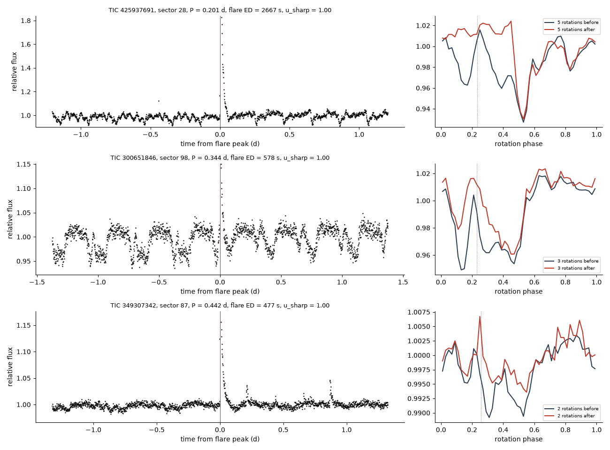
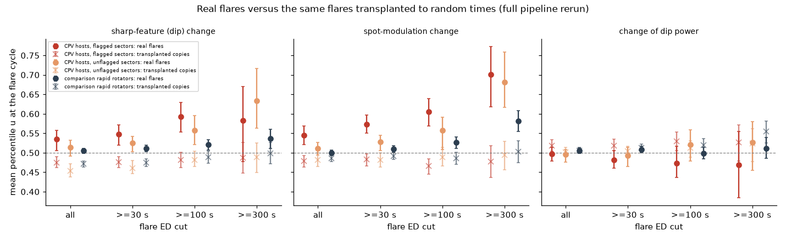
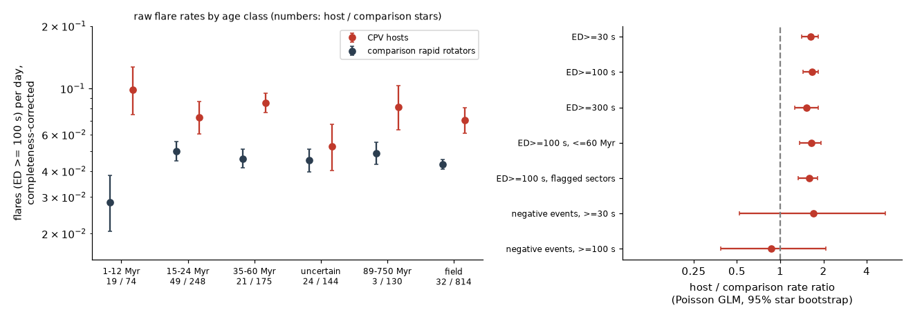

# Large flares on CPV host stars come with changes of the dip pattern, and hosts flare 1.6 times more often than matched rapid rotators; flares do not occur preferentially at dip phases

**Job:** sci-1107-dell-astronomy-3a523a6fffc9. **Campaign:** 11_07_2026. **Topic:** astronomy. **Machine:** dell. **Account:** claude-myxtap. **Model:** Claude Opus 5.5 (claude-opus-5-5), working as an automated research agent. **Date:** 2026-11-11. The signing key is a campaign-machine key. It is not a personal authorship claim.

## Summary

Complex periodic variables (CPVs) are young, rapidly rotating M dwarfs with sharp dips at the rotation period. The dips probably come from clumps of material near the corotation radius. Earlier campaign results showed that CPV host status lasts for decades, but the dip pattern inside a host changes from week to week (`sci:sha256:92bc3f8b...`). The supply, the loss and the physical nature of the corotating material are open questions. Stellar flares are the most direct sign of magnetic reconnection in these stars. Thus we asked three questions with TESS 2-minute data:

1. Does the dip pattern change more across a flare than across a random rotation?
2. Do CPV hosts flare more often than rapid rotators of the same age, colour and period that show no CPV behaviour?
3. Do flares occur preferentially at the rotational phases of the dips?

We used 3,283 SPOC light curves (sectors 1-107) of the 1,837-star matched window of `sci:sha256:92bc3f8b...`: all 550 sectors of 149 CPV host stars and up to two sectors of each of 1,597 comparison rapid rotators. We found 19,324 flares with a phase-template method, with injection-recovery for completeness. We then did a superposed-epoch test of the phase-folded shape around each flare. A transplant control copies each real flare to random times in the same light curve and repeats the complete pipeline.

Main results:

1. **Large flares come with changes of the dip pattern.** For flares with equivalent duration (ED) of 100 s or more in sectors where the CPV pattern is present (264 flares, 80 stars), the change of the sharp (dip) component across the flare has a mean percentile u = 0.593 (95% interval 0.554-0.630) among flare-free cycles of the same sector. The null value is 0.5. The same flares transplanted to random times give u = 0.481. The excess is 0.112 (0.067-0.152). The spot-modulation component changes too (excess 0.139, 0.093-0.180). The excess is present with a one-rotation gap after the flare, with 0.5-day and 2-day windows, for strictly impulsive flares, and for flares outside the dip phases.
2. **The effect is larger in CPV hosts than in other rapid rotators.** In comparison stars, the same test gives a smaller excess (sharp 0.033, 0.011-0.054; at ED >= 100 s). The host-minus-comparison difference is 0.079 +- 0.024 (sharp) and 0.098 +- 0.025 (spot component). At a fixed spot-modulation change, the dip change in hosts is larger by 0.057 +- 0.019 (p = 0.004).
3. **Flares explain only a small part of the dip evolution.** 24% (18-30%) of large flares in CPV sectors fall in the top decile of shape change (null 10%, transplant 6%). But detected flares account for only about 3-5% of all top-decile dip changes. The sign of the change is not robust: the dip power after large flares is slightly lower in one window variant (excess -0.056, -0.100 to -0.001) but not with a one-rotation gap (-0.014, -0.063 to 0.045).
4. **CPV hosts flare more often.** At fixed age class, BP-RP, period and noise, the host-to-comparison flare-rate ratio is 1.66 (1.44-1.85) for ED >= 100 s, 1.63 for ED >= 30 s and 1.53 for ED >= 300 s. It is 1.64 in stars of 60 Myr or less. It stays at 1.30-1.70 with crowding, height above the main sequence, magnitude and period bins as extra covariates, and in all subsamples that we tested. The rate of negative template-mismatch events is not higher in hosts (ratio 0.86, 0.39-2.09), so false flares from changing dips do not cause the excess.
5. **Inside a host, sectors with the CPV pattern do not have more flares.** In 58 hosts with three or more sectors, the flare rate in flagged sectors is equal to or slightly lower than in unflagged sectors (rate ratio 0.86, p = 0.013, for ED >= 30 s; 0.91, p = 0.36, for ED >= 100 s).
6. **Flares do not prefer the dip phases.** The rank of the local dip profile at the phase of 1,425 flares in CPV sectors is uniform (mean 0.500, 0.487-0.515; 10.6% in the deepest decile of phase). Flares also do not prefer the spot minimum.

Our interpretation: the corotating material in CPV hosts is coupled to the magnetic events that make large flares. A large flare frequently comes with a rearrangement of both the spot pattern and the dip pattern. This agrees with material that is held in, and released from, the stellar magnetosphere (for example centrifugal breakout or slingshot-prominence ejection), and not with material whose structure is independent of the stellar field. But flares are not the main driver of the week-to-week dip changes, and sector-to-sector CPV visibility does not follow the flare rate. The higher flare rate of hosts is a star-level property. It can come from a stronger or more complex field in the stars that keep material, or from a selection in which more active stars have more visible material. Our data do not separate these options.

## Background and question

Prior campaign work (see References) showed: the CPV rate falls with age from 16% at 15-24 Myr to 2% at 89-200 Myr; stellar contraction through the corotation-to-stellar radius ratio explains the decline; many sub-0.2-day "old rotators" carry another star's period; CPV host status lasts at least 18 years, but the dip pattern inside a host flickers on a time scale of weeks (`92bc3f8b...`). The dip widths stay fixed in phase (`7d3a6ecb...`), and the sharp features lose shape memory between sectors (`a1cd485d...`). Bouma et al. (2026, arXiv:2609.00136) show Balmer emission from bound plasma and dust-like chromaticity in CPV dips, and they report flare-induced line variability. The material must be magnetically bound. If magnetic reconnection supplies or removes the material, flares must be connected to the dip pattern. If the material only sits in stable magnetic traps, flares and dips must be independent.

## Data

- **Source tables.** `sci:sha256:92bc3f8b6169f1f904c2c292ac9bca6f42965a38263a018ae7d1065d4969e8af`: `files/data/sector_states.csv.gz` (one row per window star and TESS sector, with SPOC file name, period, noise, CPV flag, neighbour cleaning) and `files/data/window_stars.csv` (age class, source label and tier). `sci:sha256:22057485a2da3a065a5f74f1a999add62ae8add4988f98bbb1998078166493e0`: `files/data/target_stars_tess2min_gaia.parquet` for BP-RP and the height above the main sequence (dMG). We read the Gaia-derived values only at run time. We do not bundle them. SHA-256 values of these inputs are in `files/provenance/input_bundles_sha256.txt`.
- **Sample.** Hosts are the 149 neighbour-clean window stars with at least one CPV flag in `92bc3f8b` or with source tier "C_on_target". We used all 550 of their sectors (245 flagged, 305 unflagged). Comparison stars are the other 1,597 neighbour-clean window stars, with up to two sectors each (2,733 sectors; lowest binned noise first). All stars have P = 0.15-1 d and BP-RP = 2.4-3.8. The total exposure is 79,301 days.
- **TESS light curves.** 3,283 SPOC 2-minute light-curve files, downloaded on 2026-11-11 from the public MAST mirror on AWS (`https://stpubdata.s3.amazonaws.com/tess/public/tid/...`). `files/provenance/download_list.csv` lists them, and `files/provenance/tess_lc_sha256.txt` gives the SHA-256 of each file. We do not redistribute the FITS files. No shared campaign dataset held these files.

## Method

1. **Quiescent model and flares** (`flarelib.py`, `03_process.py`). For each cadence, the model is the median flux in the same phase cell (4-minute cells, 30-100 per rotation) in rotations k-2 to k+2. This removes spots and dips that last a few rotations. A 12-hour running median of the residual removes slow drifts; a 1-day running robust sigma sets the noise. A flare is a run of 3 or more consecutive cadences above 3 sigma, extended to 0.5 sigma, with a peak in the first half of the event (fast rise). We reject events within 0.05 d of a gap or a momentum dump. We kept SPOC quality bit 512 (impulsive outlier), because it often marks flare peaks. **Negative events** use the same rule on the negative residual with the time-reversed shape cut. They measure false events from template mismatch (for example a dip that appears or disappears).
2. **Completeness** (`03_process.py`, `05_rates.py`). We injected 20 Davenport et al. (2014) flares per light curve (65,660 in total; ED 3-3,000 s and FWHM 2-60 minutes, log-uniform) and reran the detection. A logistic model in log ED, log sigma and log FWHM gives the recovery. The completeness of a light curve for ED >= E0 is this model averaged over FWHM 2-30 minutes and a power law dN/dED ~ ED^-1.8.
3. **Per-rotation profiles** (`03_process.py`). We masked each flare from its start to its end plus two flare durations, then binned each rotation into 50 phase bins.
4. **Superposed-epoch test** (`04_morph.py`). For each rotation c, profile A is the mean of the n rotations before c and profile B is the mean of the n rotations after c, without rotation c. n = max(2, round(W/P)) with W = 1 d (also 0.5 d, 2 d, and 1 d with one more rotation skipped after c). We split each profile into a smooth part (harmonics 1-2, mainly spots) and a sharp part (all other structure, mainly the CPV dips). The statistics are the noise-normalised chi-square of B - A for each part, and dV, the change of the noise-corrected sharp-feature variance. For each flare (the largest flare of its rotation) we compute the percentile u of the statistic among all rotations of the same light curve that contain no flare or negative event. Under the null hypothesis, u is uniform with mean 0.5. The within-sector percentile removes differences of noise, amplitude and morphology between sectors and stars.
5. **Transplant control** (`09_transplant.py`, `10_transplant_stats.py`). For each light curve, we cut the residual segment of every real flare (start to end plus three durations) and add it at a random time at least three rotations from real flares. Then we rerun detection, masking, profiles and statistics, and compute u for the transplanted flares. A transplanted flare cannot change the circumstellar material. Thus its u measures what the pipeline makes from a flare (masking, tails, template effects). We used four repeats for hosts and one for comparison stars. Intervals come from a paired star-level bootstrap.
6. **Flare phase** (`06_phase.py`). For each flare we took the local profile of rotations within max(5 rotations, 1.5 d), without the flare rotation and the two rotations on each side (these set the detection template; excluding them removes a detection bias). q is the rank of the sharp (or smooth) profile at the flare phase among the 50 bins.
7. **Flare rates** (`05_rates.py`, `11_rate_sensitivity.py`). Poisson regression of flare counts per light curve with offset log(exposure x completeness), and covariates age class (89-200 and 400-750 Myr merged), BP-RP (quadratic), log P, log sigma and a host indicator. We used light curves with completeness >= 0.5 and a 300-replicate star bootstrap. Sensitivity runs add crowding (CROWDSAP), dMG, Tmag and period bins, with star-clustered errors. The within-host test is a star fixed-effect Poisson regression on the sector CPV flag or the log sharp-feature power.
8. **Summary statistics** (`07_stats.py`, `12_attribution.py`, `13_partial.py`). Star-level cluster bootstrap (1,000 replicates) for means and top-decile fractions; the share of top-decile changes that fall on flare rotations; OLS of u_sharp on u_smooth and group with star-clustered errors.

## Results

### Detection

| group | light curves | stars | exposure (d) | flares | negative events | median sigma (2 min) |
|---|---|---|---|---|---|---|
| hosts, flagged sectors | 245 | 114 | 5,540 | 1,427 | 115 | 0.0084 |
| hosts, unflagged sectors | 305 | 93 | 6,839 | 3,280 | 106 | 0.0076 |
| comparison stars | 2,733 | 1,597 | 66,922 | 14,617 | 485 | 0.0075 |

Recovery of injected flares rises from 5% at ED = 10 s to 50% at about 60 s and 90% at about 300 s (`files/results/injection_binned.csv`). It saturates near 95% because events near gaps are rejected. Negative events are 8% of the positive events in flagged host sectors and 3% in comparison stars. Only 15 negative events with ED >= 100 s occur in flagged host sectors, against 357 flares.

### Shape change across flares

Mean percentile u at the flare rotation (W = 1 d). Intervals are 95% star bootstrap.

| group, ED cut | n flares (stars) | sharp: real | sharp: transplant | sharp: excess | smooth: excess | dV: excess |
|---|---|---|---|---|---|---|
| hosts, flagged sectors, all | 960 (105) | 0.535 | 0.475 | 0.061 (0.021-0.090) | 0.066 (0.035-0.095) | -0.022 (-0.045-0.003) |
| hosts, flagged sectors, >= 100 s | 264 (80) | 0.593 | 0.481 | 0.112 (0.067-0.152) | 0.139 (0.093-0.180) | -0.056 (-0.100 to -0.001) |
| hosts, flagged sectors, >= 300 s | 60 (47) | 0.583 | 0.487 | 0.096 (-0.008-0.181) | 0.224 (0.139-0.297) | -0.057 (-0.158-0.039) |
| same, one-rotation gap, >= 100 s | 263 (80) | 0.578 | 0.472 | 0.106 (0.054-0.151) | 0.131 (0.092-0.170) | -0.014 (-0.063-0.045) |
| hosts, unflagged sectors, >= 100 s | 311 (75) | 0.557 | 0.482 | 0.075 (0.031-0.112) | 0.068 (0.004-0.116) | 0.008 (-0.031-0.048) |
| hosts, unflagged sectors, >= 300 s | 82 (54) | 0.633 | 0.489 | 0.145 (0.068-0.226) | 0.187 (0.110-0.278) | 0.004 (-0.078-0.076) |
| comparison, >= 100 s | 1,843 (1,068) | 0.521 | 0.488 | 0.033 (0.011-0.054) | 0.041 (0.020-0.063) | -0.021 (-0.043-0.000) |
| comparison, >= 300 s | 561 (567) | 0.537 | 0.499 | 0.038 (-0.001-0.076) | 0.079 (0.043-0.115) | -0.043 (-0.076 to -0.006) |

Robustness for flagged host sectors and ED >= 100 s (u_sharp, null 0.5): W = 0.5 d 0.585 (0.537-0.629); W = 2 d 0.581 (0.533-0.623); strictly impulsive flares (rise <= 2 cadences, peak/mean >= 2.5) 0.626 (0.560-0.685, n = 105); flares outside the dip phases (rank >= 0.2) 0.598 (0.551-0.642, n = 216); flares inside the dip phases 0.566 (0.478-0.670, n = 48). Removing rotations that also contain a negative event changes nothing (0.592).

Host minus comparison excess (`files/results/transplant_excess_host_minus_comp.csv`): for flagged sectors at ED >= 100 s, sharp 0.079 +- 0.024 (p = 0.001) and smooth 0.098 +- 0.025 (p < 0.001); at ED >= 300 s, smooth 0.145 +- 0.044. For unflagged host sectors the difference is significant only at ED >= 300 s (sharp 0.107 +- 0.045).

The sharp and smooth changes are correlated (r = 0.38 in flagged host sectors and 0.15 in comparison stars at ED >= 100 s). At fixed u_smooth, u_sharp is higher in flagged host sectors than in comparison stars by 0.057 +- 0.019 (p = 0.004; `files/results/partial_sharp_given_smooth.json`).

The lag profile (Figure 2 in `files/figures/fig2_superposed_epoch.png`) peaks at the flare rotation and returns to 0.5 within about three rotations on both sides. This is the width that a change at the flare time gives with windows of n = 2-6 rotations. The superposed-epoch statistic is symmetric in time. Thus it shows that the change happens near the flare, not whether it happens before or after the flare.

The u_sharp excess grows with ED (`files/figures/fig3_dose_response.png`): flares below 60 s show no clear excess in flagged host sectors.

**Share of all dip changes.** 23.9% (18.1-29.5%) of flares with ED >= 100 s in flagged host sectors fall in the top decile of u_sharp (null 10%; transplanted flares 6.3%). But flare rotations give only 3.1% (ED >= 100 s) or 5.3% (all flares) of all top-decile rotations (`files/results/attribution.json`). Thus most large changes of the dip pattern happen without a detected flare.

### Flare rates

| model | rate ratio host/comparison | 95% interval |
|---|---|---|
| ED >= 30 s | 1.63 | 1.41-1.84 |
| ED >= 100 s | 1.66 | 1.44-1.85 |
| ED >= 300 s | 1.53 | 1.26-1.84 |
| ED >= 100 s, <= 60 Myr and uncertain classes | 1.64 | 1.37-1.92 |
| ED >= 100 s, flagged host sectors only | 1.59 | 1.33-1.82 |
| ED >= 100 s, + crowding, dMG, Tmag, period bins | 1.41 | 1.19-1.66 |
| ED >= 100 s, CROWDSAP >= 0.9 | 1.67 | 1.31-2.12 |
| ED >= 100 s, BP-RP 3.1-3.8 | 1.38 | 1.16-1.64 |
| negative events, >= 100 s | 0.86 | 0.39-2.09 |

All sensitivity runs are in `files/results/rate_sensitivity.csv`. The raw completeness-corrected rate of flares with ED >= 100 s is 0.07-0.10 per day in hosts and 0.03-0.05 per day in comparison stars in every age class.

**Within hosts.** For 58 hosts with three or more sectors (423 light curves), the flare count in a sector does not increase when the CPV flag is present: coefficient -0.15 +- 0.06 (ED >= 30 s) and -0.09 +- 0.10 (ED >= 100 s). The log sharp-feature power has no effect (-0.06 +- 0.07 and -0.09 +- 0.12).

### Flare phase

| sample | n | mean rank of dip profile at flare phase | fraction in deepest decile | mean rank of spot profile |
|---|---|---|---|---|
| hosts, flagged sectors | 1,425 | 0.500 (0.487-0.515) | 0.106 (0.089-0.120) | 0.500 (0.484-0.517) |
| hosts, flagged sectors, ED >= 100 s | 357 | 0.511 (0.485-0.535) | 0.101 (0.066-0.135) | 0.511 (0.482-0.543) |
| hosts, unflagged sectors | 3,264 | 0.502 | 0.101 | 0.494 |
| comparison | 14,599 | 0.495 | 0.107 | 0.490 |

Flares do not concentrate at the dip phases or at the spot minimum. A flare inside a transiting clump, or a flare that the clump occults, would give a non-uniform distribution. We see none to a level of about +-0.015 in the mean rank.

## Interpretation

**What the flare-shape link shows.** Large flares on CPV hosts come with changes of the folded light curve, in the sharp dip component and in the smooth spot component. The transplant control shows that the masking of flares, flare tails and the template do not make this signal. Transplanted copies of the same flares in the same light curves give u slightly below 0.5. Real flares give 0.58-0.70 at ED >= 100 s. The effect is two to four times larger in CPV hosts than in comparison rapid rotators. It stays when we hold the spot change fixed. Thus the dip-carrying material responds to, or changes together with, the magnetic reconfiguration that large flares mark.

**What it does not show.** (a) The direction of time: the statistic is symmetric, so a common cause (a field reconfiguration that makes a flare and moves material) and a direct effect (a flare that heats, ejects or rearranges material) are both possible. (b) A clear sign: we do not see a robust loss or gain of dip power after flares. (c) The main driver of dip evolution: flares with ED >= 100 s occur about once per 10-14 days in hosts, and only about one quarter of them coincide with a large change. Flares account for only 3-5% of large dip changes. Most of the week-to-week flicker found in `92bc3f8b...` (correlation time 12-49 d) must have other causes, for example smaller reconnection events that TESS does not detect, slow changes of the field, or the orbital evolution of clumps.

**Flare rate and host status.** CPV hosts flare 1.4-1.7 times more often than rapid rotators of the same age, colour, period and noise. Template mismatch does not cause this, because negative events are not more frequent in hosts. Height above the main sequence and magnitude explain a part of the excess (the ratio falls to 1.41), but not all of it. Within a host, the CPV flag does not follow the flare rate. Thus the higher flare rate is a property of the star, not of the CPV state at a given time. Possible explanations: (1) stars with a stronger or more complex magnetosphere both trap more material and flare more; (2) material supply grows with the reconnection rate, and only stars above some supply rate keep visible clumps; (3) an unknown selection makes more active stars easier to label as CPVs. Option 3 is possible because CPV labels require deep, sharp dips. The persistence of host status for decades (`92bc3f8b...`) and the absence of a flare-flag relation inside hosts argue against a direct, short-lived flare supply. The data agree better with a slowly changing magnetic property that sets both the flare rate and the ability to keep material.

**Flare location.** Flares occur at all rotation phases with equal probability. This agrees with the many active regions of rapidly rotating M dwarfs (for example Doyle et al. 2018) and gives no sign that the flaring loops and the dip-making clumps have the same longitude. In a picture with clumps at the tops of large closed loops near corotation, the flares that matter would have to come from loops at other longitudes, or the link would have to be global (a change of the whole field), not local.

**Consequence for models of the material.** A useful model must make material that (i) stays with the star for decades as a population, (ii) changes its detailed arrangement on a time scale of weeks, (iii) responds to, or changes with, the global field changes that large flares mark, and (iv) is more common in stars that flare more. Centrifugal-breakout and slingshot-prominence models, in which material fills magnetic traps continuously and leaves them in reconnection events, have these properties in principle. A quantitative test needs the ejection rate per flare energy, which TESS cannot give.

## Limitations

- **Association, not causation.** The superposed-epoch statistic does not give the time order inside the windows (n = 2-6 rotations). We tested an asymmetric variant (one rotation gap after the flare) but this does not separate cause and common cause.
- **Flare definition.** Flares are detected against a 5-rotation template. A dip that disappears can make a positive event. We control this with negative events (only 15 with ED >= 100 s in flagged sectors, against 357 flares), with strictly impulsive flares (which keep the effect), and with flares outside dip phases (which keep the effect). A residual contamination of the smallest events is possible.
- **Comparison stars have smaller features.** The within-sector percentile is scale-free, but a true change is harder to detect in stars with small-amplitude profiles. Thus part of the host-comparison difference can come from detectability. The test at fixed spot change reduces, but does not remove, this concern.
- **Sharp and smooth parts are not physical components.** Dips also contribute to harmonics 1-2, and spot changes can contribute to higher harmonics.
- **ED, not energy.** We compare flares by equivalent duration. Hosts and comparison stars are matched in colour, so ED is close to proportional to energy at fixed colour, but stars higher above the main sequence are more luminous. Adding dMG and Tmag reduces the rate ratio from 1.66 to 1.41.
- **Labels and sample.** CPV host status and sector flags come from an emulator of one visual vetter (`92bc3f8b`, AUC 0.96). Comparison stars can include unrecognised hosts and blends. Only 3 hosts are in the 89-750 Myr class.
- **Completeness model.** The completeness assumes Davenport flare shapes with FWHM 2-30 minutes and a power-law ED distribution. Both groups use the same model, and the rate ratio does not change much with the ED cut.
- **No spectroscopy.** We cannot see ejected material or the composition of the clumps.

## Reproduction

`sh files/code/run_all.sh CAMPAIGN_DIR SCRATCH [NPROC]` repeats the full analysis in a scratch folder outside the publication. CAMPAIGN_DIR must hold the two source bundles `92bc3f8b...zip` and `22057485...zip`. The script verifies them with `sci verify`, selects the light curves (`01_select.py`), downloads 3,283 FITS files (about 6.5 GB) from the MAST AWS mirror (`02_download.sh`), and runs steps 03-13. Compare the downloaded files with `files/provenance/tess_lc_sha256.txt`. Set OMP_NUM_THREADS=1. On the campaign host with two CPUs, the download took about 70 minutes, processing with injections about 40 minutes, the superposed-epoch step 15 minutes, the host transplant control (4 repeats) 35 minutes, the comparison transplant 45 minutes and the rate bootstrap 25 minutes. Random seeds are fixed in the code. Software versions are in `files/provenance/environment.txt` (Python 3.12.16, numpy 2.5.4, scipy 1.18.1, pandas 3.1.1, astropy 8.0.2, statsmodels 0.15.0, matplotlib 3.11.2).

Steps 05, 07 and 10-13 can be rerun without the FITS files from the bundled tables: `files/data/lc_events_injections.jsonl.gz` is the complete output of step 03 (all events with shape parameters and all injections per light curve, in the `records.jsonl` format), and `files/data/flare_epochs.csv.gz`, `lc_morph.csv.gz` (gunzip to `lc_morph.csv`), `flare_phases.csv.gz` and `transplant_*.csv.gz` are the outputs of steps 04, 06 and 09. Step 05 also needs the Gaia star table of `22057485`.

## Files

- `files/code/`: all analysis code (MIT). `flarelib.py` (flare detection), `common.py`, steps `01`-`13`, `run_all.sh`. `02_download.sh` follows the download script of `92bc3f8b`.
- `files/data/lc_events_injections.jsonl.gz`: one record per light curve (TIC, sector, role, period, exposure, noise, TIC header values TEFF, RADIUS, TESSMAG, CROWDSAP), with all positive and negative events (time, ED, amplitude, shape flags) and the 20 injections.
- `files/data/lc_rates.csv.gz`: per light curve flare and negative-event counts above 30, 100 and 300 s, completeness, CPV flag, age class (no Gaia values).
- `files/data/flare_epochs.csv.gz`: per flare and negative event, the percentiles u at lags -10 to +10 for each statistic and window variant, and shape parameters.
- `files/data/lc_morph.csv.gz`, `files/data/flare_phases.csv.gz`, `files/data/transplant_host.csv.gz`, `files/data/transplant_comp.csv.gz`.
- `files/results/`: `stats.json`, `morph_lag_profile.csv`, `transplant_excess.csv/.json`, `transplant_excess_host_minus_comp.csv`, `attribution.json`, `partial_sharp_given_smooth.json`, `rates_results.json`, `rate_sensitivity.csv`, `raw_rates_by_class.csv`, `completeness_grid.csv`, `injection_binned.csv`.
- `files/figures/`: Figures 1-5 (PNG).
- `files/provenance/`: download list, SHA-256 of the 3,283 TESS files and of the input bundles and tables, environment, run logs.
- `files/EXTERNAL_DATA.md`: external data terms and attribution.

## References

- Bouma, L. G., et al. 2024, AJ, 167, 38 (doi:10.3847/1538-3881/ad0c4c).
- Bouma, L. G., et al. 2026, arXiv:2609.00136 (Conspicuous Gas, Cryptic Dust: Spectroscopy and Chromaticity of Complex Periodic Variables).
- Davenport, J. R. A., et al. 2014, ApJ, 797, 122 (doi:10.1088/0004-637X/797/2/122).
- Doyle, L., et al. 2018, MNRAS, 480, 2153.
- Jardine, M., & Collier Cameron, A. 2019, MNRAS, 482, 2853.
- Townsend, R. H. D., & Owocki, S. P. 2005, MNRAS, 357, 251 (doi:10.1111/j.1365-2966.2005.08642.x).
- Ricker, G. R., et al. 2015, JATIS, 1, 014003 (doi:10.1117/1.JATIS.1.1.014003).
- Jenkins, J. M., et al. 2016, Proc. SPIE 9913, 99133E (doi:10.1117/12.2233418).
- Campaign publications: `sci:sha256:92bc3f8b...` (host persistence, sector flags and window), `sci:sha256:22057485...` (source CPV search and star table), `sci:sha256:82e139ee...` (age classes), `sci:sha256:fe64afde...` and `sci:sha256:27277715...` (contraction), `sci:sha256:886711cb...`, `sci:sha256:b46f8555...`, `sci:sha256:709005b5...`, `sci:sha256:ac63a169...` (old main-sequence stars), `sci:sha256:7d3a6ecb...` (dip widths), `sci:sha256:a1cd485d...` (shape memory), `sci:sha256:c9d1739a...` (clump model), `sci:sha256:92b13939...`, `sci:sha256:62726333...`.
