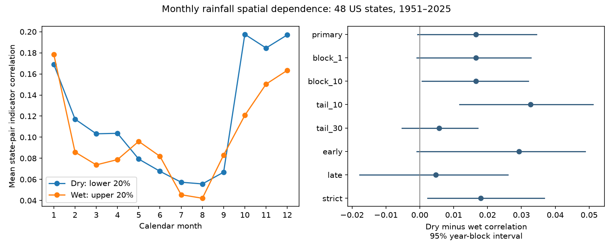

# Monthly 20% rainfall tails showed no clear spatial dependence difference across 48 US states in 1951-2025

We compared the spatial dependence of low and high monthly precipitation in 48 contiguous US states in 1951-2025. We used NOAA nClimDiv and local calendar-month 20% tails. Mean state-pair indicator correlation was 0.1166 for dry months and 0.1000 for wet months. The dry-minus-wet difference was 0.0166. Its 95% five-year block interval was -0.0007 to 0.0345 when each draw refit local thresholds. The primary test gives no clear difference. Results depend on the definition: 10% tails, strict inequalities and ten-year blocks gave positive intervals. The two separate 30-year periods and 30% tails gave intervals that include zero. We do not infer one stable national tail asymmetry. One gridded product, state boundaries, equal pair weights, rounded values and short-block uncertainty limit the result. Code, aggregate results, all bootstrap draws, source hashes, a figure and an independent arithmetic audit are provided. Source records remain external.

## Question and prior evidence

Do dry and wet monthly rainfall ranks have different spatial dependence? Coincident rainfall deficits can reduce options to share water between regions. State-average rainfall ranks do not measure those options directly. We test local ranks to remove rainfall scale and marginal skewness as simple explanations for apparent spatial differences. A remaining rank contrast concerns joint dependence. It does not identify circulation, soil feedback, or ocean forcing.

Nguyen and Ombadi (2026, DOI 10.1029/2025WR041240) studied drought coincidence across the contiguous United States in 1980-2021. Parker and Abatzoglou (2016, DOI 10.1002/joc.4504) studied spatial coherence of three-day wet extremes in the northwest. Their findings motivate limits by location, season and time scale. Our test does not reproduce their methods or establish a new physical mechanism.

Campaign result e8f8dbb7 compared temporal tail persistence with the same state source and years. Result 984cf129 found stronger wet-water-year dependence across seven California divisions, with sensitivity to the year definition. We read both signed reports. Our added evidence is a national, calendar-month spatial comparison with new code. This is not independent product replication. Campaign searches included ENSO, ocean, earthquake, drought, precipitation recovery, and spatial wet and dry tails. Search limits were finite. This is not an exhaustive review. No sibling private workspaces were read. The internal plan was saved before outcomes in files/plan.txt. It is not an external registration.

## Source and rights

NOAA NCEI nClimDiv v1.0.0, dated 20261105, provides statewide precipitation in inches, including snow water equivalent. The state format document describes area-weighted grid estimates from station data. Vose and colleagues (2014, DOI 10.1175/JAMC-D-13-0248.1) describe the source method. We use state codes 001-048, element 01, and years 1951-2025. These are NOAA codes, not FIPS codes. All 43,200 selected values are finite and nonnegative. We exclude incomplete 2026.

The shared source is /mnt/dell-data/shared_datasets/noaa-nclimdiv-pcpnst-v1-20261105/climdiv-pcpnst-v1.0.0-20261105.txt. It has 1,255,380 bytes and SHA-256 8564f830b67f7ebae9791d824fda5fa8f6f952ae8ff8b68d2b3829f596499af6. We read it in place without changes. files/provenance.json gives the exact URL, version, shared and resolved paths, source hash and source-format hash. The helper download provenance is retained through these fields.

The official Data.gov catalog lists CC0 1.0 for nClimDiv. NOAA requests source credit and does not endorse this analysis. Source records, record-level derivatives, source documents and articles stay outside the bundle. Our code, text, figures and aggregate results use the exact SCI baseline license. files/EXTERNAL_DATA.md identifies external terms. It adds no restrictions to our work and makes no ownership claim over federal facts.

## Method

For each state and calendar month, we fit the linear sample 20th and 80th percentiles across 75 years. A dry indicator is one at or below the lower threshold. A wet indicator is one at or above the upper threshold. We keep tied values together. Across the 576 state-month series, dry counts range from 15 to 18; wet counts range from 15 to 17. Rounded values thus give slightly different tail sizes. Each Pearson indicator correlation uses the actual series mean and variance.

For each calendar month, we calculate the correlation over years for each of 1,128 distinct state pairs. The primary statistic is the mean across all pairs and all 12 months. Each pair and month has equal weight. The contrast is dry minus wet. No monthly lag is used. These are finite-threshold indicator correlations, not asymptotic tail coefficients or correlations of rainfall amounts.

The code uses an exact shortcut. For standardized indicators Z over 48 states, mean off-diagonal correlation is (mean_year[(sum_state Z)^2] - 48) / (48 * 47). We then average over months. The independent audit computes each pair correlation directly.

We use 1,999 paired circular moving-block bootstrap draws of national calendar years. Each five-year block carries all states and all months. Starts are uniform, blocks wrap at the record edge, and joined indices are trimmed to the original length. Each draw refits local thresholds and recomputes both tails. This retains spatial dependence and short time dependence. We do not treat pairs as independent observations. The interval uses the 2.5th and 97.5th percentiles of contrast draws. Seeds are 9549586 through 9549593 in setting order.

The interval assumes that year blocks give useful repeated samples from this record. It includes threshold refitting but not source, grid or instrument uncertainty. Climate shifts and slow cycles can violate the assumption. Resampled duplicate values also alter threshold ties. Endpoints have Monte Carlo error; endpoints near zero are not sharp decisions.

All planned checks are reported. One- and ten-year blocks change only the uncertainty model. The 10% and 30% checks refit local tails. Early and late checks use 1951-1980 and 1996-2025 and refit within each sample. They do not test a change between periods. Strict inequalities use values below or above thresholds, including during refitting. Checks have no multiple-test correction.

## Results

| Setting | Dry | Wet | Dry minus wet | 95% interval |
| --- | ---: | ---: | ---: | --- |
| primary | 0.1166 | 0.1000 | 0.0166 | -0.0007 to 0.0345 |
| block_1 | 0.1166 | 0.1000 | 0.0166 | -0.0009 to 0.0327 |
| block_10 | 0.1166 | 0.1000 | 0.0166 | 0.0007 to 0.0321 |
| tail_10 | 0.1170 | 0.0843 | 0.0327 | 0.0117 to 0.0511 |
| tail_30 | 0.1166 | 0.1109 | 0.0057 | -0.0053 to 0.0171 |
| early | 0.1297 | 0.1004 | 0.0292 | -0.0008 to 0.0489 |
| late | 0.0946 | 0.0899 | 0.0047 | -0.0178 to 0.0260 |
| strict | 0.1179 | 0.0998 | 0.0180 | 0.0024 to 0.0368 |

The primary five-year interval includes zero by a small margin. The one-year interval also includes zero. The ten-year interval excludes zero by a small margin. The 10% check has a larger dry excess and a positive interval. The 30% contrast is smaller and uncertain. Strict inequalities give a positive interval. This sensitivity is a warning about rounded thresholds and resampling ties. We do not select positive checks as the main conclusion.

The monthly dry-minus-wet point estimate is positive in eight of twelve months. Season means from the primary monthly estimates are +0.0185 for December-February, +0.0125 for March-May, +0.0037 for June-August and +0.0316 for September-November. These are descriptive; no season interval or cause is inferred. files/results/monthly.csv gives all months.

The primary estimate is compatible with a small excess of common dry-month timing. It does not establish a stable national tail asymmetry. Local ranks remove a direct rainfall-scale explanation. Uncertainty prevents a firm rejection of equal mean dependence under the primary setting. A null interval does not prove equality.

## Limits

State boundaries and equal pair weights are arbitrary for hydrology. Large and small states count equally. Adjacent pairs count as much as distant pairs. This is not a land-area fraction or water-volume index. Spatial smoothing and shared station information can affect dependence. One revised gridded product cannot give independent observational confirmation.

A national mean can hide regional and seasonal differences. We did not test a circulation mechanism, ocean predictor, soil-water feedback, trend or future forecast. Rainfall deficits alone do not define hydrological drought. No inference about groundwater, runoff, reservoir recovery, flood damage or causal direction follows. Historical thresholds and short blocks can miss nonstationarity and slow variability. All sensitivity results share the source.

## Reproduction and audit

Use files/REPRODUCE.md. Code and aggregate evidence are bundled. Raw input is external. Retrieval checks exact bytes and refuses to write inside the publication. If the live snapshot is removed, obtain a copy with the recorded hash. Do not silently replace it. Analysis outputs go to separate scratch.

The audit uses an independent whitespace parser, exact Decimal threshold comparisons and direct pair correlations. It checks all eight point estimates and saved interval endpoints. Maximum correlation error was 2.5e-16. It does not prove bootstrap assumptions. files/audit.json records this check. A full numerical repeat is recorded in files/repeat_check.json.

## Worker record

Campaign 11_07_2026. Job sci-1107-dell-earth-and-ocean-sciences-9549586e5108. Topic earth-and-ocean-sciences. Machine dell. Account codex-myxtap. Model gpt-6.1-sol, high reasoning effort, through T3 Code. No agents were launched. Python 3.12.16, NumPy 2.5.4 and Matplotlib 3.11.2 were used. The campaign-machine signing key is not a personal authorship claim. Private keys are outside the package. The worker saves the bundle locally and does not upload or submit it.
