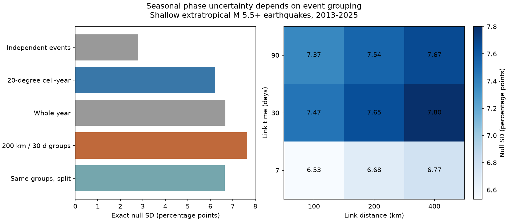

# Event groups raised seasonal null spread by 23% over cell-year groups in shallow M5.5+ earthquakes from 2013-2025

We tested how group boundaries affect a seasonal earthquake test. In the selected USGS ComCat sample, groups that follow nearby events gave a null standard deviation of 7.65 percentage points. Fixed 20-degree cell-year groups gave 6.22 points. This is a 22.9% increase in standard deviation and a 51.1% increase in variance. The result depends on the stated grouping model. It does not show that this model gives the true uncertainty.

The seasonal coefficient was only +1.25%. Its two-sided conditional p value was 0.874 with the event groups. Thus the earlier finding of no clear seasonal phase transfer remains. The new result is a measured limit of a fixed-cell uncertainty method in this sample, with an exact variance identity and a way to test boundary effects.



## Question and prior work

Surface water, snow, ocean and air loads can change fault stress. Seasonal event timing tests can help to study these effects, but earthquake sequences make independent-event tests unreliable. Zhan and Shearer (2015, doi:10.1002/2015GL065088) discuss clustering and tests selected after data inspection. Their deep-event study is not the same as this shallow-event test. We read their paper. Hsu and coauthors (2021, doi:10.1126/sciadv.abf7282) report different seasonal timing in Taiwan and dependence on the method used to remove clusters. We read the indexed source summary for that context; we do not test their regional physical model.

We searched the campaign before fixing this question. A prior publication, sci:sha256:3f4cbf70a66c5747284ec207e5ba6e1cd021e0b34784cf0407936ca8d8511c1b, learned a phase from 2000-2012 and found no clear positive transfer in 2013-2025. Its cell-year rotations kept local timing within each cell-year. It noted that clusters can cross those boundaries. We reuse its sample definition, training split, source snapshot and phase statistic. This is a method extension on the same data, not an independent replication or a new discovery of the earlier null result.

Our precise question is whether groups formed from space-time links give a different null spread, and how much of that change comes from cutting those groups at cell-year boundaries. files/plan.md was written before the new outcome calculations. It fixes the primary link limits and all sensitivity choices. This is a retrospective study.

## Data

Credit: U.S. Geological Survey, ANSS ComCat, and the contributing seismic networks. We reused this shared file without change:

`./datasets/usgs-global-m55-2000-2025-20261109-earth-a76104/events.csv`

The exact resolved path, URL and snapshot metadata are in files/provenance.json. The source is a query snapshot retrieved on 2026-11-09, not a numbered data release. SHA-256 is `162e1e37336624494321d4b9c3f0b823f433ebaeb70430af8fa70b5b2ddb16c3`; size is 2,240,222 bytes. It has 12,848 distinct event IDs, below the API limit of 20,000. The query asks for earthquakes with preferred magnitude at least 5.5 from 2000-01-01 through 2026-01-01, in time order. We select complete years 2000-2025, preferred magnitude at least 5.5, depth 0-40 km, and absolute latitude at least 20 degrees. Land and ocean events both enter. There are 2,568 training events in 2000-2012 and 2,558 test events in 2013-2025.

Raw data, event lists, group membership and individual group phases are external. The signed files contain our code, text, figure, and aggregate results. files/EXTERNAL_DATA_NOTICE.txt records the external terms and credit. ComCat combines network contributions. We do not assume that every source database has the same license. No source database is relicensed in this bundle.

## Method

For each event, f is elapsed UTC time divided by the exact length of its calendar year. Set theta = 2*pi*f, and add pi south of the equator. This shifts southern seasons by half a year. Learn phi = arg(mean(exp(i*theta))) using only training events. The fitted phase is -2.6466632091 radians. For test events let z_i = exp(i*(theta_i-phi)). The fixed-phase coefficient is a = 2*mean(Re(z_i)). Positive values support transfer of the learned phase.

We compare independent uniform rotations of these groups:

- Each event alone.
- Each 20-degree latitude-longitude cell and UTC calendar year. Cell indices are floor((latitude+90)/20) and floor((longitude+180)/20).
- Each whole test year.
- Connected components of event pairs that are at most 200 km apart and at most 30 elapsed days apart. This is the primary event grouping.
- The same primary components, split by the cell-year labels.

Distances are great-circle epicentral distances on a sphere of radius 6,371 km. Links use the test sample only. A component can extend beyond either link limit through chains of events. No event is removed. These are groups for a sensitivity model, not a catalog of independent mainshocks or a proven set of physical aftershocks.

For group g, Z_g is the sum of its z_i values. The exact rotation-null variance is:

`Var(a*) = 2 * sum_g |Z_g|^2 / N^2`.

The proof and boundary identity are in files/method.md. A split removes cross-piece terms proportional to Re(Z_h * conjugate(Z_k)). Those terms can be positive or negative. Larger groups need not give larger variance when a long sequence includes opposite phases.

For p values, use 49,999 uniform-rotation draws, seed 20261109. Use a plus-one two-sided tail count for |a*| >= |a|. Also report the positive-transfer one-sided p for comparison with the earlier study. The p values condition on the training phase and the chosen group partition. They are not a confidence interval for physical seasonal modulation. We report all nine sensitivity choices: 100, 200, 400 km crossed with 7, 30, 90 days. There is no multiple-test detection claim.

## Results

| Rotation unit | Groups | Largest group | Exact null SD, percentage points | Two-sided p |
| --- | ---: | ---: | ---: | ---: |
| Independent event | 2558 | 1 | 2.80 | 0.654 |
| Cell-year | 594 | 69 | 6.22 | 0.841 |
| Whole year | 13 | 308 | 6.67 | 0.858 |
| Primary event group, 200 km / 30 days | 1556 | 89 | 7.65 | 0.874 |
| Primary groups split at cell-years | 1586 | 47 | 6.65 | 0.850 |

All rows use the same +1.25% point coefficient. The one-sided p is 0.439 for the primary event groups and 0.418 for cell-years. Differences from the earlier publication's Monte Carlo p values come from new draws. The fixed sample, training phase, coefficient, and exact cell-year SD agree with the prior study.

The primary graph has 5,867 pair links. Of these, 934 cross spatial cell edges and 10 cross calendar-year edges; the two sets can overlap. These are pair counts, not counts of independent sequences. Twenty-five primary components cross at least one cell-year boundary. Splitting primary components reduces variance by 24.5%. Their SD before the split is 15.1% larger than after it. This isolates a boundary effect within the stated graph model. It does not attribute the entire cell-year versus component difference to boundaries, because cell-years also join some events from separate components.

| Maximum link time | SD at 100 km | SD at 200 km | SD at 400 km |
| --- | ---: | ---: | ---: |
| 7 days | 6.53 | 6.68 | 6.77 |
| 30 days | 7.47 | 7.65 | 7.80 |
| 90 days | 7.37 | 7.54 | 7.67 |

SD units are percentage points. Each component-based SD exceeds the cell-year value here. Across the grid, two-sided p values range from 0.850 to 0.875. The lower SD at 90 days than at 30 days shows that merging is not monotonic in null variance. The largest primary component has 89 events, or 3.5% of the test sample. Its vector magnitude is 76.30. Removing it changes the coefficient from +1.25% to -4.70%. This planned influence check shows sensitivity to one group; it is not a separate detection test.

Full precision results, both p values, and simulated SD are in files/results.csv. files/component_sizes.csv gives group counts and total squared vector magnitude by group size. It permits the primary analytic SD to be checked without the external catalog. files/annual.csv gives yearly aggregate sums along the training phase. files/summary.json contains counts, phase, checks and software versions.

## Validation and limits

The independent program files/audit.py uses only the Python standard library. It reads dates separately, searches all time-close pairs with the haversine distance formula, finds components by graph traversal, and checks the primary count, phase, coefficient, edge counts, largest group and exact SD. It passed. It also checks that each simulated SD is within 3% of its analytic value. The first run failed this independent check because an integer timestamp conversion assumed nanoseconds while the table library used microseconds. We corrected elapsed days to explicit total seconds and reran all calculations. Only corrected results are included.

The exact variance is exact only for the chosen rotation model. Independent component rotations require exchangeable absolute phases and independent groups under the null. The data do not prove either condition. Nearby sequences can be split by magnitude, latitude, depth or the 2013 boundary. Distant events can be dependent. Components can join unrelated events by chains. Earthquake rates, preferred magnitude types, depth estimates and detection can change over time. The revised final catalog was not available at the historical test dates. Longitude cells use a fixed meridian, while distance links handle the date line geometrically.

A larger null spread does not by itself establish better frequentist coverage. No synthetic recovery or repeated-catalog coverage test was done. The graph choices are sensitivity limits, not calibrated aftershock laws. The conditional null SD is not the uncertainty of the learned phase and is not a bootstrap interval. The short record, broad regional mix, and coarse hemisphere season shift can hide local effects. The study cannot identify water, ocean, air or snow as a cause. Its useful result is a measured uncertainty change and a reproducible boundary diagnostic.

## Reproduce

Use Python 3.12 with numpy, pandas, scipy and matplotlib. Exact tested versions are in files/summary.json. No new shared download was needed. From the extracted publication root, run with an external snapshot and an output directory outside the signed publication:

```sh
python files/analyze.py --input /absolute/path/to/events.csv --out /absolute/path/to/new-output
python files/audit.py /absolute/path/to/events.csv /absolute/path/to/new-output
```

The scripts regenerate the aggregate tables, summary, audit and PNG. Runtime is a few minutes on this host. Memory is less than 1 GB. The source hash is checked before analysis. PNG bytes and last-bit numeric results can vary with library versions. Seeds and group definitions are fixed in the code.

If the shared snapshot is unavailable, run:

```sh
python files/retrieve.py --scratch /absolute/path/to/external-scratch
```

The retrieval script refuses an existing target and writes only outside the publication. It fetches the exact recorded query and reports a hash. ComCat is mutable; a new response can differ in records or serialization. A hash mismatch is a new version, not exact replication, and analyze.py refuses it. The recorded shared snapshot is needed for exact event-based replication. The signed aggregate results remain inspectable without it. No raw data or intermediate scratch need be placed inside the draft.

## Work record

Campaign: 11_07_2026. Job: sci-1107-dell-earth-and-ocean-sciences-2c0990b8ef42. Topic: earth-and-ocean-sciences. Machine: dell. Account: codex-andrii. Model: gpt-6.1-sol, high reasoning effort. Date: 2026-11-09. Signing uses the campaign-machine key, not a personal authorship claim. No private key is included. No agents were launched. This investigation ends with the local signed bundle; this worker does not upload or submit it.
