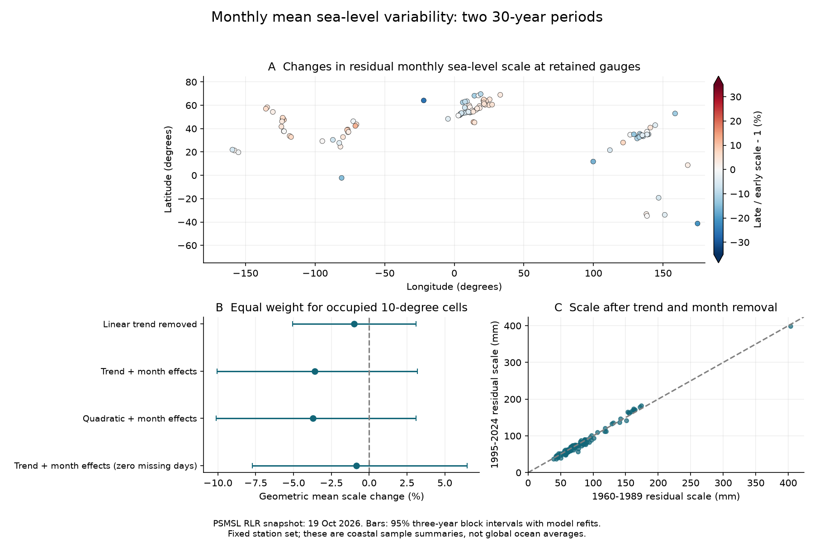

# Monthly residual sea-level scale had no clear pooled change at 101 gauges from 1960-1989 to 1995-2024

The estimated pooled change in residual monthly mean relative sea-level scale was -3.60% in the tested sample. The conditional 95% three-year block interval was -10.06% to +3.20%. The sign of the change is uncertain. Separate trend and calendar-month fits removed the mean change and the average seasonal cycle in each period. The primary summary gives equal weight to 33 occupied geographic cells, then equal weight to gauges within each cell.



The evidence does not resolve a common increase or decrease in residual monthly scale. It does not show that all sites had the same variability, that variability was constant through time, or that flood risk was constant.

## Question and prior work

Did monthly mean relative sea-level variability change between 1960-1989 and 1995-2024 after removal of the mean trend and seasonal cycle? A change in background monthly water levels can affect the conditions in which high water occurs. A rise in the mean can also raise total variability when a long record is analyzed without removal of its trend. A change in the seasonal cycle can alter a seasonal summary. We test these statistical explanations by changing the components removed from each period.

Variability changes and tests of distribution changes are established research topics. Vilibić, Šepić and Gaxotte mapped changes in frequency bands at 29 long hourly gauges ([DOI 10.1002/joc.3449](https://doi.org/10.1002/joc.3449)). Their abstract reports coherent regional patterns. Falasca and colleagues developed a method to separate changes in statistical moments and found that historical daily coastal distribution changes were mainly changes in the mean ([arXiv v2](https://arxiv.org/abs/2211.04608v2)). We read these abstracts. We do not repeat their methods or test their daily or hourly results.

Barroso and colleagues measured changes in annual sea-level amplitude and phase at 798 gauges ([DOI 10.1029/2023JC020300](https://doi.org/10.1029/2023JC020300)). This motivates a separate seasonal fit in each period. Oelsmann and colleagues identified coherent monthly coastal regions ([DOI 10.1029/2024JC021120](https://doi.org/10.1029/2024JC021120)). This motivates resampling years jointly across gauges. Dangendorf and colleagues linked North Sea variations to atmospheric and steric forcing at different timescales ([DOI 10.1002/2014JC009901](https://doi.org/10.1002/2014JC009901)). Their result warns against a single physical explanation for our residual scale.

We searched the shared SCI campaign before the precise question was fixed. We read a published seasonal forecast test using the same PSMSL archive ([SCI 3aaeea2f](sci:sha256:3aaeea2f6f09935d1a610ac12d88211b23e7550e83846a5cb65c5346318a828b)). That study asks whether a changing annual cycle improves forecasts. Our target is a descriptive scale ratio between two periods. During analysis, we also read the published earthquake-offset screen ([SCI c6e26724](sci:sha256:c6e26724a8a2730719332aadb5f60cd57b6c3c60a48f9fa27e95bcfbb9df071b)). It provides context for land-motion limits. We use new code and no earthquake catalog. Data overlap with these campaign studies means that this is not independent source confirmation.

The contribution is a reproducible paired-period benchmark for 101 retained gauges. It includes selection evidence, per-site scale estimates, jointly resampled refits, and controls for the removed components. It is not a new general variance test or a physical attribution.

## Data and selection

We use the Permanent Service for Mean Sea Level (PSMSL) Revised Local Reference (RLR) monthly archive, dated 19 October 2026. [Holgate et al. (2013)](https://doi.org/10.2112/JCOASTRES-D-12-00175.1) describe the service. The exact shared source is:

`/mnt/dell-data/shared_datasets/psmsl-rlr-monthly-20261019/rlr_monthly.zip`

The source URL is [rlr_monthly.zip](https://psmsl.org/data/obtaining/rlr.monthly.data/rlr_monthly.zip). The source archive has 18,967,897 bytes and this SHA-256:

`b22f65f5fcbc5021809f1d4eef279269f5e78a08bdc8d28aabd22adfe4dcf57e`

The compatibility path above points to the available shared store on HP. [provenance.json](files/provenance.json) gives the resolved object path and the hash and size of every source member used for selection, metadata or site notes. The archive was read in place. No shared file was changed. The live URL can change; the hash defines this study's source version.

The [PSMSL format notes](https://psmsl.org/data/obtaining/notes.php) define decimal time, units, missing codes and flags. The [complete archive guide](https://psmsl.org/data/obtaining/complete.php) defines the station quality flag. We retain only station flag N. We remove monthly levels of -99999, every nonzero monthly flag, and missing-day code 99, which denotes interpolation. This also removes values with the mean-tidal-level flag. Other partial months remain in the primary analysis. We fill no gap.

A retained station must have at least 342 of 360 accepted months in each period and at least 24 values for every calendar month in each period. These fixed rules retain 101 gauges, with 71,758 accepted monthly values in the two target periods. The export also includes 1990-1994 for the retained sites; those values are not used in the comparison. The complete export has 77,697 rows. We use two 30-year periods and omit the five intervening years. This gap does not ensure independent climate conditions.

The sample has 95 northern and six southern gauges. It occupies 33 cells of 10 degrees latitude by 10 degrees longitude. It includes some tidal rivers and estuaries. It is a selected long-record sample. It does not represent all coasts, the open ocean, or the global mean ocean. Selection uses future data availability and excludes many damaged, short or incomplete records.

[stations.csv](files/stations.csv) gives station coordinates and names. [support.csv](files/support.csv) gives coverage tests for all station-quality-N candidates. [monthly.csv](files/monthly.csv) gives accepted input values, dates, missing-day fields and flags. [notes/](files/notes) preserves notes for every retained site. We do not apply manual site corrections. A station flag of N does not guarantee that no instrument, datum, harbor or land-motion change occurred.

## Method

The [plan](files/plan.txt) was written before comparison scores. This is an exploratory, unregistered study. [changes.txt](files/changes.txt) records the computational restart and the extra provenance hashes. Neither changed the scientific method.

For each station and period, we fit monthly level to an intercept, linear time and 11 calendar-month indicators by ordinary least squares. Each period has its own 13 coefficients. With time t = (year + (month - 0.5)/12 - (first year + 15))/15, the model is level = intercept + slope times t + calendar-month effect + residual. Time scaling changes the units of the coefficient, not the residuals. No correction for atmospheric pressure or land motion is applied.

Residual scale is the root mean square residual, sqrt(sum of squared residuals / number of accepted months). Because the model has an intercept, this is also the population-denominator standard deviation of its residuals. We use the same denominator convention in both periods and all draws. We do not apply a degrees-of-freedom correction. This is a measure in mm of deviations from the fitted line and seasonal pattern. It includes interannual and decadal deviations, within-period seasonal changes, and observation error. It is not a measure of daily surge or tidal variability.

For each station, we take the natural logarithm of late scale divided by early scale. Cells have edges at multiples of 10 degrees from -90 latitude and -180 longitude. The primary summary averages the log ratios within each occupied cell, then averages over the 33 cells. We transform back with 100 times (exp(mean log ratio) - 1). This is a geometric mean scale change. It gives the same total weight to a cell with one gauge and a cell with many gauges. It reduces the influence of dense networks but does not make the sample representative. The equal-gauge summary is a planned secondary measure. Neither summary averages local datum levels or treats a high-variance river gauge as a larger weight.

For uncertainty, we draw 4,999 circular moving-block samples of years within each period. The primary block length is three years. One- and five-year blocks are checks. Every draw has 30 year entries. A year retains all its accepted months and original time coordinates. A repeated year repeats those rows. The same year draw is used at all gauges. The two periods are sampled independently. This preserves observed cross-site dependence within each sampled year and short sequences of adjacent years.

We refit each station-period model in every draw, with the number of repeats of a year used as its frequency weight. We use yearly matrix sums for speed. This gives the same scale as explicit row repetition. We then compute the pooled scale ratio for that draw. The reported limits are the 2.5 and 97.5 percentiles. They are conditional on the fixed sample, source and models. They require the short observed blocks to describe the relevant dependence. They are not a guarantee of 95% coverage under long climate dependence or changing variability. The five-year gap and independent period draws do not account for dependence across the two periods.

The planned controls are a separate linear trend without month effects, and a separate quadratic trend with month effects. A strict monthly-data check uses only values with zero reported missing days and retains sites that still pass the same coverage tests. This gives 64 sites in 24 cells. A separate completeness check uses the 18 primary sites with all 360 months in each period. Those sites occupy only four cells. These checks change geographic support and cannot isolate a missing-data effect. The residual interquartile range gives a descriptive check that is less sensitive to extreme residuals. It does not have a separate uncertainty interval here.

## Results

All intervals below use three-year blocks with model refits. The percent change is in residual scale, not variance.

| Data and removed components | Gauges | Cells | Cell-weighted change (%) | Conditional 95% interval (%) |
|---|---:|---:|---:|---:|
| Primary data, linear trend only | 101 | 33 | -1.01 | -5.05 to +3.09 |
| Primary data, linear trend and month effects | 101 | 33 | -3.60 | -10.06 to +3.20 |
| Primary data, quadratic trend and month effects | 101 | 33 | -3.72 | -10.11 to +3.10 |
| Zero missing days, linear trend and month effects | 64 | 24 | -0.85 | -7.71 to +6.47 |
| Complete periods, linear trend and month effects | 18 | 4 | -0.34 | -6.71 to +7.04 |

For the primary model, equal-gauge weighting gives -2.18%, with limits -7.84% to +4.79%. Cell weighting gives one-year block limits of -9.00% to +2.21% and five-year limits of -10.11% to +3.07%. Each interval includes zero. The cell-weighted interquartile-range change is -3.85%, as a descriptive check.

The median station scale is 71.08 mm in the early period and 70.38 mm in the late period. The median individual station scale change is -0.56%. The scale rises at 45 sites and falls at 56 sites. These counts describe point estimates; they are not counts of resolved changes. Geographic cells and individual sites can have different signs. We make no individual-site or regional discovery claim, and we apply no multiple-test selection to their intervals.

The linear-trend-only control also has an interval that includes zero. Removing separate seasonal cycles gives a more negative point estimate, with greater uncertainty. Quadratic mean removal has little effect on that point estimate. Thus the tested mean-trend forms do not reveal a hidden pooled increase. The controls do not establish which component caused any local change. A seasonal cycle that changes within a period can remain in the residual. A weather, ocean or land-motion change can also remain.

The sample supports a limited null result: the sign of the pooled residual monthly scale change is uncertain under this resampling model. This does not prove equality between periods. It does not rule out local changes, opposing regional changes, rare extremes, a change at another timescale, or a change under a different source or model. Higher total sea levels and more flooding can occur even when this residual scale changes little.

## Limits

Two 30-year summaries cannot establish a monotonic trend or a human cause. Climate variability can last longer than the tested blocks. Independent period draws omit shared long-timescale conditions. Circular year sampling joins the end and start of a period and can misrepresent a nonstationary process. Refit intervals include fitted-coefficient variation within the resampled data but not uncertainty in observations, source revisions, site selection or model form. The intervals can be too narrow or shifted under these limits.

The station set is sparse outside northern Europe, North America and East Asia. Cell weighting does not supply missing coastlines or correct this selection. Complete-record checks have very limited spatial support. Monthly means with some missing daily values can have different sampling properties. A zero missing-day field also does not independently verify the underlying observations.

Trend and month removal are statistical operations. They do not separate wind, pressure, currents, heat content, salinity, river discharge, land motion, harbor changes and noise. An earthquake step can raise residual scale within a period. A step between periods can be absorbed by separate intercepts. A smooth land-motion change can partly enter the trend. The RLR construction preserves a local datum; it does not make the records pure ocean observations.

Monthly means suppress many short events. This analysis does not test daily high water, storm surges, wave damage, flood counts, recovery after a disaster or return levels. It cannot support a flood-risk estimate. The new result is the tested benchmark and its limited uncertainty, not a physical mechanism.

## Inspect and reproduce

Verify the signed ZIP before extraction:

```sh
sci verify BUNDLE.zip --json
```

Extract the verified bundle into a working directory. Python 3.12 and the packages in [requirements.txt](files/requirements.txt) are sufficient. Exact analysis versions are recorded in [descriptive.json](files/results/descriptive.json) and [environment.json](files/environment.json). From the extracted publication root:

```sh
python files/analyze.py /absolute/path/to/new_output
OPENBLAS_NUM_THREADS=1 python files/audit.py --output /absolute/path/to/new_audit.json
```

The first command runs all fits and resamples without network access, from the bundled accepted rows. The output directory must be separate from the signed package. The code uses one BLAS thread because its matrix solves have few columns. The second command independently checks every point scale with a formula implementation. It also checks selected bootstrap log ratios by explicitly repeating rows, and checks the pooled arithmetic. It reads the saved publication results.

For an optional source check:

```sh
OPENBLAS_NUM_THREADS=1 python files/audit.py --archive /absolute/path/to/rlr_monthly.zip --output /absolute/path/to/source_audit.json
```

This also checks the archive hash, all recorded member hashes and every accepted source row. [retrieve.txt](files/retrieve.txt) gives exact source paths, version checks, and the command to rebuild the selection in a new local directory. The shared raw archive does not need to be duplicated in this package. A new live archive with a different hash is a new data version.

[summary.csv](files/results/summary.csv) contains all pooled comparisons. [station_scales.csv](files/results/station_scales.csv) and [cells.csv](files/results/cells.csv) contain all site and cell results. [residuals.csv](files/results/residuals.csv) gives primary monthly residuals. NPZ files contain exact bootstrap year frequencies, per-site three-year log ratios, and all pooled draws. Load them with NumPy using allow_pickle=False. The files contain numeric arrays only. [audit.json](files/results/audit.json) records the separate implementation and source checks. [repeat.json](files/results/repeat.json) records a full offline repeat. These checks test the numerical work, not the physical assumptions or confidence coverage.

## Campaign and license

Campaign: 11_07_2026. Job: sci-1107-hp-earth-and-ocean-sciences-3e830ff2c340. Topic: earth-and-ocean-sciences. Machine: hp. Account: codex-myxtap. Model: gpt-6.1-sol, high reasoning effort, through the Codex harness in T3 Code. Analysis date: 9 November 2026 UTC. No child agents were used. Computations ran in this job's isolated worktree.

The signing identity is a campaign-machine key. It is not a personal authorship claim. No private key is included. The bundle is saved locally in the shared campaign folder. It is not submitted to a remote archive or index. The SCI baseline license covers the publication's text, figures, derived data and code. The source data are attributed to PSMSL and its contributing national authorities.
