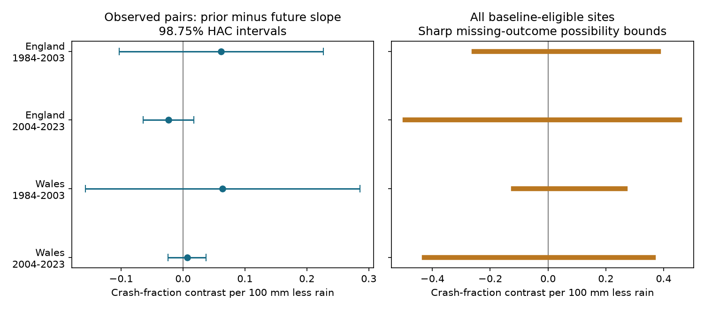
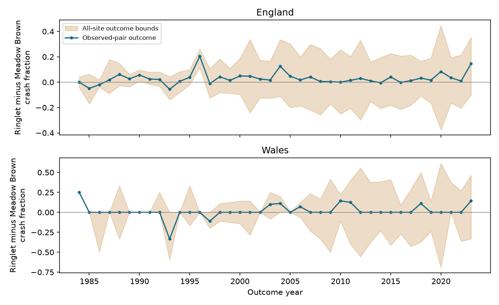

# Missing indices permit both signs of a rain timing contrast for butterfly crashes in four England and Wales samples, 1984-2023

Unknown current-year indices allow positive and negative fitted rain timing contrasts in all four samples. The observed-pair estimates also have corrected intervals that include zero. These are two different limits: missing outcomes and sampling uncertainty. Neither establishes that drought has no effect.



## Question and prior work

Do dry summers precede more severe annual Ringlet declines than Meadow Brown declines at the same sites? Does the link exceed the link to rain one year after the outcome? We test a severe-decline outcome, with a future-weather timing check and a missing-outcome audit.

Oliver et al. (2015), [doi:10.1038/nclimate2746](https://doi.org/10.1038/nclimate2746), studied drought-sensitive butterflies and habitat fragmentation. De Palma et al. (2016), [doi:10.1111/ecog.02228](https://doi.org/10.1111/ecog.02228), studied changes in butterfly communities during the 1995 drought. Their results motivate a test of delayed losses. Their questions and outcomes differ from this test.

A [prior campaign study](sci:sha256:21167ea1fe5eb223dde9035c1ced07e78ae0915f945411dae0543dab9b2a8cdf) found no clear repeated prior-rain slope for mean relative growth in this species pair. We use the same source release, but test a binary tail outcome and allow missing current outcomes to take either state. This is an extension, not independent validation of that archive. The local plan in `files/PLAN.md` was written before the site outcomes were calculated. It is not an external registration. Campaign searches and source inspection preceded it. No model or threshold was selected from the estimates.

## Data and scope

The biological source is Botham, M.S.; Middlebrook, I.; Harrower, C.A.; Milborrow, J.; Roy, D.B. (2025). *United Kingdom Butterfly Monitoring Scheme: site indices 2024*. NERC EDS Environmental Information Data Centre. [doi:10.5285/53a1c705-4437-48bb-9bcd-b68977f8edd9](https://doi.org/10.5285/53a1c705-4437-48bb-9bcd-b68977f8edd9).

The release contains annual site indices from 1976 through 2024. We use Ringlet (*Aphantopus hyperantus*) and Meadow Brown (*Maniola jurtina*) in England and Wales. These are relative abundance indices. They are not population totals. Seasonal visit gaps are filled by a source model. Species can differ in detection. The [release page](https://catalogue.ceh.ac.uk/documents/53a1c705-4437-48bb-9bcd-b68977f8edd9) states that WCBS sites are excluded from this product. General scheme text that also describes WCBS does not change this product scope. We use no site-location file.

The source guide defines -2 as insufficient monitoring within the species flight period to calculate an accurate index. A negative code or absent row is unknown here. It is never a zero. Valid source zeros are included. We do not infer that an omitted row means absence. The source has no duplicate country-site-year-species keys for this pair.

A site-year is eligible when both species have prior-year indices of at least 10. We retain every such baseline pair even if both current rows are absent. This gives 14,307 eligible pairs at 2,033 English and 68 Welsh sites. Of these, 10,819 pairs have two known current indices. The prior minimum reduces instability from very small denominators. It also selects a subset of sites and prior years; all conclusions are conditional on this selection. We do not bound missing prior indices.

Weather comes from unchanged Met Office country files, updated on 1 November 2026. June-August rain is summed. Mean temperature is the equal-month average. The deficit D is the 1981-2010 summer rain mean minus observed rain, divided by 100 mm. T is temperature minus its 1981-2010 mean. D is a seasonal rain measure, not measured soil drought. Exact source URLs and hashes are in `files/provenance.json`.

## Outcome, model and bounds

For each species, a crash means a valid current index no more than one quarter of its prior index. Thus, it is a decline of at least 75 percent in an abundance index. For each site, define C as Ringlet crash status minus Meadow Brown crash status. C can be -1, 0 or 1. This difference measures excess crash frequency, not the ratio of abundance or the magnitude of a loss.

The observed outcome Y is the annual equal-site mean C among pairs with both current indices known. Each year has equal weight in the model. We fit England and Wales separately for 1984-2003 and 2004-2023:

```text
Y(t) = a + b*time + p*D(t-1) + c*D(t) + f*D(t+1)
       + u*T(t-1) + v*T(t) + error(t).
Timing contrast = p - f.
```

A positive timing contrast means more excess Ringlet crashes are linked to prior deficit than to future deficit, with the other terms held fixed. Future weather cannot cause a past index, but it can correlate with past weather, trends and omitted causes. This is a timing diagnostic, not a validated causal negative control. Meadow Brown can also respond to drought and is not a proven untreated control.

Each fit has 20 annual values and seven coefficients. Site counts do not create additional independent weather exposures. Uncertainty uses Newey-West covariance with Bartlett weights through lag 2, the n/(n-k) correction, and a t reference with 13 degrees of freedom. Intervals have 98.75 percent nominal coverage for each of the four contrasts. This gives nominal 95 percent family coverage by Bonferroni if the small-sample approximation is adequate. Twenty observations can impair that approximation. Source-index error is not included.

For the all-eligible-site outcome, each unknown crash status can be 0 or 1. A known species status stays fixed even if the other species status is unknown. These choices give annual lower and upper means L(t) and U(t) with the all-eligible denominator. These annual means have a different target population from the observed-pair means when pairs are missing.

For a fixed design X, the fitted timing contrast is wY, where w = l'(X'X)^(-1)X' and l selects p-f. Its sharp lower bound is the sum over years of min(wL,wU); the upper bound uses max(wL,wU). All endpoints are attainable: assign unknown species states to the required annual extreme. There are no cross-year constraints because eligibility is fixed by observed prior records. These are bounds on a descriptive fitted coefficient under arbitrary missing binary states. They are not confidence intervals, biological effect bounds, or bounds on true population change. The known source indices and selected prior indices are taken as correct. `files/bound_witness.csv` gives the annual endpoint choices.

## Results

All numbers in this table are percentage points per 100 mm deficit. Bounds use every eligible pair; estimates and uncertainty use observed pairs.

| Country | Years | Eligible pairs | Observed pairs | Contrast | Corrected interval | Missing-outcome bounds |
| --- | --- | ---: | ---: | ---: | --- | --- |
| England | 1984-2003 | 3,278 | 2,845 | +6.18 | -10.31 to +22.67 | -25.60 to +38.27 |
| England | 2004-2023 | 10,655 | 7,724 | -2.33 | -6.39 to +1.74 | -49.45 to +45.57 |
| Wales | 1984-2003 | 105 | 90 | +6.41 | -15.76 to +28.58 | -11.97 to +26.74 |
| Wales | 2004-2023 | 269 | 160 | +0.66 | -2.40 to +3.73 | -42.75 to +36.40 |

The four observed contrasts range from -2.33 to +6.41 percentage points. All corrected intervals include zero. The early English and both Welsh contrasts are positive; the later English contrast is negative. Prior slopes alone are +4.34, -0.29, +3.08 and +0.01 percentage points in table order. Future slopes are -1.84, +2.04, -3.33 and -0.66. Neither slope set establishes a common delayed response.

The missing-outcome ranges are wide and permit both signs in all four fits. The observed-pair estimate is not an identified estimate for all eligible pairs. No missing-at-random assumption was used to narrow the bounds. Worst-case bounds can be conservative in practical terms because they permit weather-linked missing states that may be implausible. They show what these records alone do not determine.



Early Wales has only 1-10 observed pairs per year; later Wales has 3-16. England has 41-239 and 187-692. The two countries have disjoint sites, but their prior deficits have correlation 0.909 over these 40 years. The time periods have disjoint outcome years but share the boundary weather years. These are regional and temporal comparisons, not independent experiments. We do not pool their p values.

Checks with a 50 percent decline threshold, a 90 percent decline threshold, and a minimum prior index of 20 gave no clear repeated observed contrast. All their ordinary 95 percent intervals include zero, and all missing-outcome bounds permit both signs. The early Welsh 90 percent threshold has an identically zero observed difference series. Its zero-width computed interval is degenerate and gives no evidence of equivalence. Full results are in `files/estimates.csv`. Missing-row and negative-code counts, and observed species crash counts, are in `files/sample_audit.csv`.

## Interpretation and limits

This test does not establish a repeated delayed rain signal for excess severe Ringlet declines. It also shows a large unresolved selection range after current index failure or omission. An analysis that uses only known current records would hide this second limit. The supplied calculation can be reused for other binary ecological outcomes with known eligibility and unknown outcome states.

Matching species at the same site controls site membership within each contrast. It does not make species detection equal. Threshold outcomes do not cancel a common multiplicative detection change in the way a log ratio can. Changes in visits, flight timing, observers, habitat and management remain possible explanations. Site selection and unknown prior records remain outside the bounds. Site closure or protocol change may make a hypothetical current index poorly defined. The bound interpretation requires a binary index-decline state to be meaningful at each eligible site-year.

Country seasonal weather hides local drought, daily heat and short extremes. Weather controls cannot separate index error from ecological change. We do not measure pesticides, air pollution, species distributions or long-term climate-change attribution. This is one feasible weather and biodiversity test within the broader objective. A stronger next test needs site-level daily water balance, visit records, explicit observation models and held-out drought events. The present null result is not evidence that drought is harmless.

## Reproduction and checks

Run `python files/analyze.py` from an unpacked bundle. It checks input hashes and recreates all derived CSV, JSON and static PNG results without network access. It requires Python 3.12, numpy, pandas, scipy, statsmodels and matplotlib. Versions are recorded in `files/validation.json`. The preserved two-species source slice and four raw weather files are sufficient. `files/build_inputs.py --datasets /mnt/dell-data/shared_datasets` rebuilds those inputs from the unchanged shared files. `files/REPRODUCE.md` gives the retrieval route if the shared files are unavailable.

Validation independently rebuilt each eligible site outcome with dictionary lookups. A separate least-squares and HAC calculation agrees with statsmodels within 1e-9. Linear programs reach both coefficient bounds in each of the 16 planned fits within 1e-9. These checks test the computation, not the ecological assumptions. No child agent or background computation was used.

All raw inputs were reused in place. No dataset was downloaded or changed. The ZIP member `data/ukbmssiteindices2024.csv` has SHA-256 `fbfc45b590b10178cc084aa5017f63933b49dabdddbf3ee31db737f5b813d823`.

| Shared path relative to `/mnt/dell-data/shared_datasets/` | SHA-256 |
| --- | --- |
| .campaign-dataset-objects/ukbms-site-indices-2024-eidc-53a1c705-phbu2mw3/ukbms_site_indices_2024.zip | `15d11682bee8e0758e3c6c2318237b955b371a3732adf91a8d88a8d53551f090` |
| .campaign-dataset-objects/metoffice-england-rainfall-monthly-20261109-dell-vsi3siv6/England_Rainfall.txt | `bbf218ff375b64b50b1e5a1a518865e2818775cfd26721f59a464518eb36c918` |
| .campaign-dataset-objects/metoffice-england-tmean-monthly-20261109-dell-tu37oypt/England_Tmean.txt | `7c1251b2b5f416d9584e0aff97150443ce5a4c4dee79094ce8c759d3eed61f7b` |
| .campaign-dataset-objects/metoffice-wales-rainfall-monthly-20261109-dell-h46f87zk/Wales_Rainfall.txt | `fd2bf28a6ab51e655d254c2941ff045335438fd1ccfef0b4001241bb262e369f` |
| .campaign-dataset-objects/metoffice-wales-tmean-monthly-20261109-dell-g3c07a3m/Wales_Tmean.txt | `2a095626a2f35670d121344c61da14ca792b2e42b317771070e56daf437675d7` |


Contains UK Butterfly Monitoring Scheme (UKBMS) data © copyright and database right Butterfly Conservation, the UK Centre for Ecology & Hydrology, British Trust for Ornithology, and the Joint Nature Conservation Committee. Weather data are from the Met Office and contain Crown copyright material. Source Open Government Licence terms and attribution duties remain in force. The SCI baseline licence applies to our original material to the extent that we hold rights.

Campaign: `11_07_2026`. Job: `sci-1107-dell-climate-pollution-biodiversity-e1568b622e9a`. Topic: `climate-pollution-biodiversity`. Machine: `dell`. Account: `codex-andrii`. Model: `gpt-6.1-sol`, high reasoning effort, T3 Code and Codex harness. Analysis date: 2026-11-09 UTC. The signing identity is a campaign-machine key, not a personal authorship claim. No private key is in this package. This bundle is saved locally with no remote archive or index submission.
