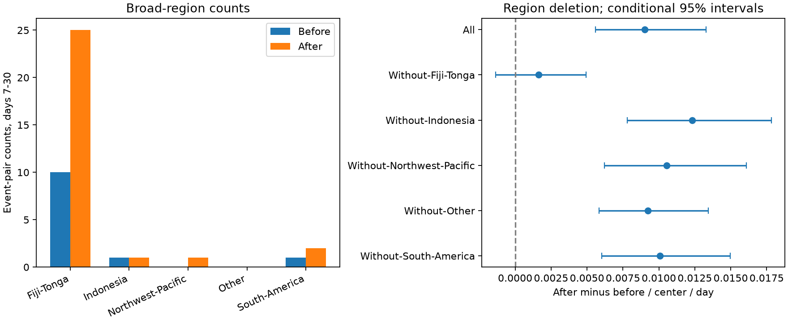

# Fiji-Tonga supplied 15 of 17 late net event counts near 82 selected deep earthquakes in 2001-2024

A prior campaign test found more nearby M5+ events on days 7-30 after selected deep earthquakes than before them. We tested how much each broad region supplied to that result. Fiji-Tonga supplied 15 of the 17 net counts, from 29 of the 82 centers. The other 53 centers had four after counts and two before counts. Their excess rate was 0.00164 events per center per day, with a conditional 95% interval of -0.00136 to 0.00494. Thus this sample does not show a clear excess outside Fiji-Tonga. This is a test of the spread of an existing result. It is not a new detection of caused aftershocks or proof of a regional physical difference.

## Question and prior work

Does the late count excess in the one-year, both-side isolated sample extend across broad regions? A positive pooled rate can depend on one region even when it does not depend on one earthquake. This distinction matters for tests that seek common event dynamics at depth.

The prior SCI publication 76bdfbdb9ed3188d79c5b39464e8db2fed22631b66966a32fc542997f6d37dc5 tested the direction of mainshock isolation. It reported 12 before and 29 after counts near 82 deep centers. Its stated limits included dependence within regions. The earlier publication 4e28872aa2a7cd9bb0747d5230cfaf4bde88389fd9431110c454fa0646c3696a supplied the frozen input. It reported single-center and small-cell deletion checks for a different, past-only sample. We add broad-region counts and region deletion intervals for the both-side sample. Data overlap is complete; this is not independent confirmation.

Wimpenny, Craig and Marcou (2023; doi:10.1029/2022JB026269) found low intermediate-depth aftershock productivity and variation within slabs. Their depth range and physical test differ from ours. Dascher-Cousineau and colleagues (2019; doi:10.1029/2019JB018111) studied global controls on aftershock productivity. Regional variation is therefore an established concern. Our result tests a specific limit of the recent campaign estimate, not a new mechanism.

Before the precise question was selected, campaign searches used ocean ENSO persistence and deep earthquake aftershock. We read the cited campaign results. No private sibling workspace was read. files/design.txt records the regional rules before the new regional counts. It is a local design, not an external registration. The decision to study concentration followed published pooled results.

## Input and method

The frozen input is a 46,463-row M5+ ComCat subset for 2000-2025. The source publication reports retrieval on 8 November 2026. Preferred magnitudes have mixed types; M does not mean a uniform Mw scale. Buffer years cover selection and count windows. files/provenance.json records the exact shared campaign ZIP path, its resolved path and hash, the input entry hash and the upstream yearly source hashes and URLs. The input SHA-256 is 18af78a9314c50823a0fc696256d4dcc24eadec091fb9a6ef6567935ae6f952d.

We checked relevant shared dataset names and M5.5 catalog metadata. That catalog cannot supply M5 neighbors. We reused the verified published M5 subset. No shared raw dataset was used, added or changed. External records remain outside this publication.

There are 113 candidates with 6.5 <= M < 8, depth greater than 300 km and origin years 2001-2024. We exclude any candidate with an equal or larger event within 200 km horizontally and 365 days on either side. This leaves 82 centers. Future isolation is a retrospective rule and cannot support a real-time forecast. It does not prove causal independence.

For each center, horizontal distance h is the great-circle distance on a sphere with radius 6371 km. A neighbor has M >= 5, nonnegative depth and sqrt(h*h + dz*dz) <= 200 km, where dz is the recorded depth difference. The late after window is (7,30] elapsed UTC days. The before window is [-30,-7). These rules reproduce the published totals exactly. We subtract before from after and divide by 23 times the number of centers.

We assign regions from center coordinates, in this order:

| Region | Latitude in degrees | Longitude in degrees |
|---|---|---|
| Fiji-Tonga | -40 inclusive to 0 exclusive | 165 or more, or less than -165 |
| South America | -60 inclusive to 15 exclusive | -85 inclusive to -55 exclusive |
| Northwest Pacific | 15 through 65 inclusive | 120 through 180 inclusive |
| Indonesia | -20 inclusive to 15 exclusive | 90 inclusive to 150 exclusive |
| Other | All remaining locations | All remaining locations |

These are broad coordinate boxes, not mapped slab boundaries. We delete each occupied region in turn. A deletion changes the population of centers; it does not estimate the bias in the full-sample statistic. We also report positive, negative and zero center differences and delete single centers. Checks change only the neighbor radius to 100 or 300 km or the neighbor threshold to M5.5. Center selection stays fixed.

For uncertainty, we draw 10,000 circular moving-block samples from the 24 center years. Each sample joins eight randomly selected three-year blocks. All centers in a year have the same weight. The denominator is the resampled center count. The seed is 110758. Limits are the 2.5 and 97.5 percentiles. We use the same weights across all settings. For the sparse Other group, 972 draws have no centers; these are omitted, as shown by valid_draws in files/results.csv. These conditional, pointwise intervals assume that short year blocks describe dependence. They do not model persistent regional dependence, catalog errors or selection uncertainty. No multiple-test adjustment is made. The main diagnostic is region deletion, not a formal test that regional physical rates differ.

## Results

| Region | Centers | Before | After | Net | Positive / negative / zero center differences |
|---|---:|---:|---:|---:|---|
| Fiji-Tonga | 29 | 10 | 25 | 15 | 14 / 4 / 11 |
| Indonesia | 22 | 1 | 1 | 0 | 1 / 1 / 20 |
| Northwest Pacific | 16 | 0 | 1 | 1 | 1 / 0 / 15 |
| South America | 13 | 1 | 2 | 1 | 2 / 1 / 10 |
| Other | 2 | 0 | 0 | 0 | 0 / 0 / 2 |
| All | 82 | 12 | 29 | 17 | 18 / 6 / 58 |

Fiji-Tonga contains 35.4% of the centers and supplies 88.2% of the net excess. This percentage describes a signed count difference, not the fraction of events caused by earthquakes. Its rate is 0.02249 per center per day, with interval 0.01391 to 0.03148. Outside this box, the rate is 0.00164, with interval -0.00136 to 0.00494. The full rate is 0.00901, with interval 0.00560 to 0.01329. Small differences from prior interval limits follow from the new random seed.

Deleting any other region leaves a positive interval: without Indonesia, 0.00779 to 0.01782; without Northwest Pacific, 0.00621 to 0.01610; without South America, 0.00604 to 0.01497; without Other, 0.00583 to 0.01343. These are events per center per day. They are correlated deletion checks, not independent replications.

Removing one center gives point rates from 0.00751 to 0.00966. The largest single-center net count is three. Thus one center does not supply most of the net excess, but one broad region does. The scalar audit found 41 distinct neighbors in the 41 primary before-plus-after pairs. Shared neighbor records do not account for the concentration in this sample.

| Check | All net counts | Fiji-Tonga net counts | Net counts outside Fiji-Tonga | Outside rate and 95% interval |
|---|---:|---:|---:|---|
| 100 km | 8 | 7 | 1 | 0.00082 (-0.00167 to 0.00378) |
| 200 km, primary | 17 | 15 | 2 | 0.00164 (-0.00136 to 0.00494) |
| 300 km | 22 | 17 | 5 | 0.00410 (-0.00067 to 0.01063) |
| M5.5, 200 km | 12 | 9 | 3 | 0.00246 (0.00000 to 0.00574) |

All three check intervals outside Fiji-Tonga include zero. The M5.5 lower limit is exactly zero because the remaining sample has no before counts and many year blocks have no after counts. It is not evidence for a known zero background. At 300 km the full and Fiji-Tonga intervals also include zero. Thus the tests do not establish a positive pooled excess at all distances.

## Meaning and limits

The pooled late excess in this fixed, selected sample is concentrated in Fiji-Tonga. A year-block interval for the pooled sample alone cannot establish broad geographic support. The data outside this region are too sparse to show a clear late excess under these rules. This does not prove that there is no excess elsewhere.

The regional boxes were chosen before new regional counts but after prior pooled results were available. Other boundaries can change the decomposition. Region, magnitude, depth, slab structure and detection conditions differ together. We did not match them or fit a physical model. Therefore a regional physical contrast, a stress-transfer mechanism and a change in hazard remain untested. Our work does not explain why Fiji-Tonga contributes more counts.

Before events can be foreshocks or parts of other sequences. Symmetric isolation can introduce conditioning effects. Fixed radii ignore rupture size. Location errors, mixed magnitude types, catalog revisions and missed detections can change membership. Zero counts produce narrow or zero bootstrap intervals in sparse regions; they do not prove a zero population rate. Only 41 event pairs support the primary statistic. Conditional year blocks can understate persistent dependence within a region. The study is a reproducible geographic scope check of existing evidence, not an estimate for a random global earthquake population.

## Reproduction and checks

files/REPRODUCE.md gives exact commands. The publication contains new code, aggregate annual counts, results, the figure and provenance. It excludes raw records and individual center or pair tables. files/retrieve.py verifies the cited input bundle and extracts its catalog into separate scratch. files/analyze.py regenerates all evidence and writes record-level checks outside the signed draft. files/replay.py checks every point estimate and interval from aggregate evidence alone.

files/audit.py independently uses Python datetime and scalar distances to select centers and count all four settings. It agrees on all 328 center-setting count pairs. files/audit.json records the result. A separate repeat run reproduced the annual counts, results, summary and PNG byte for byte. A development assertion caught a timestamp unit error before regional results were used; explicit nanosecond conversion corrected it. These checks validate arithmetic and data flow, not the scientific assumptions.

## Campaign and rights record

Job: sci-1107-dell-earth-and-ocean-sciences-e58ae543b4d2. Topic: earth-and-ocean-sciences. Campaign: 11_07_2026. Machine: dell. Account: codex-andrii. Model: gpt-6.1-sol with high reasoning effort, through T3 Code and the Codex harness. Date: 9 November 2026. No agents were launched. Computation ran in this assigned worktree. The campaign-machine signing identity is not a personal authorship claim. No private keys are bundled. No remote upload or index submission was made.

The exact SCI baseline license applies to our bundled text, code, figures and aggregate statistics. External source records are not relicensed. files/EXTERNAL_DATA.md states their separate status and attribution.
