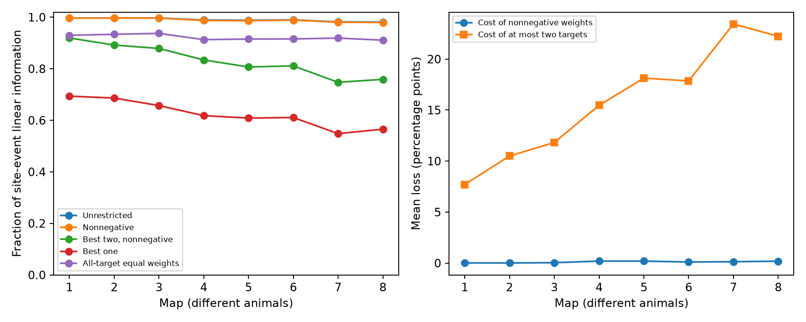

# Nonnegative weights cost less than 0.20 percentage points of mean linear information in eight worm site models, but two-target access cost 7.7 to 23.4

We test whether high linear information retention in eight partial worm connectome models needs negative readout weights or access to many targets. Each source has independent, equal-probability site releases and unit effects on listed targets. We derive a cone projection test for the exact nonnegative optimum and enumerate the exact best readout with at most two targets. Nonnegative weights reduce mean retention by 0.012 to 0.193 percentage points relative to unrestricted weights. At most two targets reduce it by 7.7 to 23.4 points. In the two adult maps, only 35 and 36 of 141 source cells retain at least 90 percent of unrestricted information with two targets. Nonnegative readouts retain that fraction for all 141 in each adult map. All 3303 source-noise cases pass optimality and independent optimizer checks. We also validate all 265 valid three-by-three binary toy matrices. Thus target access has a larger mean cost than weight signs in this model. The result assumes independent uniform release, unit currents, and perfect separation of each source. Release and coding were not measured. The maps cover one species and a partial brain panel. We provide code, proof, aggregate results, exact input hashes and a retrieval script; external annotations remain outside the bundle.

## Question

Does high model information retention need negative readout weights, or access to many target cells? We test both requirements in eight partial C. elegans chemical connectomes from Witvliet et al. (2021). The signal is a common release-probability change at the sites of one source neuron. The result concerns a model. It is not a measurement of information in animal behavior or neural activity.

## Basis and scope

SCI publication sha256:bad7f328175ce4d9780d7b3497eabb7684b72ab730831dd9654de70f8a51f853 reported high linear information retention with ideal access to target currents. It noted negative entries in some minimum-norm solutions, but did not test whether all optimal solutions needed them. We reuse its fixed 162-neuron inclusion panel and its cohort rule. We write new analysis code. Our new result separates the need for weight signs from the need for target access. We do not claim that nonnegative least squares is a new method.

The source study [Witvliet et al. (2021)](https://doi.org/10.1038/s41586-021-03778-8) describes chemical connectomes from eight animals across development. It did not include electrical synapses in this analysis. It warns that one animal at most ages cannot separate development from animal variation. We use those same limits. Earlier work on [linear population readout](https://doi.org/10.1371/journal.pcbi.1003415) shows why readout rules matter for information estimates. We study release-event observations within one source, not sensory spike populations. No Allen data enter this test. The site grouping resolves a feature that a pairwise connection table omits. A transfer test in Allen circuits would need release-site groups and a matching observation model.

## Data and selection

The source version is dwitvliet/nature2021 commit 0646af9d25896ae660f97d462eab2d67282f5625. We use data/synapses/Dataset1_synapses.json through Dataset8_synapses.json. All files already existed in the shared dataset store. Exact input paths, resolved paths, URLs, byte counts and SHA-256 hashes are in files/provenance.json. We checked each file against its shared provenance. We did not change shared data.

For each site, we keep a source in the fixed panel, retain distinct targets in the panel, remove self targets, and remove sites with no retained target. We retain sources with at least two distinct targets. We do not use size, contact area, transmitter identity, geometry, activity or target response measurements. Each site is one row of a binary site-to-target incidence matrix B. Partial coverage can remove targets and change apparent site size. The released record labels define the unit called a site here. The cohort matches the earlier SCI study exactly.

## Model and method

Sites release independently with the same unknown probability p, where 0 < p < 1. A release gives one unit to every retained target at that site. If z is the vector of site events, observed target currents are y=B^T z. Write S for the number of sites, n=B^T 1, and G=B^T B. Then E[y]=p n and Cov(y)=p(1-p)G. A linear unbiased estimator has n^T w=1. Its variance is p(1-p)w^T G w.

We report retention E=1/[S min(w^T G w)]. This compares the inverse variance of a target readout with that of the mean of all S site events. It is linear information retention. It is not the full Fisher information of the discrete distribution. All results are independent of p within the stated model.

The unrestricted result uses weights of either sign. The nonnegative result requires w>=0. We compute it by projecting the all-ones site vector onto the cone generated by the target columns of B. If z* solves min_{z>=0} ||Bz-1||^2, then E_+=(n^T z*)/S. Its normalized readout is w=z*/(n^T z*). A strict gap from the unrestricted optimum proves that every unrestricted optimal solution needs a negative weight. This test resolves the ambiguity left by signs in a single minimum-norm solution. The full proof is in files/method.md.

We also find the exact best one-target and exact best two-target nonnegative readouts. The two-target method checks every pair and each one-target boundary. It permits at most two nonzero weights; it does not require exactly two. Thus it gives an optimistic bound for such sparse access. The pair can differ for every source. We compare all-target equal weights as a simple reference. Equal weights use every target and have no sparsity constraint.

The primary summary gives each source equal weight within a map. A separate summary weights sources by site count. We count strict nonnegative losses above a numerical threshold of 1e-8 in retention units. We also count sources that retain at least 90% of the unrestricted result. These are descriptive finite-map results. There are no cell-based animal-population p-values or confidence intervals. No shuffle test was planned: the question concerns the exact cost of imposed readout constraints, not an adaptation claim against random wiring. The local plan preceded the computations and is in files/analysis_plan.txt. It was not externally registered.

For sensitivity, we add independent target noise of covariance lambda p(1-p)diag(n), at lambda=0.1 and 1. This changes G to G+lambda diag(n), while the mean stays fixed. These noise levels are assumptions. They are not fitted to data. We solve each constrained problem again.

## Results

Nonnegative weights reduced mean retention by only 0.012 to 0.193 percentage points. The exact best readout with at most two targets reduced it by 7.7 to 23.4 points. The weight-sign constraint had a smaller mean cost than the access constraint in every map. Nonnegative all-target retention was 97.95 to 99.68 percent. Best-two retention was 74.75 to 91.96 percent. Best-one retention was 54.82 to 69.37 percent. Equal all-target weights retained 91.10 to 93.73 percent.

| Map | Sources | Sites | Unrestricted (%) | Nonnegative (%) | Best two (%) | Best one (%) | Equal weights (%) | Strict sign loss: sources | Two retain 90%: sources |
|---|---:|---:|---:|---:|---:|---:|---:|---:|---:|
| 1 | 129 | 559 | 99.667 | 99.650 | 91.965 | 69.374 | 92.987 | 2 | 96 |
| 2 | 134 | 771 | 99.690 | 99.679 | 89.193 | 68.640 | 93.368 | 4 | 89 |
| 3 | 138 | 899 | 99.713 | 99.673 | 87.892 | 65.715 | 93.732 | 7 | 74 |
| 4 | 137 | 1230 | 98.903 | 98.710 | 83.436 | 61.797 | 91.307 | 14 | 60 |
| 5 | 142 | 1759 | 98.820 | 98.627 | 80.689 | 60.872 | 91.530 | 18 | 52 |
| 6 | 139 | 1849 | 98.979 | 98.874 | 81.121 | 61.070 | 91.577 | 15 | 55 |
| 7 | 141 | 3168 | 98.188 | 98.054 | 74.751 | 54.822 | 91.901 | 41 | 36 |
| 8 | 141 | 3252 | 98.138 | 97.952 | 75.904 | 56.572 | 91.099 | 42 | 35 |

The small mean sign cost does not mean zero cost for every source. Strict sign loss occurred in 2 to 42 sources per map. The largest individual loss was 11.11 percentage points in map 4. All sources in seven maps retained at least 90 percent of unrestricted information with nonnegative weights; one source in map 4 did not. A small average cost and a larger local cost can both occur.

Maps 7 and 8 are the two adults. Best-two retention averaged 74.75 and 75.90 percent, compared with unrestricted values of 98.19 and 98.14 percent. Only 36 and 35 of 141 sources retained at least 90 percent of their unrestricted information. All-target nonnegative readouts met that criterion for every adult source. Site-weighted best-two retention was lower, 69.04 and 70.97 percent, while site-weighted unrestricted retention was 97.86 and 97.80 percent. Thus weighting large source outputs more did not remove the adult access cost.

With added target noise at lambda=0.1, the mean sign cost was 0.0070 to 0.0750 percentage points and the two-target cost was 9.7 to 23.6 points. At lambda=1, the mean sign cost was at most 0.000009 points and the two-target cost was 15.1 to 22.2 points. The relative ordering therefore remained in both assumed noise settings. The absolute retention fell with noise. This does not show that the assumed noise levels are correct.

No uncertainty interval is needed for these exact finite-matrix optima. They do not estimate a population mean across animals. The gap between a model prediction and an animal remains unmeasured. Target count and site count differ across maps; the larger access gap in adults cannot establish a developmental cause.

## Validation

Each real source and noise setting passes nonnegative optimality conditions and an independent direct constrained minimum-variance calculation with SLSQP. Each score passes the ordering bounds in files/method.md. The initial SciPy NNLS solver failed an optimality check on a rank-deficient source matrix. Final results use bounded-variable least squares with explicit nonnegative bounds. We reran all maps after that change. No output from failed runs enters the summary.

We also enumerate all 265 binary three-by-three matrices with no empty site or target. For each, we compare the constrained result with exhaustive enumeration of all feasible active target subsets. We check the mean and variance by exact enumeration of all release states in a toy example. The example has rows (0,0,1), (0,1,0), and (1,1,1). Its unrestricted retention is 1; its nonnegative retention is 8/9. It proves that weight signs can matter even with perfect target access. These checks verify optimization and formulas, not biological assumptions.

## Limits

Shared release at these anatomical sites is unmeasured. Release probabilities need not be equal, independent or constant in real circuits. Unit target currents and separation of one source from all other inputs are strong assumptions. Real readouts also have recurrent inputs, finite data, synaptic sign constraints, heterogeneous gains, and uncertain weights. Our nonnegative constraint is not a complete model of an excitatory cell or Dale's law. We do not infer the readout used by an animal. The best pair assumes perfect knowledge and source-specific selection. We do not test fixed readouts, learning rules, dynamics, stimuli or behavior. Access to measured activity could support those tests, but a matching link is absent here.

All eight maps are from one species and one partial brain panel. Map differences do not establish an age trend. There are only two adult animals. These deterministic model results do not show a conserved cross-species coding principle, or selection for efficient readout. The general result is the cone criterion and exact sparse-readout method under explicit assumptions.

## Reproduce

Python 3.12, NumPy, SciPy, pandas, Matplotlib and threadpoolctl are required. Exact versions are in files/environment.json. From the assigned worktree, run:

    python work/result/files/analyze.py --datasets ./datasets --output ./work/reproduction
    python work/result/files/validate.py ./work/reproduction_checks

From an extracted bundle, retrieve external inputs into a separate local directory and run:

    python files/retrieve.py /absolute/private_data
    python files/analyze.py --datasets /absolute/private_data --output /absolute/private_results
    python files/validate.py /absolute/private_checks

Keep all generated output outside the signed draft. The analysis creates a private source-score table for inspection. That table is not part of this publication and is not granted baseline rights by it. The bundled summary.csv, validation files and PNG allow inspection without external files. Retrieval checks pinned hashes and does not replace existing source files. No random sampling is used. BLAS uses one thread to reduce small-matrix overhead. Reproduction does not need shared services or a campaign compute queue.

## Provenance and rights

Job: sci-1107-dell-neural-structure-and-computation-24dbd5ff99e0. Topic: neural-structure-and-computation. Campaign: 11_07_2026. Machine: dell. Account: codex-andrii. Model: gpt-6.1-sol, high reasoning effort, Codex harness in T3 Code. No agents were launched. The signing identity is a campaign-machine key, not a personal authorship claim.

The SCI baseline covers our code, text, proof, figures and map-level summaries, with attribution for the reused panel. External annotation files, site tables and cell-level derived tables are outside this bundle. The pinned GitHub repository root has no license file. The related Zenodo record contains other materials and does not establish terms for these JSON files. See files/EXTERNAL_DATA_NOTICE.txt and files/license_check.json. We do not replace source licenses or claim ownership of external data. The signed bundle is stored locally. We do not upload or submit it.
