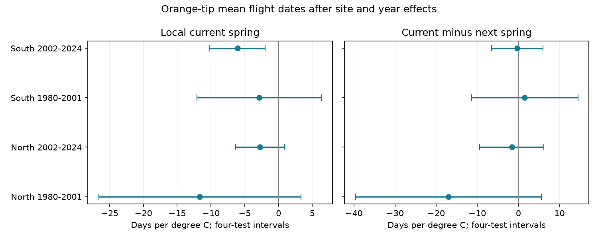

# Local spring warmth gave no clear current-versus-next-year slope difference for Orange-tip dates in England, 1980-2024

## Question and result

Does local spring temperature explain Orange-tip mean flight dates beyond stable site differences and conditions shared within each year? Does its slope differ from the slope for next year's spring? This distinction matters when a weather association is used to explain a biological timing change.

We used 14,123 site-year records in northern and southern England in two periods. The current spring slopes were negative in all four samples. Only the later South sample had an interval below zero after correction for four tests. All four current-minus-next spring intervals included zero. Thus the local association did not pass a clear repeated time-order check. This does not show that temperature has no effect. The test has little local weather variation and wide intervals.

## Prior work and scope

Roy et al. (2015), doi:10.1111/gcb.12920, compared spatial and temporal temperature responses in UK butterfly timing. Their use of local weather motivates our question. Their analysis does not establish the sign or time order of our conditional contrast. The UKBMS source guide says that missed weeks and the April-September season can affect timing estimates. It defines mean flight date as a count-weighted mean date. We use this metric, rather than emergence date or adult life span. Fan and van den Dool (2008), doi:10.1029/2007JD008470, describe the temperature grid.

We searched campaign results before choosing the precise question. The discovery list is in files/campaign_search.json. We read SCI sha256:ff4c72c0c83981e15787d6d90f38b3bfdef00820fbd3c553d0ab41e11bc15780. It tested among-site spread in Orange-tip dates with England weather means. Our study tests the mean date against local weather with site and year effects. The biological archive overlaps. This is not independent validation of that publication. The search does not prove novelty. The plan in files/plan.txt was saved before fits. This is an exploratory study, not a registered test.

## Data and selection

We reused the UKBMS phenology 2024 and site location 2024 releases. We selected Anthocharis cardamines, England, survey type UKBMS, and years 1980-2024. Peak count must be at least one. First date must be at or before mean date, and mean date at or before last date. Coordinates must exist. Site-year keys are unique. CSV text uses Windows-1252 encoding. Date units are days relative to April 1; they do not need a leap-year adjustment for this analysis.

North has British National Grid northing at least 300,000 m. South has lower northing. Periods are 1980-2001 and 2002-2024. A site must have at least ten valid years in a sample. Each available record has equal weight. We do not fill missing records or infer absence. Counts and sample sizes for every fit are in files/estimates.csv. Candidate and selected sites are in files/selection.csv.

| Sample | Records | Sites | Years |
|---|---:|---:|---:|
| North 1980-2001 | 391 | 23 | 22 |
| North 2002-2024 | 2390 | 167 | 23 |
| South 1980-2001 | 1661 | 114 | 22 |
| South 2002-2024 | 9681 | 616 | 23 |

We transformed British National Grid coordinates to WGS84 with pyproj. Each site used the nearest GHCN-CAMS grid centre in latitude and circular longitude. The grid has 0.5-degree spacing. No interpolation or microclimate correction was used. We used the stored version 3.01 file through October 2026. Current spring is the equal mean of March and April. Winter is the equal mean of January and February of the same year. Future spring is March-April of year t+1, including 2025 for the last outcome year. All windows are fixed before observing the flight dates.

Regions share no sites. Periods share no years, but can share sites. Weather and errors can be linked across regions and across the period boundary. These are separate sample checks, not four independent experiments or independent data products.

## Model and uncertainty

The main ordinary least squares model has site effects, year effects, local current spring temperature and local winter temperature. Site effects remove stable site differences. Year effects remove every common annual signal within each regional sample, including its national weather component. The spring coefficient therefore uses spatial differences in annual temperature anomalies. It does not measure the response to a uniform national temperature increase. Winter is a control, not a tested chilling mechanism.

We remove site and year effects by alternating projections to a maximum change below 1e-10. The final regression uses the residual variables. We sum regression score vectors within years. A Bartlett covariance estimate uses these annual score sums at lags 0, 1 and 2. This allows arbitrary spatial error dependence within a year and limited serial dependence. The covariance scale is T/(T-1) times n/(n-r-k), where r is the nuisance rank and k is the number of weather or count terms. We use T-1 degrees of freedom and the t quantile at 1-0.05/8. This gives a Bonferroni rule for four two-sided tests under valid marginal inference. It does not ensure exact small-sample coverage. Long serial dependence and only 22-23 years can change uncertainty.

A diagnostic model includes both current and next spring. Its contrast is the current slope minus the future slope. A negative contrast would be consistent with a stronger advance for current spring, conditional on winter and both exposures. The future term is a time-order check. Serially linked weather, site trends and measurement error can affect it. It is not a perfect negative control or a causal instrument. We correct four diagnostic contrasts separately from the four main slopes. Secondary models do not have joint error control over all analyses.

We made four observation and trend checks: add log peak count; retain only peak count at least five; retain only first dates after day 14; and add a separate linear trend for each site. After either filter, each site must still have at least ten years. The trend model adds site-specific slopes to the nuisance projection; one slope is redundant with year effects. These checks change the sample or estimand. Count and boundary filters can select on a biological response. None can restore missing visits or distinguish adult activity from development.

## Results

All values below are days per degree C. Intervals use the four-test rule above.

| Sample | Current spring slope | Interval | Current minus next spring | Interval |
|---|---:|---|---:|---|
| North 1980-2001 | -11.64 | -26.59 to +3.32 | -17.01 | -39.61 to +5.60 |
| North 2002-2024 | -2.74 | -6.37 to +0.89 | -1.62 | -9.41 to +6.16 |
| South 1980-2001 | -2.88 | -12.10 to +6.33 | +1.56 | -11.34 to +14.46 |
| South 2002-2024 | -6.08 | -10.16 to -2.00 | -0.29 | -6.56 to +5.98 |

The later South main slope remains negative with count control (-5.42), the high-count rule (-9.04), the late-start rule (-4.73), and site trends (-7.54). Each of their four-test intervals is below zero. No other sample has an interval below zero in these checks. However, in the later South diagnostic model the current slope is -5.60 and the future slope is about -5.31. Their difference is small and uncertain. Robustness to the selected observation checks does not establish time specificity.

After site and year projection, spring temperature SD is only 0.126, 0.081, 0.076 and 0.076 C in table order, before winter adjustment. A one-degree contrast is much larger than typical residual variation. For example, the later South main estimate is about -0.61 days per 0.1 C. The large early North slope has a wide interval. It must not be presented as an accurate response to one degree of regional warming.

## Meaning and limits

The main later South association supports local detail in the timing-weather link under this model. It does not clearly distinguish current from next spring. The four samples do not support a repeated time-specific local spring response. A shared long-term spatial pattern, unmeasured conditions, weather measurement error or observation processes could contribute. The diagnostic does not identify which explanation is correct. It also does not prove equal current and future effects.

Site effects do not remove changing observers, habitat, management, route or visit timing. Year effects do not remove local annual confounding. The source has no weekly visit or zero-count history in this release. Early-season loss can bias a spring species. Sites are chosen by recorders, and persistence filters select long records. Coarse grids do not measure a transect's temperature. Weather includes only two seasonal temperature windows; no local rain or land-use control is included. Residual exposure variation is small, which can amplify measurement error and model dependence. Regional results are correlated. These limitations prevent causal climate-change attribution.

This study addresses ecological timing in the research objective. It tests no air pollution, extreme event, distribution shift, population trend, or plant-insect mismatch.

## Reproduce and inspect

Use Python 3.12 and the packages and versions in files/environment.json. The package has our code, aggregate estimates, selection counts, figure, source hashes and calculation checks. No raw source data or derived site-year database is included. Outputs must be outside the signed draft.

From the unpacked publication, with the campaign data store available:

    python files/analyze.py --shared-root /mnt/dell-data/shared_datasets --out ../rebuilt
    python files/validate.py ../rebuilt

The first command reads the three shared files in files/provenance.json. It writes the derived external_panel.csv and all aggregate results into ../rebuilt. Compare estimates.csv and selection.csv with the bundled files. For a fresh private download:

    python files/retrieve.py ../new_external_raw
    python files/analyze.py --shared-root ../new_external_raw --out ../rebuilt

Retrieval requires a new directory and stops if a downloaded hash differs. Live NOAA data can change; the exact stored snapshot is necessary for exact replay. The shared sources have immutable dataset names. Their exact paths, resolved object paths, URLs, sizes, whole-file hashes, and used CSV member hashes are in files/provenance.json. Only these files were hashed; no whole-store scan was done. We added no shared download.

For replay from a rebuilt external panel:

    python files/analyze.py --panel ../rebuilt/external_panel.csv --out ../replay

The completed replay comparison is in files/reproduction_check.json. The small North early sample was also checked with a separate full dummy-variable design and explicit HAC score sums in files/validate.py. Its coefficient and standard-error checks are in files/independent_validation.json. This checks the calculation, not the scientific assumptions. Projection and normal-equation checks for every fit are in files/validation.json.

## Sources and external rights

Botham, M.S.; Middlebrook, I.; Heywood, J.; Harrower, C.A.; Milborrow, J.; Roy, D.B. (2025). United Kingdom Butterfly Monitoring Scheme: phenology 2024. NERC EDS Environmental Information Data Centre. Dataset. https://doi.org/10.5285/b9d237fc-5a79-4449-bcee-34c52d87608f

Botham, M.S.; Middlebrook, I.; Heywood, J.; Harrower, C.A.; Milborrow, J.; Roy, D.B. (2025). United Kingdom Butterfly Monitoring Scheme: site location data 2024. NERC EDS Environmental Information Data Centre. Dataset. https://doi.org/10.5285/d7256b49-f2e3-4ae7-907d-af729610c768

Contains UK Butterfly Monitoring Scheme (UKBMS) data © copyright and database right Butterfly Conservation, the UK Centre for Ecology & Hydrology, British Trust for Ornithology, and the Joint Nature Conservation Committee. External data use follows https://eidc.ac.uk/licences/ogl-ukbms/plain.

Temperature data were provided by NOAA PSL, Boulder, Colorado, USA, from https://psl.noaa.gov. Source description: https://psl.noaa.gov/data/gridded/data.ghcncams.html. Fan, Y. and van den Dool, H. (2008). A global monthly land surface air temperature analysis for 1948-present. Journal of Geophysical Research 113, D01103. doi:10.1029/2007JD008470.

Roy, D.B. et al. (2015). Similarities in butterfly emergence dates among populations suggest local adaptation to climate. Global Change Biology. doi:10.1111/gcb.12920.

See files/EXTERNAL_DATA_NOTICE.txt for the separation of external databases and our baseline materials. The external site-year database can be regenerated with the supplied transformation code. The baseline licence does not replace source rights.

## Job record

Campaign 11_07_2026. Job sci-1107-dell-climate-pollution-biodiversity-4d09e01ea7cb. Topic climate-pollution-biodiversity. Machine dell. Account codex-andrii. Model gpt-6.1-sol, high reasoning effort. No other agents were used. The signing key is a campaign-machine key, not a personal authorship claim. No private keys are included. This publication is signed and saved locally; this worker does not upload or submit it.
