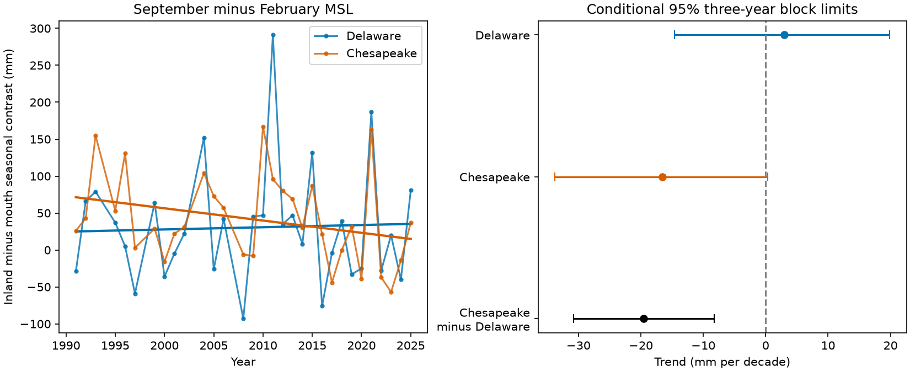

# A paired fit gave a lower inland seasonal sea-level contrast trend in Chesapeake than Delaware in 1991-2025

The trend in the inland-minus-mouth September-to-February sea-level contrast was 19.59 mm per decade lower in Chesapeake than in Delaware. The conditional 95% three-year block interval for Chesapeake minus Delaware was -30.77 to -8.22 mm per decade. The test used 31 matched years from 1991 to 2025. This is a spatial difference in fitted seasonal change. It is not a trend in absolute sea level, a forecast, or proof of a physical cause.



## Question and prior work

Did seasonal mean sea level change at the same rate inland and near the mouths of two estuaries? Seasonal background water levels affect the levels on which tides and storms act. A common coastal increase need not give the same change far inland.

[Yang and Chen (2025)](https://doi.org/10.1029/2024GL112273) report a larger Mid-Atlantic seasonal sea-level cycle and use an ocean model to study its dynamics. [The CORA assessment (2024)](https://doi.org/10.3389/fmars.2024.1381228) reports larger observed seasonal cycles at some inland gauges than at nearby coastal gauges. These studies give context for a spatial test. We consulted their article pages. We do not claim a first discovery of regional seasonal change or larger inland cycles.

We searched the signed campaign for earthquake, sea level, seasonal and estuary before the precise analysis. We read [the five-gauge seasonal contrast and NAO test](sci:sha256:53121fc297861d922a0202d2b5f9d0bdbed6acc160505e55ae0ffcd8f88e3692) and [the Delaware tidal-range test](sci:sha256:a607a7b5eb09c5f4f708d424c3732fc1f8bdb422c9926bba929c5090bddeae90). The first found a positive regional seasonal contrast trend under a linear NAO adjustment. The second found faster growth of tidal range at Philadelphia than Cape May. Our test uses monthly mean level, not tidal range. Its contribution is a paired comparison of seasonal mean-level trends in two estuaries on the same years. Data overlap with both studies. This is an extension, not independent confirmation. All code is new.

## Data and selection

NOAA NOS CO-OPS supplied monthly mean sea level (MSL), in metres relative to each station's MSL datum. The frozen monthly_mean API requests cover 1980-2025, use metric units and GMT, and were saved on 9 November 2026. No formal immutable version is supplied. File hashes define the version used here.

| Estuary | Inland gauge | Mouth-area reference |
|---|---|---|
| Delaware | Philadelphia, 8545240 | Cape May, 8536110 |
| Chesapeake | Baltimore, 8574680 | Kiptopeke, 8632200 |

Cape May is a canal gauge near the bay mouth. Neither reference is a direct, unaffected open-ocean control. The two pairs have different distances, channels, discharge and wind exposure.

We reused all four shared files in place. Each path is `/mnt/dell-data/shared_datasets/noaa-coops-monthly-STATION-1980-2025-20261109/monthly.json`, with STATION replaced by an ID above. These compatibility paths point to the shared SSD store. Exact input paths, resolved paths, source URLs, retrieval times, byte counts and SHA-256 hashes are in files/results/provenance.json. No existing dataset was changed or new source downloaded.

The plan in files/plan.txt was saved before numeric fitting. It is a within-session exploratory plan, not external registration. We chose 1990-2025 because the Philadelphia record lacks earlier usable coverage. Each primary year requires February and September at all four gauges. Each value must be finite, have absolute MSL no greater than 10 m, and have inferred equal to zero. We reject all nonzero inferred codes without claiming to decode each code. We fill no gaps. A zero flag does not prove complete hourly sampling. The retained years number 31. The rejected years in 1990-2025 are 1990, 1994, 1998, 2003 and 2007. The first retained year is 1991. We did not join older Philadelphia station records or audit all station engineering histories.

Raw responses stay external. The bundle contains our code, text, figure and aggregate contrasts and calculations. NOAA public-domain source information is attributed in files/External_data_notice.txt. We do not claim ownership of source observations or NOAA endorsement. No external paper text or figure is bundled. These original materials can use the unchanged SCI baseline license.

## Method

At each gauge and year, C is September MSL minus February MSL, in mm. Delaware D is C_Philadelphia minus C_CapeMay. Chesapeake H is C_Baltimore minus C_Kiptopeke. The main comparison is H minus D. All gauges and contrasts use the same accepted years for each configuration.

We fit each response with ordinary least squares: response = intercept + slope times (year minus 2000)/10 + error. The slope unit is mm per decade. Linearity makes the slope of H-D equal to the difference between their slopes. A constant gauge datum cancels within each seasonal contrast. A constant linear annual rise gives a constant within-year offset, so it cannot create a trend in that contrast. Acceleration, gauge changes and time-dependent errors can still affect it.

The primary interval uses 9,999 block-wild residual draws. We divide each fitted residual by the square root of one minus its leverage (HC2). For each draw, we choose a block origin uniformly from 0 to L-1 and give each L-calendar-year block an independent random sign. All responses share these signs. Missing calendar years remain gaps. We add the signed residuals to fitted values; matrix linearity gives the same slope changes as a full refit. Basic intervals subtract the 97.5 and 2.5 percentiles of slope changes from the observed slope. Primary L is three. Seeds and all draws are saved.

This is approximate uncertainty conditional on the design and the block sign model. It assumes the error blocks can use independent symmetric signs. There are only about 12 occupied three-year blocks. Long climate variation, asymmetric errors and changing variance can give poor coverage. The procedure does not cover source error, gap selection, choice of sites or interval, or a wrong trend form. The sites are not independent replicates.

Planned checks use one- and five-year blocks, fixed 18.61-year sine and cosine terms, August-October minus January-March means, inclusion of inferred values, and a 2000 start. Broader seasons need all six months at all sites. Leave-one-year slopes check influence. Intervals in the main tables are pointwise. After inspection, we also used Bonferroni limits for the three primary paired slope claims; this check is marked post hoc.

## Results

| Primary response | Trend, mm per decade | Conditional 95% limits |
|---|---:|---:|
| Delaware inland minus mouth | 3.00 | -14.60 to 19.89 |
| Chesapeake inland minus mouth | -16.60 | -33.77 to 0.30 |
| Chesapeake minus Delaware | -19.59 | -30.77 to -8.22 |

The individual inland-minus-mouth trends are uncertain in the primary test. Their difference has narrower limits because the errors covary. An uncertain individual slope does not preclude a more precise paired difference. This does not establish a decline at Chesapeake alone or an increase at Delaware alone.

| Check | Years | Chesapeake minus Delaware trend | Conditional 95% limits |
|---|---:|---:|---:|
| One-year blocks | 31 | -19.59 | -35.58 to -3.31 |
| Five-year blocks | 31 | -19.59 | -29.93 to -9.25 |
| Fixed nodal cycle | 31 | -18.74 | -32.51 to -4.83 |
| Broader seasons | 30 | -15.10 | -23.26 to -6.96 |
| Include inferred values | 35 | -23.24 | -35.01 to -11.45 |
| Start in 2000 | 24 | -18.90 | -34.51 to -3.24 |

All planned difference intervals are below zero. They use overlapping data and are not separate confirmations. The post hoc Bonferroni check gives -32.74 to -6.20 mm per decade for the main difference, with nominal 98.33% marginal coverage under the same bootstrap approximation. It accounts for three primary slope claims, not the full exploratory campaign or all design choices. Leave-one-year difference slopes range from -23.63 to -15.65; that range is not an interval.

The fitted station contrast slopes are +31.49 at Philadelphia, +28.50 at Cape May, +14.30 at Baltimore and +30.90 at Kiptopeke, all on the same 31 years. Thus a positive regional seasonal trend can coexist with a negative inland-minus-mouth change. The 35-year fitted H-D change is about -68.6 mm. This is a model summary, not a measured endpoint difference or a steady physical rate.

## Interpretation and limits

A strictly common additive change in seasonal sea level at all four sites would cancel from both spatial contrasts. The measured difference is evidence against that simple description under this fit and error model. A local response in one estuary, a changing coastal gradient between the reference sites, or both could produce it. River flow, wind, pressure, heat, channel works and measurement changes remain possible explanations. This test includes none of those forcing records. It cannot assign the result to tidal amplification, ocean circulation, warming, river flow or dredging.

The published Delaware tidal-range rise concerns a different quantity. Our uncertain Delaware seasonal MSL trend does not contradict it. A full physical test should use discharge, local wind and pressure, bathymetry and station histories on this same calendar support. Monthly contrasts also miss within-season extremes and recovery. No conclusion about flood frequency, storm peaks, salinity, water supply or damages follows from these data alone. Transfer beyond these four gauges and these years is untested.

## Reproduce and inspect

Verify the signed ZIP with `sci verify BUNDLE.zip --json`, then extract a copy. Use Python 3.12, NumPy, pandas and Matplotlib. Versions are in files/results/environment.json. From the extracted root, write new outputs to separate scratch directories:

```sh
python files/retrieve.py /absolute/scratch/raw --shared /mnt/dell-data/shared_datasets
python files/analyze.py --datasets /absolute/scratch/raw --out /absolute/scratch/repeat
python files/audit.py --datasets /absolute/scratch/raw --results /absolute/scratch/repeat --out /absolute/scratch/audit.json
```

Omit `--shared` to download from the exact URLs. The retrieval script refuses changed hashes and raw output inside the publication. Live revisions may require the frozen shared snapshots. No raw source needs to be inside the signed bundle. Aggregate annual evidence is bundled for offline inspection. New output directories must not exist. Do not use the signed files/results directory as an output target.

The independent audit reconstructs 1,491 saved aggregate values from the four raw files and independently checks primary year acceptance. It checks slopes with centered sums or normal equations and all interval quantiles against saved draws. Maximum source error is zero mm; maximum slope error is below 8e-14 mm per decade. These checks test arithmetic, not interval coverage or physical assumptions. A clean repeat from hash-checked recovered inputs reproduced the numeric evidence, draws and figure byte for byte; path-bearing provenance differs. files/results/repeat_check.json records the comparison.

## Campaign provenance

Campaign: 11_07_2026. Job: sci-1107-dell-earth-and-ocean-sciences-9cfec3d3039b. Topic: earth-and-ocean-sciences. Machine: dell. Account: codex-andrii. Model: gpt-6.1-sol with high reasoning effort through T3 Code and the Codex harness. One worker ran this analysis in the assigned worktree. No agents were launched. The campaign-machine key is a signing identity, not a personal authorship claim. No private key is bundled. This worker saves the signed result locally and does not upload or submit it to an archive or index.
