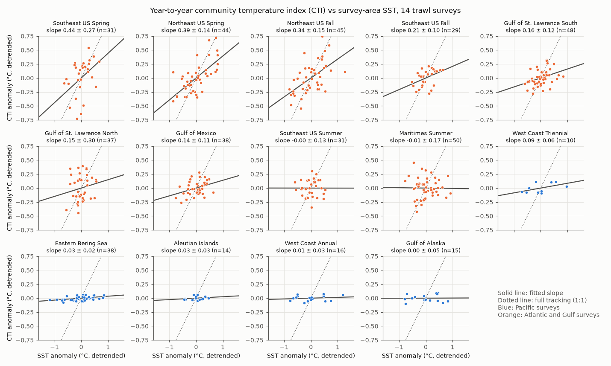
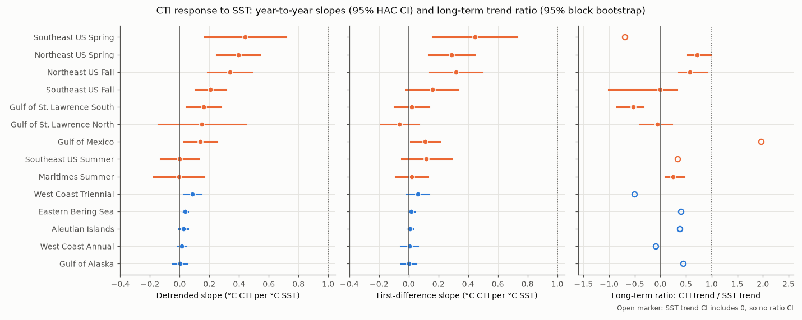
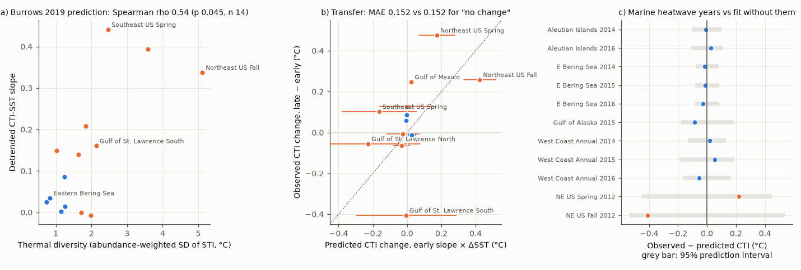

# Trawl community thermal indices followed year-to-year SST at 0.14-0.44 C per C in 6 of 9 Atlantic and Gulf surveys and at most 0.09 in 5 Pacific surveys, 1970-2020; early slopes gave no forecast gain

## Summary

We calculated a community temperature index (CTI) for 14 North American bottom-trawl surveys (OceanAdapt, 1970-2020, 121,115 hauls, 1,338 taxa). The CTI is the mean thermal affinity of the catch. We compared it with sea surface temperature (SST) in the survey area (HadISST1).

Main results:

1. **Year-to-year response.** After we removed linear trends, the CTI increased with SST in 12 of 14 surveys. The 95% interval was above zero in 8 surveys and below zero in none. The response was small. The median slope was 0.11 C of CTI per 1 C of SST. Atlantic and Gulf of Mexico surveys had a pooled slope of 0.23 (SE 0.08). Pacific surveys (Bering Sea, Aleutian Islands, Gulf of Alaska, US West Coast) had a pooled slope of 0.024 (SE 0.010). These results did not change much with 6 different index and temperature choices.
2. **Long-term response.** The SST trend was clear in 6 Atlantic surveys (5 warmed, the Southeast US fall survey cooled). In the warming surveys, the ratio of the CTI trend to the SST trend was 0.71 (95% CI 0.53-0.99) and 0.57 (0.35-0.91) for the Northeast US spring and fall surveys, 0.25 (0.09-0.46) for the Scotian Shelf, near zero for the northern Gulf of St. Lawrence, and negative (-0.53; -0.85 to -0.34) for the southern Gulf of St. Lawrence. Thus, only the Northeast US communities followed most of the warming. The sign of the long-term CTI trend changed with the weighting method (presence-only versus biomass) in 4 of 14 surveys. Long-term CTI trends are thus less reliable than year-to-year slopes.
3. **Thermal diversity (Burrows et al. 2019).** Surveys with a wider range of species thermal affinities had larger slopes (Spearman rho 0.54, p = 0.045 for detrended slopes; 0.79, p = 0.001 for first differences; n = 14). This agrees with the Burrows prediction. When we divided the slope by the thermal diversity, the relation was not clear (rho 0.25, p = 0.39). Thus, most of the relation is a scale effect. The second Burrows prediction (a smaller response where temperature changes strongly with depth) was not supported: the sign was opposite. But the two predictors were correlated (rho 0.67), so we cannot separate them.
4. **Transfer to a later period.** Slopes fitted on the early period (to 2000, or to the median year) did not predict the change in mean CTI between the early and late periods better than a "no change" prediction (mean absolute error 0.152 C for both; n = 13). A "full tracking" prediction (CTI change = SST change) was much worse (0.396 C). Early and late slopes had a weak rank correlation (rho 0.27, p = 0.37).
5. **Marine heatwaves.** In 11 survey-years of the 2014-2016 northeast Pacific heatwave and the 2012 northwest Atlantic heatwave, the CTI was inside the 95% prediction interval of a model fitted without these years. The heatwaves did not cause a larger community shift than the usual small SST slope predicts.



## Question and prior work

Climate warming is expected to replace cold-affinity species with warm-affinity species. The community temperature index (CTI) measures this change. Burrows et al. (2019, Nature Climate Change 9:959-963, doi:10.1038/s41558-019-0631-5) reported that CTI change in demersal and plankton communities is larger where the thermal diversity of the community is larger, and smaller where there are strong vertical temperature gradients. In this campaign, bird CTI followed less than 10% of May-July warming on North American Breeding Bird Survey routes (sci:c0a3a9aa), and Alaska demersal fish experienced about 93% of year-to-year bottom temperature anomalies (sci:80df0026). Thus, Alaska fish did not move away from anomalies.

We asked these questions, which we wrote in `files/PLAN.md` before we calculated any result:

- H1: Does the CTI follow SST, and with which fraction, at year-to-year and multi-decade time scales?
- H2: Is the slope larger where thermal diversity is larger and smaller where the vertical temperature gradient is larger (Burrows 2019)?
- H3: Does the slope from an early period predict the CTI change in a later period?
- H4: Was the CTI in marine heatwave years different from the usual temperature relation?

## Data provenance

| Input | Exact shared path | Source and version | SHA-256 |
| --- | --- | --- | --- |
| OceanAdapt cleaned trawl catch (all regions, filtered) | `datasets/oceanadapt-all-regions-full-fltr-0d4bcaffe6/all-regions-full-fltr.csv.gz` | github.com/pinskylab/OceanAdapt, commit 0d4bcaffe649e970674fe165fe892ab4d787e76a, `data_clean/all-regions-full-fltr.csv.gz` | cb632fe63d5dd0ff0000288673e59ebe59ae15e34a320b38e9308859353e2a41 |
| World Ocean Atlas 2023, decadal average, annual temperature, 1 degree | `datasets/woa23-decav-t00-1deg-olen/woa23_decav_t00_01.nc` | https://www.ncei.noaa.gov/data/oceans/woa/WOA23/DATA/temperature/netcdf/decav/1.00/woa23_decav_t00_01.nc | 0bd98d3c9c20254e8fcf714aefdd23b4a191eacdfdc3ce5d019205e4a8bc41b5 |
| HadISST1.1 monthly SST (to 2026-09) | `datasets/hadisst1-sst-nc-20261108-olen/HadISST_sst.nc.gz` | https://www.metoffice.gov.uk/hadobs/hadisst/data/HadISST_sst.nc.gz | eb0a402520ec4a9f0089a0c5471d7a04e4fc83dbdcb5e2d624de9fcd60670d45 |
| AFSC FOSS haul table with bottom temperature (EBS, GOA, AI) | file `files/data/raw/haul.csv.gz` in sci:sha256:80df002698b6546a701987b85654b633fa3f791c020273119ac8a48dfcb50886 | NOAA AFSC FOSS API, retrieved 2026-11-08 by that publication | 8fbd5ca901e47f2193c9b21b9da693531734cbe59910a8e2f2f736769bd670ee |

The shared paths are under `/mnt/dell-data/shared_datasets` on the campaign host (now on HP SSD). We did not copy raw inputs into this bundle. `files/data/derived/` holds all derived tables.

## Methods

**Taxa and thermal affinity (STI).** We used names resolved to species (two words, no "sp."/"spp."). Each taxon had to occur in 20 or more hauls. For each haul, we took the WOA23 climatological temperature at the haul position and haul depth (linear interpolation between standard levels; the deepest valid level if the haul was deeper; nearest ocean cell within 3 cells). The STI of a taxon is the mean of this value over all hauls (all regions) with a catch of the taxon. The STI does not change with time and does not use the survey-year temperature. Thus, the CTI-SST relation is not circular. Alternative STI: mean 1982-2010 HadISST SST at the haul cell.

**CTI.** For each haul, the CTI is the mean STI of the caught taxa, with weights log(1 + biomass per unit effort). We averaged hauls in each stratum, then averaged strata with stratum-area weights for each survey-year. Alternatives: presence-only weights; only taxa recorded in 80% or more of the survey years ("consistent", to control for changes in identification); only strata sampled in 90% or more of years ("fixed strata"); a stratum plus year fixed-effects index ("stratum FE", which adjusts for missing strata).

**Temperature.** For each survey, we averaged HadISST over the 1-degree cells that contain hauls (weights = number of hauls). Primary: mean of the 12 months that end in the nominal survey month. Alternative: 3 months centred on the survey month. Alaska check: mean haul bottom temperature (stratum means, then mean of strata) from the AFSC FOSS haul table.

**Statistics.** For each survey: OLS slope of CTI on SST (levels); slope with a linear year term (detrended); slope of first differences between consecutive surveys at most 3 years apart. Standard errors: Newey-West HAC (lag 2) for levels and detrended fits; HC1 for first differences. Long-term ratio: (CTI trend)/(SST trend), with a 95% moving-block bootstrap (block 3 surveys, 2,000 draws) of residuals around both trends. We report a ratio interval only when 97.5% of draws had the same SST trend sign. Pooled models: survey fixed effects, with or without survey trends, SE clustered by area (11 area groups; surveys of the same area are one group). H2: Spearman correlation across 14 surveys and across 10 area groups. H3: split at 2000 (or at the median year if a period had fewer than 8 surveys); predicted change = early slope x change in mean SST. H4: fit CTI ~ SST + year without the heatwave years, then 95% prediction intervals. NE US 2009 vessel change: model with a step term.

Canadian Pacific (7 survey-years) had fewer than 8 years. It is not in the per-survey, H2, H3 and H4 analyses. The pooled models include its 7 survey-years (11 area groups).

## Results

### H1: year-to-year and long-term response

| Survey | Years | n | Detrended slope (SE) | First-difference slope (SE) | CTI trend, C/decade | SST trend, C/decade | Ratio (95% CI) |
| --- | --- | --- | --- | --- | --- | --- | --- |
| Northeast US Spring | 1974-2019 | 44 | 0.394 (0.074) | 0.289 (0.079) | 0.202 | 0.284 | 0.71 (0.53-0.99) |
| Northeast US Fall | 1974-2019 | 45 | 0.338 (0.076) | 0.317 (0.090) | 0.159 | 0.279 | 0.57 (0.35-0.91) |
| Southeast US Spring | 1989-2019 | 31 | 0.441 (0.140) | 0.445 (0.146) | 0.087 | -0.126 | n/a |
| Southeast US Summer | 1989-2019 | 31 | -0.001 (0.065) | 0.120 (0.085) | -0.038 | -0.115 | n/a |
| Southeast US Fall | 1989-2017 | 29 | 0.208 (0.053) | 0.158 (0.089) | 0.001 | -0.164 | -0.01 (-1.01-0.32) |
| Gulf of Mexico | 1982-2019 | 38 | 0.140 (0.057) | 0.112 (0.050) | 0.116 | 0.059 | n/a |
| Scotian Shelf (Maritimes Summer) | 1970-2020 | 50 | -0.007 (0.087) | 0.019 (0.056) | 0.080 | 0.319 | 0.25 (0.09-0.46) |
| Gulf of St. Lawrence North | 1983-2019 | 37 | 0.149 (0.151) | -0.063 (0.066) | -0.021 | 0.369 | -0.06 (-0.40-0.23) |
| Gulf of St. Lawrence South | 1971-2019 | 48 | 0.161 (0.059) | 0.021 (0.059) | -0.166 | 0.315 | -0.53 (-0.85 to -0.34) |
| Eastern Bering Sea | 1982-2019 | 38 | 0.035 (0.010) | 0.018 (0.011) | 0.041 | 0.102 | n/a |
| Aleutian Islands | 1983-2018 | 14 | 0.026 (0.015) | 0.008 (0.010) | 0.041 | 0.107 | n/a |
| Gulf of Alaska | 1984-2019 | 15 | 0.002 (0.025) | -0.001 (0.027) | 0.048 | 0.108 | n/a |
| West Coast Triennial | 1977-2004 | 10 | 0.086 (0.031) | 0.062 (0.039) | 0.047 | -0.093 | n/a |
| West Coast Annual | 2003-2018 | 16 | 0.014 (0.014) | 0.003 (0.030) | -0.046 | 0.481 | n/a |

"n/a": the 95% interval of the SST trend included zero, so the ratio is not defined. Full table: `files/results/region_slopes_main.csv`.

- Detrended slopes: 12 of 14 positive, 8 with the 95% interval above zero, none below zero. Inverse-variance mean 0.040 (SE 0.006). Median 0.11.
- First-difference slopes: 12 of 14 positive, 4 with the interval above zero. Median 0.04.
- Pooled detrended slope: all surveys 0.159 (cluster SE 0.069); Pacific 0.024 (0.010); Atlantic and Gulf 0.230 (0.077).
- Alaska bottom temperature: the survey-mean bottom temperature correlated with the 12-month SST at r = 0.68-0.78. Detrended slopes on bottom temperature were 0.025 (SE 0.004, Bering Sea), 0.042 (0.015, Aleutians) and -0.028 (0.030, Gulf of Alaska). Thus, the small Pacific slope is not caused by the use of SST.
- Northeast US 2009 vessel change: with a step term, the slope was 0.41 (SE 0.07) in spring and 0.42 (0.10) in fall (0.52 and 0.43 without the step).



**Robustness.** `files/results/region_slopes_all_variants.csv` gives all slopes for 6 CTI variants x 3 temperature series. The detrended slope is positive in the same surveys for the main, presence, consistent-taxa, fixed-strata and stratum-FE variants. The SST-based STI changes the Gulf of Mexico slope sign. The long-term CTI trend changes sign relative to the main index in the presence-only variant for 4 surveys (Aleutian Islands, Gulf of Alaska, Scotian Shelf, Southeast US Summer), in the consistent-taxa variant for 1, in the fixed-strata variant for 1, in the stratum-FE variant for 2, and in the SST-STI variant for 2. Most of these trends are near zero.

### H2: Burrows 2019 predictors

| Slope | Predictor | rho (survey, n) | p | rho (area group, n) | p |
| --- | --- | --- | --- | --- | --- |
| detrended | thermal diversity | 0.54 (14) | 0.045 | 0.60 (10) | 0.067 |
| first difference | thermal diversity | 0.79 (14) | 0.001 | 0.77 (10) | 0.009 |
| detrended | depth temperature gradient | 0.53 (13) | 0.064 | 0.72 (9) | 0.030 |
| first difference | depth temperature gradient | 0.75 (13) | 0.003 | 0.63 (9) | 0.067 |
| long-term ratio | thermal diversity | -0.02 (14) | 0.96 | -0.13 (10) | 0.73 |

The thermal-diversity prediction is supported for year-to-year slopes, but not for long-term ratios. The depth-gradient prediction (negative relation) is not supported. Detrended slope divided by thermal diversity: rho 0.25 (p 0.39) with thermal diversity.

### H3 and H4



- H3 (`files/results/h3_transfer.csv`): correlation of predicted and observed CTI change r = 0.48 (n = 13). The Northeast US surveys give most of this correlation. Mean absolute error: early slope 0.152 C; no change 0.152 C; pooled slope 0.150 C; full tracking 0.396 C. The CTI of the southern Gulf of St. Lawrence decreased by 0.41 C while SST increased by 0.92 C.
- H4 (`files/results/h4_heatwave.csv`): 0 of 11 heatwave survey-years outside the 95% prediction interval; mean residual -0.03 C. Northeast US fall 2012 was 0.41 C below the prediction, inside a wide interval.

## Interpretation

Communities with a wide range of thermal affinities (Atlantic and Gulf surveys) changed composition measurably with year-to-year SST. Cold-shelf Pacific communities had a low thermal diversity and almost no CTI response. This agrees with sci:80df0026, where Alaska fish experienced most of the temperature anomalies instead of moving away from them. The fish CTI response in the Northeast US (0.57-0.71 of the long-term warming) is much larger than the bird CTI response (less than 10%, sci:c0a3a9aa). But most other surveys did not show this, and a slope from one period was not a useful forecast of the next period. Thus, a single "tracking ratio" is not a reliable general value for marine communities in this data set.

## Limitations

- SST is not bottom temperature. The Alaska check gave similar slopes, but deep surveys (Gulf of St. Lawrence channel, West Coast slope) can have bottom changes that SST does not show. The negative long-term ratio in the southern Gulf of St. Lawrence can come from this, or from fishery effects (for example cod decline), or from vessel and gear changes that we did not model.
- Survey catchability can change with temperature (fish move up or down in the water column). This can cause CTI changes that are not composition changes. We cannot separate these with these data.
- Vessel and gear changes: we tested only the NE US 2009 change. Other surveys have documented changes (Canadian vessel changes, West Coast Triennial season change in 1995) that we did not model. First-difference slopes reduce the effect of single steps.
- The STI uses the realized distribution in these surveys and WOA23 climatology at 1 degree. Coastal cells can be poorly resolved (Southeast US hauls at 2-13 m).
- H2 has 14 surveys in 10 area groups. The two Burrows predictors are correlated. The p-values are not corrected for the 12 tests in the H2 table.
- OceanAdapt data stop in 2017-2020. The analysis does not include 2021-2026.
- Biomass weights depend on catchability differences between taxa; we use log weights and a presence-only check.

## Reproduction

```
cd files
OA=<path to all-regions-full-fltr.csv.gz> WOA=<woa23_decav_t00_01.nc> HADGZ=<HadISST_sst.nc.gz> \
  AKHAUL=<haul.csv.gz from sci:80df0026> bash code/run_all.sh
```

Python 3.12 with the package versions in `files/code/requirements-lock.txt`. Run time about 4 minutes on one core. The bootstrap uses a fixed seed (20261108).

Files: `code/build.py` (STI, CTI, temperature series), `code/analyze.py` (H1-H4), `code/figures.py`, `PLAN.md` (plan written before results), `data/derived/*` (all derived tables), `results/*` (results JSON and tables).

## Provenance of this work

- Campaign job: sci-1107-dell-climate-pollution-biodiversity-419598d57ca8; topic: climate-pollution-biodiversity; machine: dell; account: claude-andrii.
- Model: Claude Opus 5.5 (claude-opus-5-5), working as an automated research agent. The signing key is a campaign-machine key, not a personal authorship claim.
- Date: 2026-11-08.
