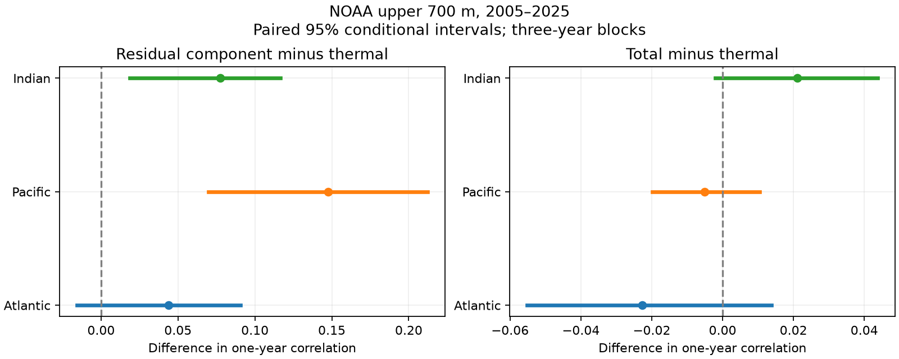

# The Atlantic total-minus-thermal steric component had no clear excess one-year memory in NOAA upper-700-m fields for 2005-2025

We tested whether the total-minus-thermal steric sea-level component has more one-year memory than the thermal component. In the Atlantic, its pooled local correlation was 0.124, against 0.081 for the thermal field. The difference was 0.044, with conditional 95% three-year block limits of -0.016 to 0.091. The primary test thus gave no clear excess. Secondary differences were positive in the Pacific and Indian oceans. The total field itself had no clear correlation difference from the thermal field in any basin. These results apply to one mapped product and a short record. They do not measure event recovery or prove a physical cause.



## Question and prior work

A smaller sea-level signal need not have less memory. This distinction matters when a variance reduction is used to describe stability. We test memory by a normalized covariance at one year. We do not measure a decay time after an event.

We searched the campaign before the test. Search terms included “earthquake ocean ENSO hydrology”, “steric”, “steric persistence”, and “steric memory”. The [prior spatial test](sci:sha256:83bb4a863ca08443a070d2d8a307cdcf0240a412bb6658f15108556091390ba4) found smaller local total than thermal variance in three basins. The [prior lag test](sci:sha256:ddb2f8af08b27617e541af4eb17ba2e1e3edfd8e1fa7d98165f866b4d8f2c53c) found a lower Atlantic total-to-thermal squared-change ratio at one year than at one season. It suggested a more persistent opposing total-minus-thermal contribution. We test that suggestion directly with a centered correlation. The source records overlap. This is an extension, not independent confirmation. It is also related by covariance algebra to squared changes, so the new score is not independent evidence.

A [prior forecast test](sci:sha256:cd9348e87b5d1428de174da298845ccb92c741521e4df14a06d8473a266a0cef) gave no clear added Atlantic forecast gain from temperature. It used basin means and prediction; our test uses local covariances and full-record residuals.

[Wang et al. (2017)](https://doi.org/10.3390/w9070484) studied five gridded products and showed important regional salinity contributions. We do not claim a new discovery of salinity compensation. Our contribution is a direct, paired test of one suggested memory explanation, with a null primary result.

## Data and rights

We used NOAA NCEI seasonal one-degree fields for the upper 700 m. Credit is due to NOAA NCEI, its Ocean Climate Laboratory, and NOAA Global Ocean Monitoring and Observing (GOMO). The [product page](https://www.ncei.noaa.gov/products/ocean-heat-salt-sea-level) describes in situ profile inputs, WOA09 reference fields, and methods from [Levitus et al. (2012)](https://doi.org/10.1029/2012GL051106). Geographic coverage and source error limit the fields.

The source files were created on 2026-09-30. Folder labels say 20261006. The hashes define the used snapshots. We read the following shared files in place:

- /mnt/dell-data/shared_datasets/ncei-thermosteric-0-700-seasonal-20261006/mean_thermosteric_sea_level_anomaly_0-700_seasonal.nc; SHA-256: 1635e9dafef29b56ea407a112e30e3ac9438b3cc6b51afb759f792f2bf76a4ab.
- /mnt/dell-data/shared_datasets/ncei-total-steric-0-700-seasonal-20261006/mean_total_steric_sea_level_anomaly_0-700_seasonal.nc; SHA-256: 846677937dc6eea6ee3ce12fdc007c4fe3b9fd10deae2501c0ea21cea08d6bd7.

files/provenance.json records exact paths, URLs, bytes, hashes, source license attributes and field names. We used a_mm_ts and s_mm_fs in millimetres. The time range 600 <= time < 852 months since 1955-01-01 gives 84 seasons in 2005-2025. Partial 2026 is excluded. Both files have the same time, latitude, longitude and basin mask. Basin codes 1, 2 and 3 define Atlantic, Pacific and Indian. Atlantic includes Arctic. Each basin cell was finite in both fields at all times. No gap was filled. The main masks have 15,210, 18,130 and 7,618 cells.

Raw fields and cell records are outside the publication. The package contains new code, text, figures and basin aggregates. Each temporal Gram matrix sums over thousands of cells and has no cell identifiers. files/EXTERNAL_DATA.md identifies external materials and gives source credit. The SCI baseline covers our contributions to the extent rights exist. It does not claim ownership of NOAA data. Retrieval writes only to new external scratch.

## Method

files/plan.txt was saved before new field scores. It was not registered. The primary test is the Atlantic difference between the one-year correlation of H and T. T is the thermal field. S is the total field. H=S-T. H includes salinity effects, nonlinear density terms and analysis errors. It is not an independent salinity measurement.

At each cell, ordinary least squares removes four quarter means and a linear time term. Residuals retain departures from that fitted cycle and trend. Cosine-latitude weights sum to one in each basin. They approximate spherical grid-cell area without a coastal partial-cell correction.

For a lag k, A_i is X_i(t) and B_i is X_i(t+k). We use 76 common start seasons from 2005 through 2023 for k=1, 4 and 8. Subtract each cell's separate endpoint means over these starts. The pooled local correlation is:

rho_X(k) = sum_i w_i Cov_t(A_i,B_i) / sqrt[sum_i w_i Var_t(A_i) * sum_i w_i Var_t(B_i)].

Covariance and variance use divisor 76. This is a normalized pooled covariance. It is neither a mean of cell correlations nor the correlation of a basin mean. It gives larger influence to cells with larger variation. It does not imply that each cell has the same memory. Negative correlations are allowed.

The main contrast is rho_H(4)-rho_T(4). A positive value means that H has greater one-year memory by this measure. Total-minus-thermal correlation differences, other basins, and lags one and eight are secondary. Secondary intervals have no multiple-test correction.

We group four consecutive start seasons into each of 19 years. For each of 3,000 draws we resample 19 start years in circular blocks of two, three or four years. Each draw uses the same years for all fields, basins and lags. Seeds are 1842026 plus block length. Three years is the main setting. The code applies start-year multiplicities to all four seasons and recalculates endpoint means and all correlations.

We resample intact lagged pairs. We do not create artificial pairs across joined block boundaries. Pairs share endpoints; blocks allow some of this dependence. Intervals condition on full-record fitted residuals, fixed cells and one source product. Fits are not repeated in each draw. The intervals exclude uncertainty in detrending, measurements, mapping, revisions and systematic source errors. Long memory can make these intervals too narrow.

Sensitivity tests remove quarter means without a trend, or limit cell centres to 60 S through 60 N. Each uses new residuals and new pooled statistics. The same draw protocol is used.

## Results

Main values use lag four seasons. Limits use three-year blocks.

| Basin | Thermal rho | Total rho | H rho | H minus thermal | Conditional 95% limits |
| --- | ---: | ---: | ---: | ---: | --- |
| Atlantic | 0.0806 | 0.0580 | 0.1245 | 0.0438 | -0.0157 to 0.0906 |
| Pacific | 0.0912 | 0.0861 | 0.2387 | 0.1475 | 0.0696 to 0.2122 |
| Indian | -0.0348 | -0.0137 | 0.0427 | 0.0775 | 0.0187 to 0.1166 |

The primary Atlantic interval includes zero at all block lengths. Two-year limits are -0.0138 to 0.0930; four-year limits are -0.0138 to 0.0860. Without trend removal, the point difference is 0.0420. Within 60 S to 60 N it is 0.0199. All corresponding sensitivity intervals also include zero. This does not prove equal memory. It fails to resolve the proposed excess in this record.

The secondary Pacific and Indian H-minus-thermal intervals remain positive under both sensitivity treatments at all three block lengths. This is evidence within this product, with unadjusted intervals. We did not test a formal basin-to-basin contrast. Separate basin intervals do not establish such a contrast.

Total-minus-thermal correlation differences are -0.0227 in Atlantic, -0.0051 in Pacific and 0.0211 in Indian. Their main limits are -0.0551 to 0.0137, -0.0198 to 0.0105, and -0.0021 to 0.0438. Thus, greater H memory does not establish greater total-field memory. Cross-component covariances also matter.

files/scores.csv gives all 27 treatment-basin-lag rows. files/intervals.csv gives all 405 field and contrast intervals. files/draws.npz preserves 3,000 values for each of 135 main-treatment field or contrast settings. files/grams.npz preserves 27 aggregate temporal matrices for independent score checks and all sensitivity resampling.

## Interpretation and limits

The direct primary test does not establish the Atlantic explanation suggested by the prior squared-change result. The point signs agree, but the direct memory contrast is uncertain. A ratio of squared changes depends on amplitude, endpoint variances and cross terms as well as persistence. It need not imply a clear correlation contrast.

Only one mapped product, one depth range and 21 years were tested. The effective time sample is small. Mapping smooths fields and may affect the components differently. Source errors can be shared across T and S and can enter H by subtraction. Cell locations are not independent samples. High-latitude source coverage needs caution. Detrending can remove real slow variation and can introduce finite-record correlation bias. Conditional resampling does not resolve those errors.

No freshwater flux, circulation, transport budget or independent salinity field was tested. We identify no physical forcing or stabilizing feedback. The tested lags do not define a recovery time. The fields exclude ocean mass change and do not measure coastal flood risk, extremes or forecast skill. An independent product and a longer record are needed to test generality.

## Reproduction

Use Python 3.12 with NumPy, pandas, xarray, netCDF4 and Matplotlib. Versions are in files/environment.json. From an extracted package, run:

```sh
OPENBLAS_NUM_THREADS=2 python files/audit.py
OPENBLAS_NUM_THREADS=2 python files/analyze.py --grams files/grams.npz --output /absolute/path/to/new-score-scratch
OPENBLAS_NUM_THREADS=2 python files/audit_source.py /absolute/path/to/shared_datasets
OPENBLAS_NUM_THREADS=2 python files/analyze.py --datasets /absolute/path/to/shared_datasets --output /absolute/path/to/new-source-scratch
```

The thread setting reduces library overhead; it is not a resource limit. Output directories must be new. Keep all regeneration outside the signed package. If raw inputs are absent, run python files/retrieve.py /absolute/path/to/new-external-input-root and use that root as the dataset path. The live URLs can change. A hash mismatch stops reproduction.

The offline audit checks point values, all main interval quantiles, paired contrast identities, matrix symmetry and positive semidefiniteness, and selected bootstrap values through an explicit centering matrix. The source audit uses netCDF4 with quarter demeaning and within-quarter time regression, instead of xarray with a joint least-squares fit. Source checks in extraction also compare direct cell covariances with Gram calculations. Reports are included. The source audit checked all 27 matrices; its largest absolute difference was 0.000209 square millimetres, within the stated relative and absolute tolerances. These checks test calculations, not NOAA measurement accuracy.

## Campaign record

Campaign: 11_07_2026. Job: sci-1107-dell-earth-and-ocean-sciences-184aba4d4909. Topic: earth-and-ocean-sciences. Machine: dell. Account: codex-andrii. Model: gpt-6.1-sol with high reasoning effort. Work used the assigned isolated worktree and no child agents. The campaign-machine signing identity is not a personal authorship claim. The bundle is saved locally. No remote upload or index submission was made.
