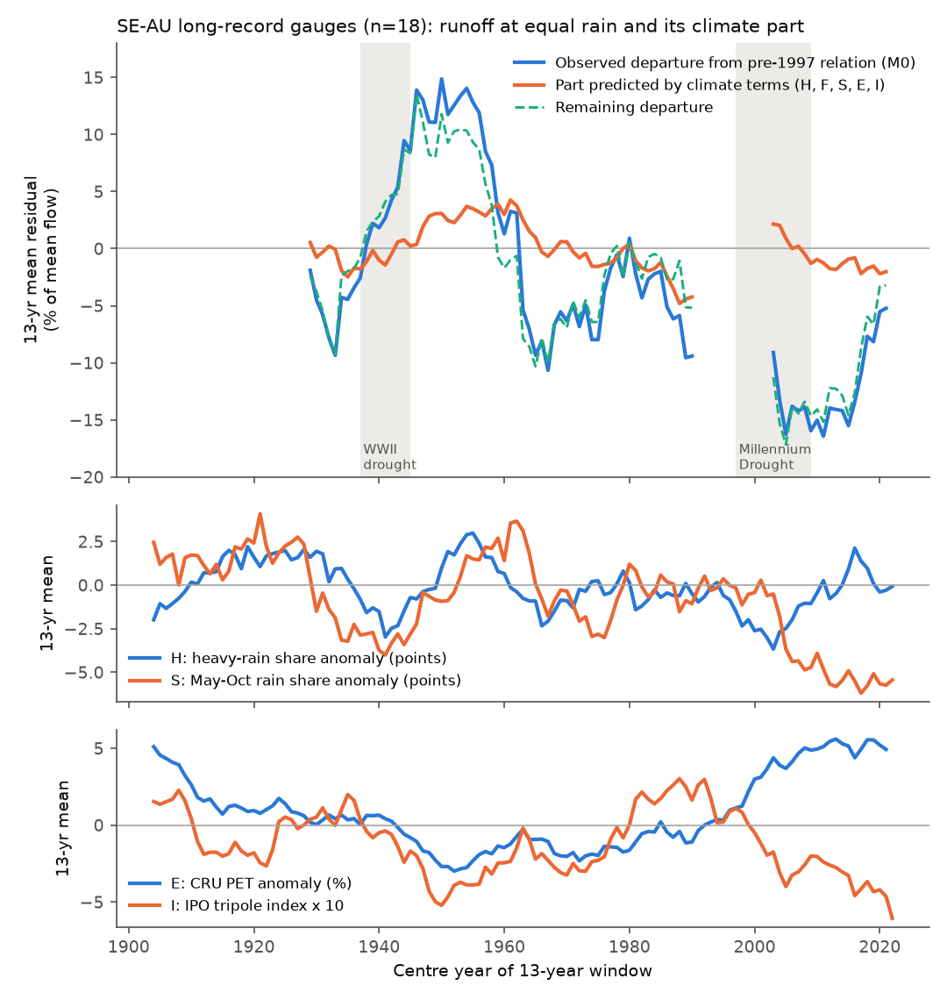
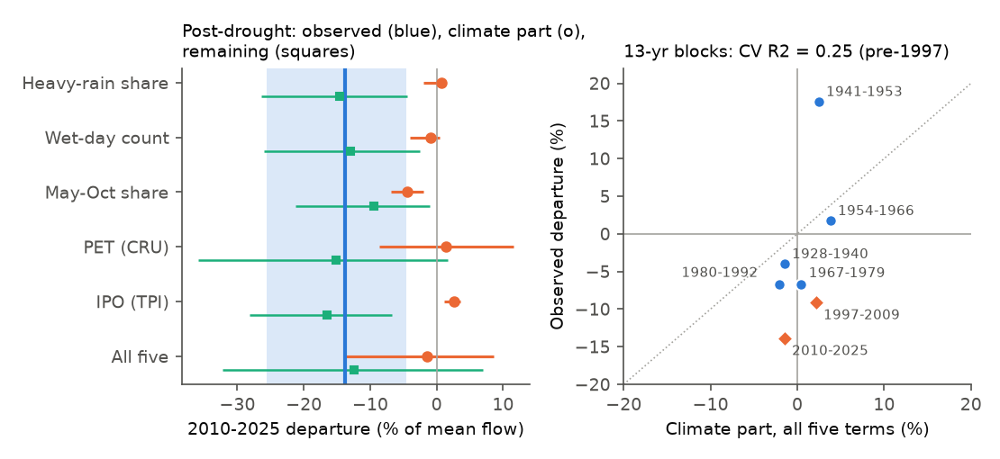
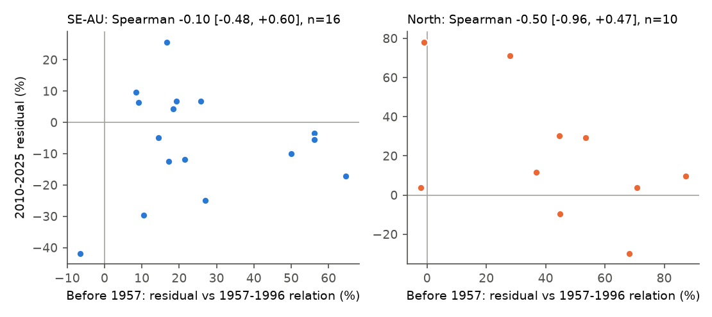

# Rain intensity, seasonality, PET and the IPO did not explain 1902-2025 changes in runoff at equal rain at 18 south-east Australian gauges; cool-season rain loss explains 1/3 of the 2010-2025 deficit

Job `sci-1107-hp-earth-and-ocean-sciences-54f00681606a`, campaign 11_07_2026, topic
earth-and-ocean-sciences, machine hp, account claude-olen. Model: Claude Opus 5.5
(`claude-opus-5-5`) in Claude Code (T3 Code). The signing key is a campaign-machine key. It is
not a personal authorship claim.

## Summary

**Question.** Bundle 4e9ae7e7 found in long Bureau of Meteorology (BoM) flow records that runoff
at equal annual rain in south-east Australia (SE-AU) was high before about 1957, low in the
1960s-1990s, and low again after 1997. The post-1997 deficit is at the low edge of this earlier
variation. That bundle did not test causes. The open question is: is the variation a
multi-decadal change in runoff efficiency with a climatic cause, or is the post-1997 deficit a
unique state change? We asked: **do measured climate covariates explain the multi-decadal
variation before 1997, with the same coefficients that hold from year to year, and do they then
also predict the post-1997 deficit?**

**Covariates.** Five measured covariates, each available from 1901 or earlier:

- **H**: daily heavy-rain share (share of the year's rain on days at or above the station's 95th
  percentile of wet days). We calculated it from a fixed network of 145 GHCN-D (BoM) daily
  stations, each valid in at least 80% of the years in 1900-1956, 1957-1996 and 1997-2024, within
  100 km of the catchment.
- **F**: wet-day count, from the same stations.
- **S**: cool-season (May-October) share of catchment rain (SILO).
- **E**: potential evapotranspiration (CRU TS 4.09).
- **I**: IPO tripole index (from ERSST v5).

**Method.** Annual panel model in % of each gauge's mean flow:
100 Q/Qbar = a_g + b_g P + c_g P(t-1) + z beta. The rain terms are per gauge and beta is common to all gauges. The model is
calibrated on pre-1997 years only. We used 18 SE-AU gauges with 50 or more pre-1997 years and 10 or more pre-1957 years, in
8 cells of 2 x 2 degrees (the gauge set of 4e9ae7e7). All models use the same gauge-years
(1901-2024). We used fixed 13-year blocks before 1997, and each block was predicted from a fit
on all other pre-1997 years. Intervals are 95% cell-bootstrap intervals (2,000 draws). The plan
and decision rules (`files/ANALYSIS_PLAN.md`, SHA-256 13aa5d82...) were written before any runoff
residual was calculated.

**Main results.**

1. **Daily rain intensity did not explain efficiency.** The heavy-rain share had no clear
   year-to-year effect (beta_H = +0.34% of mean flow per share point, -0.56 to +1.00; planned
   test T1 failed). It explained none of the block variation (cross-validated R2 = -0.01). It
   also explained none of the 2010-2025 deficit (climate part +0.7%, -2.0 to +1.4). This was
   the same with Tuesday-Saturday readings only, weekly totals, 99th-percentile days and a 150 km
   network.
2. **All five covariates together explained only part of the earlier variation.** The
   cross-validated R2 over the pre-1997 blocks was 0.25 (-0.43 to 0.70). The high 1941-1953
   block (+17.6%) had a climate part of only +2.5%. The two low blocks 1967-1979 and 1980-1992
   (-6.7% each) had climate parts of +0.5% and -2.1%.
3. **The post-1997 deficit remained.** The 2010-2025 departure was -13.8% (-25.7 to -4.5). The
   five-term climate part was -1.5% (-14.1 to +8.7), which is 11% of the departure. The remaining
   departure was -12.4% (-32.2 to +6.9). Of the five terms, only the cool-season share made a
   clear contribution: -4.4% (-6.9 to -1.9), or 32%. The May-October share fell from 54% of
   annual rain (1957-1996) to 48% (2010-2025), which is the lowest in the record. The IPO
   predicted a small surplus (+2.6%) after 1997 because negative-IPO years had more runoff at
   equal rain before 1997 (beta_I = -7.3% per unit, -10.3 to -3.0).
4. **Decision.** By the planned rules, rain intensity alone does **not** explain the variation
   (R2 < 0.2 and less than 25% of the post-1997 deficit). The five-term result is **partial**:
   R2 is between 0.2 and 0.5, and the post-1997 climate part is less than 25%. The planned
   "state-shift" reading (R2 >= 0.5 and a remaining deficit with an interval below 0) was not
   met in the main analysis or in any robustness variant.
5. **Post hoc: the early surplus and the late deficit occurred in different catchments.**
   Against the 1957-1996 relation, the pre-1957 surplus of a gauge did not predict its
   2010-2025 deficit (Spearman -0.10, -0.48 to +0.60; n=16). The 1997-2009 and 2010-2025
   deficits were strongly related (+0.73, +0.46 to +0.81; n=26). Larger 2010-2025 deficits
   occurred in flatter catchments with less plant-available soil water. The pre-1957 surplus was
   larger at low elevation and where the land-use disturbance index is high (exploratory, many
   tests).

**Conclusion.** None of the five measured climate covariates, which include daily rain intensity
and frequency, explains the century-scale changes in SE-AU runoff at equal rain. The loss of
cool-season rain after 2005 explains about one third of the 2010-2025 deficit. The 1941-1953
high efficiency and the 1960s-1990s lows have no climatic explanation in these data. The weak
relation between the early surplus and the late deficit across catchments suggests that these
are different processes, and not one multi-decadal efficiency cycle. With 5 usable blocks and
8 cells, the intervals are wide. Thus these data cannot reject a climatic cause that we did not
measure. They also cannot prove that the post-1997 state is unique.

## Data

| Data | Use | Source and version |
| --- | --- | --- |
| Daily mean discharge, 58 CAMELS-AUS gauges | annual runoff (years with >= 350 valid days) | BoM Water Data Online KiWIS, `DMQaQc.Merged.DailyMean.09HR`, retrieved 2026-11-11 |
| SILO monthly gridded rain 1889-2025 | catchment rain P and cool-season share S | SILO open data (S3), retrieved 2026-11-11 |
| GHCN-D daily PRCP, 474 ASN stations (records <= 1905 to >= 2023) | heavy-rain share H and wet days F (fixed network of 145) | NOAA NCEI by_station files, retrieved 2026-11-11 |
| CRU TS 4.09 PET 1901-2024 | E | shared campaign copy, `datasets/cru-ts-4.09-pet-1901-2024` |
| NOAA ERSST v5 monthly | IPO tripole index I | shared campaign copy, `datasets/ersst-v5-psl-sst-mnmean-20261108-olen` |
| CAMELS-AUS v2.03 boundaries and attributes | catchment weights, centroids and attributes | shared campaign copies of Zenodo 14289037 |

Checks before the analysis. Each fixed-network station has a daily threshold from all its wet
days in 1900-2025. Weekend accumulation in early records can make false heavy days. Thus we also
calculated H from Tuesday-Saturday readings only and from Tuesday-Monday weekly totals. The annual series
agree: median station-level correlation of the daily share with the Tuesday-Saturday share 0.86
and with the weekly share 0.68 (473 stations). The SE-AU 13-year mean of H varied by
less than 4 share points. Its lowest values were in 1993-2005 (-3.7 points in 1997-2009), and it
recovered after 2010 (+1.7). The cool-season share S was low in 1935-1945 (about -4 points) and
reached its lowest values after 2005 (-6 points). E (CRU PET) was high before 1915 and after 2000.
Before 1950 E depends on few stations. The IPO index had its usual phases (negative 1946-1976
and 1999-2025, positive 1977-1998).

## Results

### Planned tests, main gauge set (18 SE-AU gauges, 8 cells)

| Model | beta (% of mean flow per unit; 95% CI) | CV R2, pre-1997 blocks | Climate part 1997-2009 | Climate part 2010-2025 | Remaining 2010-2025 | Share explained |
| --- | --- | --- | --- | --- | --- | --- |
| H heavy-rain share | H +0.34 [-0.56, +1.00] | -0.01 [-0.09, 0.11] | -0.1 | +0.7 [-2.0, +1.4] | -14.6 [-26.4, -4.4] | -5% |
| F wet days | F -0.33 [-0.66, +0.15] | 0.11 [-0.21, 0.37] | -0.7 | -0.9 [-4.0, +0.5] | -13.0 [-26.0, -2.5] | 6% |
| S May-Oct share | S +0.76 [+0.50, +1.30] | 0.04 [-0.37, 0.18] | +0.5 | -4.4 [-6.9, -1.9] | -9.5 [-21.3, -1.0] | 32% |
| E PET | E +0.24 [-1.33, +2.19] | -0.02 [-0.13, 0.21] | +0.9 | +1.4 [-8.7, +11.6] | -15.2 [-35.9, +1.6] | -10% |
| I IPO | I -7.26 [-10.25, -3.04] | 0.11 [0.01, 0.31] | +2.0 | +2.6 [+1.2, +3.6] | -16.4 [-28.2, -6.8] | -19% |
| All five | H +0.30; F -0.24; S +0.77 [+0.50, +1.32]; E +0.01 [-1.60, +1.88]; I -8.15 [-11.81, -2.90] | 0.25 [-0.43, 0.70] | +2.2 | -1.5 [-14.1, +8.7] | -12.4 [-32.2, +6.9] | 11% |

The observed departure from the pre-1997 relation was -9.1% (-18.4 to -1.5) in 1997-2009 and
-13.8% (-25.7 to -4.5) in 2010-2025. Units of the beta values: H in share points x 100; F and E in %
anomaly; S in % of annual rain; I in index units. The wide interval of the five-term
climate part after 1997 comes mainly from E: its beta is not determined (-1.6 to +1.9) and E was
4-5% above its pre-1997 mean after 1997.

Cross-validated 13-year blocks (all five terms; blocks with 5 or more gauges; Figure 2 right):

| Block | Gauges | Observed departure | Climate part |
| --- | --- | --- | --- |
| 1928-1940 | 7 | -4.0 | -1.5 |
| 1941-1953 | 15 | +17.6 | +2.5 |
| 1954-1966 | 14 | +1.8 | +3.8 |
| 1967-1979 | 16 | -6.7 | +0.5 |
| 1980-1992 | 17 | -6.7 | -2.1 |

The blocks 1902-1914 (1 gauge) and 1915-1927 (4 gauges) had too few gauges and were not used. The
time null of the plan: the remaining cross-validated block departures before 1997 ranged from
-7.2% to +15.1%. The 2010-2025 remaining departure (-12.4%) is below this range. But the range
comes from only 5 blocks, and fixed blocks do not catch the lowest rolling windows of
4e9ae7e7 (1959-1971 and 1983-1995, -11% to -13%). Thus this is weak evidence that the post-1997
state is unique.

### Robustness (planned)

| Variant | Gauges (cells) | beta_H | CV R2, H | CV R2, all five | 2010-2025 observed | Climate part, all five | Remaining | Pre-1997 remaining range |
| --- | --- | --- | --- | --- | --- | --- | --- | --- |
| Main (r95s, 100 km) | 18 (8) | +0.34 [-0.56, +1.00] | -0.01 | 0.25 [-0.43, 0.70] | -13.8 | -1.5 [-14.1, +8.7] | -12.4 [-32.2, +6.9] | -7.2 to +15.1 |
| r95s, Tuesday-Saturday readings | 18 (8) | +0.22 [-0.33, +0.62] | -0.03 | 0.25 [-0.39, 0.69] | -13.8 | -1.9 [-14.0, +7.8] | -11.9 [-31.3, +7.1] | -7.3 to +15.2 |
| Weekly-block share | 18 (8) | +0.29 [-0.24, +0.92] | -0.06 | 0.21 [-0.46, 0.69] | -13.8 | -1.7 [-14.2, +7.9] | -12.2 [-31.3, +7.0] | -8.3 to +15.3 |
| 99th-percentile share | 18 (8) | +0.93 [-0.28, +1.97] | -0.02 | 0.23 [-0.45, 0.72] | -13.8 | -0.0 [-14.5, +10.8] | -13.8 [-33.1, +7.1] | -8.0 to +15.0 |
| 150 km network | 18 (8) | +0.47 [-0.55, +1.39] | 0.00 | 0.26 [-0.46, 0.70] | -13.8 | -1.4 [-14.0, +8.4] | -12.4 [-32.2, +6.7] | -7.1 to +15.0 |
| Without regulated gauges | 16 (8) | +0.26 [-0.55, +0.72] | 0.01 | 0.24 [-0.07, 0.72] | -13.7 | -3.1 [-14.7, +7.9] | -10.6 [-32.4, +8.9] | -7.9 to +15.3 |
| Per-gauge beta (no pooling) | 18 (8) | +0.34 [-0.56, +1.00] | 0.10 | 0.63 [-0.48, 0.84] | -13.8 | -1.3 [-16.8, +12.9] | -12.5 [-36.6, +9.6] | -4.3 to +10.6 |
| Larger SE-AU set (>= 30 pre-1997 years) | 32 (10) | +0.11 [-0.57, +0.52] | 0.00 | 0.43 [-0.07, 0.71] | -16.2 | -5.1 [-13.8, +4.2] | -11.0 [-23.2, -0.7] | -6.5 to +15.1 |
| North region (control) | 9 (7) | +1.50 [+0.73, +2.17] | 0.16 | 0.48 [-0.26, 0.65] | +15.0 | +8.9 [-1.6, +18.6] | +6.1 [-23.4, +46.5] | -9.5 to +25.8 |

The per-gauge betas gave a higher block R2 (0.63), but with a very wide interval, and the
post-1997 climate part did not change (-1.3%). In the larger set (32 gauges with shorter early
records), the climate part was -5.1% (31%, mostly S), and the remaining deficit was -11.0%
(-23.2 to -0.7). In the northern control (summer-rain catchments), heavy-rain share had a clear
positive effect (beta_H = +1.50, +0.73 to +2.17). The climate terms reproduced part of the North's
recovery after 2009 (+8.9 of +15.0). Thus the method can find a rain-character effect where one is
present.

### Post hoc cross-catchment test (not in the plan)

Per gauge, we fitted Q = a + bP + cP(t-1) on 1957-1996 only and calculated the mean residual
before 1957 (E57, >= 10 years), in 1997-2009 (D97) and in 2010-2025 (D10). An error in the
reference fit adds the same term to E57 and D10. This biases their correlation towards positive
values. Thus a negative correlation would be conservative evidence for one shared process.

| Pair (SE-AU) | n | Spearman (95% cell bootstrap) |
| --- | --- | --- |
| E57 vs D10 | 16 | -0.10 (-0.48 to +0.60) |
| E57 vs D97 | 16 | -0.12 (-0.55 to +0.47) |
| D97 vs D10 | 26 | +0.73 (+0.46 to +0.81) |
| D10 vs mean slope | 27 | +0.45 (+0.08 to +0.63) |
| D10 vs plant-available soil water (solpawhc) | 27 | +0.49 (+0.13 to +0.75) |
| D10 vs impoundment factor | 27 | -0.24 (-0.40 to -0.03) |
| E57 vs mean elevation | 17 | -0.35 (-0.77 to -0.01) |
| E57 vs land-use disturbance factor | 17 | +0.33 (+0.14 to +0.68) |

We tested 21 attribute pairs per region (full list in `files/results/crossgauge/`). Thus single
pairs near the interval edge can be chance results. The robust result is the pattern: the
post-1997 deficit is a stable property of a catchment (D97 and D10 agree). It is larger in
flatter catchments with less soil water storage, which agrees with Saft et al. (2016, doi:10.1002/2016WR019525). The
pre-1997 surplus does not predict it.

## Interpretation

- **Rain intensity is not the missing climatic cause in SE-AU.** The daily heavy-rain share
  changed little at the decade scale. It had no clear year-to-year effect on runoff at equal
  rain in SE-AU, but it did have an effect in the northern control. This removes one of the
  main climatic explanations of the multi-decadal efficiency changes for the cool-season,
  winter-rain catchments.
- **Cool-season rain loss is a real, partial cause of the post-2010 deficit.** At equal annual
  rain, a larger May-October share gives more runoff (0.76% of mean flow per share point). The
  share fell to the lowest values of the 1889-2025 record after 2005. This explains about 4 of
  the 14 points of the 2010-2025 deficit. The same term does not explain the 1941-1953 high
  or the 1960s-1990s lows. This agrees with earlier work on the autumn-winter rain decline and
  with bundle 4e9ae7e7, where a cool-season rain term changed the window departures only a
  little.
- **The Pacific state points the wrong way.** Before 1997, negative-IPO years had more runoff at
  equal rain (consistent with the IPO-runoff literature). The IPO was negative for most of
  1999-2025, so the IPO predicts a surplus, not a deficit. This makes a Pacific decadal cause of
  the post-1997 deficit unlikely.
- **Two processes, not one cycle.** If one multi-decadal efficiency process made both the high
  1940s-1950s and the low post-1997 periods, the catchments with the largest early surplus
  would be the ones with the largest later deficit. They were not. The post-1997 deficit is
  stable within a catchment and follows catchment properties (slope, soil water storage) that
  earlier work linked to drought-induced shifts. The pre-1957 surplus has a different pattern
  (larger at low elevation and in disturbed catchments). This agrees with a change in
  catchment state between eras, such as post-war farm dams and pasture development, or with
  early rating errors. We did not test these causes.
- **What remains open.** The 1941-1953 high efficiency is not explained by any measured climate
  term. Post-war land development is a candidate cause. Then the 1951-1996 reference of
  earlier campaign bundles would mix a land-use transition with climate. Long records of farm
  dam numbers or of rating curves would be needed to test this.

## Limitations

- **Few early gauges.** Only 5 of the 13-year blocks before 1997 have 5 or more gauges. The 18
  gauges are in 8 cells. The cell-bootstrap intervals of the block R2 are wide (for example
  -0.43 to 0.70). A climatic cause with a moderate effect cannot be excluded.
- **The covariates are not complete.** Not tested: rain at sub-daily scale, spatial rain pattern
  within a catchment (for example orographic rain in high catchments, which the low-elevation
  station network does not sample), snow, and soil moisture at the start of the wet season.
  H and F come from stations within 100-150 km, not from the catchment itself.
- **Early covariate quality.** CRU PET before about 1950 depends on few stations, and its beta was
  not determined. GHCN-D data before 1910 can contain untagged multi-day accumulations. The
  Tuesday-Saturday and weekly variants control for weekend accumulations, but not for other
  accumulations.
- **Common sample.** All models use 1901-2024 gauge-years with all covariates. Thus the residual
  values differ slightly from 4e9ae7e7, which used 1889-2025 and P only.
- **The model is linear, annual and pooled.** The beta values are common to all gauges in the
  main analysis. The per-gauge variant changed the block R2 but not the post-1997 result.
- **The cross-catchment test is post hoc.** It uses many attribute pairs and present-day
  attributes (land cover and disturbance indices of about 2010-2020, not of the 1950s).
- **Flow data quality.** Flow data before 1957 can contain rating errors. We did not test this.
  See 4e9ae7e7 for quality-code checks.

## Figures



**Figure 1.** Top: rolling 13-year mean residual of the 18 SE-AU gauges from their pre-1997
rainfall-runoff relation (blue). The part predicted by the five climate terms is orange, and
the remaining departure is green (in-sample fit on all pre-1997 years; windows with 5 or more
gauges; windows do not cross 1996/1997). Middle and bottom: 13-year means of the covariates over
the same gauges.



**Figure 2.** Left: the 2010-2025 departure (blue line, 95% interval shaded), the climate part
predicted by each model (circles) and the remaining departure (squares), with 95% cell-bootstrap
intervals. Right: observed and cross-validated climate-predicted 13-year block departures before
1997 (blue) and post-1997 periods (orange) for the five-term model. The dotted line is 1:1.



**Figure 3.** Post hoc test. For each gauge, the mean residual before 1957 against the 2010-2025
residual (both relative to a 1957-1996 fit). Left: SE-AU. Right: northern control.

## Files

- `files/ANALYSIS_PLAN.md`: plan and decision rules, written before any residual was
  calculated; `files/provenance/plan_log.txt` records its hash and time.
- `files/code/`: all code. `reproduce.sh` runs the full pipeline in a separate scratch folder:
  downloads (`fetch_bom_flow.py`, `fetch_silo.sh`, `fetch_ghcnd.sh`; IPv4 helper
  `ipv4_sitecustomize.py`), inputs (`build_flow.py`, `silo_catchment_rain.py`,
  `station_daily_indices.py`, `cru_pet_catchment.py`, `tpi_ersst.py`, `gauge_covariates.py`),
  planned tests (`climate_efficiency.py`, `run_planned.sh`), post hoc test
  (`posthoc_crossgauge.py`) and `figures.py`. The download, flow-building and SILO scripts are
  copies from bundle 4e9ae7e7.
- `files/results/<variant>/summary.json`: all planned statistics (betas, block values, CV R2,
  post-1997 observed, climate part and remaining departure, with bootstrap intervals);
  `printout.txt` is the console summary.
- `files/results/crossgauge/`: per-gauge mean residuals (E57, D97, D10) with CAMELS-AUS
  attributes, and all Spearman correlations.
- `files/provenance/`: BoM request log with SHA-256 of each response; SHA-256 of all SILO and
  GHCN-D files; GHCN-D station list and fixed network with distances; gauge list;
  shared-dataset records; hashes of the private derived tables.
- `files/DATA_NOTICE.md`: third-party data terms and credit lines. No flow, rain, PET or SST
  values are in this bundle.
- `files/environment.txt`: Python and package versions.

## Reproduction

```
mkdir /tmp/scratch && cd /tmp/scratch
bash <bundle>/files/code/reproduce.sh <bundle>/files <campaign>/datasets
```

This takes about 1 hour on 2 CPUs, most of it for the downloads (about 2.3 GB). The 2,000-draw
bootstraps take about 3 minutes per variant. BoM agencies can revise flow values, so a later
download can differ slightly; compare with the response hashes in `provenance/`.
