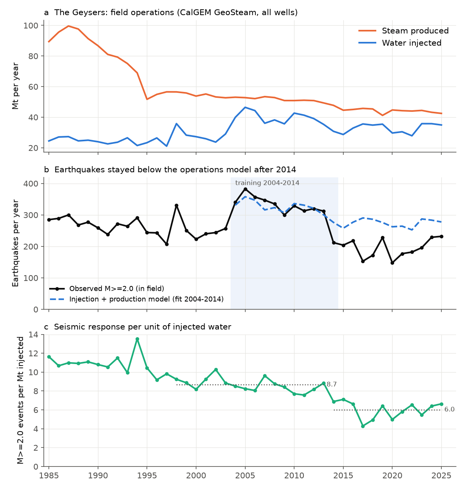
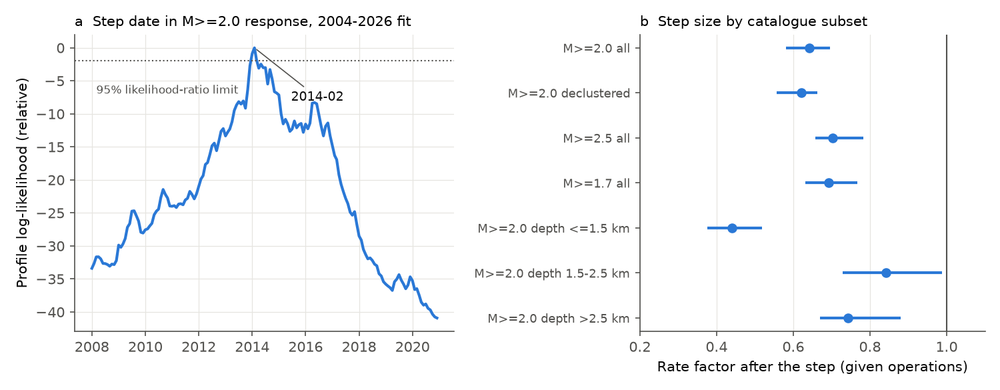
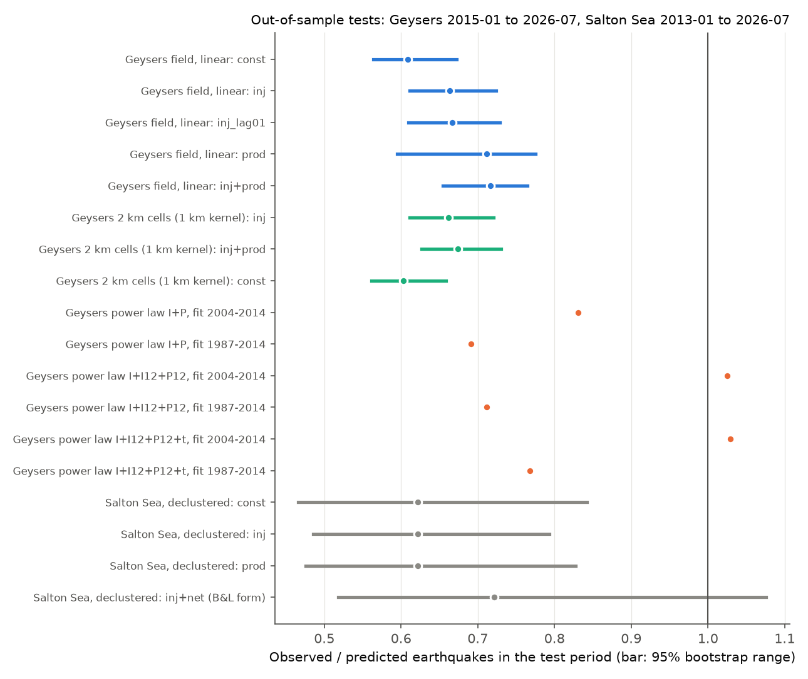

# Geysers earthquakes per unit of injected water fell by one third in an early-2014 step that injection, production and well location do not explain (CalGEM wells, ComCat M 2+, 1985-2026)

The Salton Sea test is a second result: operation models fitted to 1990-2012 also over-predict 2013-2026 declustered counts.

## Summary

At geothermal fields, earthquake rates are often modelled as a function of the fluid mass that the operator injects and produces. Trugman et al. (2016) found that the background earthquake rate at The Geysers (California) followed water injection closely to about 2014. Brodsky and Lajoie (2013) fitted Salton Sea Geothermal Field earthquakes with injection and net production for 1981-2012. We did an out-of-sample test of these model types with about 11 more years of data.

We downloaded the monthly injection and production records of every well (796 Geysers wells, 247 Salton Sea wells) from the CalGEM GeoSteam service and summed them by month and by 2 km cell. We counted USGS ComCat earthquakes within 2 km of the wells. We fitted the models on years before the test period and compared their forecasts with the observed counts.

Main results:

1. **The Geysers models over-predict 2015-01 to 2026-07.** The field had 2,273 M 2.0+ earthquakes in this period. A linear injection + production model fitted on 2004-2014 predicted 3,173 (95% bootstrap range 2,972-3,473). The ratio of observed to predicted was 0.72. All 15 linear field models (5 model forms, 3 training periods) gave ratios of 0.61-0.74, and the observed count was below all 400 bootstrap draws in each case. Declustered counts (ratio 0.59-0.71), M 2.5+ (0.68-0.80) and M 1.7+ (0.65-0.79) gave the same result.
2. **The change was a step in early 2014, not a slow trend.** With injection and production as covariates for 2004-2026, a rate step fitted best at 2014-02 (likelihood-ratio range 2014-01 to 2014-03). After the step the rate was 0.64 (95% range 0.58-0.70) of the rate that operations predict. The step model is better than a log-linear trend model by 34 AIC units and better than no change by 90 AIC units.
3. **Lower injection, lower production and the new location of injection do not explain the step.** Injection fell from 39.9 Mt/yr (2004-2013 mean) to 32.7 Mt/yr (2014-2025) and steam production fell from 51.7 to 44.4 Mt/yr. These changes are in the models. Cell models (2 km cells, wells spread with 0, 1 or 2 km Gaussian kernels) predicted 283-310 M 2+ earthquakes per year for 2015-2025; 194 per year occurred (ratio 0.63-0.69, all below the 95% ranges). In 14 of the 15 cells with at least 5 events per year, the count fell (median ratio 0.55).
4. **A strong production effect fitted on 2004-2014 fails on earlier years.** A power-law model with an elasticity of 2.55 on 12-month production reproduced the 2015-2026 total (ratio 1.03). But the same fit predicted 2.1 times the observed count for 1987-2003, when production fell by about 45%. A fit on 1987-2014 gave an elasticity of 0.25 (SE 0.09) and over-predicted 2015-2026 again (ratio 0.71).
5. **We found no evidence for local exhaustion by cumulative injection.** With cell and year fixed effects, cumulative injected mass did not reduce the cell response per unit injection (coefficient per 10 Mt: +0.01, -0.02, -0.11; p = 0.52, 0.67, 0.09 for kernels of 0, 1 and 2 km).
6. **The step is largest for shallow events.** At ComCat depths of 1.5 km or less the factor was 0.44 (0.38-0.52). At 1.5-2.5 km it was 0.84 (0.73-0.99), and below 2.5 km it was 0.74 (0.67-0.88).
7. **The step is not an NCSN magnitude change.** For events in both the NCSN (ComCat) and the LBNL "EGS" catalogues, the median magnitude difference stayed between -0.45 and -0.63 in every half-year from 2003 to mid-2015, and it did not move at the step. The LBNL catalogue, with its own magnitudes, also had fewer events in 2014 (M 3+ by LBNL magnitude: 90 in 2013, 44 in 2014).
8. **The seasonal response also became smaller, and the efficiency recovered only in part.** The within-year slope of earthquakes on injection was 3.8 (2.7-5.0) events per Mt in 2004-2014 and 2.2 (1.1-3.3) in 2015-2026. The number of M 2+ events per Mt injected was 7.6-10.3 every year from 1998 to 2013 (mean 8.7). It was 4.3-7.1 from 2014 to 2025 (mean 6.0) and 6.4-6.7 in 2024-2026.
9. **Salton Sea: operation models found no positive link in 1990-2012 and over-predict 2013-2026.** For declustered M 2.0+ events in the field, the fitted injection and production coefficients were zero for 1990-2012. The test period had 184 events against 296 predicted by a constant rate (95% range 218-395, ratio 0.62). The Brodsky-Lajoie model form (injection + net production) predicted 255 (171-355, ratio 0.72). Raw counts are controlled by swarms (2005, 2021) and have no clear model error (ratio 0.89-1.28). The number of declustered events per Mt injected continued its long fall (about 0.3 in the 1990s, 0.15 in 2004-2012, 0.05-0.14 in 2023-2025).

Our conclusion: at The Geysers, the earthquake response per unit of injected water changed in early 2014 and stayed lower for 12 years. The total injected mass, the produced mass, their location on a 2 km grid, and a cumulative-injection exhaustion term do not explain this change. Models that relate earthquake rates only to monthly injected and produced mass are therefore not stable over decades at either field. A variable that the public monthly well records do not contain (for example injection temperature, which GeoSteam does not give after 2007, the injection depth interval, or a change in reservoir pressure or steam saturation in the shallow reservoir) must have changed. We did not identify that variable.

## What is new

- To our knowledge this is the first out-of-sample test of the Trugman et al. (2016) injection-seismicity relation at The Geysers, with 2015-2026 data, and of the Brodsky and Lajoie (2013) model form at the Salton Sea, with 2013-2026 data.
- We used all well records from CalGEM GeoSteam (per-well monthly mass), not only field totals. This let us test spatial reallocation and cumulative exhaustion at the 2 km scale.
- The campaign record had no earlier publication on geothermal-field operations and seismicity (searches: "Geysers", "Coso", "Salton Sea", "geothermal", "fluid injection earthquake rate"). The result is similar to two other campaign results for human-made seismicity: Oklahoma rates fell faster than pressure models fitted to 2010-2016 (sci:sha256:d6c0ec4f174b1330bc04ff13b32b6747e594058c722d3ada3a7a4f9069c8d5e6), and Groningen needed a different production memory after 2020 (sci:sha256:5826d0025c5a4094dc4800a36b7aac6db106ef17174f534d965dd09643f9eb4a). In all three cases, operation-based models fitted on one period did not hold in the next period.

## Data

| Data | Source and version | Use |
| --- | --- | --- |
| Well records, The Geysers (field GEYSR, 796 wells) | CalGEM GeoSteam, `https://geosteam.conservation.ca.gov/GeoWellSearch/ExportInjectionReport?apinum=<API>` and `ExportSteamReport`, well list from `ExportToExcel` (POST `selectedField=GEYSR`). Retrieved 2026-11-11/12. Data from 1980 to 2026-07. | Monthly injected water mass ("Gross Injected", 1000 kg) and produced steam mass ("Gross Steam"), well locations. |
| Well records, Salton Sea (field SNSEA, 247 wells) | Same service; production from `ExportWaterReport` ("Gross Fluid"). | Monthly injected and produced fluid mass. |
| Earthquakes, The Geysers | USGS ComCat FDSN, box 38.70-38.90 N, 122.95-122.65 W, M 1.5+, 1984-01-01 to 2026-11-11, three chunks, retrieved 2026-11-12 (NCSN, network nc). | Event counts, depths, declustering. |
| Earthquakes, Salton Sea | Shared store `datasets/comcat-saltonsea-m1p5-1984-20261110` (ComCat box 33.10-33.25 N, 115.70-115.50 W, M 1.5+), SHA-256 `efa7ef6e...c52`. | Event counts, declustering. |
| LBNL Geysers catalogue | NCEDC "DOE Enhanced Geothermal Systems" catalogue, network BG, M 2.0+ (LBNL magnitude), 2003-04-22 to 2016-06-30, `https://ncedc.org/cgi-bin/catalog-search2.pl`, retrieved 2026-11-12. | Independent magnitude and rate check. |

SHA-256 values of every downloaded file are in `files/data/provenance/` (`calgem_geosteam_files_sha256.csv`, 3,000 files; `catalogue_files_sha256.csv`). The Coso field (COSO) records in GeoSteam had no monthly data, so we could not test Coso. Brawley was downloaded but not analysed.

The CalGEM monthly series are not versioned. We therefore include the per-well monthly masses that we used (`files/data/series/calgem_well_month_GEYSR.csv.gz`, `..._SNSEA.csv.gz`) and the well lists. We do not include ComCat or LBNL event rows. We include the ComCat event IDs with our in-field and declustering flags (`files/data/provenance/geysers_comcat_event_ids_flags.csv.gz`). See `files/EXTERNAL_DATA_NOTICE.md`.

## Methods

**Operations.** We summed the monthly well masses by field and month (Mt = 10^9 kg). Injection temperature is reported for less than 2% of the injected mass after 2007, so we could not use it.

**Earthquakes.** We kept events with epicentres within 2 km of a well that reported any injection or production. The primary count is M 2.0+ (NCSN Md). Maximum-curvature Mc of the M 1.5+ catalogue is about 1.6 in every year, so M 2.0 is above Mc. We also used M 1.7+ and M 2.5+. Declustering: Zaliapin and Ben-Zion (2013) nearest-neighbour proximity (b = 1, d_f = 1.6, epicentral distance), with the threshold from a two-component Gaussian mixture (`files/code/nnd.py`). At The Geysers 88% of M 2+ events were background events, and this share was stable over time. At the Salton Sea (M 1.8+) it was 38%.

**Field models (`step2_field_models.py`).** Negative binomial (NB2) counts with an identity-link mean mu = b0 + bI I_t + bP P_t (all coefficients 0 or more). Model forms: constant, injection, injection averaged over months t and t-1, production, injection + production. Training periods: 2004-2014 (after the Santa Rosa pipeline), 1998-2014 and 1986-2014. Test: 2015-01 to 2026-07 (139 months). The 95% range of the test total comes from 400 refits on training years resampled as whole years, each followed by NB draws for the test months.

**Power-law models (`step2b_powerlaw.py`).** NB GLM with a log link on log I_t, log P_t, and 12-month trailing means, with and without a linear time term. We tested each 2004-2014 fit on 1987-2003 (backcast) as well as on 2015-2026.

**Cell models (`step3_spatial.py`).** 2 km cells. Each well's yearly mass is spread to cells with a Gaussian kernel (sigma 0, 1 or 2 km). In each cell, nonnegative least squares fits N = a + k I (+ q P) on 2004-2014. The sum of cell forecasts for 2015-2025 is compared with the observed sum (300 year-block bootstrap refits with Poisson draws). Exhaustion test: NB GLM of cell-year counts with log I, cumulative prior injection (per 10 Mt), cell and year fixed effects, and cell-clustered standard errors (cell-years with at least 0.05 Mt).

**Change point (`step6_changepoint.py`).** For 2004-01 to 2026-07: mu_t = (b0 + bI I_t + bP P_t) exp(g [t >= tau]). We scanned tau monthly from 2008-01 to 2020-12 and used the profile log-likelihood. We compared this model with a log-linear trend model and with no change. Step factors for subsets use the best tau and 200 bootstrap refits on years resampled within each side of the step (the step year is left out of the bootstrap).

**Seasonal slopes.** Monthly anomalies from a centred 13-month mean; least-squares slope of the earthquake anomaly on the injection anomaly at lags 0-3 months; year-block bootstrap.

**Magnitude check (`step5_magcheck.py`).** We matched LBNL events (M 2.0+) to NCSN events (M 1.5+) within 2 s and 3 km and calculated the half-year median of NCSN M minus LBNL M for LBNL M 2.3+.

**Salton Sea (`step4_salton.py`).** Same NB identity-link models, but coefficients on injection and net production may be negative (Brodsky-Lajoie form). Training 1990-2012 or 2000-2012; test 2013-01 to 2026-07; 300 bootstrap refits.

## Results tables

### The Geysers, field models, M 2.0+, test 2015-01 to 2026-07 (observed 2,273)

| Training | Model | Predicted (95% range) | Observed / predicted |
| --- | --- | --- | --- |
| 2004-2014 | constant | 3,736 (3,382-4,032) | 0.61 |
| 2004-2014 | injection | 3,425 (3,139-3,718) | 0.66 |
| 2004-2014 | production | 3,194 (2,931-3,821) | 0.71 |
| 2004-2014 | injection + production | 3,173 (2,972-3,473) | 0.72 |
| 1998-2014 | injection + production | 3,059 (2,864-3,463) | 0.74 |
| 1986-2014 | injection + production | 3,259 (3,005-3,529) | 0.70 |

All 60 rows (4 catalogue variants) are in `files/data/results/field_models.csv`.

### Step at 2014-02, by subset (factor on the operations model, 95% range)

| Subset | Factor | Rate before / after (per year) |
| --- | --- | --- |
| M 2.0+ all | 0.64 (0.58-0.70) | 333 / 197 |
| M 2.0+ declustered | 0.62 (0.56-0.66) | 297 / 170 |
| M 2.5+ | 0.70 (0.66-0.78) | 84 / 54 |
| M 1.7+ | 0.69 (0.63-0.77) | 735 / 468 |
| M 2.0+, depth 1.5 km or less | 0.44 (0.38-0.52) | 149 / 59 |
| M 2.0+, depth 1.5-2.5 km | 0.84 (0.73-0.99) | 113 / 87 |
| M 2.0+, depth more than 2.5 km | 0.74 (0.67-0.88) | 71 / 51 |

Other figures: `files/figures/fig4_cells_depth.png` (cell ratios and depth bands) and `files/figures/fig5_salton_magcheck.png` (Salton Sea operations and response; NCSN-LBNL magnitude difference).

## Limitations

- **The cause is not identified.** The public monthly records do not give injection temperature after 2007, the depth of the open interval, injection pressure at depth, or the source of the injected water. A change in any of these can change the seismic response. We did not test reservoir pressure or steam saturation.
- **Depth.** The shallow-event result depends on ComCat (NCSN) depths. These depths have a datum and velocity-model uncertainty. The LBNL depths are about 1.5 km deeper on average, so we did not compare depth bands between catalogues.
- **Magnitudes after mid-2015.** The NCSN-LBNL check covers 2003 to mid-2015 only. LBNL magnitudes changed after mid-2015 and the LBNL catalogue ends in 2016-06. A later NCSN magnitude change cannot be excluded by this check. The step date (2014-02) is inside the checked period.
- **Timing between catalogues.** In the LBNL catalogue the fall is larger in the second half of 2014 than in the first half. Thus the exact month of the change is uncertain, but both catalogues show the fall in 2014.
- **Models.** The models are simple (linear or power-law means, no pore-pressure diffusion and no ETAS triggering). The bootstrap ranges use whole years and include parameter and count noise, but not model-form uncertainty. Many related tests were done; we report all of them in `files/data/results/`.
- **Salton Sea.** Swarms (2005, 2021) control raw counts, and the 38% background share shows that declustering removes much of the activity. Our ComCat catalogue is not the relocated catalogue that Brodsky and Lajoie used, and our training period starts in 1990 (completeness). Thus this is not an exact replication.
- **Live sources.** ComCat and GeoSteam can change. Our analysis uses the downloads of 2026-11-11/12 (hashes given).

## What remains open

1. Find the 2014 operational change at The Geysers: injection temperature, the split between Santa Rosa effluent, Lake County effluent and condensate, or well completion depths (operator reports or CalGEM district files).
2. Test the step with a relocated catalogue (for example a double-difference catalogue) and moment magnitudes after 2016.
3. Test Coso when monthly production data become available (the GeoSteam files were empty).
4. Add pore-pressure diffusion or rate-and-state models with per-well injection histories.

## Reproduce

1. Copy the code to a scratch folder outside the publication: `mkdir -p scratch && cp -r files/code scratch/code_src && cd scratch && bash code_src/run_all.sh`. All downloads and outputs go to `scratch/work/`.
2. Downloads: about 3,000 small CalGEM files (about 1 hour at 1 request per second), three ComCat queries, one Salton Sea ComCat query and 14 NCEDC queries. Use IPv4 (`curl -4`); IPv6 stalled on the campaign host.
3. Compare the downloads with `files/data/provenance/*.csv`. Then compare `scratch/work/out/*.csv` with `files/data/results/`. The analysis end month is fixed at 2026-07, so later downloads use the same months.
4. Software: Python 3.12, numpy, pandas, scipy, statsmodels 0.14, scikit-learn, matplotlib, openpyxl. Set `OMP_NUM_THREADS=1` (run_all.sh does this). Random seeds are fixed.
5. A faster check without downloads: copy `files/data/series/geysers_monthly_series.csv` to `scratch/work/derived/` and run steps 2 and 2b. Step 6 also needs the event file that step 1 writes from the ComCat download.

## Provenance

- SCI job: sci-1107-hp-earth-and-ocean-sciences-c066b7966ead; campaign 11_07_2026; topic earth-and-ocean-sciences; machine hp; model Claude Opus 5.5 (claude-opus-5-5), working as an automated research agent. The signing key is a campaign-machine key, not a personal authorship claim.
- Analysis date: 2026-11-12.

## References

- Trugman, D. T., Shearer, P. M., Borsa, A. A., Fialko, Y. (2016). A comparison of long-term changes in seismicity at The Geysers, Salton Sea, and Coso geothermal fields. J. Geophys. Res. Solid Earth 121, 225-247. doi:10.1002/2015JB012510
- Brodsky, E. E., Lajoie, L. J. (2013). Anthropogenic seismicity rates and operational parameters at the Salton Sea Geothermal Field. Science 341, 543-546. doi:10.1126/science.1239213
- Zaliapin, I., Ben-Zion, Y. (2013). Earthquake clusters in southern California I: Identification and stability. J. Geophys. Res. Solid Earth 118, 2847-2864. doi:10.1002/jgrb.50179
- Majer, E. L., Baria, R., Stark, M., Oates, S., Bommer, J., Smith, B., Asanuma, H. (2007). Induced seismicity associated with Enhanced Geothermal Systems. Geothermics 36, 185-222. doi:10.1016/j.geothermics.2007.03.003
- NCEDC (2014), Northern California Earthquake Data Center. UC Berkeley Seismological Laboratory. doi:10.7932/NCEDC
