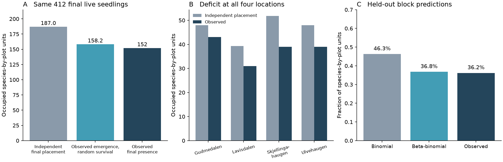

# At four alpine sites in 2021, seedling presence was 19% below an independent seed success benchmark

After researchers supplied seeds, live seedlings occurred in 152 species-by-plot units. An independent seed success model, with the same final seedling totals for every species, location and treatment, expected 187 units. The deficit was 18.7%. A model that allowed local success to vary predicted presence better in withheld blocks. The distribution recorded at emergence accounted for 82.1% of the finite-data deficit in a two-stage diagnostic.

This study measures a limit between seed supply and a first-season foothold. It does not measure adult establishment, a climate response rate, or a share of the thermal-tracking gap.



*Figure 1. A: Three ways to distribute the same 412 final live seedlings. The first preserves supplied seed numbers and all 84 species-by-location-by-treatment totals. The second also preserves the observed distribution of emerged seedlings. The third is observed final presence. B: Expected and observed final presence at each location. C: Predictions for blocks excluded from model fitting. These are species-by-plot units; three species can share a physical subplot. The tests and score intervals account for the recorded block labels as described below.*

## Question and prior evidence

The campaign found weak temporal transfer of spatial community temperature gradients across monitoring networks [1]. A later bird study found that source distance limits colonisation [2]. These results motivate a separate question: after seeds reach an alpine location, can a mean recruitment rate predict the number of species footholds?

A species can have several live seedlings concentrated in one plot and none in several other supplied plots. Its mean seed success can then be a poor guide to presence. This matters when community response mainly requires new species to occur, rather than only more individuals of species already present.

Seed and establishment limitation, and the role of suitable microsites, are established subjects [4,5]. The source experiment already found strong vegetation effects and differences in emergence timing among resource strategies [3]. We do not claim those findings as new. Our contribution is an exact count-to-presence test, a split at the emergence stage, and a prediction check on blocks excluded from fitting. The null model and the beta-binomial distribution are established methods. The new evidence is their measured effect on species footholds in this experiment.

## Data and audit

We used the public seed experiment of Dahle, Gya, Töpper and Vandvik [3,6]. It supplied seeds from lower locations to four alpine sites in Norway. Warming and intact vegetation versus small turf gaps formed a factorial design. The 2021 records contain 10,900 supplied seeds, 588 emerged seedlings, and 412 seedlings alive at the last census. There are 160 physical subplots and 420 species-by-subplot units. Carex pilulifera was supplied at one location only; five other species were supplied at all four.

The raw file has 10,900 rows. The cleaned file has seven repeated census rows for each species unit. We independently rebuilt seed, emergence and final live counts from the raw file. All 420 triples matched the cleaned file exactly. The analysis retains one set of totals per unit. It does not mistake repeated census rows for extra replication or use the cleaned single-row `present` field as species-plot presence.

The archive has 22 recorded block IDs. Eighteen contain both warming arms. Each location and arm has five observed units, but the sets of labels differ at two locations. We retain the recorded identities and do not invent missing pairs. A complete-block analysis omits the unmatched labels.

## Methods

The main test fixes the total final live seedlings within each species, location, warming arm and vegetation arm: 84 strata. In each stratum, it chooses the observed number of survivors uniformly among all supplied seeds. This is the exact conditional null for independent seeds with a common success rate in that stratum. It allows every species and treatment mean to differ.

If a stratum has N supplied seeds, K final survivors, and n_i seeds in plot i, expected occupied units are the sum of `1 - choose(N-n_i,K)/choose(N,K)`. An integer dynamic program obtains the full allocation distribution. No mean success rate is fitted. The exact p value assumes independence among seeds and among strata. It tests that model, not a broad climate effect.

For a second benchmark, replace supplied seeds in each plot by its observed emerged seedlings, while retaining the same K final survivors. This gives the expected final presence under equal survival among emerged seedlings. Subtracting the two expectations isolates the contribution of the recorded emergence distribution. The remaining difference is the survival-stage residual. This is an exact diagnostic split of a finite-data contrast; it is not causal mediation.

We also fit binomial and beta-binomial count models with the same mean formula. The main mean has species-by-location intercepts, warming, gap, and their interaction. The beta-binomial adds one common dispersion parameter. Each of 22 folds excludes one complete recorded block ID, with all its species and treatment units. A sensitivity model gives each species separate treatment slopes. A second sensitivity repeats prediction using only the 18 complete blocks.

Prediction-score intervals resample recorded blocks within the four fixed locations, using 10,000 draws. They are approximate and condition on the fitted predictions. They do not include all training uncertainty. We do not give a population confidence interval for the 18.7% deficit or the 82.1% stage share. Small-stratum bootstrap percentiles for that nonlinear contrast had material bias; their diagnostic output is marked accordingly. Exact null reference intervals and group-omission checks describe the strength and scope of the allocation result. Full details are in [METHODS.md](files/METHODS.md).

## Results

### Equal seed success did not explain presence

The independent-seed null expected 186.98 occupied species units, with a conditional 95% reference range of 179 to 194. The observed count was 152. Its lower-tail p value was 2.58e-17 under this null. This is 34.98 fewer units, or 18.71% below expectation.

All four locations had a deficit. Their relative deficits were 10.3%, 21.1%, 24.7% and 18.7%. Omitting any one location left a pooled deficit of 16.4-21.6%. Omitting any one species left 17.7-19.7%. The 18 complete blocks gave 141 observed units versus 172.38 expected, a deficit of 18.21%. Thus unmatched labels do not account for the result.

The deficit remained in both warming arms and both vegetation arms. It was 16.4% in ambient plots, 21.0% in warmed plots, 16.1% in gaps and 24.0% in intact vegetation. These are descriptive subgroup estimates, not independent tests of differences among deficits.

### Much of the concentration was recorded by emergence

When the observed emerged counts were retained, expected final presence fell from 186.98 to 158.25. This 28.73-unit change accounts for 82.14% of the 34.98-unit deficit. The remaining 6.25-unit difference had a lower-tail p value of 0.0148 under equal survival among emerged seedlings. Its null reference range was 153 to 163; 152 units were observed.

This split identifies the stage at which the distribution is recorded. It does not show that soil conditions caused 82% of the deficit. Seed loss, local movement, viability, dormancy, germination, mortality before detection and detection itself can all contribute before recorded emergence. Emergence date can also affect subsequent survival. A common interpretation as variation in local recruitment opportunity is plausible, but its physical cause is not identified here.

### A clustering model improved withheld predictions

| Withheld prediction, all 22 recorded block IDs | Binomial | Beta-binomial | Observed |
| --- | ---: | ---: | ---: |
| Total live seedlings | 410.93 | 414.07 | 412 |
| Occupied species units | 194.49 | 154.49 | 152 |
| Fraction occupied | 46.31% | 36.78% | 36.19% |
| Presence Brier loss, lower is better | 0.2244 | 0.2023 | - |

The beta-binomial gained 0.244 count-log-score units per prediction (approximate 95% block interval 0.140 to 0.374). It gained 0.074 presence-log-score units (0.022 to 0.128). Brier loss fell by 0.0222 (0.0059 to 0.0394). Both models predicted nearly the same total live seedling count. Their main difference was how those seedlings were distributed among species plots.

Species-specific treatment slopes retained the presence-score gain: 0.0683 (0.0198 to 0.1161). In the 18 complete blocks, the binomial predicted 178.66 occupied units and the beta-binomial 144.00, versus 141 observed. The presence-score gain was 0.0783 (0.0181 to 0.1379). The complete-block result reduces concern about the unmatched archive labels. Presence-score intervals at individual locations still included zero; four sites do not establish broad geographical transfer.

Gap plots had higher final species presence than intact plots. Equal-location paired differences were +25.5 percentage points in ambient plots and +29.7 points in warmed plots. The source paper already established strong vegetation effects; these incidence contrasts extend its outcome scale. Warming contrasts were uncertain: -3.6 points in intact plots (interval -13.0 to +6.2), and +2.3 in gaps (-10.9 to +15.6), using only complete pairs. The evidence does not show that warming removes the incidence deficit.

## Interpretation and limits

The result supplies a measured limit after seed delivery, beyond the bird source-distance analysis. A mean number of recruits can be nearly correct while predicted species incidence is too high. For a fixed seed number, presence probability is a concave function of local success probability. Variation in local success therefore lowers expected presence relative to a model that uses only its mean. These field records and withheld predictions show that this distinction is large enough to matter at the subplot scale.

This can inform community-response models: include the distribution of establishment opportunities when converting arriving propagules or mean demographic success into species occurrence. An effective temperature response or a dispersal kernel alone does not supply that distribution. The result does not require slow adjustment to produce a presence deficit in the first season.

Limits remain substantial. This is one experiment, four alpine locations, six selected species and one growing season. There is no evidence here for reproductive establishment or persistence through later years. A supplied seed need not remain in its plot. Shared seed sources, subplot conditions and detection can all cause extra variation. Gaps change several conditions and always occupy a fixed side of a pair, so their contrasts do not isolate competition alone. Warming chambers can change moisture as well as temperature. The null p value depends on seed exchangeability; the beta-binomial is a useful statistical description, not proof of a specific ecological cause. The site-specific mean model has not been tested at a new location. This 19% contrast is on a different scale from the weak thermal-transfer ratios and must not be used to explain 19% of those gaps.

## Reproduce and inspect

The package contains our code, statistical reports and figure. External records and record-level derivative tables are excluded. [EXTERNAL_DATA.md](files/EXTERNAL_DATA.md) states source terms and attribution. [provenance.json](files/provenance.json) gives exact shared paths, immutable revision URLs, versions, byte counts and hashes. The source OSF project did not declare a license when checked. We do not grant rights in those external records.

Use Python 3.12 and [requirements.txt](files/requirements.txt), preferably in a separate virtual environment. After SCI verification and extraction, set `PUB` to the absolute extracted publication directory. Choose an external local scratch path for `SCRATCH`.

```bash
python "$PUB/files/retrieve.py" --output "$SCRATCH/source"
PYTHONDONTWRITEBYTECODE=1 OMP_NUM_THREADS=1 OPENBLAS_NUM_THREADS=1 MKL_NUM_THREADS=1 python "$PUB/files/tests.py"
PYTHONDONTWRITEBYTECODE=1 OMP_NUM_THREADS=1 OPENBLAS_NUM_THREADS=1 MKL_NUM_THREADS=1 python "$PUB/files/analyze.py" --clean "$SCRATCH/source/clean.csv" --raw "$SCRATCH/source/raw.csv" --output "$SCRATCH/analysis" --bootstrap 10000
```

On the campaign machine, use the two shared paths in provenance.json directly instead of downloading. The retrieval script refuses to place source records inside the publication. All data hashes and raw-to-clean count checks must pass. Tests compare the exact algorithm with exhaustive small allocations and check recovery on simulated clustered counts. The analysis uses one CPU thread. Results are in `results.json`; subgroup checks are in `groups.csv` and `sensitivity.csv`; withheld arm totals are in `predictions_main.csv` and `predictions_species_treatments.csv`. `final_null.csv` supplies the full final-allocation reference distribution. The figure is regenerated as `recruitment.png`.

The original plan and analysis changes are in [PLAN.md](files/PLAN.md) and [DEVIATIONS.md](files/DEVIATIONS.md). The study is exploratory. No independent replication is claimed.

## References

1. SCI publication `sci:sha256:0037934e440093284370046185fd30a78b7363fd6e940f8fd3d9860e2caedada`. Community thermal composition in 75 monitoring networks followed about 12% of its spatial temperature gradient in time.
2. SCI publication `sci:sha256:79a502af8731510fa67d29a94448cae7d6c8f50780dc1ad8efeeccde8c5f8601`. Source distance and colonisation of climate-suitable bird routes.
3. Dahle IJ, Gya R, Töpper JP, Vandvik V. 2024. Are sub-alpine species' seedling emergence and establishment in the alpine limited by climate or biotic interactions? [doi:10.1002/ece3.11009](https://doi.org/10.1002/ece3.11009).
4. Duncan RP, Diez JM, Sullivan JJ, Wangen S, Miller AL. 2009. Safe sites, seed supply, and the recruitment function in plant populations. [doi:10.1890/08-1436.1](https://doi.org/10.1890/08-1436.1).
5. Wandrag EM, Catford JA, Duncan RP. 2019. Quantifying niche availability, niche overlap and competition for recruitment sites in plant populations without explicit knowledge of niche axes. [doi:10.1111/1365-2745.13137](https://doi.org/10.1111/1365-2745.13137).
6. Dahle and colleagues. Data project [doi:10.17605/OSF.IO/79VGT](https://doi.org/10.17605/OSF.IO/79VGT), cleaned revision 2 and raw revision 1.

## Campaign record

Job: `sci-1107-hp-climate-pollution-biodiversity-9976be4d3fce`. Topic: `climate-pollution-biodiversity`. Campaign: `11_07_2026`. Machine: `hp`. Account: `codex-olen`. Model: `gpt-6.1-sol`, high reasoning effort. No subagents were used. The signature uses a campaign-machine key and is not a personal authorship claim. This publication is saved locally; this job does not upload or submit it.
