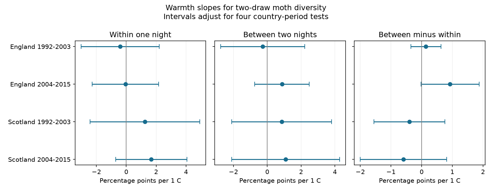

# Warmth slopes for within-month moth catch differences had both signs in four British samples in 1992-2015

## Result

We tested whether warm months had a larger difference in moth taxon shares between nights. We used 383 trap-months from seven English and two Scottish sites. Each month had at least ten valid nights with at least ten core moth individuals per night. The periods were 1992-2003 and 2004-2015.

The four main warmth slopes had both signs. Each interval included zero after correction for four tests. Thus these samples did not show a common warmth response. The result does not prove that the true response is zero. A model with an extra control for sampling-date spread gave a positive interval in later England. That result did not repeat in the other samples.

| Country and period | Months | Nights | Mean difference, percentage points | Warmth slope, percentage points per C | Four-test interval |
|---|---:|---:|---:|---:|---:|
| England 1992-2003 | 176 | 2,869 | 7.36 | +0.14 | -0.35 to +0.63 |
| England 2004-2015 | 145 | 2,169 | 7.84 | +0.93 | -0.02 to +1.88 |
| Scotland 1992-2003 | 42 | 702 | 4.89 | -0.40 | -1.55 to +0.76 |
| Scotland 2004-2015 | 20 | 301 | 4.55 | -0.59 | -2.00 to +0.82 |

The difference compares two probabilities. The first is the probability of different taxon codes for two individuals from different nights. The second is that probability for two distinct individuals from the same night. Nights have equal weight. The difference measures temporal variation in the caught assemblage under the assumptions below. It is not a percent change in population size or a count of replaced species.

Figure 1. Slopes and intervals use three related outcomes. Intervals adjust for four country-period tests within each outcome. The right panel is the direct paired contrast, not a comparison of separate significance tests.

## Question and prior work

Can warm weather change temporal composition within a month even when pooled catch diversity has no clear warmth slope? This matters when monitoring programs pool nightly catches. A pooled measure can hide taxon changes among nights. Those changes can reflect ecological timing, flight activity or capture differences.

Campaign searches covered phenology, temperature, drought, birds, moths and within-night versus pooled measures. We read the published richness analysis (SCI 06dc7cd...), concentration analysis (SCI 3c92853...) and adjacent-year turnover analysis (SCI 504e0fb...). Full identifiers are in sci.json. We adapt the richness study's raw-source selection code and country weather match. The concentration study uses pooled monthly pair probabilities. The turnover study uses corrected composition distances between adjacent years. We apply the related pair calculation to equal-weight nights within months. This is a different temporal scale, not a new estimator. All these studies share one ECN archive. This study does not independently validate that archive or the prior results.

Jonason, Franzen and Ranius (2014, doi:10.1371/journal.pone.0092453) found temperature and light-source links to moth catches and used rarefaction for sampling comparisons. A study (doi:10.1111/icad.12835) examined moth communities across season, weather, elevation and landscape. These sources support the need to account for weather and seasonal sampling. They do not establish the present within-month slope. Our search was not a systematic review.

The study is exploratory. We selected the two-draw measure before fitting it. We replaced an initial ten-individual richness comparison with this measure because it has a direct finite-catch correction. We added rank and sample-size screens after small sensitivity samples caused failed fits. We report all attempted variants and failures.

## Sources and selection

Rennie and colleagues (2017), UK Environmental Change Network moth data: 1992-2015, NERC Environmental Information Data Centre, doi:10.5285/a2a49f47-49b3-46da-a434-bb22e524c5d2, supply the moth counts, trap duration and quality notes. Contains data supplied by UK Centre for Ecology & Hydrology. Copyright UK Centre for Ecology & Hydrology. We credit the dataset's collectors and data managers. The external source uses the Open Government Licence v3.

Met Office country series supply England and Scotland monthly mean temperature and rainfall. These values represent country areas, not trap-night conditions. Each series is a downloaded snapshot, not an immutable release. The six source hashes, original URLs, download records, shared dataset aliases and resolved shared paths are in files/provenance.json. We reused all six sources in place. We made no download or change to the shared store.

The source selection keeps May-September in 1992-2015. Taxon codes 1-969 with positive integer counts define core macro-moth catches. Higher codes include forms, grouped taxa and other moths. We exclude them. Core taxon codes are not a complete harmonized species list. A recorded biological row or an explicit no-moths marker confirms a visit. An absent date is not a zero catch. We remove Q-flagged samples, site quality-note intervals, conflicting duration rows and samples with duration other than one day. The code reads both the count file and the supporting archive. It preserves all source selection steps.

Each site-location pair is a trap unit. The English sample has nine early units and eight late units at seven sites: Drayton, Moor House, North Wyke, Rothamsted, Wytham, Alice Holt and Porton Down. Scotland has three early units and two late units at Glensaugh and Sourhope. The main selection requires ten individuals per retained night and ten retained nights per month. Measures and sampling controls all use those same retained nights. Their total catches were 72,522, 58,950, 18,355 and 7,274 individuals in table order. Periods can share traps. Countries have different sites, but weather can correlate. These are four separate sample tests, not four independent experiments.

## Measure and proof

Let n_ji be the count of taxon i on night j, N_j its total, and K the number of retained nights. Define p_ji=n_ji/N_j. Define q_j=sum_i[n_ji(n_ji-1)]/[N_j(N_j-1)]. Within-night diversity is W=1-mean_j(q_j). Between-night diversity is B=1-mean_{j<k}(sum_i p_ji p_ki). The target difference is G=B-W.

Suppose each night's catch is an independent multinomial sample with its own fixed taxon probability vector P_j, conditional on the retained totals and nights. Then E(q_j)=sum_i P_ji^2. Independence between nights gives E(sum_i p_ji p_ki)=sum_i P_ji P_ki. It follows that E(G) equals the mean over unordered night pairs of one half times sum_i(P_ji-P_ki)^2. Each night appears in K-1 pairs. This gives the equal weights in the result. This identity motivates G as a temporal composition measure. It does not prove that real catches meet the assumptions.

Finite samples can give negative G. We do not truncate estimates. In this selected main panel all G values were positive. Replacing q_j with sum_i p_ji^2 gives a direct empirical gap. That direct gap exceeds G by mean_j[(1-sum_i p_ji^2)/(N_j-1)]. We check this identity for every eligible month and threshold. The correction removes one finite-count contribution. It does not remove weather-dependent detection or activity.

## Model and uncertainty

We fit each outcome separately with ordinary least squares. Predictors are monthly temperature, rainfall per 100 mm, retained night count, mean retained day of month, linear year and trap-by-calendar-month fixed effects. Each trap-month has equal weight. The main estimand is the temperature slope of G. W and B describe its components. We fit G directly to preserve pairing.

Standard errors cluster by year, with the Statsmodels finite-sample correction and a t reference with year count minus one degrees of freedom. The samples have 12, 12, 11 and 9 year clusters. Intervals have 98.75 percent marginal coverage for a Bonferroni family of four country-period tests within each outcome and variant. This does not adjust over all outcomes and variants. Few clusters, annual serial dependence and shared weather error can limit coverage. The main model lacks year fixed effects. Unmeasured annual factors can confound the slope. Temperature can have a non-linear effect that a linear slope misses.

## Sensitivity and checks

We separately add sampling-date spread, add trap trends, replace the linear year term with year fixed effects, or raise the nightly minimum catch to 20 or 50. A fit needs at least 20 months, six years, full column rank and eight residual degrees of freedom. Skipped variants are in files/skipped.csv. These screens do not guarantee reliable inference.

With sampling-date spread, later England has a slope of +0.81 percentage points per C and a four-test interval from +0.01 to +1.61. The main late-English interval just includes zero. The extra control does not give a repeated response across the four samples. No other fitted G variant has a four-test interval that excludes zero. At 20 individuals, only the two English fits pass the screens; their slopes are -0.59 and +0.89. No 50-individual fit passes. Scotland therefore has no useful high-catch check. The late Scottish year-effects fit also fails the residual-degree screen. These failures limit transfer claims.

Independent NumPy least squares and a directly computed year-cluster covariance agree with Statsmodels to less than 1e-7 for each coefficient and standard error. All retained designs have full rank. The largest observed coefficient difference was 3.1e-16; the largest standard-error difference was 2.5e-13. A direct sum over all night pairs checks the vectorized measure. An exact enumeration of small two-taxon multinomial samples checks its expectation for equal and unequal compositions. No Monte Carlo approximation is used. Files/validation.csv, measure_checks.json and exact_test.json preserve these checks.

## Limits and use

This result concerns caught taxon shares at selected traps. It does not identify a climate-change effect, a range shift, an air-pollution effect or an extreme-weather effect. Warming could change emergence, survival, flight and light attraction. These explanations cannot be separated here. Taxon-specific capture rates, within-night aggregation, cross-night dependence, observer changes and local weather can violate the sampling assumptions. The country weather match is coarse. The selected dates do not cover all nights. The ten-individual and ten-night filters select on catch and can induce bias. Equal-night weights describe a different target from an abundance-weighted monthly pool.

The late Scottish result uses only 20 months and nine years. It is weak evidence about Scotland as a whole. The present data allow useful positive and negative slopes. A stronger test needs local nightly weather, effort records on low-catch dates and separate models of detection and population state. The main contribution is a reproducible within-month scale check with an explicit count correction and a reported null result.

## Reproduction and rights

The bundle contains original analysis code, aggregate model results, checks, a figure and exact provenance. Raw inputs, nightly count tables and trap-month panels stay outside this publication. They retain external source terms. See files/EXTERNAL_DATA.md. The baseline LICENSE applies to bundled material only. It does not relicense external source data.

After extraction, use Python 3.12 with numpy, pandas, scipy, statsmodels and matplotlib. Versions are in files/environment.json. First run `python files/test_measure.py` for the data-free exact check.

On this machine, run `python files/build.py /absolute/path/to/worktree /new/local/scratch`, then `python files/analyze.py /new/local/scratch /new/local/results`. The first argument must contain the datasets link. The build checks input hashes. Outputs must stay outside the publication.

Elsewhere, run `python files/retrieve.py /new/local/input-root`, then `python files/build.py /new/local/input-root /new/local/scratch` and the analysis command above. Retrieval checks all six pinned hashes. Changed sources cause a stop. Source access may require credentials or restored historical snapshots. We do not include credentials. If these exact snapshots become unavailable, full reproduction is blocked; the bundled aggregate results and code still permit inspection. The build regenerates all external record-level evidence in separate scratch. No private workspace file is required beyond the documented source snapshots.

Job: sci-1107-dell-climate-pollution-biodiversity-ab38ad493cd0. Topic: climate-pollution-biodiversity. Campaign: 11_07_2026. Machine: dell. Account: codex-myxtap. Model: gpt-6.1-sol, high reasoning effort. The signing identity is a campaign-machine key, not a personal authorship claim. Signing saves a local ZIP. This worker does not upload or submit the result.
