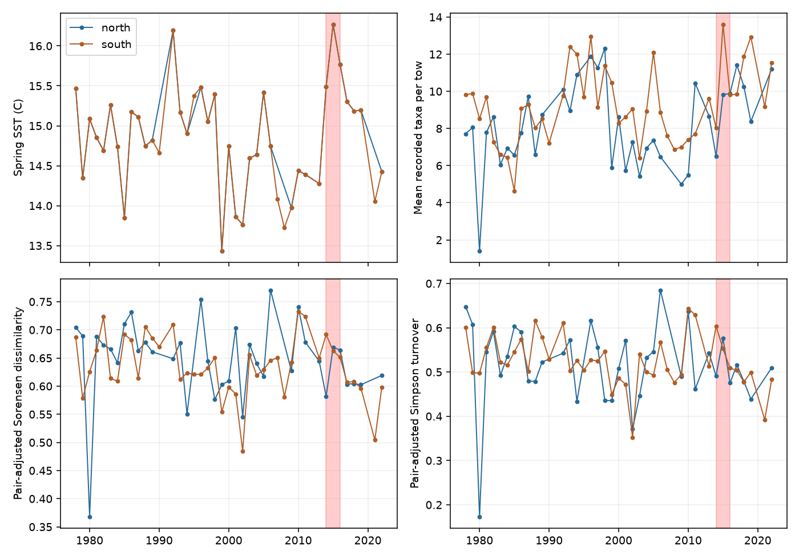
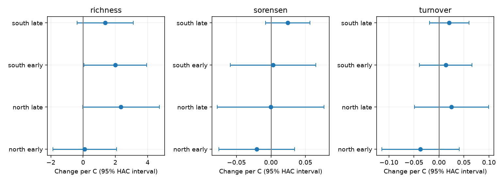

# Larval fish samples became more alike in two California sectors in 2017-2019 than in 2014-2016 despite cooler spring water

Job: sci-1107-dell-climate-pollution-biodiversity-1453dd0ccee9. Topic: climate-pollution-biodiversity. Campaign: 11_07_2026. Machine: dell. Account: codex-andrii. Model: gpt-6.1-sol, high reasoning effort. Date: 2026-11-09. The signing key identifies a campaign machine. It does not claim personal authorship.

## Question and scope

Does warmer spring water make fish larva samples from different stations more alike? Does that relation hold across two sectors and two periods? We tested this question in a long public survey. We then compared the warm years 2014-2016 with 2017-2019. We did not measure air pollution or attribute the warm event to human climate change.

Thompson et al. (2022; doi:10.1111/gcb.16010) studied the larval fish response to the warm event. A prior campaign result tested taxon temperature slopes and sample richness. We read that result before we set this spatial analysis. Our new test separates total spatial dissimilarity from taxon replacement and from unequal richness. We use the same raw observations as that campaign result. This is a new analysis, not an independent dataset.

## Main results

The primary sample has 664 tows in 37 northern survey years and 1,269 tows in 42 southern survey years. There are 19 repeat stations in the north and 32 in the south. Each sector uses separate stations. Both sectors share a survey system and water masses, so their errors and environmental drivers can be related.

Pre-2014 spring temperature did not give a common direction for turnover across all four sector-period fits. All four marginal 95% intervals include zero. These broad intervals do not prove that temperature has no effect.

| Sector | Period | Years | Turnover slope per C | 95% interval |
| --- | --- | --- | --- | --- |
| north | early | 15 | -0.0367 | -0.1137 to +0.0403 |
| north | late | 15 | +0.0252 | -0.0486 to +0.0991 |
| south | early | 17 | +0.0135 | -0.0392 to +0.0663 |
| south | late | 17 | +0.0207 | -0.0190 to +0.0603 |


In 2017-2019, regional March-May SST was 0.616 C lower than in 2014-2016. Mean pair-adjusted Sorensen dissimilarity fell by 0.03485 in the north and 0.06487 in the south. Simpson turnover fell by 0.03621 and 0.06158. Mean recorded richness rose by 1.28 and 1.06 taxa per tow. Thus the spatial convergence did not require lower local recorded richness.

The dissimilarity falls were larger than those in all 13 northern and all 23 southern earlier complete six-year windows. Turnover falls were less unusual: two earlier windows in each sector had falls at least as large. Earlier windows overlap. Counts are descriptive ranks, not permutation probabilities.

Resampling the three observed years in each event period gives a dissimilarity change interval of -0.0654 to +0.0218 in the north and -0.0876 to -0.0474 in the south. For turnover, the ranges are -0.0984 to +0.0232 and -0.1089 to -0.0168. These are small-sample bootstrap summaries. They do not account for serial dependence or the choice of event. They are not reliable population confidence bounds.



## Checks for observation bias

The same pair must have at least two samples in each event period for the direct matched-pair check. This retains 164 northern and 488 southern pairs. Equal-pair mean Sorensen changes are -0.03643 and -0.06180. Turnover changes are -0.04323 and -0.05704. Pairs share stations. Pair counts must not be used as independent sample sizes.

A coarser label check groups each scientific name by its first word. Most groups are genera; family-level and other coarse names stay as separate groups. This is not a full taxonomic reconciliation. Dissimilarity changes are -0.03230 and -0.06580. Turnover changes are -0.03640 and -0.05937. A 90% repeat-site rule also retains both negative directions, but leaves only five northern stations.

A separate equal-individual check uses only stations with at least ten larvae in every one of the six event years. We draw ten larvae without replacement in each tow and repeat this 300 times. This retains six northern and 18 southern stations. Mean dissimilarity changes are -0.06476 and -0.12516; turnover changes are -0.12012 and -0.21512. At 20 larvae, only the south has enough sites: 11 sites give changes of -0.08616 and -0.12980. At 50 larvae neither sector has enough sites. Monte Carlo ranges in rarefaction.csv measure the random draw only. They do not measure ecological uncertainty. The restricted sites and small larva counts limit this check.

A 400-800 cubic metre volume filter retains only the south under the repeat-site rule. Its dissimilarity and turnover changes are -0.04198 and -0.01864. Only two heatwave years remain, so this is a weak check. The absence of a northern result is a loss of support, not a null estimate. Mean effective volume was higher in the later event period. Detection can still affect the main estimate.

## Methods

We use starboard bongo tows (CB, S), March-May, 1978-2022. The fixed lines are 76.7, 80, 83.3, 86.7, 90, and 93.3. Stations range from 26 to 90. The north uses the first three lines; the south uses the last three. In each year we choose the nominal cruise month closest to April. A tie uses the cruise with more core tows, then the lower cruise code. Actual tow dates can cross month boundaries. At a repeat station within that cruise, we use the first tow.

A station must occur in at least 80% of available pre-2014 sector years. A year must have at least half the possible station pairs, after removal of pairs with an empty sample. A positive larva count means presence. A taxon absent from the count table is treated as absent from the tow. All names and ranks are included in the main test. This assumption needs complete count reporting.

For shared taxa a, taxa found only in one tow b, and taxa found only in the other tow c, Sorensen dissimilarity is (b+c)/(2a+b+c). Simpson turnover is min(b,c)/(a+min(b,c)). The difference is the nestedness component. This follows Baselga (2010). It is a statement about sample composition; it is not a direct measure of local extinction or movement.

We subtract each station pair's pre-2014 mean from its dissimilarity. We add the sector's pre-2014 grand pair mean to keep the plot on a useful scale. Annual results average those adjusted pairs. This removes fixed pair differences but does not remove changing detection or station-by-year effects. The direct matched-pair check uses the original pair measures, without offsets.

SST is the cosine-latitude weighted March-May ERSSTv5 mean for grid centres in 31-35 N and 124-117 W. The grid is coarse: two latitude centres and four longitude centres. The same regional SST predictor is used in both sectors. The northern line pattern is not a separate temperature experiment.

For 1978-1995 and 1996-2013 separately, we fit annual outcome on SST, linear year, mean tow day of year, and mean log effective volume. Effective volume is volume sampled times proportion sorted. We also report SST-plus-year models and a pooled pre-2014 model. Errors use HAC covariance with two lags and the finite-sample correction. Reported intervals use the normal approximation. Sample sizes are small; no multiple-test adjustment was applied. We do not select a significant slope as a main result.

Earlier-window checks use every complete six-calendar-year window ending by 2013. They compare its final three years with its first three. Event-year bootstrap summaries use 10,000 draws with fixed seed 1453. Event periods and primary methods were set before our first fitted results. Matched-pair, earlier-window and equal-individual checks were added after the first results. No alternate failed result was removed. The earlier 1997-1998 contrast is also saved, though spring SST in that two-year average was not warmer than its five-year reference.



## Limits and meaning

The samples became more alike after the warm event under several sampling rules. This agrees with a delayed community response, but it does not isolate that explanation. Changes in transport, abundance, sorting, detection, and taxonomy can also cause the pattern. Broad pre-event temperature intervals allow meaningful positive and negative effects. We cannot reject all simple temperature responses or establish ecological memory. The northern event bootstrap spans zero. Only three event years per block and one survey system are available. This study cannot infer a global biodiversity trend, species range shift, or pollution effect.

## Inputs and rights

All three inputs already existed in the shared store. No dataset was changed or downloaded for this analysis. Paths below are relative to the worktree. The datasets link points to the shared campaign data store. Source URLs, retrieval metadata, sizes, and file hashes are in files/provenance.json. Tows and counts were retrieved on 2026-11-09; ERSSTv5 was retrieved on 2026-11-08. We used the exact snapshots given by the hashes.

| Shared input | SHA-256 |
| --- | --- |
| `datasets/calcofi-erddap-ichthyoplankton-tows-20261109/tows.csv` | `5f9aec07fd612be7f324cb6c3a4239b2b5054dd36a2db9b2395aef127e097d6c` |
| `datasets/calcofi-erddap-larvae-counts-1951-2023-20261109/lrvcnt.csv` | `6e85103ecea079e818052b5f0aa2abee72896198d9465baebceb4fd8f258b863` |
| `datasets/ersst-v5-psl-sst-mnmean-20261108-olen/sst.mnmean.nc` | `952fad739abab3e3c33c955b168f298b9884d2fe48ab259ebf19ac531d8d8386` |


NOAA SWFSC provided the survey tables. NOAA PSL, Boulder, Colorado, USA, provided SST. External input tables and record-level extracts are excluded. The package includes our code, figures, text, and new aggregate results. See files/NOTICE.md for source attribution and external terms. The exact SCI baseline LICENSE applies to bundled work.

## Reproduce and inspect

From the worktree, run:

```sh
python work/result/files/analyze.py --datasets ./datasets --output ./work/reproduce
python work/result/files/rarefy.py ./datasets ./work/reproduce
python work/result/files/validate.py ./work/reproduce
```

For a separate machine, run `python files/fetch.py /absolute/scratch/data` from an extracted bundle. It retrieves the three exact snapshots and verifies their hashes. A changed source stops retrieval. Then run analyze.py and rarefy.py with that scratch data root and a separate output folder. Do not write external inputs or new outputs into the signed draft. The input sources can change; local shared snapshots with matching hashes are the exact reproduction route.

Python package versions are in files/software.json. The analysis needs numpy, pandas, xarray, a NetCDF backend, statsmodels, and matplotlib. No fitting randomness is used. Random checks have fixed seeds. validate.py independently checks every fitted slope with NumPy least squares and checks decomposition identities. The full computation takes about one minute on this host. All outputs are small aggregate tables. No private key is included.
