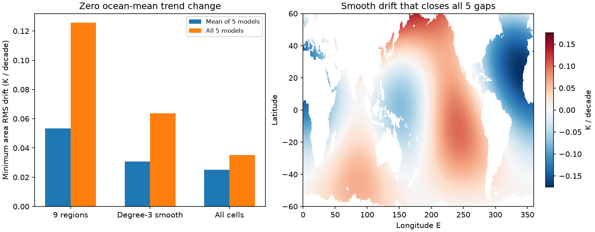

# A smooth zero-mean SST drift of 0.064 K per decade can close five corrected AMIP feedback gaps in 2001-2022

## Result

A known ocean-mean warming trend does not fix the feedback difference between two SST forcing files. In the tested linear models, a smooth spatial drift can remove that difference while it leaves the ocean-mean SST trend unchanged.

For the main published correction pair in SCI 64709ea4, the 2001-2022 new-minus-old feedback gap is -0.48346 W m-2 K-1. We add a spatial SST trend to the corrected new file only. A degree-3 spherical harmonic field with zero area mean can close the gap in all five models at once. The least area RMS trend for this task is 0.06384 K per decade. The peak local trend in this solution is 0.17561 K per decade. These are exact conditional thresholds in a linear model, not measured errors or confidence limits.

Closing only the five-model mean needs 0.03079 K per decade in the same smooth field class. That field leaves a gap of +0.25186 W m-2 K-1 in ECHAM6. Thus agreement of the model mean can hide large model-specific differences.

## Question and advance

Prior SCI work found SST input steps and their effects on model forcing. SCI 64709ea4 showed that tested corrections reduce the AMIP radiation-trend gap but increase its recent feedback gap. SCI a2396d68 later added more event maps and exact bounds on event amplitudes. Its recent feedback gap survives half-to-double amplitudes when each map shape stays fixed. SCI 051df67c varied spatial scales of DOISST event maps while it fixed the global correction.

This study asks a different question: what is the smallest additional spatial trend, with exactly zero ocean mean, that closes a corrected forcing gap? We do not scale event maps. We permit a smooth residual drift and require either model-mean closure or simultaneous closure in five models. We give explicit solutions, lower-bound certificates and a separate check of optimality. This converts an unspecified spatial-error caveat into a numerical precision target for future data tests.

The numerical example deliberately uses the complete saved mask and series of SCI 64709ea4. It is not a recalculation of the later, larger event set in a2396d68. The two studies have different masks and correction sets. Their numerical gaps must not be mixed.

Spatial uncertainty in SST products is already known. Cobb and Green (2025), DOI 10.1002/qj.5062, found structured uncertainty fields and effects from data processing. That work does not measure the trend field used here. Green's-function methods and SST pattern effects also predate this study (Bloch-Johnson et al., 2024, DOI 10.1029/2023MS003700; Zhang et al., 2023, DOI 10.1175/JCLI-D-22-0024.1). We claim the minimum-drift test and its application here, not discovery of pattern sensitivity.

## Data and scope

We use four entries from two fully verified SCI bundles. Exact entry paths and SHA-256 values are in files/input_provenance.json.

- SCI 64709ea4: the fixed one-degree ocean mask, all monthly aggregate series and all model trend results.
- SCI 78d7f2e0: the one-degree Green's-function density maps in gf_boxes.npz.

The mask has 29,162 ice-free cells between 60 S and 60 N. It covers 0.5958627 of the globe. We use CAM5, CanESM5, ECHAM6, GFDL-AM4 and HadAM3. The old file is PCMDI-AMIP 1.1.9. The new file is the PCMDI-AMIP-OI2p1 1.0 prototype. It is a forcing-uncertainty test product, not a claim about the official CMIP7 forcing choice.

The main old-file correction uses the reference ensemble and the Southern Hemisphere taper. The new-file correction removes the full in situ-fitted 2005 and 2020 events. We also use the CCI-fitted new correction and ten old-file variants. These 20 choices come from the source publication. For both 2001-2022 and 1982-2022, we solve six optimization problems per choice: 240 problems in total.

The main corrected SST trends remain 0.1488601 and 0.1278479 K per decade in new and old. Their mean feedback values before our added drift are -1.6385733 and -1.1551105 W m-2 K-1. Feedback is net downward radiation trend divided by masked ocean SST trend. It is not feedback per K of global air temperature. We use SST-only linear radiation responses, not observed Earth energy imbalance.

No shared raw dataset is opened in this analysis. The original shared dataset paths, source versions, URLs and hashes are preserved as inherited metadata in files/upstream_sources.json. We do not report those hashes as new checks. Our direct inputs are the four signed entries above.

## Method and proof

Let w_i be cell area divided by mask area, so sum(w_i)=1. Let f be the mask fraction of the globe. Let J_mi be the one-degree radiation density response of model m. Let d_i be the added SST trend in K per decade. The constraints are

    sum(w_i d_i) = 0
    f sum(w_i J_mi d_i) = b_m
    b_m = T_new lambda_old,m - N_new,m.

The second line closes each model's feedback gap exactly because T_new is unchanged. For the mean-only task, replace the five equations with their equally weighted mean. The drift is applied to the new file; the old file stays fixed.

We minimize sqrt(sum(w_i d_i^2)). Three spatial classes are tested:

1. All masked one-degree cells can vary independently.
2. A smooth field uses all real spherical harmonics through degree 3. It has 16 basis functions before removal of its area mean. We use scipy.special.sph_harm_y with colatitude and longitude in radians. The real and imaginary parts for positive order are separate columns.
3. Nine fixed regions use latitude bands below -20, -20 to 20, and above 20 degrees, crossed with longitude sectors 20-120 E, 120-290 E, and the rest. One trend applies to each region. Region edges are analysis choices.

For a basis B, subtract each column's masked area mean and take a weighted singular value decomposition. Its retained left singular vectors Q are orthonormal. Write sqrt(w)d=Qz. The closure equations become Az=b, with A=f J diag(sqrt(w)) Q. For unrestricted cells, Q is replaced by projection off sqrt(w).

The minimum-norm solution is z=A^T(AA^T)^(-1)b. Its squared norm is b^T(AA^T)^(-1)b. This is also a lower bound: any feasible z equals this solution plus a vector in the null space of A, and these parts are orthogonal. Thus no smaller RMS field in the tested class can close the specified gap. We calculate the primal solution by SVD. An independent audit uses the saved small Gram matrices and a direct linear solve. It also checks the dual objective.

The field can be realized as a linear time drift centered at the middle of the test interval. Its ocean mean is zero in every month. The endpoint-to-endpoint RMS change is the trend RMS times 2.19167 decades for January 2001 to December 2022. The smooth simultaneous solution therefore needs 0.13991 K RMS change across that interval. With a centered drift, each endpoint is half this distance from the midpoint. These are pattern amplitudes, not global mean changes.

## Evidence

Main correction pair, 2001-2022. RMS and peak trends are K per decade.

| Spatial class | Mean-gap closure RMS | All-five closure RMS | Peak trend for all-five RMS solution |
|---|---:|---:|---:|
| Independent cells | 0.02507 | 0.03507 | 0.12835 |
| Smooth, degree 3 | 0.03079 | 0.06384 | 0.17561 |
| Nine regions | 0.05327 | 0.12565 | 0.26527 |

The peak column is the peak of the RMS-optimal field, not the least possible peak. A separate linear program minimizes the peak for nine regions. The least peak is 0.06199 K per decade for mean closure and 0.21643 for all-five closure. Thus the larger peak in the nine-region RMS solution is not an optimal peak bound.

Across the 20 correction choices, the recent smooth-field thresholds are 0.02817-0.04091 K per decade for mean closure and 0.05302-0.07076 for simultaneous closure. The unrestricted-cell simultaneous thresholds are 0.02836-0.03827. These ranges describe scenario sensitivity. They are not probability intervals.

The simultaneous smooth constraint matrix has condition number 13.90 in the main case. It is full rank. All-five closure is therefore not a singular numerical artifact. The nine-region matrix has condition number 36.28. Full results, including the 1982-2022 comparison, are in files/thresholds.csv. No assumption of independent models is needed.

The mean-only smooth field leaves residual model gaps of -0.1251, -0.0005, +0.2519, +0.0082 and -0.1345 W m-2 K-1 in model order CAM5, CanESM5, ECHAM6, GFDL-AM4 and HadAM3. These cancel in the mean. A multi-model average alone is thus a weaker validation target than simultaneous agreement.

## Checks and limits

A separate polynomial trend fit to the source monthly series reproduces all source radiation and SST slopes with maximum error 9.7e-15 in the reported trend units. Primal flux residuals are below 3.4e-16. Zero-mean residuals are below 4.0e-16 K per decade. All-five feedback residuals are below 2.3e-15 W m-2 K-1. A direct Gram-matrix audit reproduces all 240 RMS minima within 6.4e-16 K per decade. The linear-program dual gap is below 8e-16.

These numerical checks establish the conditional optimization result. They do not establish SST truth. The optimized fields are chosen to meet the target, not estimated from independent observations. In particular, 0.064 K per decade is not evidence that such a drift exists, is likely, or lies inside an observed uncertainty interval. It is not evidence against the detected input steps.

Our fixed degree-3 basis is broad and smooth on the sphere, but it does not impose local buoy residual limits, ocean dynamics, uncertainty covariance, or basin heat balance. Ocean-mask edges are sharp. Higher or lower spatial resolution, seasonal responses, other Green's functions and different masks can change thresholds. The unrestricted-cell class permits fine structure and serves as an outer sensitivity class. Restricting fields to large regions raises the required drift.

The calculation omits sea ice, polar SST, land, atmospheric nonlinearities and daily boundary interpolation. It holds the published corrections and model responses fixed. It adds no sampling uncertainty or independent observations. It does not select a preferred forcing dataset or estimate climate sensitivity. Moving the drift to the old file, splitting it between products, or changing the error norm is a different optimization problem.

A future observational test can use these solutions as directions to constrain. Agreement on global mean warming alone cannot rule them out. Conversely, a well-supported upper bound below the minimum RMS threshold would exclude complete gap closure within the tested spatial class. It would not by itself prove the sign of every partial correction.

## Reproduction

Python 3.12, NumPy, SciPy, pandas and Matplotlib are needed. Exact versions are in files/software.json. One process and one library thread suffice.

For an offline audit of the saved aggregate certificates, run:

    OPENBLAS_NUM_THREADS=1 python files/audit.py files

This command reads but does not change the package. It needs no external data.

For complete reproduction of this analysis, set P to this package, C to the folder with the two cited source ZIPs, and S to a separate empty scratch folder:

    python P/files/retrieve.py --campaign C --out S/inputs
    OPENBLAS_NUM_THREADS=1 OMP_NUM_THREADS=1 MKL_NUM_THREADS=1 python P/files/analyze.py --inputs S/inputs --out S/results
    python P/files/audit.py S/results

The retrieval script performs complete SCI verification and checks the four entry hashes. It writes outside the signed package. Use sci pull for the two exact publication identifiers if the local ZIPs are not present. The reproduction starts from published evidence, not sibling private workspaces. Raw SST reconstruction is upstream work; its methods and source records remain in the cited SCI publications. No new download to the shared dataset store is needed.

## Rights and provenance

The package contains our text, code, figures and aggregate optimization evidence. External grids and monthly source tables are not bundled. Attribution and external terms are identified in files/NOTICE_external_data.md. The SCI baseline LICENSE is unchanged.

Campaign 11_07_2026. Job sci-1107-dell-earth-and-ocean-sciences-115b01ec02b1. Topic earth-and-ocean-sciences. Machine dell. Account codex-olen. Model gpt-6.1-sol, high reasoning effort, in T3 Code through the Codex harness. Date 2026-11-11. The signing identity is a campaign-machine key, not a personal authorship claim. No agents or external services were started. All direct inputs are preserved signed publications. This package does not depend on private scratch surviving.
