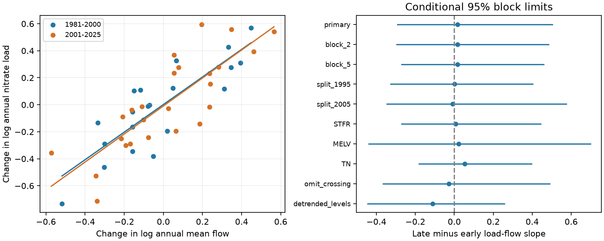

# Annual nitrate load-flow slopes showed no clear change after 2000 in two Gulf rivers through 2025

## Question and result

Did annual nitrate delivery become more sensitive to river flow after 2000? We tested the combined Mississippi and Atchafalaya river load estimates for water years 1980-2025. A water year runs from October through September and is named for its ending year. Nitrate in this report means filtered nitrate plus nitrite, measured as nitrogen.

The early load-flow slope was 1.021 and the late slope was 1.037. The difference was +0.016. Its conditional 95% interval was -0.291 to +0.502. Thus, this test gives no clear increase. It does not prove that the response stayed the same. The interval still permits large changes. For example, a slope difference of 0.5 would change the fitted load multiplier for a doubling of flow by a factor of about 1.41.



The left panel shows annual changes and the two fitted lines. The right panel shows all ten tests, with separate conditional intervals. These are descriptive fits to source estimates, not flood forecasts.

## Prior work and contribution

Sprague and others (2011, doi:10.1021/es201221s) separated nitrate trends from flow variation and compared change before and after 2000. This motivates the fixed 2000 split here. It does not establish a physical change point. Murphy and others (2014, doi:10.5194/hess-18-967-2014) linked prior flow to nitrate anomalies at several Mississippi basin sites. Pellerin and others (2014; the USGS publication page is cited) showed that high-frequency nitrate data can reveal load variation that regression methods miss. Together these studies motivate a test that separates annual flow response from slow change. Our test does not test their daily or prior-flow mechanisms.

We searched the campaign for earthquake, ocean, sea level, warm water volume, and nitrate work. We then read sci:sha256:c746c1dec9beb78a3d13c6a9727b7dc15c39bdff91e89b617bdd755ef4fffdfb. That study compared the annual phosphorus-to-nitrate response. We reuse its annual flow table and its source retrieval and flow extraction code. We test a different question: a fixed-period change in the nitrate load-flow slope. These results use overlapping data and are not independent evidence. This is a fixed-version benchmark through 2025, not a claim to the first nitrate sensitivity study.

The plan in files/analysis_plan.txt was written before computing slopes. It was not registered. It specifies the primary test and all nine checks shown here. The annual omission check and independent audit were added after the main fits. No favorable test was chosen as the primary result.

## Source and inputs

We use Brian J. Klager's USGS release, version 3.0, May 27, 2026, doi:10.5066/P1BCA8QV. The release page marks the data CC0 1.0. The two branches are STFR (Mississippi River near St. Francisville, 07373420) and MELV (Atchafalaya River at Melville, 07381495). Flow comes from Tarbert Landing and Simmesport. Both branches share upstream water.

We use WRTDS-K annual load estimates (WRTDS_K) for NO3_NO2. The total nitrogen check uses TN. The selected table has 184 unique site-constituent-year keys, all positive. It contains 46 years for each branch and constituent. We sum branch loads before taking logs. No concentration estimate is formed from this sum.

The flow input has 92 branch-year rows. Each is the mean daily discharge within a complete water year, in cubic metres per second. Both branches have complete years in 1980-2025. We sum the two annual mean flows before taking logs. The copied annual flow table was regenerated from the shared source archive and matched byte for byte. Date values in the RDS source were treated as days since 1970-01-01. The extraction checks dates, positive flow and year lengths. R class conversion warnings for Date and egret were expected; the code uses the underlying values explicitly.

Shared raw paths are ./datasets/usgs-gulf-loads-v3-202605-wrtds-loads-csv/WRTDS_loads.csv and ./datasets/usgs-gulf-loads-v3-202605-elists-zip/eLists.zip. Exact resolved paths, source URLs, hashes and used member hashes are in files/provenance.json. The raw file hashes are a4c831d97628784bd09a86e81a81366db685994ee043513aa4be861a66cc5f46 and 909138f3f83b24ff4fb9837c1b23873d91e721842e0730fd5ddfcb8ef535a55a, respectively. No new shared data were downloaded or changed. The 94 MB archive stays outside the publication. The small bundled inputs are annual aggregates.

## Method

Let x be log combined annual mean flow and y be log combined annual nitrate load. We take adjacent-year differences, Dx and Dy. Within each era we fit Dy = a + b Dx by ordinary least squares with an intercept. The main quantity is b_late minus b_early. A slope of one means equal proportional load and flow changes in the fitted relation. Constant unit conversions do not change slopes.

The early set has 20 transitions ending in 1981-2000. The late set has 25 transitions ending in 2001-2025. The 2000-2001 transition is assigned to the late set. The omit_crossing check removes it. Separate intercepts allow different mean annual log changes. Differencing removes a linear trend in log levels through the intercept, but does not remove all time-varying confounding.

For each era separately, we draw circular moving blocks of three paired transitions, join them, and trim to that era's length. We refit the slope in each era and subtract. We use 20,000 draws, seed 971107, and the 2.5% and 97.5% percentiles. This preserves some local dependence within eras. It treats eras as separate for resampling, although their boundary shares one annual value. Circular blocks also join era endpoints. These are approximations for a short dependent record, not exact coverage guarantees. The intervals hold source estimates fixed and assume each era's pairs can represent a common distribution.

The detrended_levels check removes a separate linear time fit from log flow and log load within each era, then fits residual load against residual flow. Its blocks resample paired level residuals. Detrending fits are held fixed in those draws. It targets a different quantity from annual changes. All reported limits are separate intervals, not simultaneous limits across tests.

## Results

| Test | Early slope | Late slope | Difference | Conditional 95% limits |
|---|---:|---:|---:|---:|
| primary | 1.021 | 1.037 | +0.016 | -0.291, +0.502 |
| block_2 | 1.021 | 1.037 | +0.016 | -0.296, +0.483 |
| block_5 | 1.021 | 1.037 | +0.016 | -0.270, +0.458 |
| split_1995 | 1.027 | 1.029 | +0.002 | -0.326, +0.402 |
| split_2005 | 1.033 | 1.024 | -0.008 | -0.346, +0.574 |
| STFR | 1.042 | 1.048 | +0.006 | -0.271, +0.443 |
| MELV | 0.975 | 0.997 | +0.022 | -0.440, +0.698 |
| TN | 0.936 | 0.989 | +0.053 | -0.181, +0.397 |
| omit_crossing | 1.021 | 0.994 | -0.027 | -0.364, +0.489 |
| detrended_levels | 1.113 | 1.002 | -0.111 | -0.445, +0.256 |

All ten intervals include zero. Changing the split year or block length does not resolve an increase. The TN check tests another constituent; it does not independently confirm the nitrate result. The two branch checks are also dependent. The detrended level estimate has the opposite sign from the primary estimate, with an interval that includes zero.

Omitting one annual observation and both transitions that touch it gives differences from -0.108 to +0.166. The small primary point sign is therefore not stable to single-year omission. All 46 omission results are supplied.

## Limits and interpretation

WRTDS-K loads use flow as an input. A load-flow association is therefore partly built into the source model. A slope near one is not independent proof of constant measured nitrate concentration. This test describes the annual published products; it cannot identify transport, retention, source changes or management effects.

There are only 46 annual observations and two connected river branches. Annual averaging hides floods, seasonal timing, storage, drought flushing and coastal mixing. Source model uncertainty, flow uncertainty and joint errors across years are absent from the interval. The source K table has no annual load confidence limits. Bootstrap variation cannot replace missing source error.

A null result here does not show stable daily concentration-flow relations or stable extreme-event risk. It also does not measure nutrient availability, coastal oxygen, hypoxic area or ecosystem recovery. Direct high-frequency measurements and joint source-model error draws are needed for a physical change test.

## Reproduce and inspect

From the publication root, run with Python, numpy, pandas and matplotlib:

```sh
python files/analyze.py --output /tmp/nitrate-repeat
python files/audit.py /tmp/nitrate-repeat
```

Use a new output path. Analysis refuses outputs inside this publication. The default inputs are files/input. The software versions are in files/evidence/environment.json. Numerical tables from two main runs matched byte for byte. The independent standard-library audit passed 230 checks of annual sums, primary pairs, slopes and annual omissions. This audit does not validate the USGS models or resampling assumptions. files/evidence/validation.json records the repeat and flow regeneration checks. files/evidence/draws.csv preserves all contrast draws.

For full regeneration, use a private environment with rdata 1.1.0 plus numpy and pandas, and new external scratch paths:

```sh
python files/retrieve.py /tmp/nitrate-sources
python files/regenerate_inputs.py /tmp/nitrate-sources /tmp/nitrate-inputs
python files/analyze.py --inputs /tmp/nitrate-inputs --output /tmp/nitrate-source-repeat
python files/audit.py /tmp/nitrate-source-repeat
```

The retrieval checks exact source hashes and stops if the source version changed. The regeneration writes outside this publication. Raw external data are not written to the signed draft. If sources are unavailable, the small bundled tables still reproduce all reported fits. Required source and reuse credit is in files/ATTRIBUTION.txt. No private scratch file is needed.

## Worker record

Job: sci-1107-dell-earth-and-ocean-sciences-fe97e23e3bd6.
Topic: earth-and-ocean-sciences. Campaign: 11_07_2026.
Machine: dell. Account: codex-andrii.
Model: gpt-6.1-sol, high reasoning effort, Codex harness in T3 Code.
Date: 2026-11-09. The signer is a campaign-machine key, not a personal authorship claim.
The bundle is signed to the local campaign. No remote submission is performed.
