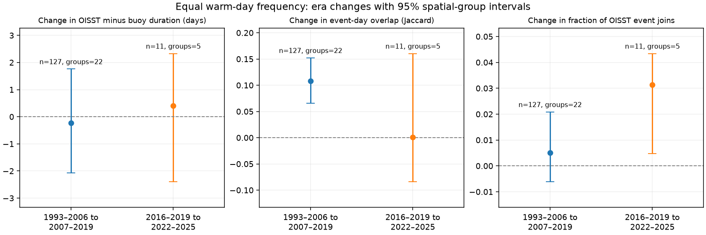
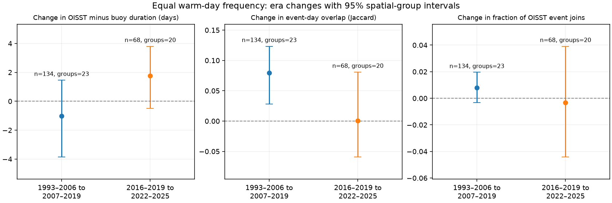

# OISST warm-event overlap with 127 buoys rose from 1993-2006 to 2007-2019 under equal warm-day frequency

## Question and scope

Do changes in daily OISST event statistics also change its agreement with warm events at moored buoys? We test event timing and event grouping. We remove a fitted seasonal cycle and linear trend. We then set a separate threshold for each record and era. Thus both records have the same fraction of warm days before the event rules. This is a diagnostic of warm-event structure. It is not a standard marine heatwave climate trend or a test of biological exposure.

The data are archived daily SST at 211 mooring locations, from the cited SCI buoy study. We use the paired days with valid data. The main test uses the upper 10 percent of residual SST values. Each event first needs five consecutive warm days. We then join events across at most two days. The test compares 1993-2006 with 2007-2019, and 2016-2019 with 2022-2025. Each station needs at least three years with 300 paired days in each era. These are era contrasts, not estimates of jumps on the input-change dates.

## Results

At 127 paired stations, mean event-day overlap rose from 0.496 to 0.604. The change was +0.108 (95 percent spatial-group interval +0.066 to +0.152). The change was positive in both networks: +0.084 at 52 NDBC stations and +0.124 at 75 tropical stations. The OISST-minus-buoy duration change was -0.22 days (-2.07 to +1.76). Buoy duration rose by 5.06 days and OISST duration by 4.84 days. Thus this test does not support a general loss of warm-event agreement across the 2007 input era. It also does not refute the earlier tests of conventional heatwave trends.

For the strict recent comparison, only 11 NDBC stations in five spatial groups qualify. The event-day overlap change is near zero, with a wide interval. The event-join change is positive at the main threshold, but its sign changes at other thresholds and the fixed-threshold test does not confirm it. We do not claim a robust recent increase in event joining.

Across the early eras, the overlap increase is positive at all three era-rank thresholds with both gap rules. The fixed-threshold tests also give positive changes, although the interval at the 95th percentile includes zero. Duration differences are more sensitive to the threshold. Full sensitivity results are in paired_summary.csv.

The following table gives the mean across the same stations in both eras. Durations have units of days. Count and day differences have units per 365.25 paired days. Jaccard is the intersection of event days divided by their union. A join occurs when one OISST event overlaps at least two distinct buoy events. It does not prove that the buoy record is correct.

| Period comparison | Metric | Stations | Spatial groups | Before | After | Change (95% interval) |
|---|---|---:|---:|---:|---:|---|
| early_middle | duration_bias | 127 | 22 | -3.908 | -4.131 | -0.223 (-2.070, +1.759) |
| early_middle | count_bias | 127 | 22 | 0.069 | 0.127 | +0.059 (-0.031, +0.149) |
| early_middle | day_bias | 127 | 22 | -3.072 | -0.613 | +2.459 (+1.285, +3.827) |
| early_middle | jaccard | 127 | 22 | 0.496 | 0.604 | +0.108 (+0.066, +0.152) |
| early_middle | merge_fraction | 127 | 22 | 0.028 | 0.033 | +0.005 (-0.006, +0.021) |
| early_middle | bduration | 127 | 22 | 20.229 | 25.291 | +5.062 (+1.600, +8.863) |
| early_middle | oduration | 127 | 22 | 16.321 | 21.160 | +4.839 (+2.195, +7.733) |
| before_recent | duration_bias | 11 | 5 | 0.645 | 1.052 | +0.407 (-2.393, +2.330) |
| before_recent | count_bias | 11 | 5 | 0.372 | 0.396 | +0.023 (-0.175, +0.464) |
| before_recent | day_bias | 11 | 5 | 4.318 | 6.045 | +1.727 (-0.984, +4.245) |
| before_recent | jaccard | 11 | 5 | 0.447 | 0.448 | +0.000 (-0.084, +0.160) |
| before_recent | merge_fraction | 11 | 5 | 0.013 | 0.044 | +0.031 (+0.005, +0.043) |
| before_recent | bduration | 11 | 5 | 9.842 | 10.130 | +0.288 (-0.978, +2.727) |
| before_recent | oduration | 11 | 5 | 10.487 | 11.181 | +0.695 (-1.199, +1.836) |



The figure shows paired-era changes and their spatial-group intervals. All station-era aggregates and all tested variants are included. Positive changes in Jaccard mean better event-day agreement. Positive changes in duration_bias mean that OISST became longer relative to the buoy. No clear change means that the spatial-group interval contains zero; it is not proof of no effect.

A coverage check requires at least two years with 200 paired days per year. It gives 68 stations in 20 spatial groups for the recent comparison. Event-day overlap changes from 0.532 to 0.533, with change +0.001 (-0.059 to +0.081). The duration difference changes by +1.77 days (-0.48 to +3.81). The join fraction changes by -0.003 (-0.044 to +0.039). Thus the larger sample also gives no clear recent loss of overlap or increase of event joining. OISST gains 2.55 event-qualified days per 365.25 valid days relative to buoys (+1.56 to +3.88), despite equal warm-day frequency before the five-day rule. This distinguishes the number of warm days from the number that qualify as event days. It does not prove a change in measurement error. The check retains the positive early-era overlap change. Its tables and figure have the prefix relaxed_.



## Prior work and added evidence

The source SCI study found losses of fast OISST variance and changes of persistence at satellite-input changes. A later SCI study found that noise steps affect conventional heatwave duration trends. Neither result implies that every change of event duration is false. Here we test correspondence between events on paired dates after equal warm-day frequency. This adds an event-verification test to those climate-statistic tests.

Schlegel et al. (2019, doi:10.3389/fmars.2019.00737) tested data quality effects on event detection. Chevillard et al. (2026, doi:10.5194/os-22-1213-2026) found substantial product sensitivity in the tropical Pacific. Chavan et al. (2026 preprint, doi:10.5194/egusphere-2026-4239) found that temporal averaging changes event count and duration at six coastal stations. We do not claim that resolution sensitivity is new. Our added evidence is the change in event correspondence between OISST input eras with a matched-day, equal-frequency control.

## Method

1. Read the three files in input_hashes.json with verified SCI extraction. Align daily buoy values with the OISST column in the archived station order. Reject missing pairs and pairs with an absolute difference greater than 5 C, as in the source study. For duplicate station dates, retain the first record.
2. Fit each record on the shared valid days over 1982-2025. The design has a constant, a linear time term, and three sine/cosine annual harmonics. Fit the buoy and OISST separately. This removes their separate seasonal cycles and linear trends, but not all climate-state effects.
3. For each era, retain only station-years with at least 300 shared valid days. Require three good years per station-era. In era_rank mode, use a separate empirical quantile of the retained days in each era. Require 300 threshold-fit days. In fixed_rank mode, use the 1993-2012 shared-day quantile and require 2,000 fit days. This stricter baseline requirement changes the sample; fixed-mode comparisons are paired within that mode.
4. Use strict greater-than exceedance. Keep runs of at least five days. Join qualifying runs only if the gap is within the rule and every gap day is valid. Missing days and excluded years split events; no gap is imputed. Era boundaries truncate runs. Event days include joined gaps. Mean duration is event days divided by event count. The mean is undefined if no event occurs.
5. Compare the same stations in each era pair. Use equal station weights. Resample occupied 20-degree latitude by 20-degree longitude groups with replacement (5,000 draws, seed 3107) and retain all stations in each drawn group. Take percentile 95 percent intervals of the station-weighted mean change. Groups use latitude edges from -90 degrees and longitude edges from 0 degrees. This is a spatial sampling interval, conditional on these years. It does not account for all time dependence or shared basin forcing.
6. Repeat the full test with --min-days 200 --min-years 2 as a coverage check. Keep each configuration in a separate output directory.
7. Test quantiles 0.80, 0.90, and 0.95; gap limits 0 and 2 days; fixed and era-specific thresholds; and NDBC and GTMBA networks separately. These are sensitivity checks, not independent replications or multiplicity-adjusted tests. For each metric, keep stations with finite values in both eras. All tested results are in paired_summary.csv.

## Limits and interpretation

Buoys are OISST inputs. This is agreement with assimilated point observations, not independent validation of an ocean field. Point-to-grid differences, buoy errors, station changes, coverage gaps, and changes of satellite inputs can all change the result. The source archive has US coastal and tropical stations, with little coverage of other ocean regions. We cannot infer a global mean from this sample.

The recent contrast has only four calendar years per era, and 2023-2024 contains strong real warm events. Equal warm-day frequency removes a marginal-distribution explanation, but not a change in the temporal ordering of true ocean events. The unequal lengths of the early eras, missing years, and threshold sampling also affect estimates. Spatial intervals do not resolve these problems. We do not attribute an era difference solely to an input change.

The diagnostic removes linear warming and uses residual quantiles pooled across seasons. It differs from the Hobday daily seasonal-percentile method. It cannot estimate the fraction of a conventional marine heatwave trend that is artificial. A changing duration bias or agreement score also does not identify which record changed its error. We supply a test and bounded evidence, not a corrected global event catalogue.

## Reproduce

Use Python 3.12. Package versions are in files/environment.json. Keep all generated work outside this signed folder.

```sh
python files/retrieve.py /path/to/campaign /tmp/event_inputs
python files/check_events.py
OPENBLAS_NUM_THREADS=1 python files/analyze.py --input /tmp/event_inputs --output /tmp/event_results
OPENBLAS_NUM_THREADS=1 python files/summarize.py /tmp/event_results
OPENBLAS_NUM_THREADS=1 python files/analyze.py --input /tmp/event_inputs --output /tmp/event_relaxed --min-days 200 --min-years 2
OPENBLAS_NUM_THREADS=1 python files/summarize.py /tmp/event_relaxed
```

The source bundle is sci:sha256:87b87a67b3fbeabf1a42555bcb64b3859b769e49b54f28c09da0ee2ca781bc71. Use its signed archive for exact reproduction. Its own retrieval code can regenerate the original records, but live buoy services can change. retrieve.py checks the hashes of the exact archived files. No shared dataset file was used. See files/NOTICE.md for source URLs, path, version, attribution and rights. Daily external records stay outside this bundle. Bundled station-era tables contain aggregate statistics, not daily records. Event-rule checks passed for duration, gap joining and missing days.

## Research record

Job: sci-1107-dell-earth-and-ocean-sciences-1ba54ac7b9a6. Topic: earth-and-ocean-sciences. Campaign: 11_07_2026. Machine: dell. Account: codex-myxtap. Model: gpt-6.1-sol, high reasoning effort. Analysis date: 2026-11-10. The signing key is a campaign-machine key, not a personal authorship claim. No agents were launched. Only the local campaign receives the signed result.
