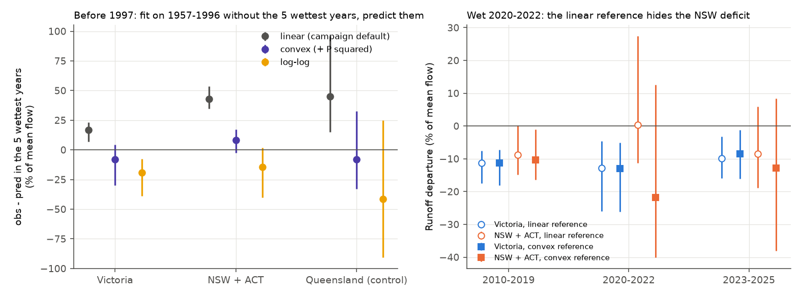
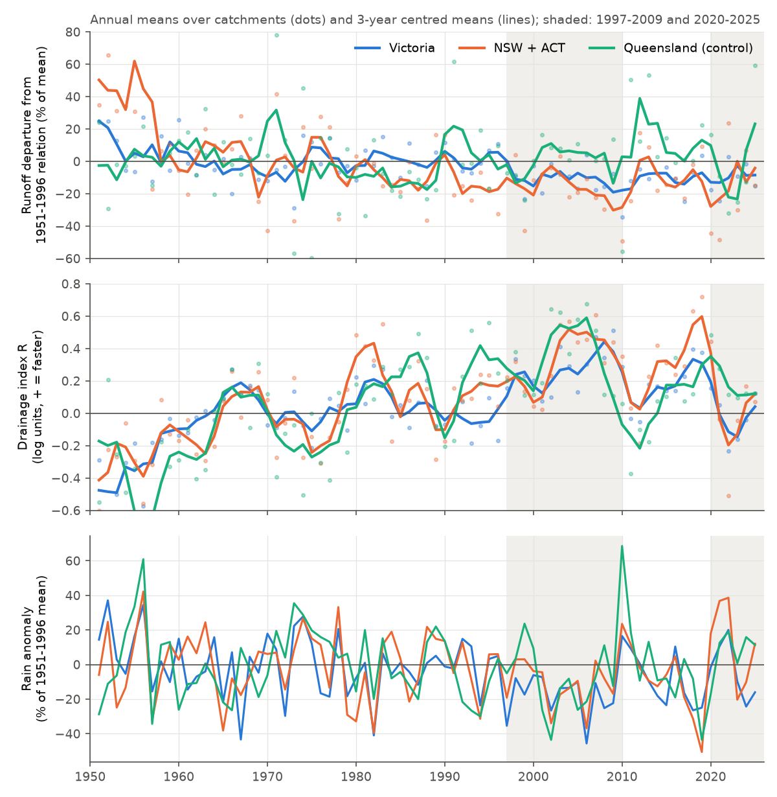
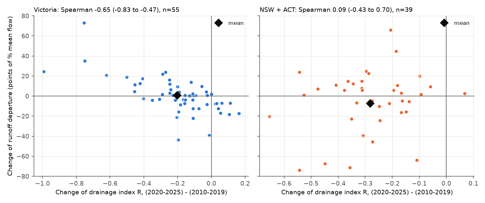

# In 2020-2025 south-east Australian stream drainage returned to its pre-1997 rate but the runoff deficit at equal rain did not shrink; a linear rain model hid it in wet years (112 gauges)

Job `sci-1107-hp-earth-and-ocean-sciences-dcbabd7291c7`, campaign 11_07_2026, topic
earth-and-ocean-sciences, machine hp, account claude-sci. Model: Claude Opus 5.5 (`claude-opus-5-5`)
in Claude Code (T3 Code). The signing key is a campaign-machine key. It is not a personal
authorship claim.

## 1. Summary

**Question.** After 1997, runoff in south-east Australia (SE-AU) fell below each catchment's
1951-1996 rain-runoff relation. Campaign work found two features of this change: a loss of rain
sensitivity (the mm deficit grows with rain; sci:sha256:871b2192, sci:sha256:463123a6) and faster
stream drainage at equal flow (sci:sha256:fab37b7c). The faster drainage returned to the pre-1997
rate in 2020-2025 at 29 long gauges. Is the drainage change the mechanism of the runoff deficit,
and did the deficit and its form end when drainage recovered? The years 2020-2025 are out of
sample for all campaign models fitted to CAMELS-AUS (which ends in 2021-2022). They contain three
wet La Nina years (2020-2022; SE-AU rain +20% of the 1951-1996 mean, NSW +32%) and a dry period
(2023-2025; Victoria -15%).

**Data and method.** 112 CAMELS-AUS v2.03 catchments with >= 30 complete years in 1951-1996 and
flow to 2025: 57 in Victoria (VIC), 39 in New South Wales + ACT (NSW), and 16 in Queensland as a
northern control. Daily flow 1950-2025 from Bureau of Meteorology (BoM) Water Data Online (144 of
155 candidate records passed a check against CAMELS-AUS). Rain: SILO catchment rain from CAMELS-AUS
to 2019 and SILO grids for 2020-2025. For each catchment we fitted the 1951-1996 annual relation
Q = a + bP + cP(t-1) (linear, planned primary) and the same relation with a P^2 term (convex,
planned sensitivity). We measured: the runoff departure D (% of the 1951-1996 mean flow); a loss-form
index f (0 = parallel shift of the relation; f > 0 = the deficit grows in proportion to the expected
flow); the drainage index R (recession rate at equal flow and month, log units, from
sci:sha256:fab37b7c); and the out-of-sample error in 2020-2025 of four continuations fitted with
data up to 2019. Intervals are 95% bootstrap intervals over 2 x 2 degree cells. The plan
(`files/ANALYSIS_PLAN.md`) was written before any value after 2021 was computed; three addenda
record the QC rule and all post hoc work.

**Main results.**

1. **A linear annual rain model is biased in very wet years (post hoc check).** Before 1997, with
   the 5 wettest years left out of the fit, the linear relation under-predicted their runoff by
   27% of mean flow in SE-AU (95% CI 18 to 38; NSW 43%, VIC 17%; calibration 1957-1996, which
   excludes the high-runoff early 1950s). The convex relation had no clear bias (-2%, -16 to +8)
   and the lowest leave-one-out error. With the linear model, part of every wet-year comparison is
   a curvature artefact. We therefore give the convex results first and the planned linear results
   beside them.
2. **The runoff deficit did not shrink in 2020-2025.** Convex reference: SE-AU departure -10.9%
   (-15.4 to -6.9) in 2010-2019 and -13.5% (-25.6 to -4.3) in 2020-2025; in the wet years
   2020-2022 -16.5% (-29.6 to -4.5). VIC: -11.3% and -10.7% (-20.0 to -4.8). NSW: -10.4% and
   -17.7% (-37.8 to +5.4). Linear reference: SE-AU -10.3% and -8.5% (-15.3 to -1.8); VIC -11.2% and
   -11.2%; NSW -8.8% and -4.5% (-14.2 to +13.5). The apparent NSW recovery with the linear model
   comes from the 2020-2022 wet years (linear +0.4%, convex -21.8%), where the linear model fails.
   Out of sample, "continue the 1997-2019 mm offset" predicted 2020-2025 runoff better than "return
   to the 1951-1996 relation" in VIC, NSW and SE-AU (SE-AU RMSE difference 4.6% of mean flow, 2.4 to
   8.1).
   The deficit in 2010-2019 predicted the deficit in 2020-2025 across catchments (Spearman 0.59,
   0.44 to 0.76).
3. **Drainage recovered completely, also in the dry years.** SE-AU R was +0.23 (+0.15 to +0.31) in
   2010-2019 and -0.00 (-0.08 to +0.10) in 2020-2025; it stayed near zero in the dry 2023-2025
   (+0.02, -0.07 to +0.12; VIC -0.02). With the multi-year wetness part removed (R*), 2020-2025 was
   -0.02 (-0.10 to +0.08). By the planned rule, efficiency and drainage were **decoupled** at the
   regional scale in SE-AU and VIC: drainage lost all of its post-1997 change, but the runoff deficit
   kept all of it (retained fraction 1.24, 0.43 to 1.98, convex; 0.83 linear).
4. **The evidence on the loss form is mixed; the 1997-2019 low rain slope did not continue.** The
   loss-form index f was 0.25 (0.15 to 0.36) in 1997-2019 and 0.13 (-0.00 to +0.20) in 2020-2025
   (convex; change -0.12, -0.29 to +0.01). The 2020-2025 value equals that of the pre-1997 lows
   (1959-1971: 0.13; 1983-1995: 0.09). But f differed between the wet 2020-2022 (-0.10, -0.38 to
   +0.09: a near-constant mm deficit) and the dry 2023-2025 (0.27, -0.02 to +0.37: a deficit that
   scales with flow). Out of sample, the 1997-2019 refitted low rain slope was the worst continuation
   in wet years (SE-AU +10.8% of mean flow above the constant offset, 3.4 to 22.2); the constant
   offset and the proportional loss were equal (+0.7%, -3.9 to +5.7). By the planned rule the
   2020-2025 deficit was a **parallel shift** with both references, but with the convex reference
   this decision is marginal. With the linear reference the change of form looks larger (f 0.35 to
   -0.10), but part of it is the curvature artefact.
5. **In Victoria, catchments whose drainage recovered more also regained more runoff.** Across 55
   VIC catchments, the change of R and the change of D from 2010-2019 to 2020-2025 had Spearman
   -0.65 (-0.83 to -0.47); with the rain change removed -0.71 (-0.85 to -0.51); with R* -0.72
   (post hoc). The fitted line gives +5.3 points of D for each 0.1 decrease of R (slower drainage) and an
   intercept of -10.0 points (-13.3 to -4.9): at unchanged drainage, the VIC departure became 10
   points more negative. The mean drainage recovery (-0.19) and this drift cancel. In NSW (39) and
   in the northern control there was no relation (NSW +0.09, -0.43 to +0.70).
6. **The northern control does not show the same coupling.** Queensland drainage was faster in
   2020-2025 (+0.20, +0.00 to +0.48) without a runoff deficit (+0.6%, -20 to +15).

**Conclusion.** The faster stream drainage after 1997 was not the mechanism that holds SE-AU runoff
below its old relation. Drainage returned to the pre-1997 rate by 2020-2025 and stayed there in the
dry 2023-2025, but the regional runoff deficit at equal rain did not shrink, also in the very wet
2020-2022. In the wet years the deficit was a near-constant mm offset, and the low post-1997 rain
slope over-predicted the wet-year loss. Over 2020-2025 the loss form was the same as in the
1959-1971 and 1983-1995 lows. In Victoria, catchment-level drainage recovery went with efficiency
recovery, but a drainage-independent drift of the same size cancelled it in the regional mean. The
persistent Victorian deficit is larger than any pre-1997 Victorian low (-4% and +2%; 2020-2025:
-11%). The persistent part does not support a simple "drought-induced store depletion" mechanism, because the
stream-feeding store drained normally again. Its cause remains open. A practical result for all
annual rain-runoff tests: a linear relation under-predicts very wet years by 17-45% of mean flow
and can make a persistent deficit look like a recovery.

## 2. Background

Campaign bundles established the post-1997 deficit and its loss of rain sensitivity
(sci:sha256:871b2192, sci:sha256:fde6f0d6), the parallel form of the pre-1997 lows
(sci:sha256:463123a6), the faster drainage after 1997 and its return by 2020-2025
(sci:sha256:fab37b7c), and the persistence of the low state in Victorian catchments to 2025 with
hidden Markov models (sci:sha256:36d145c1; Peterson et al., 2021, Science 372, 745). Other bundles
found that the evidence for a rain-slope change is weaker with matched rain years or shared rain
support (sci:sha256:433be6d1, sci:sha256:6edc2b7d). None of these tested the deficit, its form and
the drainage rate together in the out-of-sample years 2022-2025, and none checked the annual
model's calibration in very wet years.

## 3. Data

| Input | Source and version | Use | In bundle? |
|---|---|---|---|
| Catchments, boundaries, areas; mm/d flow (QC); SILO and AGCD catchment rain | CAMELS-AUS v2.03 (Fowler et al., 2025), Zenodo 14289037, CC BY 4.0; shared campaign copies `datasets/camels-aus-v2.03-zenodo14289037-*` | sample, rain 1950-2019, QC | No; SHA-256 in `files/provenance/input_datasets.csv` (all re-hashed and matched) |
| Daily discharge 1950-2025 | BoM Water Data Online, KiWIS `DMQaQc.Merged.DailyMean.09HR`, retrieved 2026-11-12, CC BY 4.0 | annual runoff, recessions | No; station, `ts_id`, time and SHA-256 per series in `files/provenance/bom_wdo_series.csv` |
| Monthly rain grids 2020-2025 | SILO 0.05 degree `monthly_rain` (Queensland Government), CC BY 4.0; shared copies `datasets/silo-monthly-rain-{2020..2025}-20261111-31fe` | catchment rain 2020-2025 | No; SHA-256 in `files/provenance/input_datasets.csv` |

- **Flow QC** (Addendum 1, `03b_qc.py`): keep a gauge with >= 20 common valid years, a median
  WDO/CAMELS annual ratio of 0.95-1.05 and annual r >= 0.98. 144 of 155 passed
  (`files/results/qc/qc_wdo_vs_camels.csv`); median ratio 1.000.
- **Rain joint**: the SILO grid means agree with CAMELS-AUS SILO in 2020-2021 (median ratio 0.999);
  5 gauges outside 0.97-1.03 were scaled as planned; 2 gauges without CAMELS SILO in 2020-2021 use
  the grid unscaled (`files/results/qc/rain_overlap.csv`).
- **Sample rule**: >= 30 valid years in 1951-1996, >= 8 in 1997-2009, >= 7 in 2010-2019, >= 4 in
  2020-2025 (valid year: >= 95% of days with flow; sensitivity 90%). 112 gauges in 21 cells.
- Record-level flow and rain tables are not in the bundle. `files/code/run_all.sh` rebuilds them
  in a separate scratch folder. BoM can revise recent flows; a later download can differ slightly.
  The SHA-256 of our local annual table is in `files/provenance/local_derived_sha256.txt`.

## 4. Methods

- **Reference relation.** Per catchment, OLS of calendar-year runoff Q_t on P_t and P_{t-1} over
  valid years 1951-1996 (linear); convex variant adds P_t^2. For the windows 1959-1971 and
  1983-1995 the fit leaves the window out.
- **Departure.** D = mean(obs - pred) / mean 1951-1996 flow x 100, per window, then averaged over
  catchments. Windows: 1959-1971, 1983-1995, 1997-2009, 2010-2019, 2020-2025, 2020-2022, 2023-2025.
- **Loss form f.** Within each window and catchment, both the residual and the prediction are
  divided by the mean flow and centred. f = -(pooled slope of residual on prediction). A parallel
  shift gives f = 0; runoff reduced by a fixed fraction gives f equal to that fraction.
- **Out-of-sample continuations (data to 2019).** M0: the 1951-1996 relation. M_off: M0 plus the
  mean 1997-2019 residual (mm). M_mult: M0 times the 1997-2019 ratio of observed to predicted flow.
  M_post: the relation refitted on 1997-2019. Error: per-catchment RMSE in 2020-2025 relative to
  mean flow, all years and years with rain above the 1951-1996 mean; we compare models by the mean
  of per-catchment differences.
- **Drainage index R.** Segment estimator of sci:sha256:fab37b7c (`recession.py`, copied): runs of
  >= 7 non-increasing days after 2 days are dropped; ln(rate) on flow-decile, month and year
  effects; flows below the 1951-1996 Q10 exceedance; year effects centred on 1951-1996. R* removes
  the part predicted by current-year and previous-3-year rain anomalies (pooled 1951-1996 fit:
  -0.0046 and -0.0088 per % anomaly).
- **Uncertainty.** 2,000 draws of 2 x 2 degree cells (catchments in a cell move together).
- **Reference check (post hoc, Addendum 3).** Before 1997, fit each form without the 5 wettest years
  and predict them; also leave-one-out errors. Calibration 1951-1996 and 1957-1996.

## 5. Results

### 5.1 The reference relation in very wet years



**Figure 1.** Left: before 1997, observed minus predicted runoff in the 5 wettest years of each
catchment when the fit (1957-1996) leaves them out. The linear relation under-predicts; the convex
relation is close to zero; a log-log relation over-predicts. Right: the runoff departure in
2010-2019, 2020-2022 and 2023-2025 with the two references. Open circles: linear; filled squares:
convex. The two references agree in Victoria; in NSW, the wet 2020-2022 years look recovered only
with the linear reference.

Observed minus predicted runoff (% of mean flow), calibration 1957-1996 (1951-1996 gives the same
pattern: `files/results/linear/curvature_check_1951.json`):

| Group | 5 wettest years, linear | convex | log-log | wettest 20% (leave-one-out), linear | convex |
|---|---|---|---|---|---|
| SE-AU | +27 (18 to 38) | -2 (-16 to +8) | -17 (-32 to -8) | +10 (7 to 13) | -1 (-3 to +2) |
| VIC | +17 (7 to 23) | -8 (-30 to +5) | -19 (-39 to -7) | +7 (3 to 10) | 0 (-2 to +2) |
| NSW | +43 (35 to 54) | +8 (-2 to +17) | -15 (-40 to +2) | +14 (11 to 18) | -2 (-5 to +3) |
| North | +45 (15 to 96) | -8 (-33 to +33) | -42 (-91 to +25) | +14 (5 to 24) | -2 (-5 to +4) |

The convex form also had the lowest leave-one-out RMSE in every group (SE-AU 0.322 against 0.339
linear and 0.344 log-log, fraction of mean flow). The 5 wettest pre-1997 years had 1.33 times the
mean rain. 2022 rain was 1.20 times the 1951-1996 mean in the median VIC catchment and 1.39 times
in the median NSW catchment, so the 2020-2022 comparison is in the range where the linear model
fails.

### 5.2 Runoff departure, drainage and loss form by window



**Figure 2.** Annual means over catchments (dots) and 3-year centred means (lines). Top: runoff
departure from the convex 1951-1996 relation. Middle: drainage index R. Bottom: rain anomaly.
Shading: 1997-2009 and 2020-2025. The departure stays low after 2020 while R returns to zero.


**Figure 3.** Window estimates (convex reference) of D, R and f with 95% cell-bootstrap intervals.

Convex reference (preferred). D in % of mean flow; R in log units.

| Window | VIC D | VIC R | VIC f | NSW D | NSW R | NSW f | SE-AU D | SE-AU f | North D | North R |
|---|---|---|---|---|---|---|---|---|---|---|
| 1959-1971 | -4.2 (-10.8, -0.9) | +0.05 | 0.16 | +5.0 (-2.1, 14.5) | -0.06 | 0.11 | -0.1 | 0.13 | +14.6 | -0.02 |
| 1983-1995 | +2.3 (-0.9, 6.4) | +0.03 | 0.07 | -16.9 (-25.7, -8.6) | +0.13 | 0.09 | -5.2 | 0.09 | -3.6 | +0.32 |
| 1997-2009 | -9.8 (-21.2, -3.6) | +0.27 | 0.25 | -13.8 (-24.2, -4.0) | +0.33 | 0.25 | -11.4 | 0.25 | +2.1 | +0.36 |
| 2010-2019 | -11.3 (-18.0, -7.3) | +0.18 | 0.17 | -10.4 (-16.3, -1.0) | +0.30 | 0.33 | -10.9 | 0.26 | +10.2 | +0.04 |
| 2020-2025 | -10.7 (-20.0, -4.8) | -0.02 | 0.09 | -17.7 (-37.8, 5.4) | +0.02 | 0.14 | -13.5 | 0.13 | +0.6 | +0.20 |
| 2020-2022 | -13.0 (-26.1, -5.1) | -0.00 | 0.00 | -21.8 (-40.1, 12.5) | -0.03 | -0.14 | -16.5 | -0.10 | -8.2 | +0.29 |
| 2023-2025 | -8.5 (-16.1, -1.2) | -0.02 | 0.22 | -12.8 (-38.0, 8.4) | +0.07 | 0.28 | -10.2 | 0.27 | +8.6 | +0.11 |

All intervals for every entry are in `files/results/convex/summary.json` (key `D_<window>`,
`R_<window>`, `f_<window>`). R does not depend on the rain reference.

Linear reference (planned primary), D in % of mean flow:

| Window | VIC | NSW | SE-AU | North |
|---|---|---|---|---|
| 2010-2019 | -11.2 (-17.4, -7.6) | -8.8 (-14.8, 0.2) | -10.3 (-14.6, -6.2) | +23.0 |
| 2020-2025 | -11.2 (-20.0, -5.2) | -4.5 (-14.2, 13.5) | -8.5 (-15.3, -1.8) | +1.9 |
| 2020-2022 | -12.8 (-26.0, -4.6) | +0.4 (-11.3, 27.4) | -7.5 (-16.9, 3.1) | -3.0 |
| 2023-2025 | -9.8 (-15.9, -3.2) | -8.4 (-18.9, 5.9) | -9.3 (-16.0, -2.2) | +7.0 |

With the 90% valid-day rule (113 gauges) the linear 2020-2025 departures change by at most 0.3 points
(`files/results/linear_valid90/summary.json`).

### 5.3 Out-of-sample continuations, 2020-2025


**Figure 4.** RMSE of three continuations minus the RMSE of the constant mm offset (convex
reference). Values above zero mean the constant offset was better.

| Comparison (convex; % of mean flow) | SE-AU | VIC | NSW | North |
|---|---|---|---|---|
| return (M0) minus offset, all years | +4.6 (2.4, 8.1) | +4.4 (1.7, 9.1) | +4.8 (1.6, 9.0) | +5.0 (-1.8, 10.0) |
| return minus offset, wet years | +5.0 (3.4, 7.2) | +4.8 (2.8, 7.9) | +5.3 (2.9, 8.3) | +8.0 (1.6, 15.0) |
| proportional minus offset, wet years | +0.7 (-3.9, 5.7) | +3.3 (0.2, 9.3) | -3.0 (-11.7, 5.6) | -1.2 (-11.6, 6.1) |
| 1997-2019 refit minus offset, wet years | +10.8 (3.4, 22.2) | +4.5 (1.2, 7.7) | +19.8 (3.5, 41.7) | +0.3 (-10.7, 14.1) |

Linear reference, wet years: return minus offset +3.5 (1.9, 5.4); proportional minus offset +8.4
(4.2, 13.4); refit minus offset +15.8 (7.2, 26.9) (SE-AU). In the northern control, continuing the
1997-2019 departure was also better than a return: multi-year departures persist there too, but
there they were positive.

### 5.4 Loss form

Paired bootstrap differences of f (SE-AU; `files/results/*/f_differences.json`):

| Difference | Convex | Linear |
|---|---|---|
| f(1997-2019) | 0.25 (0.15, 0.36) | 0.35 (0.26, 0.44) |
| f(2020-2025) - f(1997-2019) | -0.12 (-0.29, +0.01) | -0.45 (-0.62, -0.27) |
| f(2020-2025) - f(1959-1971) | -0.00 (-0.17, +0.20) | -0.27 (-0.42, -0.11) |
| f(2020-2025) - f(1983-1995) | +0.05 (-0.09, +0.16) | -0.19 (-0.31, -0.06) |
| f(1997-2019) - f(1959-1971) | +0.12 (-0.01, +0.24) | +0.18 (0.06, 0.31) |
| f(1997-2019) - f(1983-1995) | +0.17 (0.07, 0.26) | +0.26 (0.18, 0.34) |

In VIC with the convex reference, f(1997-2019) was 0.19 (0.16, 0.23) and did not differ from the
1959-1971 low (+0.03, -0.04 to +0.09). So with a calibrated reference the post-1997 "loss of rain
sensitivity" is smaller than with the linear model, and in Victoria it is not clearly different
from the 1959-1971 low.

### 5.5 Drainage against efficiency across catchments



**Figure 5.** Per catchment, change of R against change of D (convex) from 2010-2019 to 2020-2025.
Diamond: mean. Some NSW points are outside the plotted range.

| Group | Spearman dR, dD | partial, given rain change | dR* vs dD | OLS intercept (D points at dR = 0) |
|---|---|---|---|---|
| VIC (55) | -0.65 (-0.83, -0.47) | -0.71 (-0.85, -0.51) | -0.72 (-0.87, -0.56) | -10.0 (-13.3, -4.9) |
| NSW (39) | +0.09 (-0.43, 0.70) | +0.03 (-0.43, 0.70) | -0.09 (-0.57, 0.50) | +5.8 (-10.2, 37.6) |
| SE-AU (94) | -0.32 (-0.67, 0.20) | -0.43 (-0.70, 0.04) | -0.45 (-0.71, -0.04) | -8.3 (-12.2, 0.8) |
| North (16) | +0.13 (-0.59, 0.82) | -0.14 (-0.63, 0.51) | +0.31 (-0.46, 0.83) | -19.7 (-55.2, -9.5) |

Linear reference: VIC -0.66 (-0.84, -0.49), SE-AU -0.43 (-0.71, +0.02).

### 5.6 Planned decisions

| Hypothesis | Rule | Convex (preferred) | Linear (planned primary) |
|---|---|---|---|
| H1 persistence, SE-AU | D(2020-25) CI < 0 and <= 0.5 D(2010-19) | persisted (-13.5 vs -10.9) | persisted (-8.5 vs -10.3) |
| H1, VIC | same | persisted | persisted |
| H1, NSW | recovered if CI includes 0 and below half | partial (CI includes 0, but larger deficit) | partial (borderline: 4.48 against 4.41) |
| H2 form, SE-AU | parallel if f CI includes 0 and M_off lowest wet RMSE | parallel shift (marginal: M_mult equal) | parallel shift |
| H3 regional, SE-AU and VIC | R(2020-25) <= 0.5 R(2010-19) and D retains >= half, CI < 0 | decoupled | decoupled |
| H3 regional, NSW | same | not met (D CI includes 0) | not met |
| H3 catchment level | Spearman CI < 0 | VIC yes; NSW, SE-AU no | VIC yes; NSW, SE-AU no |

## 6. Limitations

- The convex reference was a planned sensitivity, but our choice to prefer it is post hoc
  (Addendum 3). It rests on a pre-1997 test of the 5 wettest years. A quadratic term can
  over-predict far outside the calibration range; NSW 2022 rain is near the edge of that range.
- The 1951-1996 wettest years include the high-runoff early 1950s. We repeated the check with
  1957-1996 calibration and found the same bias, so curvature, not that era, drives it.
- 2020-2025 is six years: three wet and three mostly dry. NSW intervals are wide (39 gauges in
  6 cells). The northern control has 16 gauges.
- Annual calendar-year model with rain only; no evaporative demand term for 2022-2025. Campaign
  work found that evaporative demand does not explain the post-1997 loss.
- Rain after 2019 is SILO only. AGCD grids for 2022-2025 were not used; campaign work shows that
  rain-product choice can change some comparisons.
- BoM flows after 2023 include provisional values. Some VIC gauges have water use upstream; this
  sample is not restricted to unimpaired catchments.
- The Victorian catchment-level coupling (result 5) is post hoc in its rain controls. Common errors in
  low-flow ratings could affect both R and D at one gauge. The negative intercept depends on a
  linear fit.
- The loss-form index f pools catchments; it is not a per-catchment rain slope, so it is not
  directly comparable with the rain-slope ratios of earlier bundles.

## 7. Reproduce

```
bash files/code/run_all.sh /path/to/scratch [/path/to/shared/datasets]
```

The script gets CAMELS-AUS v2.03 (Zenodo) and SILO grids (or links the campaign shared copies),
downloads BoM WDO flows, and runs `01_candidates.py` (sample), `02_fetch_bom_wdo.py` (flows),
`03_build.py` (daily and annual tables, rain joint), `03b_qc.py` (flow QC), `04_analysis.py`
(departures, f, out-of-sample models, R; variants linear/convex/90%), `05_posthoc.py` (R*, partial
correlations), `08_curvature_check.py` (reference check), `09_fdiff.py` (paired f differences),
`06_figures.py` and `07_provenance.py`. All outputs go to the scratch folder. Python 3.12 with
numpy, pandas, scipy, xarray, netCDF4, geopandas, shapely, pyarrow and matplotlib. Run time is about
1 h on 2 cores. Set `NBOOT=100` for a quick check.

## 8. Files

- `files/ANALYSIS_PLAN.md`: plan (SHA-256 of the first version in `files/provenance/plan_v1.sha256`)
  and Addenda 1-3.
- `files/code/`: all code (MIT under the bundle LICENSE; `recession.py` and
  `02_fetch_bom_wdo.py` come from sci:sha256:fab37b7c and sci:sha256:36d145c1).
- `files/results/convex/`, `files/results/linear/`: `summary.json` (all window, model and
  correlation estimates with intervals), `posthoc_summary.json`, `f_differences.json`,
  `catchments_posthoc.csv` (per-catchment window statistics), `R_annual.csv` and `Rstar_annual.csv`
  (drainage index per catchment-year), `regional_annual_series.csv` (Figure 2 data).
  `files/results/linear/curvature_check_*.{json,csv}`: reference check.
  `files/results/linear_valid90/`: 90% valid-day variant. `files/results/qc/`: candidate list,
  flow QC and rain-joint tables.
- `files/provenance/`: input hashes, BoM series identifiers.
- `files/DATA_NOTICE.md`: attribution and terms for external data.

## References

- Fowler, K. J. A., et al. (2025). CAMELS-AUS v2. Earth Syst. Sci. Data 17, 4079-4095.
  doi:10.5194/essd-17-4079-2025; data doi:10.5281/zenodo.14289037.
- Jeffrey, S. J., et al. (2001). Using spatial interpolation to construct a comprehensive archive of
  Australian climate data. Environ. Model. Softw. 16, 309-330. doi:10.1016/S1364-8152(01)00008-1.
- Peterson, T. J., Saft, M., Peel, M. C., John, A. (2021). Watersheds may not recover from drought.
  Science 372, 745-749. doi:10.1126/science.abd5085.
- Fowler, K., et al. (2022). Explaining changes in rainfall-runoff relationships during and after
  Australia's Millennium Drought: a community perspective. HESS 26, 6073-6120.
  doi:10.5194/hess-26-6073-2022.
- Bureau of Meteorology Water Data Online: https://www.bom.gov.au/waterdata/
